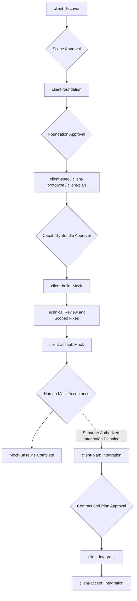

# Client Workflow

## Scope

The workflow applies to web/mobile capability design, mock implementation and approved API integration. Capture platform, capability, mode, requested task/finding and dependency revisions. Read shared/client rules and the platform profile; resolve techniques through the skill catalog and load only matching concerns. Deferred techniques require their catalog condition and installed availability.

## Stage Flow

Design the platform scope and representative foundation first, then design and approve one coherent capability bundle at a time. Do not require every capability prototype to be complete before implementing an approved capability. Spec, prototype and plan may be refined together within the authorized design scope; approval identifies their compatible revisions. Routine implementation review/fix cycles are internal to approved build/integration work. Arrows across human gates require an explicit decision; the diagram does not authorize stage chaining.

## Artifact Ownership

| Artifact                       | Canonical Path                                                                           |
| ------------------------------ | ---------------------------------------------------------------------------------------- |
| Product scope                  | `docs/product-overview.md` and `docs/product-features.md`                                |
| Platform delivery              | `docs/client/<platform>/feature-delivery.md`                                             |
| Experience map and UI baseline | `docs/client/<platform>/{experience-map.md,ui-design.md}`                                |
| Foundation prototype           | `docs/client/<platform>/foundation-prototype/index.html`                                 |
| Capability design and tasks    | `specs/client/<platform>/<capability>/{SPEC.md,tasks.md,prototype/,prototype-review.md}` |
| Review and verification        | `specs/client/<platform>/<capability>/{review-notes.md,verification.md}`                 |
| Integration plan               | `specs/client/<platform>/<capability>/integration-plan.md`                               |
| Disposable Run Evidence        | Operating-system temporary directory; retention follows shared evidence policy           |

Resolve schemas through `.agents/templates/README.md`. Specs reference approved UI rule IDs/revisions. Scope/foundation and coherent capability bundles are approved dependencies. Delivery catalogs record established capability IDs, mode, state, revisions and explicit human decisions. Artifact approval, technical verification and human acceptance are distinct records.

## Revision and Record Management

Use stable capability IDs and record artifact path plus revision; do not use a timestamp alone as approval. A material change to an approved dependency creates a proposed revision and impact list. Preserve the accepted revision/history, stop only dependent work, and obtain approval of the affected bundle before resuming. Unaffected approved work may continue within its authorized scope.

Delivery rows are keyed by capability ID and mode. Keep separate `MOCK` and `INTEGRATION` rows; integration never replaces mock acceptance. Within capability `verification.md` and `review-notes.md`, keep mode/revision-labelled sections rather than overwriting earlier decisions. Failed checks require correction and a fresh result. Unavailable required checks produce `VERIFICATION_PENDING`; `VERIFIED` requires every mandatory technical check to pass. Human acceptance also requires the declared UI/native review. An accepted revision remains historical evidence, not approval of later changes.

`all-mock` selects the explicit platform inventory at recorded revisions. Store the platform summary and human decision in its `feature-delivery.md`, linking capability verification records and cross-capability journey results. Missing or pending capabilities cannot silently disappear from that scope. Capability-scoped integration remains separately invocable; `all-mock` is not an implicit prerequisite unless the approved integration plan requires it.

## Execution and Verification

Use applicable skills from the matching client workflow entrypoint. Browser inspection requires actual screenshot viewing, UI actions/assertions and console/network review; preserve approved acceptance criteria and golden-image gates. Native work uses proven physical targets under mobile rules. Pending evidence stays pending. Technical review uses the six-axis shared review template; only the authorized caller dispatches fixes.

Shared context runs in workflow mode. Debug unexpected failures through root-cause analysis. Simplify only covered green code with a real readability opportunity, approved scope and test command; no HTML report/template loading, save-location question or duplicate refactor gate. Follow shared Git rules and the user's delivery instructions. Routine implementation within approved scope proceeds autonomously.

## client-discover

Usage: `$client-discover <web|mobile>`

### Inputs

Product scope, roles, relevant product feature IDs and platform ADRs.

### Procedure

Resolve journeys, navigation, screen/state inventory, supporting UX, priorities and capability dependencies. Use `context-priming` in workflow mode and `grilling` for material ambiguity. Scope decisions belong to the human.

### Outputs

`docs/client/<platform>/experience-map.md`.

### Completion Gate

Human approval of scope and journeys before dependent foundation/capability work.

## client-foundation

Usage: `$client-foundation <web|mobile>`

### Inputs

Approved platform scope and journeys.

### Procedure

Draft the platform UI baseline with stable rule IDs, semantic tokens, component/interaction criteria, accessibility and platform differences. Create a representative interactive HTML prototype. Use design/accessibility skills and browser inspection for supported previews; propose visual values for human review.

### Outputs

`docs/client/<platform>/ui-design.md` and `foundation-prototype/index.html`.

### Completion Gate

Human approval identifies both the UI baseline and representative prototype revisions before dependent capability design/build work.

## client-spec

Usage: `$client-spec <platform> <capability>`

### Inputs

Approved experience map and UI baseline; declared capability scope.

### Procedure

Specify actors, FR/BR/AC, screen flow, UI state matrix, data/action/error needs, misuse cases and platform/offline concerns. Reference global rule IDs/revisions and add capability-local requirements. Resolve material ambiguity before dependent work. Client models describe UI/service needs, not an approved wire contract.

### Outputs

`specs/client/<platform>/<capability>/SPEC.md`.

### Completion Gate

The spec may be prepared with prototype/tasks as one coherent design bundle; the complete bundle requires approval before `client-build`.

## client-prototype

Usage: `$client-prototype <platform> <capability>`

### Inputs

Capability spec draft/approved revision and approved platform baseline.

### Procedure

Build an interactive HTML/CSS/JS prototype covering navigation, dialogs, validation and relevant loading/empty/error/success/permission/offline states. Keep scenario selectors outside product UI. Operate the preview, capture and view screenshots and verify named outcomes when browser access is available. Mobile HTML demonstrates design/flow; native evidence belongs to the device stage.

### Outputs

prototype/index.html, `prototype-review.md` and scenario evidence in the capability bundle.

### Completion Gate

Human review of the prototype revision as part of the capability bundle.

## client-plan

Usage: `$client-plan <platform> <capability> [--mode mock|integration]`

### Inputs

Mock: stable spec/prototype revisions and approved platform baseline. Integration: mock acceptance and approved public contract.

### Procedure

For mock work, create vertical slices with dependency order, file scope, observable acceptance and verification matrix. A spec/prototype need not be separately approved before preparing the same bundle plan. For integration, create a separate plan with contract/environment revision, client mappings, adapter tasks and test matrix; keep the mock task/history. Identify unit/component, browser/native and human checks, including device-access fallback.

### Outputs

`tasks.md` for mock work; `integration-plan.md` for integration work.

### Completion Gate

Human approval of the mock bundle or integration plan before its implementation.

## client-build

Usage: `$client-build <platform> <capability> [task-id]`

### Inputs

Approved spec, baseline, prototype and tasks at compatible revisions; mock mode.

### Procedure

Implement → run → inspect → test → technical review → fix → verify within approved scope. A task ID narrows execution to that task; otherwise complete the capability plan in dependency order. Use deterministic service fakes and resettable scenarios. Apply test-first to testable behavior, six-axis technical review and authorized `client-fix` for in-scope defects. Without native access, complete code checks, prepare review scenarios/fixtures/expected results and leave native evidence pending.

### Outputs

Working capability, task progress, review findings and verification evidence.

### Completion Gate

Material scope/spec/UI changes require an amendment approval before dependent code. No per-file or routine-refactor confirmation gate.

## client-review

Usage: `$client-review <platform> <capability> [task-id]`

### Inputs

Requested diff/task/capability and its approved dependencies/evidence.

### Procedure

Evaluate correctness, design, security, performance, coverage and style. Combine relevant design/testing/security skills with exploratory journeys and edge states. Inspect focus/keyboard, responsiveness/native behavior and console/network outcomes where applicable. A task review covers that task without requiring the whole feature to be finished. Report severity, location, evidence, impact and checks not run.

### Outputs

`review-notes.md` using the shared review template; updated verification evidence.

### Completion Gate

Standalone review may write only its declared findings/verification artifacts; application code, approved requirements and design dependencies remain read-only. An authorized build/integration caller may route implementation defects to `client-fix`; material artifact changes require approval.

## client-fix

Usage: `$client-fix <platform> <capability> [finding-id]`

### Inputs

Direct fix request or an authorized build/integration caller with scoped findings.

### Procedure

Reproduce → localize → hypothesize → fix root cause → regression guard → re-verify. Use TDD for code-testable logic/behavior; visual-only defects use appropriate image/interaction evidence. Preserve approved behavior and user changes. Product/design gaps require an amendment, not a spec change to justify an implementation defect.

### Outputs

Scoped corrections, finding disposition and regression evidence.

### Completion Gate

Stay within the authorized findings and scope. Material requirement/design changes wait for approval.

## client-accept

Usage: `$client-accept <platform> <capability|all-mock>`

### Inputs

Reviewable preview, approved dependencies and the actual verification matrix.

### Procedure

Prepare journeys/scenarios and route technical defects to `client-fix` only when corrections are explicitly requested or already authorized by the build/integration caller; otherwise report them. Summarize checks plus outstanding evidence. All-mock acceptance covers the platform capability inventory and cross-capability journeys. Where native access is unavailable, provide scenarios and expected results for human native/hardware review. Record explicit acceptance only after the human confirms the declared scope/mode and required conditions are met.

### Outputs

`verification.md`, acceptance decision and platform delivery progress.

### Completion Gate

Mock acceptance stops before API integration. No automatic integration, `handoff` or new product scope.

## client-integrate

Usage: `$client-integrate <platform> <capability>`

### Inputs

Separate integration invocation, mock acceptance, approved public contract and integration plan, identified target environment.

### Procedure

Implement HTTP adapters and wire/client mappers behind feature service interfaces. Test mappings, auth/error/retry/state behavior and applicable schema/journeys/security. Keep mock scenarios for regression. Consumer/mock checks do not replace provider/system verification. Report contract gaps and stop dependent work; do not create endpoints, change BE/infra or redesign accepted UI. Review/fix within approved integration scope.

### Outputs

HTTP integration, contract/mapping checks, journey evidence and acceptance preparation.

### Completion Gate

Prepare integrated acceptance through `client-accept` in `INTEGRATION` mode. Record acceptance only after the human decision; material contract/design changes require their owning approval.

## Verification by Mode

| Mode                         | Required Evidence                                                                                                                                                                                     |
| ---------------------------- | ----------------------------------------------------------------------------------------------------------------------------------------------------------------------------------------------------- |
| Prototype                    | Reproducible preview, named control/state scenarios, viewed screenshots and human design decision; unavailable browser inspection remains pending                                                     |
| Mock Implementation          | Configured lint/type checks, behavior tests, risk-based mock journeys, visual comparison and relevant accessibility/native checks; no provider correctness claim                                      |
| Integration                  | Preserve mock regression checks; add wire/client mappings, approved schema checks when tooling exists, and authorized target-environment journeys; distinguish controlled fixtures from live outcomes |
| Mobile Without Device Access | Complete feasible code checks and prepare human scenarios; retain pending native checks until device evidence or explicit human review supplies them                                                  |

Plan required versus optional checks before execution, with rationale for inapplicable checks. Native checks are platform-specific. A human may supply missing UI/device evidence but cannot turn a failing code check into a pass. Use synthetic accounts/data; live payments, notifications and other irreversible external effects need authorization for the selected environment and scenario. Retry only operations whose approved semantics allow it.

## Configuration Work

Source ownership follows the platform source guide; capability plans map to cohesive feature modules rather than one module per spec. Web uses Vite mounting with app composition; Expo reserves its app directory for routes/layouts and keeps composition in bootstrap. Package/setup work does not require populating every architecture folder.

Application bootstrap/lint/test/CI/runtime setup follows an authorized setup plan and client/shared rules. UI prototypes are dependencies for product behavior, not a requirement for configuration-only work. Runtime and library choices follow the actual stack and compatibility constraints.
