<div align="center">
  <h1>UniHub Workshop</h1>
  <small>
    <strong>Author:</strong> Nguyễn Tấn Phát
  </small> <br />
  <p>An EMS for managing university workshops and events</p>
</div>

<div align="center">

[](https://github.com/phatnguyen975/unihub-workshop/actions/workflows/ci-backend.yml)
[](https://github.com/phatnguyen975/unihub-workshop/actions/workflows/ci-workers.yml)


</div>

## Overview

UniHub Workshop is a university workshop management platform connecting students, organizers and check-in staff throughout the event lifecycle. Students discover workshops, register and receive QR tickets; organizers manage events and monitor attendance; staff scan tickets and synchronize check-ins, including when connectivity is interrupted.

## Features

- **Workshop management:** organization-scoped administration, publishing, staff assignment, discovery and search.
- **Registration and payments:** free and paid registrations, capacity protection, Stripe sandbox payments and cancellation.
- **On-site attendance:** batch synchronization and attendance summaries for organizers and assigned staff, with offline-first mobile QR scanning in the client.
- **Live updates:** authenticated Server-Sent Events for attendance and other supported domain events.
- **Background processing:** email and in-app notifications, search synchronization, student CSV ingestion, AI brochure summaries and scheduled maintenance.
- **Security and resilience:** RS256 JWTs, role and resource authorization, idempotency, rate limiting and observability.

See the [feature catalog](docs/feature-catalog.md) for feature scope and status.

## Architecture



Neon hosts PostgreSQL outside the local machine; it is not part of Compose. The backend and workers use the same Neon database with separate primary and read-replica endpoints. Primary handles writes and consistency-sensitive reads; replica handles eligible reporting and other eventually consistent reads.

The backend is a Spring Modulith modular monolith. Workers are a separately runnable application with hexagonal boundaries. Domain events and RabbitMQ connect asynchronous processing; Redis also supports rate limiting, caching and transient realtime distribution. See [system design](docs/system-design.md) and [project structure](docs/project-structure.md).

### Technology Stack

| Area                   | Technology and Role                                                               |
| ---------------------- | --------------------------------------------------------------------------------- |
| Web                    | React 19.3.1, TypeScript — student and organizer portal                           |
| Mobile                 | React Native 0.88.1, TypeScript, SQLite — offline-first staff check-in            |
| Runtime                | Java 25, Spring Boot 4.0.6, Gradle Wrapper 9.5.1                                  |
| Backend                | Spring Modulith 2.0.6, Spring Security, Spring Data JPA/JDBC, Flyway              |
| Workers                | Spring Boot, Spring Batch, RabbitMQ consumers, PDFBox                             |
| Data                   | Neon PostgreSQL 18, Redis 8.6, Elasticsearch 9.4.2, MinIO storage (S3-compatible) |
| Messaging and Realtime | RabbitMQ 4.3, Redis Pub/Sub, Server-Sent Events                                   |
| External Integrations  | Stripe, SMTP/Mailpit, Google Gemini AI provider                                   |
| Operations             | Nginx 1.30, Docker Compose, Micrometer, Prometheus, Grafana                       |

## Prerequisites

- [Git](https://git-scm.com/), [JDK 25](https://adoptium.net/temurin/releases/) and [Docker with Compose](https://docs.docker.com/compose/install/). Both applications include their own Gradle Wrapper; a separate Gradle installation is unnecessary.
- OpenSSL available in the terminal to generate theRSA key pair. On Windows, Git Bash or a separate OpenSSL installation can provide it.
- A [Neon](https://neon.com/docs/connect/connect-from-any-app) account and development project, with primary and read-replica connection details and a database role permitted to run migrations. The applications run locally but require network access to Neon.
- For paid-registration testing, use [Stripe Sandbox](https://docs.stripe.com/sandboxes), its test secret key and the [Stripe CLI](https://docs.stripe.com/stripe-cli). Payments do not work with the dummy key.
- For email testing, use Mailpit to capture messages locally without an email account, or use a real SMTP account. For Gmail, enable [2-Step Verification](https://support.google.com/accounts/answer/185839) and create an [App Password](https://myaccount.google.com/apppasswords). See [Google's Guide](https://support.google.com/accounts/answer/185833) if the option is unavailable.
- For real Gemini summaries, create an API key in [Google AI Studio](https://aistudio.google.com/apikey). The mock provider needs no external AI key. See the [Gemini API Key Guide](https://ai.google.dev/gemini-api/docs/api-key) for access requirements.
- Ensure Docker has enough memory for Elasticsearch and the other containers, and that the ports in the [port table](#ports-and-addresses) are available. On Linux, Elasticsearch may require host configuration such as `vm.max_map_count`; consult the [Elasticsearch Docker Documentation](https://www.elastic.co/guide/en/elasticsearch/reference/current/docker.html) if its container fails to start.

## Local Development Setup

Commands start at the repository root unless stated otherwise. Do not commit `.env` files, private keys, passwords, Stripe secrets or tokens.

### Shared Setup

#### Clone and Create Environment Files

```bash
git clone https://github.com/phatnguyen975/unihub-workshop.git
cd unihub-workshop
```

```bash
# Linux / macOS
cp infra/.env.example infra/.env
cp apps/backend/.env.example apps/backend/.env
cp apps/workers/.env.example apps/workers/.env
```

```powershell
# Windows PowerShell
Copy-Item infra/.env.example infra/.env
Copy-Item apps/backend/.env.example apps/backend/.env
Copy-Item apps/workers/.env.example apps/workers/.env
```

Edit the three files before starting. Compose reads `infra/.env`; each Spring application loads its own `.env` in the `dev` profile when started from its application directory. The examples contain placeholders, not usable credentials. Avoid overwriting existing `.env` files if you have already configured them.

#### Configure Neon PostgreSQL

1. Sign in to the [Neon Console](https://console.neon.tech/) and create a project for development. Select its development branch and database; use a separate development project or branch, not an existing production database.
2. In **Connect**, select the branch, database and role. Copy the connection details for the branch's read-write **primary** compute. Select a **direct / unpooled** connection for Primary so Flyway's session-level advisory lock remains on the same database session. Record the host, database name, username and password privately.
3. Create a **read replica compute on that same branch** and obtain its own connection details from **Connect**. It must access the same database as Primary; an independent Neon branch or a separate database is not a replica of the live development dataset. Neon dashboard labels and availability can change; see its [connection guide](https://neon.com/docs/connect/connect-from-any-app) and [read-replica guide](https://neon.com/blog/create-read-replicas-in-the-free-plan).
4. Convert each Neon connection into the JDBC URL and separate credentials below. For example, Neon may show `postgresql://<user>:<password>@<host>/<database>?sslmode=require`, place `<user>` and `<password>` in their respective variables, and use `jdbc:postgresql://<host>/<database>?sslmode=require` as the URL. Keep required connection options supplied by Neon; do not paste credentials into the JDBC URL.

Set the following in **both** `apps/backend/.env` and `apps/workers/.env`, replacing every placeholder:

```dotenv
SPRING_DATASOURCE_PRIMARY_URL=jdbc:postgresql://<primary-host>:5432/<database>?sslmode=require
SPRING_DATASOURCE_PRIMARY_USERNAME=<primary-user>
SPRING_DATASOURCE_PRIMARY_PASSWORD=<primary-password>
SPRING_DATASOURCE_REPLICA_URL=jdbc:postgresql://<replica-host>:5432/<database>?sslmode=require
SPRING_DATASOURCE_REPLICA_USERNAME=<replica-user>
SPRING_DATASOURCE_REPLICA_PASSWORD=<replica-password>
```

Use the actual Neon endpoint hosts and credentials, including `sslmode=require`. Primary and replica may use the same role credentials if that role has access to both; their endpoint hosts differ. Apply the same settings to both application files. Avoid placing the connection strings or secrets in logs, screenshots or commits.

The first backend instance runs Flyway migrations. Wait for it to finish starting before launching the second backend and workers. Workers have Flyway disabled and expect the schema to exist. Both applications configure connection pools; adjust their `*_HIKARI_MAXIMUM_POOL_SIZE` values if your database connection allowance is small.

#### Align Local Service Credentials

Choose local development values in `infra/.env` and use matching values in **both application** `.env` files:

| Infrastructure Variable                                    | Backend and Workers Variables                          |
| ---------------------------------------------------------- | ------------------------------------------------------ |
| `REDIS_PASSWORD`                                           | `SPRING_DATA_REDIS_PASSWORD`                           |
| `RABBITMQ_DEFAULT_USER`, `RABBITMQ_DEFAULT_PASS`           | `SPRING_RABBITMQ_USERNAME`, `SPRING_RABBITMQ_PASSWORD` |
| `AWS_ACCESS_KEY_ID`, `AWS_SECRET_ACCESS_KEY`, `AWS_REGION` | Same names                                             |

For host-run applications keep `SPRING_DATA_REDIS_HOST=localhost`, `SPRING_RABBITMQ_HOST=localhost`, `SPRING_ELASTICSEARCH_URIS=http://localhost:9200`, and `AWS_S3_ENDPOINT=http://localhost:9000`. Set local Grafana credentials in `infra/.env`. Choose MinIO-compatible credentials accepted by the server; these are separate from AWS cloud credentials. Bucket initialization creates `unihub-media`, `unihub-brochures` and `unihub-csv-drops`.

The Compose stack uses the S3-compatible `pgsty/silo` image for its `minio` service. The local Elasticsearch and object-storage configuration is intended for development.

#### Configure Email and AI

Choose an email option in `apps/workers/.env`:

- **Mailpit:** Set `SPRING_MAIL_HOST=localhost`, `SPRING_MAIL_PORT=1025`, and leave `SPRING_MAIL_USERNAME` and `SPRING_MAIL_PASSWORD` empty. Use the Mailpit override in the Workers Setup commands to disable SMTP authentication and STARTTLS. Captured messages appear at `http://localhost:8025`.
- **Gmail SMTP:** Set `SPRING_MAIL_HOST=smtp.gmail.com`, `SPRING_MAIL_PORT=587`, `SPRING_MAIL_USERNAME` to your Gmail address, and `SPRING_MAIL_PASSWORD` to the app password created above. Keep the application's default SMTP authentication and STARTTLS settings; omit the Mailpit override from the Workers Setup commands.

For AI summaries, set `AI_PROVIDER=mock` for local mock responses. To use Gemini, set `AI_PROVIDER=gemini`, `AI_GEMINI_API_KEY` to your key, and `AI_GEMINI_MODEL` to a model available to your account.

#### Start Infrastructure

From the repository root:

```bash
docker compose -f infra/docker-compose.yml up -d
docker compose -f infra/docker-compose.yml ps
```

Wait for infrastructure health checks and the one-shot `minio-init` container to complete successfully. Nginx can start before backend processes; requests through it will fail until at least one backend is ready. The Compose file does not start Neon PostgreSQL or either application.

### Backend Setup

#### Generate JWT Signing Keys

From the repository root, run the following in a shell with OpenSSL. Generate one pair and use it for both backend instances. The backend reads an unencrypted **PKCS#8 private key** and an **X.509 public key** from its classpath:

```bash
mkdir -p apps/backend/src/main/resources/security
openssl genpkey -algorithm RSA -pkeyopt rsa_keygen_bits:2048 -out apps/backend/src/main/resources/security/private.pem
openssl pkey -in apps/backend/src/main/resources/security/private.pem -pubout -out apps/backend/src/main/resources/security/public.pem
```

In PowerShell, create the directory with `New-Item -ItemType Directory -Force apps/backend/src/main/resources/security` and run the same two `openssl` commands. Protect `private.pem`; do not replace an existing pair accidentally. Changing the pair invalidates existing JWTs signed with the old key. The files are ignored by Git.

#### Configure Seed Data and OTP

In `apps/backend/.env`, set a unique local organization and root organizer. The `orgSlug` must match a configured organization slug:

```dotenv
SEED_ORGANIZATIONS=[{"name":"Demo University","slug":"demo-university"}]
SEED_ROOT_ORGANIZERS=[{"email":"organizer@example.com","displayName":"Demo Organizer","orgSlug":"demo-university"}]
APP_OTP_HMAC_SECRET=<your-own-long-random-local-secret>
```

On first startup, the backend seeds missing entries and logs the generated temporary organizer password once. Record it privately; restarting does not reset an existing account's password. Change it using `POST /api/v1/auth/password/temporary` with `email`, `currentPassword` and `newPassword`; the successful response contains an authenticated session. Do not share startup logs containing the temporary password.

#### Configure Stripe Sandbox and Webhooks

Stripe is needed to test paid registrations. Select a Stripe **sandbox** in the Dashboard, open its API keys page and put its `sk_test_...` secret in `apps/backend/.env` as `STRIPE_SECRET_KEY`. Never use a live key for this demo. See [Stripe API keys](https://docs.stripe.com/keys).

Install the [Stripe CLI](https://docs.stripe.com/stripe-cli), then in a separate terminal:

```bash
stripe login
stripe listen --forward-to http://localhost/api/v1/payments/webhook
```

During authorization, choose the **same sandbox/environment** as the backend API key. Copy the `whsec_...` signing secret printed by `stripe listen` into `STRIPE_WEBHOOK_SECRET` in `apps/backend/.env`; keep the listener running. The CLI signing secret is separate from the API key and from a Dashboard webhook endpoint's secret. Start or restart **both backend instances** after setting it. If forwarding directly to a backend instead of Nginx, use that backend's port in `--forward-to`.

For a sandbox paid-registration test, obtain the PaymentIntent ID from the current response's client secret or payment record, then confirm it using the same Stripe CLI environment:

```bash
stripe payment_intents confirm <payment_intent_id> --payment-method=pm_card_visa --return-url="http://localhost"
```

The PaymentIntent ID is the `pi_...` portion **before** `_secret_`; never share the client secret. A Stripe `succeeded` status confirms the provider-side payment, while successful webhook delivery and registration processing must also be checked. Refer to the [paid registration contract](specs/paid-workshop-registration/API_CONTRACT.md).

#### Start the Backend Instances

Start backend 1 first and wait for Flyway migrations and startup before starting backend 2. Use a separate terminal for each instance, starting from the repository root.

```bash
# Linux / macOS
cd apps/backend
SERVER_PORT=8081 HOSTNAME=unihub-backend-1 ./gradlew bootRun
SERVER_PORT=8082 HOSTNAME=unihub-backend-2 ./gradlew bootRun
```

```powershell
# Windows PowerShell
Set-Location apps/backend
$env:SERVER_PORT="8081"; $env:HOSTNAME="unihub-backend-1"; .\gradlew.bat bootRun
$env:SERVER_PORT="8082"; $env:HOSTNAME="unihub-backend-2"; .\gradlew.bat bootRun
```

### Workers Setup

The student CSV ingestion job is scheduled, not automatically populated with demo students. To exercise student registration against real fixtures, follow the [ingestion specification](specs/nightly-student-csv-ingestion/SPEC.md) and set `INGESTION_EXPECTED_FACULTIES` to the intended seeded organization names.

#### Start the Workers

Start workers in a separate terminal after backend 1 has finished its migrations. The commands include the local Mailpit override; for Gmail SMTP, omit the `SPRING_APPLICATION_JSON` line and use the settings configured in Shared Setup.

```bash
# Linux / macOS
cd apps/workers
export SPRING_APPLICATION_JSON='{"spring":{"mail":{"username":"","password":"","properties":{"mail.smtp.auth":"false","mail.smtp.starttls.enable":"false"}}}}'
SERVER_PORT=8083 HOSTNAME=unihub-workers ./gradlew bootRun
```

```powershell
# Windows PowerShell
Set-Location apps/workers
$env:SPRING_APPLICATION_JSON='{"spring":{"mail":{"username":"","password":"","properties":{"mail.smtp.auth":"false","mail.smtp.starttls.enable":"false"}}}}'
$env:SERVER_PORT="8083"; $env:HOSTNAME="unihub-workers"; .\gradlew.bat bootRun
```

The `HOSTNAME` values label application metrics; Compose maps Prometheus target names to the host gateway. On Linux/macOS, run `chmod +x gradlew` if needed.

### Web Setup

Web setup instructions will be added when the application is implemented.

### Mobile Setup

Mobile setup instructions will be added when the application is implemented.

### Verify the Setup

1. Visit the individual health endpoints: [backend 1](http://localhost:8081/actuator/health), [backend 2](http://localhost:8082/actuator/health), and [workers](http://localhost:8083/actuator/health). `UP` is the expected healthy response. Nginx intentionally blocks `/actuator`; check these directly.
2. Open [gateway health](http://localhost/healthz), [Swagger UI](http://localhost:8081/swagger-ui.html), [Mailpit](http://localhost:8025), [RabbitMQ](http://localhost:15672), [Prometheus targets](http://localhost:9090/targets), and [Grafana](http://localhost:3000). Sign in using your configured local credentials where required.
3. Change the seeded organizer's temporary password as described above, then use the returned token or log in via `POST http://localhost/api/v1/auth/login`. Explore endpoints in Swagger or Postman; detailed request contracts are available in [`specs/`](specs/).
4. For paid registration, confirm that Stripe CLI forwards webhook events successfully and that the application's registration status updates; a provider-side payment result alone is not the end-to-end outcome.

### Stop or Reset

Stop each host application and the Stripe listener with `Ctrl+C`. Stop infrastructure while preserving its named volumes:

```bash
docker compose -f infra/docker-compose.yml down
```

To deliberately delete this Compose stack's local named volumes as well, use `docker compose -f infra/docker-compose.yml down -v`. That resets stored infrastructure data, including local object storage and message-broker data; it does **not** reset the separately managed PostgreSQL database.

## Ports and Addresses

| Component             | Local Address                                     | Configuration                                                                                |
| --------------------- | ------------------------------------------------- | -------------------------------------------------------------------------------------------- |
| Nginx gateway         | `http://localhost:80`                             | `infra/docker-compose.yml`; upstreams in `infra/.env`                                        |
| Backend 1 / 2         | `localhost:8081` / `localhost:8082`               | `SERVER_PORT` in each host process; Nginx uses `BACKEND_1_HOST` / `BACKEND_2_HOST`           |
| Workers               | `localhost:8083`                                  | `SERVER_PORT` in the workers process; Prometheus target in `infra/prometheus/prometheus.yml` |
| Neon PostgreSQL       | Neon cloud primary / replica endpoints            | Primary and replica URL variables in both application `.env` files; not in Compose           |
| Redis                 | `localhost:6379`                                  | Compose port and `SPRING_DATA_REDIS_*`                                                       |
| RabbitMQ / Management | `localhost:5672` / `http://localhost:15672`       | Compose port and `SPRING_RABBITMQ_*`                                                         |
| Elasticsearch         | `http://localhost:9200`                           | Compose port and `SPRING_ELASTICSEARCH_URIS`; transport port `9300` is also exposed          |
| S3 API / Console      | `http://localhost:9000` / `http://localhost:9001` | Compose port and `AWS_S3_ENDPOINT` / credentials                                             |
| Mailpit SMTP / UI     | `localhost:1025` / `http://localhost:8025`        | Compose ports and workers mail settings                                                      |
| Prometheus / Grafana  | `http://localhost:9090` / `http://localhost:3000` | Compose and `infra/prometheus/prometheus.yml`                                                |

`infra/.env` defaults the gateway upstreams to `host.docker.internal:8081` and `:8082`. Compose supplies host-gateway mappings for Linux. `WORKERS_HOST` appears in the example environment file but is not consumed by the current Compose services; Prometheus workers routing is defined in its own YAML. Changing application ports therefore requires updating the matching Nginx upstream values and/or Prometheus targets as well.

For future containerized applications, `localhost` inside an application container refers to that container. Service URLs would need to use Compose service names, and gateway/Prometheus targets would need to match the future Compose topology. The commented Docker-mode examples in `infra/.env.example` are illustrative; the current Compose file does not define those application services.

## Tests

Each application has its own test suite and wrapper. From the relevant directory, run `./gradlew test` on Linux/macOS or `.\gradlew.bat test` in PowerShell. Tests follow the repository's unit-test and static architecture-check policy; see [AGENTS.md](AGENTS.md).

## Troubleshooting

| Symptom                                       | Check                                                                                                                                                                                        |
| --------------------------------------------- | -------------------------------------------------------------------------------------------------------------------------------------------------------------------------------------------- |
| Missing or invalid RSA key on backend startup | Generate both files in `apps/backend/src/main/resources/security/`; verify the private key is PKCS#8 and both files belong to the same pair.                                                 |
| Database or Flyway failure                    | Check JDBC URLs, credentials, connectivity and schema privileges. Use a session-capable direct Primary connection for migrations and confirm both applications target the intended database. |
| Missing environment variables                 | Start each application in its own directory with the `dev` profile and check its `.env`; verify infrastructure and application credentials agree.                                            |
| `502` from gateway                            | Confirm infrastructure is healthy, backend processes have started on `8081`/`8082`, and Nginx upstreams match the host ports.                                                                |
| No email in Mailpit                           | Confirm workers are running, the mail host/port are `localhost:1025`, and the Mailpit SMTP overrides are present in the workers process. Check worker logs and RabbitMQ.                     |
| Stripe `resource_missing`                     | Check that CLI and backend use the same sandbox and that the value is the current `pi_...` PaymentIntent ID, not the entire client secret.                                                   |
| Stripe webhook `400` / signature failure      | Check the listener's current `whsec_...` against `STRIPE_WEBHOOK_SECRET` in both backend processes; restart them after changes. Confirm the forwarded URL and sandbox.                       |
| A port is already in use                      | Stop the conflicting process or change the relevant Compose port, app configuration and gateway/Prometheus targets consistently.                                                             |

## Full Docker Compose Setup

The current Compose file provisions infrastructure only; application services, client images, service-to-service addresses and their Compose startup order will be added at a later stage.

## Repository Structure

```text
UniHub/
├── AGENTS.md           # Agent rules + Documentation Map (always loaded)
├── .agents/            # Agent skills infrastructure
│   ├── skills/         # Reusable, language-agnostic skill definitions
│   └── commands/       # Slash commands (/spec, /plan, /build, /review, /fix)
├── apps/               # Product applications in the monorepo
│   ├── backend/        # Spring Boot Modulith core backend API
│   ├── workers/        # Background workers (batch, notifications, AI)
│   ├── web/            # React web portal for students and organizers
│   └── mobile/         # React Native offline-first check-in app
├── docs/               # Architecture, design, database, and API documentation
├── infra/              # Local Docker, data services, observability configs
├── scripts/            # Executable scripts (Docker deploy, DB seeding, test scenarios)
└── specs/              # Per-feature spec artifacts produced by the SDD workflow
```

Start with the [system design](docs/system-design.md), [API standards](docs/api-standards.md), [database schema](docs/database-schema.md) and [feature catalog](docs/feature-catalog.md) for deeper details.
