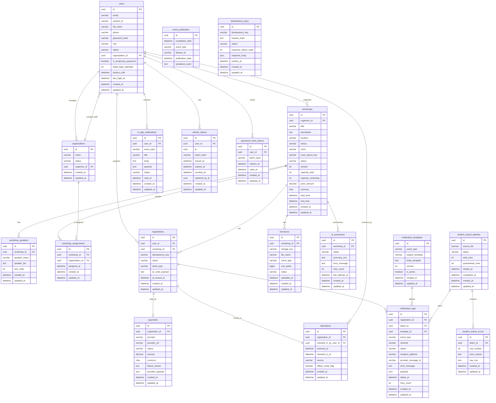

# UniHub Workshop - Database Schema

This document defines the production-ready PostgreSQL schema for UniHub Workshop. It is the source of truth for Flyway migrations.

## 1. Global ERD

## 2. Detailed Table Definitions

### `users` Table

| Attribute             | Type         | Constraint                                                   | Default Value     | Indexing                     | Description                                                  |
| :-------------------- | :----------- | :----------------------------------------------------------- | :---------------- | :--------------------------- | :----------------------------------------------------------- |
| id                    | UUID         | PK                                                           | gen_random_uuid() | UNIQUE B-Tree (id)           | Primary key.                                                 |
| email                 | VARCHAR(255) | NOT NULL                                                     | None              | UNIQUE B-Tree (lower(email)) | Login identifier, normalized uniqueness.                     |
| student_id            | VARCHAR(50)  | NULL, UNIQUE                                                 | NULL              | UNIQUE B-Tree (student_id)   | Legacy system student identifier for CSV ingestion matching. |
| full_name             | VARCHAR(200) | NOT NULL                                                     | None              | B-Tree (full_name)           | Display name.                                                |
| phone                 | VARCHAR(30)  | NULL                                                         | NULL              | B-Tree (phone)               | Optional contact number for profile.                         |
| password_hash         | VARCHAR(255) | NOT NULL                                                     | None              | None                         | BCrypt password hash.                                        |
| role                  | VARCHAR(30)  | NOT NULL, CHECK (role IN ('STUDENT','ORGANIZER','STAFF'))    | None              | B-Tree (role)                | RBAC role claim value stored in JWTs.                        |
| status                | VARCHAR(20)  | NOT NULL, CHECK (status IN ('UNVERIFIED','ACTIVE','LOCKED')) | 'UNVERIFIED'      | B-Tree (status)              | Account lifecycle state.                                     |
| organization_id       | UUID         | FK -> organizations(id) ON DELETE RESTRICT                   | NULL              | B-Tree (organization_id)     | Staff organization membership.                               |
| is_temporary_password | BOOLEAN      | NOT NULL                                                     | false             | None                         | Forces password change on first login.                       |
| failed_login_attempts | INT          | NOT NULL, CHECK (failed_login_attempts >= 0)                 | 0                 | None                         | Brute-force counter.                                         |
| lockout_until         | TIMESTAMPTZ  | NULL                                                         | NULL              | B-Tree (lockout_until)       | Temporary lockout expiration.                                |
| last_login_at         | TIMESTAMPTZ  | NULL                                                         | NULL              | B-Tree (last_login_at)       | Successful login timestamp.                                  |
| created_at            | TIMESTAMPTZ  | NOT NULL                                                     | now()             | B-Tree (created_at)          | Audit timestamp.                                             |
| updated_at            | TIMESTAMPTZ  | NOT NULL                                                     | now()             | B-Tree (updated_at)          | Audit timestamp.                                             |

### `organizations` Table

| Attribute    | Type         | Constraint                                        | Default Value     | Indexing              | Description                              |
| :----------- | :----------- | :------------------------------------------------ | :---------------- | :-------------------- | :--------------------------------------- |
| id           | UUID         | PK                                                | gen_random_uuid() | UNIQUE B-Tree (id)    | Primary key.                             |
| name         | VARCHAR(200) | NOT NULL                                          | None              | B-Tree (name)         | Organization or department name.         |
| status       | VARCHAR(20)  | NOT NULL, CHECK (status IN ('ACTIVE','INACTIVE')) | 'ACTIVE'          | B-Tree (status)       | Organization lifecycle status.           |
| organizer_id | UUID         | FK -> users(id) ON DELETE RESTRICT                | None              | B-Tree (organizer_id) | Organizer who manages this organization. |
| created_at   | TIMESTAMPTZ  | NOT NULL                                          | now()             | B-Tree (created_at)   | Audit timestamp.                         |
| updated_at   | TIMESTAMPTZ  | NOT NULL                                          | now()             | B-Tree (updated_at)   | Audit timestamp.                         |

### `workshops` Table

| Attribute          | Type          | Constraint                                                                                           | Default Value     | Indexing                 | Description                               |
| :----------------- | :------------ | :--------------------------------------------------------------------------------------------------- | :---------------- | :----------------------- | :---------------------------------------- |
| id                 | UUID          | PK                                                                                                   | gen_random_uuid() | UNIQUE B-Tree (id)       | Primary key.                              |
| organizer_id       | UUID          | FK -> users(id) ON DELETE RESTRICT                                                                   | None              | B-Tree (organizer_id)    | Workshop owner (organizer).               |
| title              | VARCHAR(255)  | NOT NULL                                                                                             | None              | B-Tree (title)           | Workshop title.                           |
| description        | TEXT          | NULL                                                                                                 | NULL              | GIN (to_tsvector)        | Full description for search.              |
| location           | VARCHAR(255)  | NOT NULL                                                                                             | None              | B-Tree (location)        | Venue location label.                     |
| venue              | VARCHAR(255)  | NULL                                                                                                 | NULL              | B-Tree (venue)           | Venue or building name.                   |
| room               | VARCHAR(120)  | NULL                                                                                                 | NULL              | B-Tree (room)            | Room or hall identifier.                  |
| room_layout_key    | VARCHAR(512)  | NULL                                                                                                 | NULL              | B-Tree (room_layout_key) | Object storage key for room layout asset. |
| status             | VARCHAR(20)   | NOT NULL, CHECK (status IN ('DRAFT','PUBLISHED','CANCELED','COMPLETED'))                             | 'DRAFT'           | B-Tree (status)          | Workshop lifecycle state.                 |
| version            | INT           | NOT NULL, CHECK (version >= 0)                                                                       | 0                 | None                     | Optimistic lock for edits.                |
| capacity_total     | INT           | NOT NULL, CHECK (capacity_total >= 0)                                                                | 0                 | None                     | Total seats.                              |
| capacity_remaining | INT           | NOT NULL, CHECK (capacity_remaining >= 0 AND capacity_remaining <= capacity_total)                   | 0                 | None                     | Live seat counter.                        |
| price_amount       | NUMERIC(10,2) | NOT NULL, CHECK (price_amount >= 0)                                                                  | 0.00              | None                     | Ticket price; 0 for free.                 |
| currency           | CHAR(3)       | NULL, CHECK ((price_amount = 0 AND currency IS NULL) OR (price_amount > 0 AND currency IS NOT NULL)) | NULL              | B-Tree (currency)        | ISO 4217 currency for paid workshops.     |
| start_time         | TIMESTAMPTZ   | NOT NULL                                                                                             | None              | B-Tree (start_time)      | Scheduled start time.                     |
| end_time           | TIMESTAMPTZ   | NOT NULL, CHECK (end_time > start_time)                                                              | None              | B-Tree (end_time)        | Scheduled end time.                       |
| created_at         | TIMESTAMPTZ   | NOT NULL                                                                                             | now()             | B-Tree (created_at)      | Audit timestamp.                          |
| updated_at         | TIMESTAMPTZ   | NOT NULL                                                                                             | now()             | B-Tree (updated_at)      | Audit timestamp.                          |

### `workshop_speakers` Table

| Attribute    | Type         | Constraint                            | Default Value     | Indexing              | Description           |
| :----------- | :----------- | :------------------------------------ | :---------------- | :-------------------- | :-------------------- |
| id           | UUID         | PK                                    | gen_random_uuid() | UNIQUE B-Tree (id)    | Primary key.          |
| workshop_id  | UUID         | FK -> workshops(id) ON DELETE CASCADE | None              | B-Tree (workshop_id)  | Parent workshop.      |
| speaker_name | VARCHAR(200) | NOT NULL                              | None              | B-Tree (speaker_name) | Speaker full name.    |
| speaker_bio  | TEXT         | NULL                                  | NULL              | None                  | Short bio.            |
| sort_order   | INT          | NOT NULL, CHECK (sort_order >= 0)     | 0                 | B-Tree (sort_order)   | Ordering for display. |
| created_at   | TIMESTAMPTZ  | NOT NULL                              | now()             | B-Tree (created_at)   | Audit timestamp.      |
| updated_at   | TIMESTAMPTZ  | NOT NULL                              | now()             | B-Tree (updated_at)   | Audit timestamp.      |

### `workshop_assignments` Table

| Attribute       | Type        | Constraint                                 | Default Value     | Indexing                                     | Description                            |
| :-------------- | :---------- | :----------------------------------------- | :---------------- | :------------------------------------------- | :------------------------------------- |
| id              | UUID        | PK                                         | gen_random_uuid() | UNIQUE B-Tree (id)                           | Primary key.                           |
| workshop_id     | UUID        | FK -> workshops(id) ON DELETE CASCADE      | None              | UNIQUE B-Tree (workshop_id, organization_id) | Workshop assigned to an organization.  |
| organization_id | UUID        | FK -> organizations(id) ON DELETE RESTRICT | None              | B-Tree (organization_id)                     | Organization responsible for check-in. |
| assigned_at     | TIMESTAMPTZ | NOT NULL                                   | now()             | B-Tree (assigned_at)                         | Assignment timestamp.                  |
| created_at      | TIMESTAMPTZ | NOT NULL                                   | now()             | B-Tree (created_at)                          | Audit timestamp.                       |
| updated_at      | TIMESTAMPTZ | NOT NULL                                   | now()             | B-Tree (updated_at)                          | Audit timestamp.                       |

### `registrations` Table

| Attribute       | Type         | Constraint                                                                                               | Default Value     | Indexing                        | Description                              |
| :-------------- | :----------- | :------------------------------------------------------------------------------------------------------- | :---------------- | :------------------------------ | :--------------------------------------- |
| id              | UUID         | PK                                                                                                       | gen_random_uuid() | UNIQUE B-Tree (id)              | Primary key.                             |
| user_id         | UUID         | FK -> users(id) ON DELETE RESTRICT                                                                       | None              | B-Tree (user_id)                | Student owner of the registration.       |
| workshop_id     | UUID         | FK -> workshops(id) ON DELETE RESTRICT                                                                   | None              | B-Tree (workshop_id)            | Workshop being registered.               |
| idempotency_key | VARCHAR(255) | NOT NULL, UNIQUE                                                                                         | None              | UNIQUE B-Tree (idempotency_key) | Prevents duplicate registrations.        |
| status          | VARCHAR(20)  | NOT NULL, CHECK (status IN ('PENDING','REGISTERED','CONFIRMED','PAID','FAILED','CANCELED','CHECKED_IN')) | 'PENDING'         | B-Tree (status)                 | Registration lifecycle state.            |
| ticket_type     | VARCHAR(20)  | NOT NULL, CHECK (ticket_type IN ('FREE','PAID'))                                                         | 'FREE'            | B-Tree (ticket_type)            | Derived from price at registration time. |
| qr_code_payload | TEXT         | NULL                                                                                                     | NULL              | None                            | Signed QR payload or URL.                |
| qr_issued_at    | TIMESTAMPTZ  | NULL                                                                                                     | NULL              | B-Tree (qr_issued_at)           | QR issuance timestamp.                   |
| created_at      | TIMESTAMPTZ  | NOT NULL                                                                                                 | now()             | B-Tree (created_at)             | Audit timestamp.                         |
| updated_at      | TIMESTAMPTZ  | NOT NULL                                                                                                 | now()             | B-Tree (updated_at)             | Audit timestamp.                         |

### `payments` Table

| Attribute        | Type          | Constraint                                                            | Default Value     | Indexing                     | Description                     |
| :--------------- | :------------ | :-------------------------------------------------------------------- | :---------------- | :--------------------------- | :------------------------------ |
| id               | UUID          | PK                                                                    | gen_random_uuid() | UNIQUE B-Tree (id)           | Primary key.                    |
| registration_id  | UUID          | FK -> registrations(id) ON DELETE CASCADE                             | None              | B-Tree (registration_id)     | Registration being paid.        |
| provider         | VARCHAR(50)   | NOT NULL                                                              | None              | B-Tree (provider)            | Payment gateway identifier.     |
| provider_ref     | VARCHAR(100)  | NOT NULL, UNIQUE                                                      | None              | UNIQUE B-Tree (provider_ref) | Gateway transaction reference.  |
| status           | VARCHAR(20)   | NOT NULL, CHECK (status IN ('PENDING','SUCCESS','FAILED','REFUNDED')) | 'PENDING'         | B-Tree (status)              | Payment lifecycle state.        |
| amount           | NUMERIC(10,2) | NOT NULL, CHECK (amount >= 0)                                         | 0.00              | None                         | Charge amount.                  |
| currency         | CHAR(3)       | NOT NULL                                                              | None              | B-Tree (currency)            | ISO 4217 currency.              |
| failure_reason   | TEXT          | NULL                                                                  | NULL              | None                         | Failure description for audits. |
| provider_payload | JSONB         | NULL                                                                  | NULL              | GIN (provider_payload)       | Raw gateway response metadata.  |
| created_at       | TIMESTAMPTZ   | NOT NULL                                                              | now()             | B-Tree (created_at)          | Audit timestamp.                |
| updated_at       | TIMESTAMPTZ   | NOT NULL                                                              | now()             | B-Tree (updated_at)          | Audit timestamp.                |

### `attendance` Table

| Attribute             | Type        | Constraint                                              | Default Value     | Indexing                        | Description                                 |
| :-------------------- | :---------- | :------------------------------------------------------ | :---------------- | :------------------------------ | :------------------------------------------ |
| id                    | UUID        | PK                                                      | gen_random_uuid() | UNIQUE B-Tree (id)              | Primary key.                                |
| registration_id       | UUID        | FK -> registrations(id) ON DELETE RESTRICT              | None              | UNIQUE B-Tree (registration_id) | Ensures one attendance per registration.    |
| checked_in_by_user_id | UUID        | FK -> users(id) ON DELETE SET NULL                      | NULL              | B-Tree (checked_in_by_user_id)  | Staff member who scanned the QR.            |
| scanned_at            | TIMESTAMPTZ | NULL                                                    | NULL              | B-Tree (scanned_at)             | Device scan timestamp from offline clients. |
| checked_in_at         | TIMESTAMPTZ | NOT NULL                                                | now()             | B-Tree (checked_in_at)          | Server check-in timestamp.                  |
| source                | VARCHAR(20) | NOT NULL, CHECK (source IN ('ONLINE','OFFLINE','SYNC')) | 'ONLINE'          | B-Tree (source)                 | Capture channel.                            |
| offline_mode_flag     | BOOLEAN     | NOT NULL                                                | false             | None                            | True if captured offline.                   |
| created_at            | TIMESTAMPTZ | NOT NULL                                                | now()             | B-Tree (created_at)             | Audit timestamp.                            |
| updated_at            | TIMESTAMPTZ | NOT NULL                                                | now()             | B-Tree (updated_at)             | Audit timestamp.                            |

### `brochures` Table

| Attribute   | Type         | Constraint                                         | Default Value     | Indexing                    | Description              |
| :---------- | :----------- | :------------------------------------------------- | :---------------- | :-------------------------- | :----------------------- |
| id          | UUID         | PK                                                 | gen_random_uuid() | UNIQUE B-Tree (id)          | Primary key.             |
| workshop_id | UUID         | FK -> workshops(id) ON DELETE CASCADE              | None              | B-Tree (workshop_id)        | Workshop owning the PDF. |
| storage_key | VARCHAR(512) | NOT NULL                                           | None              | UNIQUE B-Tree (storage_key) | Object storage key.      |
| file_name   | VARCHAR(255) | NULL                                               | NULL              | None                        | Original filename.       |
| mime_type   | VARCHAR(100) | NULL                                               | NULL              | None                        | Stored MIME type.        |
| size_bytes  | BIGINT       | NULL, CHECK (size_bytes >= 0)                      | NULL              | None                        | File size in bytes.      |
| status      | VARCHAR(20)  | NOT NULL, CHECK (status IN ('UPLOADED','DELETED')) | 'UPLOADED'        | B-Tree (status)             | File lifecycle.          |
| uploaded_at | TIMESTAMPTZ  | NOT NULL                                           | now()             | B-Tree (uploaded_at)        | Upload timestamp.        |
| created_at  | TIMESTAMPTZ  | NOT NULL                                           | now()             | B-Tree (created_at)         | Audit timestamp.         |
| updated_at  | TIMESTAMPTZ  | NOT NULL                                           | now()             | B-Tree (updated_at)         | Audit timestamp.         |

### `ai_summaries` Table

| Attribute       | Type        | Constraint                                                      | Default Value     | Indexing                    | Description                      |
| :-------------- | :---------- | :-------------------------------------------------------------- | :---------------- | :-------------------------- | :------------------------------- |
| id              | UUID        | PK                                                              | gen_random_uuid() | UNIQUE B-Tree (id)          | Primary key.                     |
| workshop_id     | UUID        | FK -> workshops(id) ON DELETE CASCADE                           | None              | UNIQUE B-Tree (workshop_id) | One summary record per workshop. |
| status          | VARCHAR(20) | NOT NULL, CHECK (status IN ('PROCESSING','COMPLETED','FAILED')) | 'PROCESSING'      | B-Tree (status)             | AI job status.                   |
| summary_text    | TEXT        | NULL                                                            | NULL              | None                        | Final summary text.              |
| error_message   | TEXT        | NULL                                                            | NULL              | None                        | Failure details for audits.      |
| retry_count     | INT         | NOT NULL, CHECK (retry_count >= 0)                              | 0                 | None                        | Retry attempts.                  |
| last_attempt_at | TIMESTAMPTZ | NULL                                                            | NULL              | B-Tree (last_attempt_at)    | Latest processing attempt.       |
| created_at      | TIMESTAMPTZ | NOT NULL                                                        | now()             | B-Tree (created_at)         | Audit timestamp.                 |
| updated_at      | TIMESTAMPTZ | NOT NULL                                                        | now()             | B-Tree (updated_at)         | Audit timestamp.                 |

### `event_publication` Table

| Attribute        | Type         | Constraint | Default Value     | Indexing                  | Description                                    |
| :--------------- | :----------- | :--------- | :---------------- | :------------------------ | :--------------------------------------------- |
| id               | UUID         | PK         | gen_random_uuid() | UNIQUE B-Tree (id)        | Primary key.                                   |
| completion_date  | TIMESTAMPTZ  | NULL       | NULL              | B-Tree (completion_date)  | When publication completed for a listener.     |
| event_type       | VARCHAR(255) | NOT NULL   | None              | B-Tree (event_type)       | Published event type.                          |
| listener_id      | VARCHAR(255) | NOT NULL   | None              | B-Tree (listener_id)      | Spring Modulith listener identifier.           |
| publication_date | TIMESTAMPTZ  | NOT NULL   | now()             | B-Tree (publication_date) | When the event was registered for publication. |
| serialized_event | TEXT         | NOT NULL   | None              | None                      | Serialized event payload stored by Modulith.   |

### `idempotency_keys` Table

| Attribute            | Type         | Constraint                                                   | Default Value     | Indexing                        | Description                      |
| :------------------- | :----------- | :----------------------------------------------------------- | :---------------- | :------------------------------ | :------------------------------- |
| id                   | UUID         | PK                                                           | gen_random_uuid() | UNIQUE B-Tree (id)              | Primary key.                     |
| idempotency_key      | VARCHAR(255) | NOT NULL, UNIQUE                                             | None              | UNIQUE B-Tree (idempotency_key) | Client-provided idempotency key. |
| request_hash         | TEXT         | NOT NULL                                                     | None              | None                            | Hash of request payload.         |
| status               | VARCHAR(20)  | NOT NULL, CHECK (status IN ('PENDING','COMPLETED','FAILED')) | 'PENDING'         | B-Tree (status)                 | Idempotency lifecycle.           |
| response_status_code | INT          | NULL                                                         | NULL              | None                            | Cached response status.          |
| response_body        | JSONB        | NULL                                                         | NULL              | GIN (response_body)             | Cached response payload.         |
| expires_at           | TIMESTAMPTZ  | NOT NULL                                                     | None              | B-Tree (expires_at)             | TTL cutoff.                      |
| created_at           | TIMESTAMPTZ  | NOT NULL                                                     | now()             | B-Tree (created_at)             | Audit timestamp.                 |
| updated_at           | TIMESTAMPTZ  | NOT NULL                                                     | now()             | B-Tree (updated_at)             | Audit timestamp.                 |

### `student_import_batches` Table

| Attribute        | Type         | Constraint                                                      | Default Value     | Indexing              | Description                |
| :--------------- | :----------- | :-------------------------------------------------------------- | :---------------- | :-------------------- | :------------------------- |
| id               | UUID         | PK                                                              | gen_random_uuid() | UNIQUE B-Tree (id)    | Primary key.               |
| source_file      | VARCHAR(512) | NOT NULL                                                        | None              | B-Tree (source_file)  | S3 object key for the CSV. |
| status           | VARCHAR(20)  | NOT NULL, CHECK (status IN ('PROCESSING','COMPLETED','FAILED')) | 'PROCESSING'      | B-Tree (status)       | Batch lifecycle.           |
| total_rows       | INT          | NOT NULL, CHECK (total_rows >= 0)                               | 0                 | None                  | Rows processed.            |
| quarantined_rows | INT          | NOT NULL, CHECK (quarantined_rows >= 0)                         | 0                 | None                  | Rows quarantined.          |
| started_at       | TIMESTAMPTZ  | NULL                                                            | NULL              | B-Tree (started_at)   | Job start time.            |
| completed_at     | TIMESTAMPTZ  | NULL                                                            | NULL              | B-Tree (completed_at) | Job end time.              |
| created_at       | TIMESTAMPTZ  | NOT NULL                                                        | now()             | B-Tree (created_at)   | Audit timestamp.           |
| updated_at       | TIMESTAMPTZ  | NOT NULL                                                        | now()             | B-Tree (updated_at)   | Audit timestamp.           |

### `student_import_errors` Table

| Attribute    | Type        | Constraint                                         | Default Value     | Indexing            | Description                |
| :----------- | :---------- | :------------------------------------------------- | :---------------- | :------------------ | :------------------------- |
| id           | UUID        | PK                                                 | gen_random_uuid() | UNIQUE B-Tree (id)  | Primary key.               |
| batch_id     | UUID        | FK -> student_import_batches(id) ON DELETE CASCADE | None              | B-Tree (batch_id)   | Parent batch.              |
| row_number   | INT         | NOT NULL, CHECK (row_number > 0)                   | None              | B-Tree (row_number) | 1-based row number in CSV. |
| error_reason | TEXT        | NOT NULL                                           | None              | None                | Validation failure reason. |
| raw_row      | TEXT        | NOT NULL                                           | None              | None                | Original CSV row data.     |
| created_at   | TIMESTAMPTZ | NOT NULL                                           | now()             | B-Tree (created_at) | Audit timestamp.           |
| updated_at   | TIMESTAMPTZ | NOT NULL                                           | now()             | B-Tree (updated_at) | Audit timestamp.           |

### `notification_templates` Table

| Attribute        | Type         | Constraint                     | Default Value     | Indexing                     | Description                                   |
| :--------------- | :----------- | :----------------------------- | :---------------- | :--------------------------- | :-------------------------------------------- |
| id               | UUID         | PK                             | gen_random_uuid() | UNIQUE B-Tree (id)           | Primary key.                                  |
| event_type       | VARCHAR(100) | NOT NULL                       | None              | B-Tree (event_type)          | Event name (for example, WorkshopRegistered). |
| subject_template | VARCHAR(255) | NOT NULL                       | None              | None                         | Template subject line.                        |
| body_template    | TEXT         | NOT NULL                       | None              | None                         | Template body with placeholders.              |
| version          | INT          | NOT NULL, CHECK (version >= 1) | 1                 | B-Tree (event_type, version) | Template version for controlled rollout.      |
| is_active        | BOOLEAN      | NOT NULL                       | true              | B-Tree (is_active)           | Marks the active version.                     |
| created_at       | TIMESTAMPTZ  | NOT NULL                       | now()             | B-Tree (created_at)          | Audit timestamp.                              |
| updated_at       | TIMESTAMPTZ  | NOT NULL                       | now()             | B-Tree (updated_at)          | Audit timestamp.                              |

### `in_app_notifications` Table

| Attribute  | Type         | Constraint                                    | Default Value     | Indexing            | Description                                   |
| :--------- | :----------- | :-------------------------------------------- | :---------------- | :------------------ | :-------------------------------------------- |
| id         | UUID         | PK                                            | gen_random_uuid() | UNIQUE B-Tree (id)  | Primary key.                                  |
| user_id    | UUID         | FK -> users(id) ON DELETE CASCADE             | None              | B-Tree (user_id)    | Recipient user.                               |
| event_type | VARCHAR(100) | NOT NULL                                      | None              | B-Tree (event_type) | Event name (for example, WorkshopRegistered). |
| title      | VARCHAR(255) | NOT NULL                                      | None              | None                | In-app notification title.                    |
| body       | TEXT         | NOT NULL                                      | None              | None                | In-app notification body.                     |
| payload    | JSONB        | NULL                                          | NULL              | GIN (payload)       | Rendered payload metadata.                    |
| status     | VARCHAR(20)  | NOT NULL, CHECK (status IN ('UNREAD','READ')) | 'UNREAD'          | B-Tree (status)     | Read state.                                   |
| read_at    | TIMESTAMPTZ  | NULL                                          | NULL              | B-Tree (read_at)    | Read timestamp.                               |
| created_at | TIMESTAMPTZ  | NOT NULL                                      | now()             | B-Tree (created_at) | Audit timestamp.                              |
| updated_at | TIMESTAMPTZ  | NOT NULL                                      | now()             | B-Tree (updated_at) | Audit timestamp.                              |

### `notification_logs` Table

| Attribute           | Type         | Constraint                                                                             | Default Value     | Indexing                   | Description                                             |
| :------------------ | :----------- | :------------------------------------------------------------------------------------- | :---------------- | :------------------------- | :------------------------------------------------------ |
| id                  | UUID         | PK                                                                                     | gen_random_uuid() | UNIQUE B-Tree (id)         | Primary key.                                            |
| registration_id     | UUID         | FK -> registrations(id) ON DELETE RESTRICT                                             | NULL              | B-Tree (registration_id)   | Registration for transactional notifications.           |
| batch_id            | UUID         | FK -> student_import_batches(id) ON DELETE SET NULL                                    | NULL              | B-Tree (batch_id)          | Batch for system alerts.                                |
| template_id         | UUID         | FK -> notification_templates(id) ON DELETE SET NULL                                    | NULL              | B-Tree (template_id)       | Template version used for rendering.                    |
| event_type          | VARCHAR(100) | NOT NULL                                                                               | None              | B-Tree (event_type)        | Event name (WorkshopRegistered, CsvIngestionCompleted). |
| channel             | VARCHAR(20)  | NOT NULL, CHECK (channel IN ('EMAIL','SMS','PUSH','IN_APP'))                           | 'EMAIL'           | B-Tree (channel)           | Delivery channel.                                       |
| status              | VARCHAR(30)  | NOT NULL, CHECK (status IN ('QUEUED','SENT','DELIVERED','FAILED','PERMANENT_FAILURE')) | 'QUEUED'          | B-Tree (status)            | Delivery lifecycle.                                     |
| recipient_address   | VARCHAR(255) | NOT NULL                                                                               | None              | B-Tree (recipient_address) | Email or destination address.                           |
| provider_message_id | VARCHAR(100) | NULL                                                                                   | NULL              | None                       | Provider reference.                                     |
| error_message       | TEXT         | NULL                                                                                   | NULL              | None                       | Failure details.                                        |
| payload             | JSONB        | NULL                                                                                   | NULL              | GIN (payload)              | Rendered payload metadata.                              |
| status_at           | TIMESTAMPTZ  | NOT NULL                                                                               | now()             | B-Tree (status_at)         | Timestamp for this status entry (append-only).          |
| retry_count         | INT          | NOT NULL, CHECK (retry_count >= 0)                                                     | 0                 | None                       | Retry attempts.                                         |
| created_at          | TIMESTAMPTZ  | NOT NULL                                                                               | now()             | B-Tree (created_at)        | Audit timestamp.                                        |
| updated_at          | TIMESTAMPTZ  | NOT NULL                                                                               | now()             | B-Tree (updated_at)        | Audit timestamp.                                        |

### `refresh_tokens` Table

| Attribute       | Type         | Constraint                        | Default Value     | Indexing            | Description                  |
| :-------------- | :----------- | :-------------------------------- | :---------------- | :------------------ | :--------------------------- |
| id              | UUID         | PK                                | gen_random_uuid() | UNIQUE B-Tree (id)  | Primary key.                 |
| user_id         | UUID         | FK -> users(id) ON DELETE CASCADE | None              | B-Tree (user_id)    | Token owner.                 |
| jti             | UUID         | NOT NULL, UNIQUE                  | None              | UNIQUE B-Tree (jti) | JWT ID claim for revocation. |
| token_hash      | VARCHAR(255) | NOT NULL                          | None              | None                | Hash of refresh token.       |
| issued_at       | TIMESTAMPTZ  | NOT NULL                          | now()             | B-Tree (issued_at)  | Issue time.                  |
| expires_at      | TIMESTAMPTZ  | NOT NULL                          | None              | B-Tree (expires_at) | Expiration time.             |
| revoked_at      | TIMESTAMPTZ  | NULL                              | NULL              | B-Tree (revoked_at) | Revocation timestamp.        |
| replaced_by_jti | UUID         | NULL                              | NULL              | None                | Rotation link to new token.  |
| created_at      | TIMESTAMPTZ  | NOT NULL                          | now()             | B-Tree (created_at) | Audit timestamp.             |
| updated_at      | TIMESTAMPTZ  | NOT NULL                          | now()             | B-Tree (updated_at) | Audit timestamp.             |

### `password_reset_tokens` Table

| Attribute  | Type         | Constraint                        | Default Value     | Indexing                   | Description                |
| :--------- | :----------- | :-------------------------------- | :---------------- | :------------------------- | :------------------------- |
| id         | UUID         | PK                                | gen_random_uuid() | UNIQUE B-Tree (id)         | Primary key.               |
| user_id    | UUID         | FK -> users(id) ON DELETE CASCADE | None              | B-Tree (user_id)           | Token owner.               |
| token_hash | VARCHAR(255) | NOT NULL, UNIQUE                  | None              | UNIQUE B-Tree (token_hash) | One-time reset token hash. |
| expires_at | TIMESTAMPTZ  | NOT NULL                          | None              | B-Tree (expires_at)        | Token expiry.              |
| used_at    | TIMESTAMPTZ  | NULL                              | NULL              | B-Tree (used_at)           | Consumption timestamp.     |
| created_at | TIMESTAMPTZ  | NOT NULL                          | now()             | B-Tree (created_at)        | Audit timestamp.           |
| updated_at | TIMESTAMPTZ  | NOT NULL                          | now()             | B-Tree (updated_at)        | Audit timestamp.           |

## 3. Implementation Notes

- Enable `pgcrypto` and use `gen_random_uuid()` for UUID v4 primary keys.
- Store all timestamps in UTC using `TIMESTAMPTZ`; enforce consistency at the application layer.
- Add a standard trigger to set `updated_at = now()` on every `UPDATE`.
- **Use a partial unique index to enforce one active registration per user and workshop:** `UNIQUE (user_id, workshop_id) WHERE status IN ('PENDING','REGISTERED','CONFIRMED','PAID','CHECKED_IN')`.
- Enforce capacity integrity with `CHECK (capacity_remaining >= 0 AND capacity_remaining <= capacity_total)` and lock workshops with `SELECT ... FOR UPDATE` during seat allocation.
- **Add cleanup jobs for TTL-bound tables:** `idempotency_keys.expires_at`, `password_reset_tokens.expires_at`, `refresh_tokens.expires_at`.
- Create a partial index for `event_publication` where `completion_date IS NULL` to speed pending publication scans.
- **Full-Text Search:** Create a composite GIN index on the workshops table to search both title and description simultaneously: `CREATE INDEX idx_workshops_fts ON workshops USING GIN (to_tsvector('simple', title || ' ' || coalesce(description, '')));`
- **Template versioning:** Use a partial unique index to ensure exactly one active version per event type: `CREATE UNIQUE INDEX idx_active_template ON notification_templates (event_type) WHERE is_active = true;`
- **Read replica safety:** Route browse queries to replicas; avoid read-after-write for registrations and payments to prevent stale reads.
