# UniHub Workshop - Technical Design

## 1. Architectural Overview

### Architectural Paradigm

The system uses **Event-Driven Modular Monolith** powered by **Spring Modulith** and Clean Architecture boundaries.

This approach balances high-traffic scalability with simplified operational complexity. The **Event-Driven Modular Monolith** keeps operational complexity low while enforcing strong internal module boundaries. The **Spring Modulith** event registry and broker decouple asynchronous operations, handling high workloads without blocking core synchronous transactions.

**Why this is the best fit?**

- **High concurrency, low ops overhead:** A single deployable unit scales horizontally behind a load balancer while avoiding microservice orchestration burden.
- **Strict data consistency:** Centralized PostgreSQL transactions reduce the risk of overbooking under heavy contention.
- **Clear growth path:** Well-defined module boundaries allow gradual extraction into services if future scale requires it.
- **Simplified CI/CD & Deployment:** Maintaining a single deployment pipeline and avoiding the network latency and distributed tracing overhead associated with microservices.

### Tiered Infrastructure & Components

The system architecture is organized into a strict tiered structure to distribute load and enforce clear operational concerns:

- **Client Tier:** React (TypeScript) for the responsive web portal; React Native (TypeScript) with a local SQLite engine for the offline-first mobile check-in application.
- **Edge / API Gateway Layer:** Nginx acting as the reverse proxy, load balancer, and edge router responsible for SSL termination and global rate-limiting.
- **Backend Tier:** Java and Spring Boot leveraging **Spring Modulith** for internal async event publication registry and modular boundary enforcement.
- **Data Persistence Tier:** Serverless Neon PostgreSQL for core relational data and ACID transactions; S3-compatible Object Storage for PDF assets and legacy CSV storage.
- **Asynchronous & Caching Layer:** Redis for distributed caching; RabbitMQ for reliable, decoupled message brokering.

### Core Resilience Strategies

- **Edge-Level Admission Control (Rate Limiting):** Absorbing sudden traffic spikes directly at the gateway to consistently safeguard backend availability and performance.
- **Fault Isolation (Circuit Breakers):** Preventing unpredictable failures in external integrations (such as payment providers) from cascading and disrupting unrelated core services like workshop browsing.
- **Exactly-Once Processing (Idempotency):** Protecting transactional data integrity comprehensively against network drops, timeout resubmissions, and aggressive client retries.
- **Graceful Degradation:** Offloading heavy, non-critical computations (such as AI document parsing and mass notifications) into deferred background execution threads.

## 2. Static Architecture - C4 Models

### 2.1. Level 1: System Context Diagram

- Student
  - Description: Browses workshops, registers for sessions (free or paid), pays when required, and checks in on-site using a QR confirmation.

- Organizer
  - Description: Manages workshops, staff, and schedules strictly within a Logical Multi-tenant Organization scope (Faculty/Department). All data access and administrative actions are constrained to the Organizer's tenant boundary and enforced by API and service-layer tenancy checks.

- Check-in Staff
  - Description: Performs on-site QR scanning using the Mobile App, relies on local offline persistence for resilience, and synchronizes batched check-ins when network connectivity is available.

- UniHub Workshop System
  - Description: The core platform responsible for registration, payment orchestration, event publication, offline-first check-in reconciliation, and orchestration of background workers for deferred processing.

- Payment Gateway
  - Description: Generalized external payment provider used for card authorization/capture and payment status callbacks; invoked over HTTPS/JSON with circuit-breaker protection.

- Notification Providers
  - Description: External services (email and in-app delivery) used to send confirmations and operational notifications; consumed asynchronously via HTTPS/JSON.

- AI Service
  - Description: External third-party provider that performs asynchronous PDF parsing and summarization; UniHub submits extraction jobs and consumes results via an event-driven worker pipeline.

- Legacy System
  - Description: A legacy student management system that periodically drops nightly CSV exports into object storage (S3-compatible). There is no direct API; files are validated and ingested by offline batch workers.

### 2.2. Level 2: Container Diagram

- Web App
  - Technology: React, TypeScript (Local Node.js).
  - Purpose: Responsive web portal for Students and Organizers; performs client-side validation, renders QR confirmations, and initiates registration flows. Authenticates users (JWT) and communicates with the API via the local gateway.

- Mobile App
  - Technology: React Native, TypeScript.
  - Purpose: Offline-first check-in application for Check-in Staff. Captures scans, writes events to the local SQLite queue, and syncs batched events to the backend when connectivity permits.

- Local SQLite Database
  - Technology: SQLite embedded on the device.
  - Purpose: Acts as the offline-first queue for pending check-in events, ensuring durable local persistence, idempotent upserts, and deterministic reconciliation during batch syncs.

- API Gateway / Load Balancer
  - Technology: Nginx (Docker).
  - Purpose: Edge routing, load balancing, and Token Bucket rate limiting for incoming HTTP traffic inside the local Docker network. Forwards validated requests to the Core Backend Monolith.

- Core Backend Monolith
  - Technology: Java, Spring Boot, Spring Modulith (Docker).
  - Purpose: Implements the authoritative domain logic, module-level event publication registry, outbox pattern for reliable event externalization, transactional seat allocation, payment orchestration, and coordinates background job scheduling.

- Background Workers
  - Technology: Java, Spring Boot, Spring Batch (Docker).
  - Purpose: Executes deferred tasks such as AI PDF summarization, notification dispatch, and nightly CSV ingestion. Consumes brokered events, interacts with object storage and external APIs, and persists async results to the cloud database.

- PostgreSQL (Authoritative Store)
  - Technology: Neon PostgreSQL (Cloud Service).
  - Purpose: Authoritative transactional datastore for registrations, payments, and attendance. Access requires JDBC over SSL/TLS to ensure encryption in transit between local services and the cloud-hosted database.

- Message Broker
  - Technology: RabbitMQ (Docker).
  - Purpose: Provides reliable, decoupled queues for event-driven processing, worker retries, and dead-letter handling using the outbox-driven integration from the Core Backend Monolith.

- Cache / Rate Limiter
  - Technology: Redis (Docker).
  - Purpose: Provides cache-aside reads for performance and shared token-bucket counters used by the gateway for admission control and rate limiting.

- Object Storage
  - Technology: MinIO / S3-compatible (Docker).
  - Purpose: Stores unstructured assets (PDFs and nightly CSV drops). Workers and the Core Backend read/write objects via the S3 API for ingestion and processing.

## 3. High-Level Architecture Diagram

### System Architecture

This diagram shows the production topology: horizontally scaled Spring Boot app servers behind an API gateway, Redis for cache and token bucket rate limiting, PostgreSQL primary-replica for write safety and read scalability, and Spring Modulith event publication registry with dedicated workers for AI and CSV ingestion. External integrations are modeled explicitly.

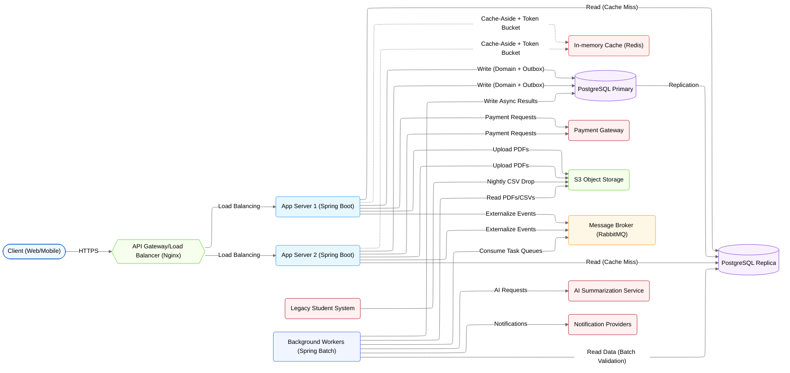

- **Traffic distribution:** Nginx load balances external HTTPS requests across horizontally scaled Spring Boot app servers.
- **Cache and rate limiting:** App servers use cache-aside reads with Redis and enforce Token Bucket rate limiting at the edge.
- **Read/write separation:** App servers read from the PostgreSQL replica on cache misses and write domain data plus event publications to the primary.
- **Worker responsibilities:** Spring Modulith persists event publications and externalizes them to RabbitMQ, while workers write async results on the primary and read from the replica for batch validation workloads such as CSV ingestion.
- **Broker integration:** Spring Modulith externalizes published events to RabbitMQ, and workers consume tasks for AI summarization and notification delivery.

### Workshop Registration Flow

This sequence captures the end-to-end registration flow, including concurrency control, idempotent payment retries, and event publication-driven notifications.

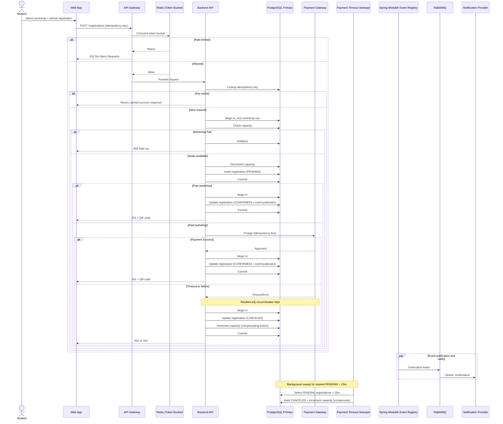

- **Idempotency barrier:** The API checks the idempotency key before any reservation logic, returning a cached success response on retries to avoid double processing.
- **Short-lived pessimistic locking:** The capacity lock is held only inside the reservation transaction and released before any payment call, preventing long-held locks and connection pool exhaustion.
- **Compensating transactions:** Timed-out or failed payments transition the registration to `CANCELED` and increment capacity, ensuring the final seat is not lost.
- **Circuit breaker protection:** Resilience4j guards the payment call path and surfaces controlled failures when the gateway degrades.
- **Event publication registry:** Confirmation notifications are persisted and externalized by Spring Modulith, decoupled from the synchronous user request.

### Offline Check-in & Synchronization Flow

This sequence illustrates offline capture, local persistence, and server-authoritative reconciliation that prevents duplicate attendance records.

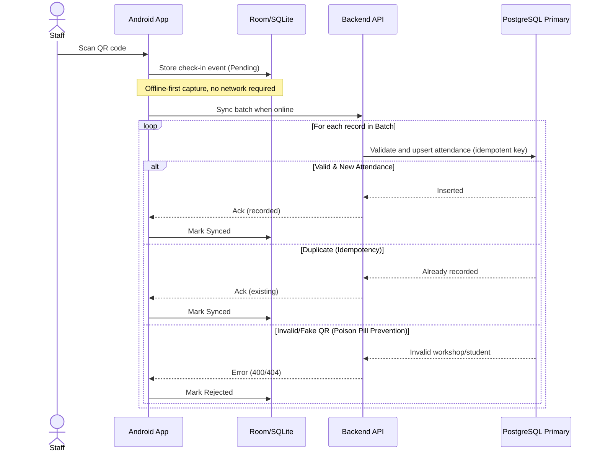

- **Offline-first capture:** The mobile app records scans locally to keep check-in operational during network drops.
- **Batch synchronization:** Pending records are synced in batches when connectivity returns, reducing request overhead.
- **Idempotent conflict resolution:** Duplicate records return a success acknowledgment so the client can safely clear them, even if a prior response was lost.
- **Poison Pill prevention:** Invalid QR codes are deterministically rejected and marked rejected locally, preventing infinite retry loops that waste bandwidth and battery.

### Async AI Summarization Flow

This sequence shows the asynchronous pipeline for PDF processing using the Spring Modulith event publication registry and brokered workers, including error handling when the AI service is unavailable.

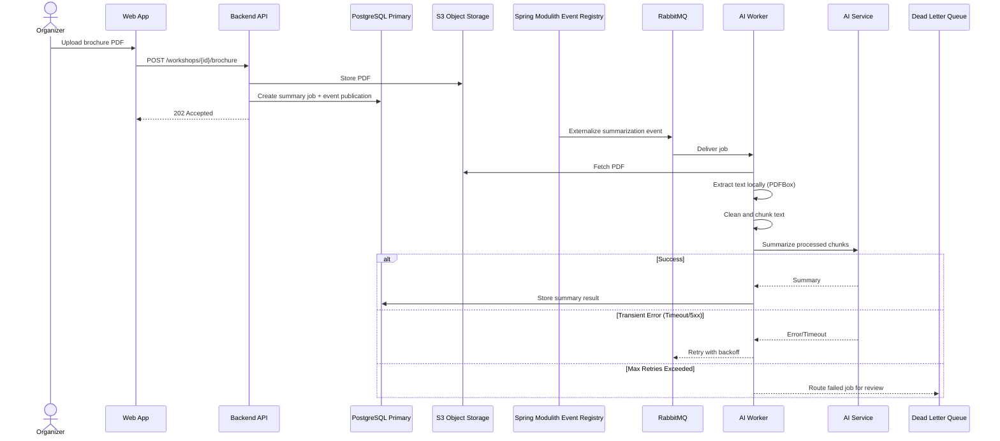

- **Decoupled processing:** The API persists the job and event publication entry, then returns 202 so heavy PDF processing runs asynchronously.
- **Local preprocessing:** The worker extracts, cleans, and chunks text before calling the AI service to avoid oversized payloads and token limit errors.
- **Fault tolerance:** Transient AI failures trigger backoff retries through the broker without blocking other jobs.
- **Dead Letter Queue (DLQ):** Jobs that exceed retry limits are routed to the DLQ for manual review, keeping the main queue healthy.

### Nightly Legacy CSV Ingestion Flow

This flowchart represents the nightly batch pipeline, showing fault-tolerant parsing, validation, and row-level quarantine without failing the entire job.

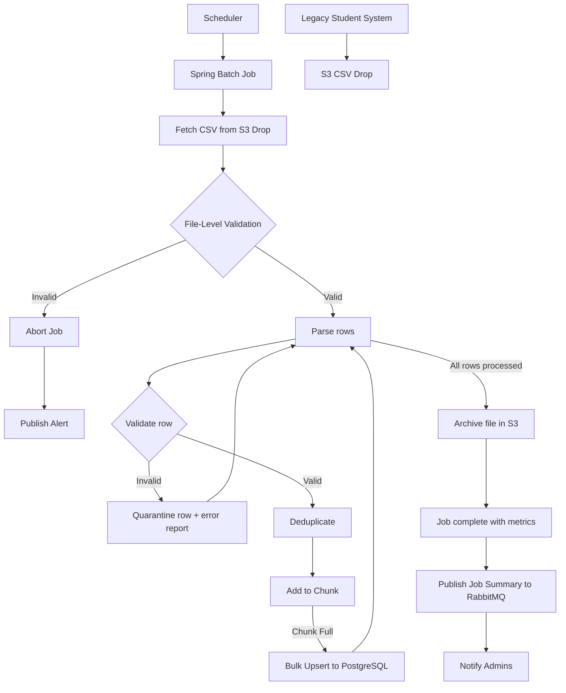

- **File-level guardrails:** Header and size validation prevents corrupted or malformed uploads from crashing the batch job.
- **Chunk-oriented processing:** Valid rows are buffered and upserted in bulk to maximize throughput and avoid connection exhaustion.
- **Fault tolerance & quarantining:** Invalid rows are isolated into a quarantine report while the job continues.
- **Archiving strategy:** Processed files are moved to an archive folder to prevent accidental reprocessing.
- **Proactive alerting:** Job summaries (success and quarantined counts) are published to RabbitMQ to notify administrators.

### Workshop Lifecycle Management Flow

This sequence captures the admin-driven workshop lifecycle and the event-driven propagation of changes to downstream services.

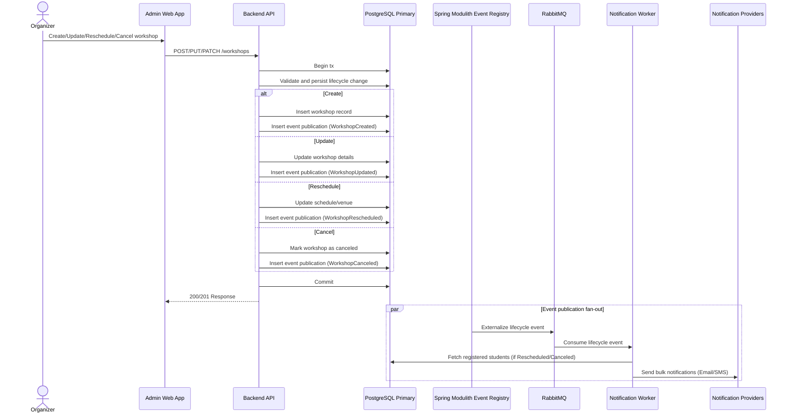

- **Lifecycle coverage:** Admins can create, update, reschedule, or cancel workshops through the web portal.
- **Transactional event publication:** The lifecycle change and event publication are committed in the same transaction to guarantee consistent state and downstream notification delivery.
- **Asynchronous fan-out:** The notification worker consumes lifecycle events, fetches impacted students, and sends bulk emails without blocking the admin UI.

### Workshop Search & Cache-Aside Flow

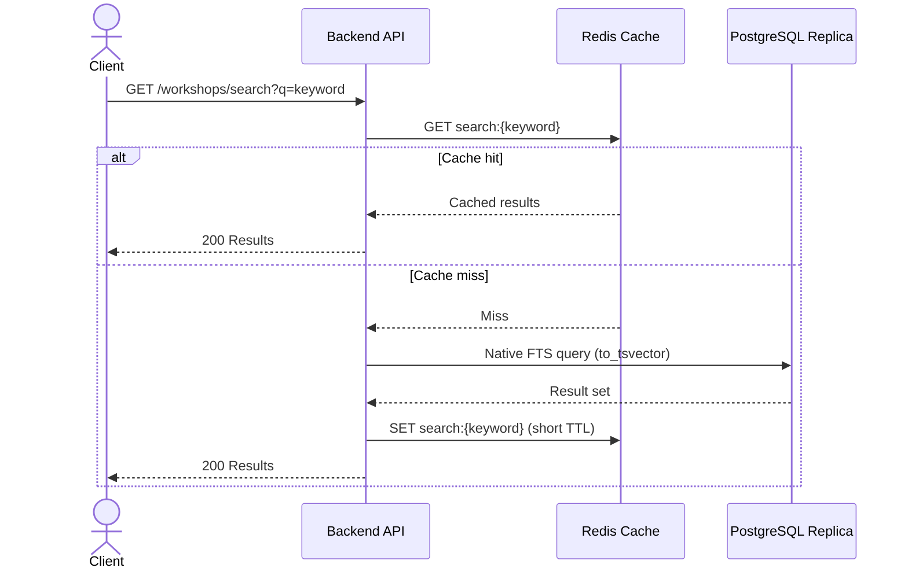

## 4. Database Design

### Database Technology Stack

- **Core Data Stores (Server-Side):**
  - **PostgreSQL (Primary System of Record):** Provides strict ACID guarantees, pessimistic row-level locking for the 60-seat race condition, and durable storage for Idempotency and Spring Modulith Event Publication records.
  - **Redis (Cache & Rate Limiter):** High-throughput, low-latency storage for Token Bucket rate limiting and cache-aside workshop availability reads during the 12,000-user surge.
  - **S3-Compatible Object Storage (Blob Store):** Cost-effective, scalable persistence for unstructured data, specifically used for storing Organizer-uploaded PDF brochures and nightly CSV drops from the legacy system.
- **Mobile Data Store (Client-Side):**
  - **SQLite via Room:** Local cache for workshop details and an event queue (`PendingCheckIn`) to support offline-first check-in.
- **Database Tooling:**
  - **Flyway (Migration Tool):** Migration-first schema management with deterministic, version-controlled deployments; Hibernate `ddl-auto=update` is explicitly disabled.
  - **HikariCP (Connection Pool):** Efficient JDBC connection management to prevent connection pool exhaustion under burst traffic.

### Entity-Relationship Diagram (ERD)

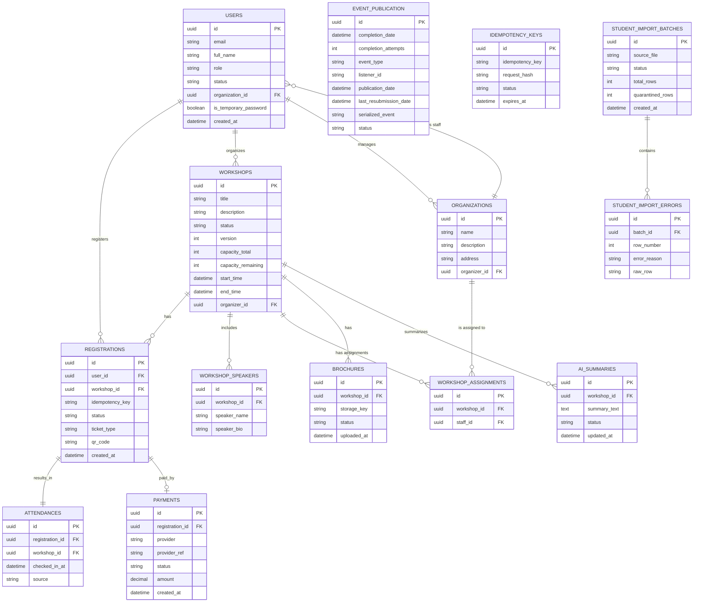

The schema separates core domain tables (users, workshops, registrations, payments, attendance) from technical pattern tables (event publications and idempotency keys) to keep business logic clean while enabling resilience patterns. Workshop content artifacts (brochures and AI summaries) are modeled as first-class entities for lifecycle tracking, while import batches and errors capture CSV ingestion outcomes without polluting the core domain. This separation supports high-concurrency workflows, reliable async processing, and offline check-in reconciliation without coupling operational metadata directly to transactional records.

### Core Schema & Data Dictionary

**USERS**

| Field Name              | Data Type (PostgreSQL) | Business/Technical Purpose                                      |
| :---------------------- | :--------------------- | :-------------------------------------------------------------- |
| `organization_id`       | UUID                   | Links staff users to their organization for check-in grouping.  |
| `is_temporary_password` | BOOLEAN                | Forces password change on first login for provisioned accounts. |

**ORGANIZATIONS**

| Field Name     | Data Type (PostgreSQL) | Business/Technical Purpose                      |
| :------------- | :--------------------- | :---------------------------------------------- |
| `name`         | TEXT                   | Human-readable organization or department name. |
| `organizer_id` | UUID                   | Organizer that manages the organization.        |

**WORKSHOP_ASSIGNMENTS**

| Field Name        | Data Type (PostgreSQL) | Business/Technical Purpose                        |
| :---------------- | :--------------------- | :------------------------------------------------ |
| `workshop_id`     | UUID                   | Workshop being assigned to a staff organization.  |
| `organization_id` | UUID                   | Organization responsible for check-in operations. |

**WORKSHOPS**

| Field Name           | Data Type (PostgreSQL) | Business/Technical Purpose                                               |
| :------------------- | :--------------------- | :----------------------------------------------------------------------- |
| `capacity_total`     | INTEGER                | Fixed seat capacity used for demand planning and validations.            |
| `capacity_remaining` | INTEGER                | Live seat counter updated under pessimistic lock to prevent overbooking. |
| `version`            | INTEGER                | Optimistic locking for non-capacity edits (title, schedule).             |
| `status`             | TEXT                   | Lifecycle state: `DRAFT`, `PUBLISHED`, `CANCELED`, `COMPLETED`.          |

**REGISTRATIONS**

| Field Name        | Data Type (PostgreSQL) | Business/Technical Purpose                                                                       |
| :---------------- | :--------------------- | :----------------------------------------------------------------------------------------------- |
| `idempotency_key` | TEXT                   | Correlates retries to the same request for safe deduplication.                                   |
| `status`          | TEXT                   | `PENDING`, `CONFIRMED`, `CANCELED`; `CANCELED` triggers capacity compensation (restores 1 seat). |

**PAYMENTS**

| Field Name | Data Type (PostgreSQL) | Business/Technical Purpose                                     |
| :--------- | :--------------------- | :------------------------------------------------------------- |
| `status`   | TEXT                   | Payment lifecycle: `PENDING`, `SUCCESS`, `FAILED`, `REFUNDED`. |

**EVENT_PUBLICATION**

| Field Name               | Data Type (PostgreSQL) | Business/Technical Purpose                                                       |
| :----------------------- | :--------------------- | :------------------------------------------------------------------------------- |
| `event_type`             | TEXT                   | Published event type recorded by Spring Modulith.                                |
| `listener_id`            | TEXT                   | Target listener identifier for publication routing.                              |
| `publication_date`       | TIMESTAMP              | When the event was registered for publication.                                   |
| `completion_date`        | TIMESTAMP              | When the publication completed for the listener (null if pending).               |
| `completion_attempts`    | INTEGER                | Tracks the number of retry attempts for the event publication.                   |
| `last_resubmission_date` | TIMESTAMP              | Timestamp of the last attempt to resubmit the event for publication.             |
| `serialized_event`       | TEXT                   | Serialized event payload persisted by the Event Publication registry.            |
| `status`                 | TEXT                   | Lifecycle status of the event publication (e.g., INCOMPLETE, COMPLETED, FAILED). |

**IDEMPOTENCY_KEYS**

| Field Name     | Data Type (PostgreSQL) | Business/Technical Purpose                                |
| :------------- | :--------------------- | :-------------------------------------------------------- |
| `request_hash` | TEXT                   | Unique fingerprint of the request payload for validation. |
| `expires_at`   | TIMESTAMP              | TTL cutoff for cleanup to prevent table bloat.            |

### Concurrency & Integrity Constraints

- **Capacity Protection (Race Condition Prevention):** Enforce `CHECK (capacity_remaining >= 0)` on `WORKSHOPS` and use `SELECT ... FOR UPDATE` to lock the workshop row during seat allocation to guarantee no overbooking.
- **Idempotency Barrier (Double-Charge Prevention):** Apply `UNIQUE (idempotency_key)` on both `IDEMPOTENCY_KEYS.idempotency_key` and `REGISTRATIONS.idempotency_key` to prevent duplicate processing on client retries.
- **Offline Sync Deduplication:** Add `UNIQUE (registration_id)` (or `UNIQUE (workshop_id, user_id)`) on `ATTENDANCE` to silently discard duplicate sync attempts from offline clients.
- **Data Consistency:** Enforce `FOREIGN KEY ... ON DELETE RESTRICT` to prevent deleting a workshop that has existing registrations.

### Indexing Strategy

| Table               | Indexed Columns        | Index Type                                       | Business/Performance Rationale                                 |
| :------------------ | :--------------------- | :----------------------------------------------- | :------------------------------------------------------------- |
| `IDEMPOTENCY_KEYS`  | `idempotency_key`      | B-Tree                                           | Fast lookup during registration surges to deduplicate retries. |
| `EVENT_PUBLICATION` | `completion_date`      | Partial B-Tree (`WHERE completion_date IS NULL`) | Speeds pending publication scans.                              |
| `WORKSHOPS`         | `status`, `start_time` | Composite B-Tree                                 | Accelerates schedule browsing and filtering.                   |
| `REGISTRATIONS`     | `user_id`              | B-Tree                                           | Efficient per-user registration history lookups.               |
| `REGISTRATIONS`     | `workshop_id`          | B-Tree                                           | Efficient workshop roster and capacity checks.                 |

### Mobile Local Database (Room SQLite Schema)

The mobile database is intentionally minimal and is not a replica of the server. It stores a read-only workshop cache for staff selection and a write-optimized event queue for offline check-ins.

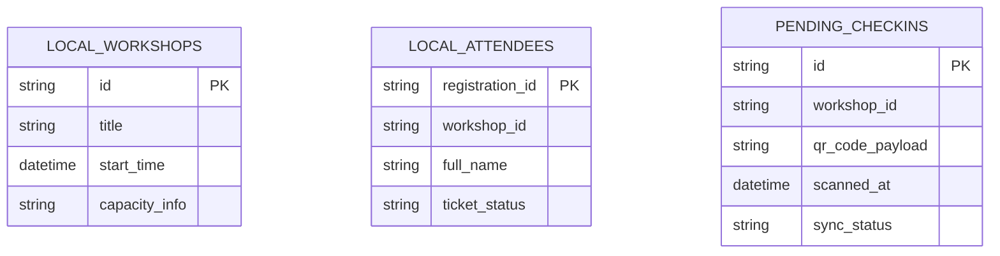

- **LocalWorkshop (Read-Only Cache):** Minimal fields required for staff to select a workshop; refreshed when online.
- **LocalAttendee (Read-Only Cache):** Read-only cache for the attendee roster, enabling offline search and verification without network.
- **PendingCheckIn (Event Queue):** Offline scans with `sync_status` values `PENDING`, `SYNCED`, `FAILED`, or `REJECTED` to drive deterministic reconciliation.

## 5. Access Control Design

### RBAC Model & User Personas

We use **Role-Based Access Control (RBAC)** with role claims enforced at the API and UI layers.

| Role        | Access Rights                                                                                      |
| :---------- | :------------------------------------------------------------------------------------------------- |
| `STUDENT`   | View published workshops, register for workshops, view their own QR codes.                         |
| `ORGANIZER` | Create/update/cancel workshops, upload PDF brochures, view attendee lists for their own workshops. |
| `STAFF`     | View workshop details assigned to them and submit offline check-in sync batches.                   |

Database roles and Spring Security authorities are stored and processed strictly as plain domain values. The authentication layer **does not** prepend `ROLE_` when issuing JWTs or constructing authorities.

### Stateless JWT & Role Claims

The API Gateway and Backend Services do not query PostgreSQL for permissions on every request. They trust a cryptographically signed JWT and perform `O(1)` authorization checks using the embedded role claim.

**Example decoded JWT payload:**

```json
{
  "sub": "1b8f8c7b-2e4b-4f6c-9b3b-6b8d2f0c9a12",
  "role": "ORGANIZER",
  "iat": 1767225600,
  "exp": 1767229200,
  "jti": "9c1f6c23-0f5d-4f8b-9f51-2d5f3a2f1d9e"
}
```

- **Client usage (React/Android):** The client decodes the role claim to drive the UI, such as hiding the "Create Workshop" action for STUDENT.
- **Server usage (Spring Boot):** The API enforces access via the role claim using authority checks (for example, `@PreAuthorize("hasAuthority('ORGANIZER')")`) and uses `sub` for row-level ownership checks.

### Multi-Layer Enforcement Points

- **Layer 1: UI/Client Layer (React & Mobile):** The client decodes the JWT to gate UI elements (hide menus, disable routes) for user experience. This improves UX but is not a security control.
- **Layer 2: API Gateway & Controller Layer (Endpoint Security):** Requests are intercepted, JWT signatures are verified, and endpoint access is enforced by role claims (for example, `@PreAuthorize`). This blocks a Student from calling Organizer endpoints directly.
- **Layer 3: Business/Data Layer (Data Ownership):** Services enforce ownership checks beyond role validation. For example, `PUT /workshops/{id}` verifies `ROLE_ORGANIZER` and confirms `workshops.organizer_id == jwt.sub` to prevent cross-tenant tampering.

### Authorization Sequence Diagram

This diagram illustrates the defense-in-depth strategy using an Organizer attempting to edit a workshop, showing how each layer prevents unauthorized access.

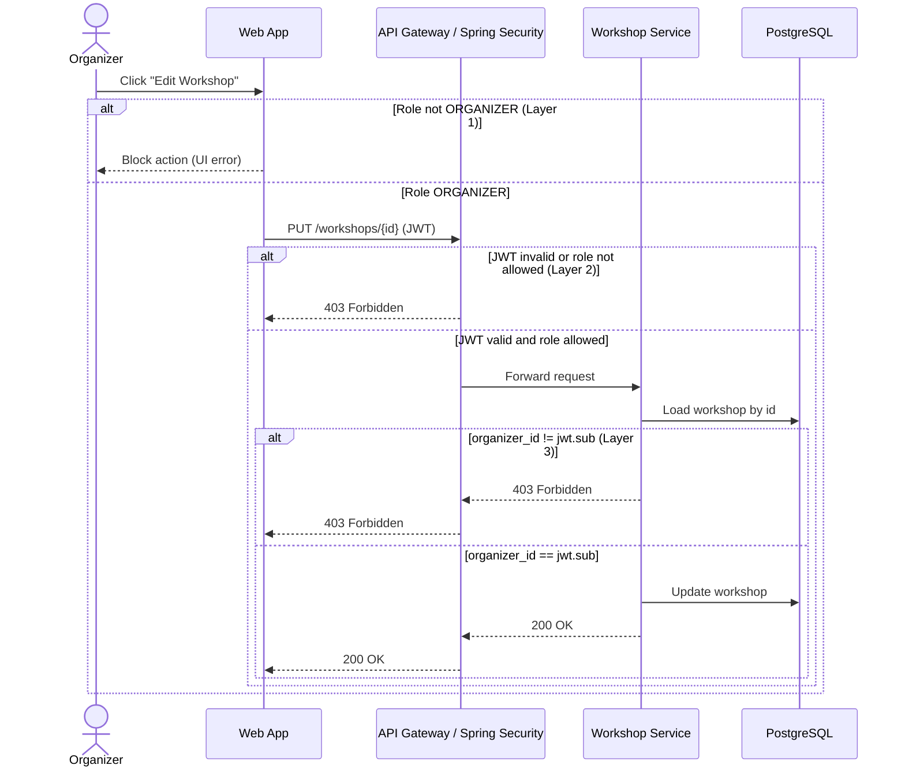

- **Layer 1 (UX/UI Gating):** Provides immediate feedback and hides restricted features from unauthorized users, but is cosmetic and can be bypassed.
- **Layer 2 (Endpoint Gating):** The API gateway and Spring Security boundary require a `ROLE_ORGANIZER` claim for `PUT /workshops/{id}`.
- **Layer 3 (Data Gating):** The service enforces ownership by matching `workshops.organizer_id` with `jwt.sub`, preventing IDOR attacks.

## 6. System Protection Mechanisms

### Traffic Spike Management

Registration demand peaks at 12,000 concurrent users within the first 10 minutes, with 60% concentrated in the initial 3-minute window. To keep the backend stable under that burst, the API Gateway enforces a distributed **Token Bucket** rate limiter using **Bucket4j** with **Redis** as the shared state store.

Each user or IP is assigned a bucket with a fixed capacity of tokens. Every `POST /registrations` request consumes a token, and tokens refill at a steady rate. This allows short bursts during the first 3 minutes while still capping sustained throughput, preventing the registration service and database from being overwhelmed.

When a bucket is empty, the gateway rejects the request with HTTP `429 Too Many Requests`. The frontend shows a simple "Please wait" message and retries with backoff, protecting the system while keeping the user informed.

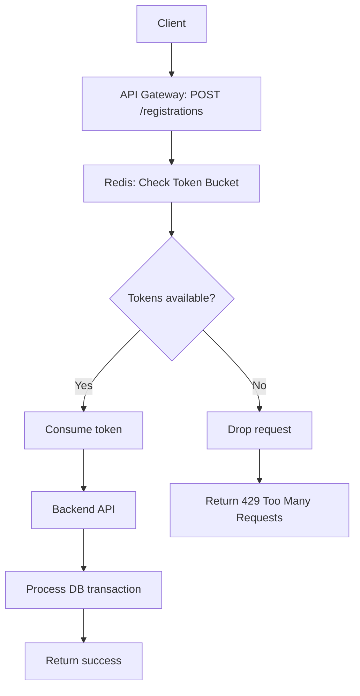

### Third-Party Service Resilience

External payment gateways are inherently unreliable due to network latency, timeouts, and partial outages. If the backend waits on slow payment calls, request threads queue up and can exhaust the Spring Boot thread pool, causing a cascading failure across the UniHub system.

To prevent this, the payment integration uses a Circuit Breaker implemented with Resilience4j. The breaker continuously tracks failure rate and slow-call rate; when thresholds are exceeded, it opens and blocks further payment calls.

When the circuit is open, the system fails fast instead of hanging. It returns an immediate error or places the registration in a "Payment Pending" state so users can retry later, while free workshop registration and browsing remain fully operational.

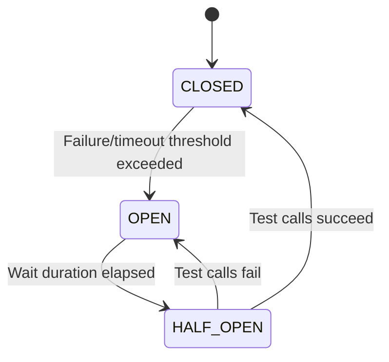

### Transaction Idempotency

Client retries caused by network drops or impatient clicks can create duplicate `POST /registrations` requests, risking double-booking or double-charging. The system enforces exactly-once processing with an idempotency key strategy backed by PostgreSQL.

- **Key generation and transmission:** The React/Android client generates a UUIDv4 and sends it in the `Idempotency-Key` header.
- **Storage and duplicate detection:** The backend stores keys in `IDEMPOTENCY_KEYS` with a `UNIQUE` constraint, creating a database-level barrier against race conditions.
- **Workflow:** On the first attempt, the key is inserted, the payment is processed, and the final response payload is serialized and stored with the key. On a retry, the API finds the existing key and immediately returns the cached response, bypassing the payment gateway and write logic.
- **TTL configuration:** Each key includes an `expires_at` timestamp (for example, 24 hours), and a scheduled cleanup job deletes expired records to prevent table bloat.

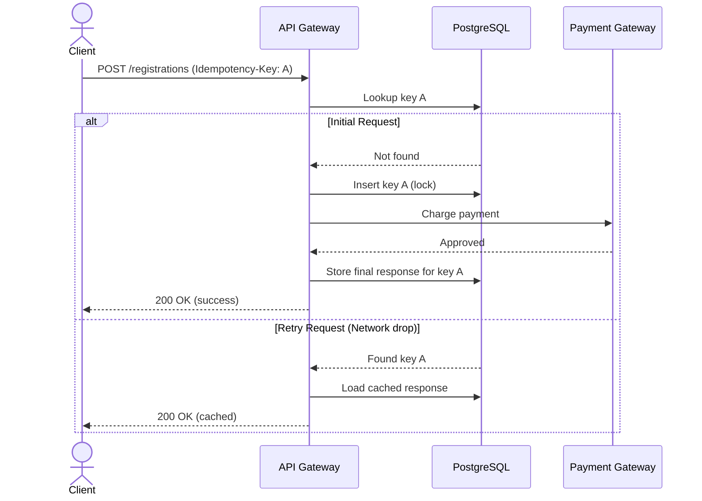
