# UniHub Workshop - Technical Design

## 1. Overall Architecture

### Architectural Style

**Chosen architecture:** Modular Monolith with event-driven components and Clean Architecture boundaries.

This approach balances the high-traffic requirements with rapid time-to-market expectations and optimized operational overhead. A modular monolith keeps operational complexity low while enforcing strong internal boundaries (registration, payments, check-in, notifications, ingestion, admin). Event-driven components (via a broker and outbox pattern) handle asynchronous workloads like notifications, AI summarization, and CSV ingestion without blocking core transactions.

**Why this is the best fit now:**

- **High concurrency, low ops overhead:** A single deployable unit scales horizontally behind a load balancer while avoiding microservice orchestration burden.
- **Strict data consistency:** Centralized PostgreSQL transactions reduce the risk of overbooking under heavy contention.
- **Clear growth path:** Well-defined module boundaries allow gradual extraction into services if future scale requires it.
- **Rapid delivery requirements:** Faster integration and testing with reduced operational overhead.

> [!TIP]
> This architecture keeps the critical path (seat allocation and payment) synchronous and strongly consistent, while offloading non-critical tasks to async workers.

### Core Components

| Component                       | Purpose                                                    | Notes                                                                  |
| :------------------------------ | :--------------------------------------------------------- | :--------------------------------------------------------------------- |
| React Web App                   | Student discovery/registration and Admin management portal | React + TypeScript UI with RBAC-guarded views                          |
| Android Mobile App (Java / XML) | QR scanning and offline-first check-in                     | Room/SQLite local store with deterministic sync                        |
| Java Backend API                | Central business logic and orchestration                   | Spring Boot modular monolith, HikariCP, Resilience4j, outbox relay     |
| PostgreSQL                      | System of record                                           | Primary-replica topology with pessimistic locking and idempotency keys |
| Message Broker                  | Async event processing                                     | RabbitMQ for notifications, AI, and ingestion events                   |
| Cache / Rate Limiter            | Spike protection and fast reads                            | Redis token bucket and cache-aside workshop reads                      |
| Object Storage                  | PDFs and ingestion files                                   | S3-compatible storage for brochures and CSV drops                      |

### Communication Protocols

- **Web App to Backend:** HTTPS using REST/GraphQL APIs with JWT-based auth.
- **Mobile App to Backend:** HTTPS REST APIs optimized for batch sync and idempotency.
- **Backend to PostgreSQL:** JDBC with transaction isolation and row-level locking.
- **Backend to Broker:** AMQP protocol for async jobs and event fan-out.
- **Backend to External Services:** HTTPS for Payment Gateway, AI service, and notification providers.
- **Legacy CSV Input:** Scheduled file drop over SFTP or secure object storage pickup.

### Resilience Strategy

- **Admission control:** Token Bucket rate limiting in Redis enforced at the API gateway.
- **Strong consistency:** Pessimistic locking in PostgreSQL primary to prevent overbooking.
- **Graceful degradation:** Resilience4j circuit breakers around payment and AI services.
- **Idempotency:** Idempotency keys stored in PostgreSQL with TTL for payments and sync.
- **Offline-first safety:** Room/SQLite local persistence with server-side idempotent reconciliation.

> [!NOTE]
> The synchronous path is kept minimal: validate user, reserve seat, confirm payment, issue QR. Everything else is asynchronous and retry-safe.

## 2. C4 Diagram

### 2.1. Level 1 - System Context

<p align="center">
  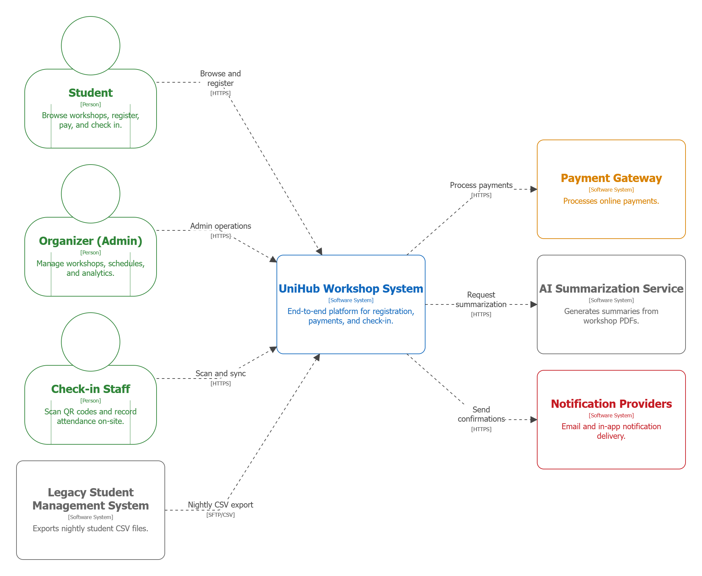
  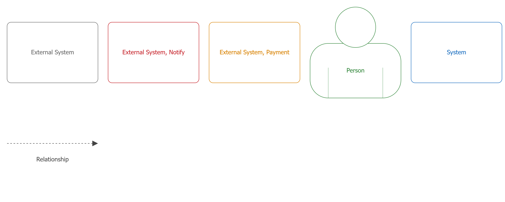
</p>

The system context view positions UniHub Workshop as the central platform coordinating all workshop lifecycle activities. Three primary personas interact with the system. **Students** browse schedules, register for sessions, and receive QR confirmations. **Organizers** use the system for operational control, including workshop creation, rescheduling, and analytics. **Check-in staff** rely on the system for attendance validation through the mobile app.

External dependencies shape the system boundary. The **Legacy Student Management System** provides nightly CSV exports for identity verification, which flow into UniHub without a return path. The **Payment Gateway** processes paid registrations and requires resilient integration to avoid service collapse during outages. The **AI Summarization Service** is invoked to produce concise workshop descriptions from uploaded PDFs. **Notification Providers** deliver immediate confirmations and alerts, and must be pluggable to enable future channels without core changes.

This context emphasizes clear trust boundaries: all users interact through secure HTTPS endpoints, while external systems are integrated through dedicated adapters. It reinforces that UniHub owns transactional integrity and availability, while external services are treated as potentially unreliable dependencies protected with circuit breakers and retry policies.

### 2.2. Level 2 - Container

<p align="center">
  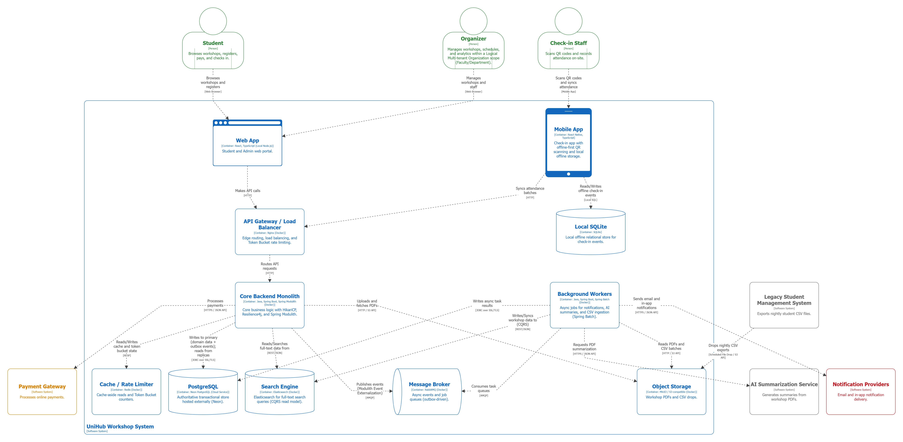
  
</p>

The container view decomposes UniHub into client apps, backend components, and infrastructure services aligned with the modular monolith strategy. The **React + TypeScript Web App** serves Students and Organizers with distinct RBAC-guarded experiences. The **Android Mobile App** is dedicated to check-in staff and includes a local database for offline-first scanning and later synchronization.

At the edge, an **API Gateway / Load Balancer** provides TLS termination, routing, and rate limiting to protect the backend during the 12,000+ user surge. The **Backend API** is a single Java deployable with strict internal modules (registration, payment, notifications, check-in, ingestion, admin). It performs transactional operations against **PostgreSQL**, enforcing seat allocation and payment consistency.

Asynchronous workloads run through a **Message Broker** and **Background Workers** to keep the critical path fast and reliable. Workers handle notifications, AI summarization, and CSV ingestion without blocking user requests. A **Cache / Rate Limiter** layer (Redis) supports burst control and fast availability reads. **Object Storage** holds workshop PDFs and nightly CSV exports, enabling reliable batch processing and auditability.

This structure ensures the system can scale horizontally under traffic spikes, maintain data integrity with PostgreSQL transactions, and support offline check-ins with eventual reconciliation while keeping operational overhead manageable with optimized operational resources.

## 3. High-Level Architecture Diagram

### System Architecture

This diagram shows the production topology: horizontally scaled Spring Boot app servers behind an API gateway, Redis for cache and token bucket rate limiting, PostgreSQL primary-replica for write safety and read scalability, and dedicated workers for outbox relay, AI, and CSV ingestion. External integrations are modeled explicitly.

<p align="center">
  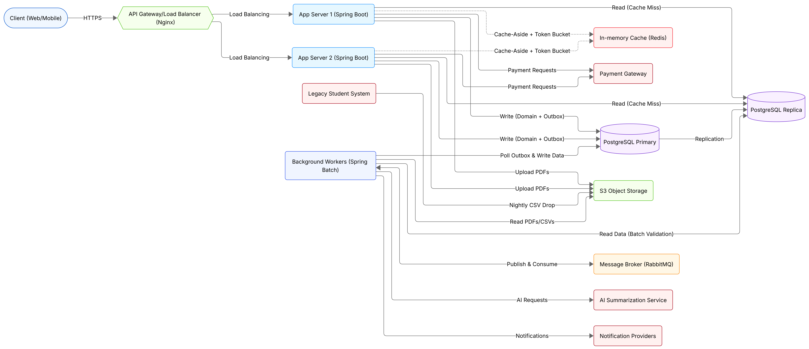
</p>

- **Traffic distribution:** Nginx load balances external HTTPS requests across horizontally scaled Spring Boot app servers.
- **Cache and rate limiting:** App servers use cache-aside reads with Redis and enforce Token Bucket rate limiting at the edge.
- **Read/write separation:** App servers read from the PostgreSQL replica on cache misses and write domain data plus outbox events to the primary.
- **Worker responsibilities:** Workers poll and lock outbox rows and write async results on the primary, while reading from the replica for batch validation workloads such as CSV ingestion.
- **Broker integration:** Workers publish and consume tasks via RabbitMQ to drive AI summarization and notification delivery.

### Workshop Registration Flow

This sequence captures the end-to-end registration flow, including concurrency control, idempotent payment retries, and outbox-driven notifications.

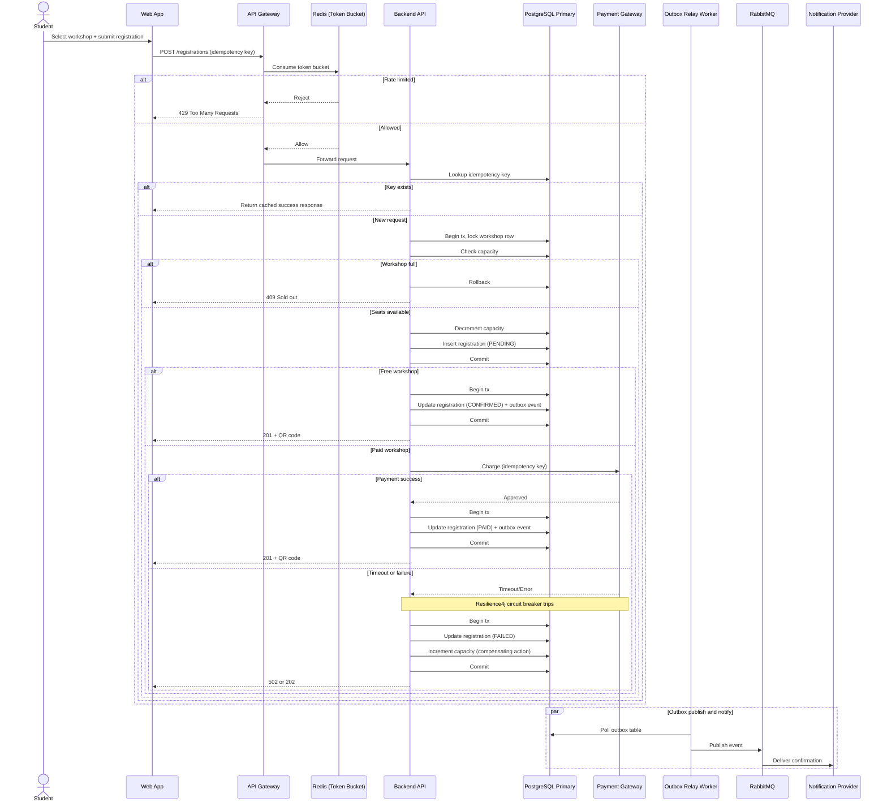

- **Idempotency barrier:** The API checks the idempotency key before any reservation logic, returning a cached success response on retries to avoid double processing.
- **Short-lived pessimistic locking:** The capacity lock is held only inside the reservation transaction and released before any payment call, preventing long-held locks and connection pool exhaustion.
- **Compensating transactions:** Failed or timed-out payments transition the registration to `FAILED` and increment capacity, ensuring the final seat is not lost.
- **Circuit breaker protection:** Resilience4j guards the payment call path and surfaces controlled failures when the gateway degrades.
- **Outbox pattern:** Confirmation notifications are published asynchronously by the relay, decoupled from the synchronous user request.

### Offline Check-in & Synchronization Flow

This sequence illustrates offline capture, local persistence, and server-authoritative reconciliation that prevents duplicate attendance records.


- **Offline-first capture:** The mobile app records scans locally to keep check-in operational during network drops.
- **Batch synchronization:** Pending records are synced in batches when connectivity returns, reducing request overhead.
- **Idempotent conflict resolution:** Duplicate records return a success acknowledgment so the client can safely clear them, even if a prior response was lost.
- **Poison Pill prevention:** Invalid QR codes are deterministically rejected and marked failed locally, preventing infinite retry loops that waste bandwidth and battery.

### Async AI Summarization Flow

This sequence shows the asynchronous pipeline for PDF processing using the outbox pattern and brokered workers, including error handling when the AI service is unavailable.

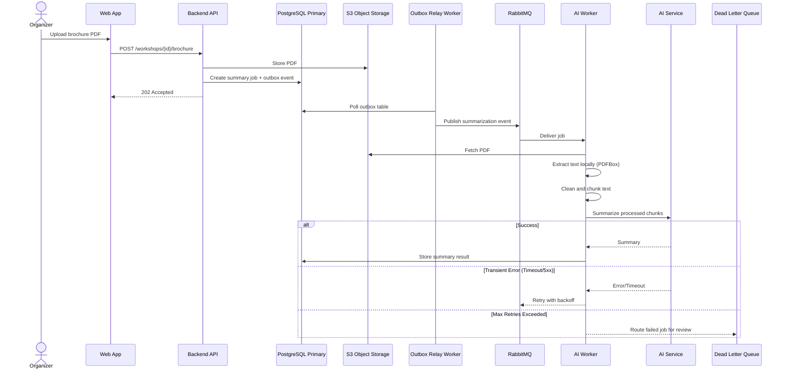

- **Decoupled processing:** The API persists the job and outbox entry, then returns 202 so heavy PDF processing runs asynchronously.
- **Local preprocessing:** The worker extracts, cleans, and chunks text before calling the AI service to avoid oversized payloads and token limit errors.
- **Fault tolerance:** Transient AI failures trigger backoff retries through the broker without blocking other jobs.
- **Dead Letter Queue (DLQ):** Jobs that exceed retry limits are routed to the DLQ for manual review, keeping the main queue healthy.

### Nightly Legacy CSV Ingestion Flow

This flowchart represents the nightly batch pipeline, showing fault-tolerant parsing, validation, and row-level quarantine without failing the entire job.

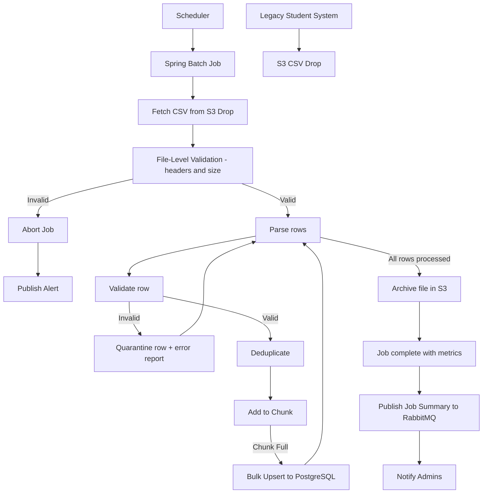

- **File-level guardrails:** Header and size validation prevents corrupted or malformed uploads from crashing the batch job.
- **Chunk-oriented processing:** Valid rows are buffered and upserted in bulk to maximize throughput and avoid connection exhaustion.
- **Fault tolerance & quarantining:** Invalid rows are isolated into a quarantine report while the job continues.
- **Archiving strategy:** Processed files are moved to an archive folder to prevent accidental reprocessing.
- **Proactive alerting:** Job summaries (success and quarantined counts) are published to RabbitMQ to notify administrators.

### Workshop Lifecycle Management Flow

This sequence captures the admin-driven workshop lifecycle and the event-driven propagation of changes to downstream services.

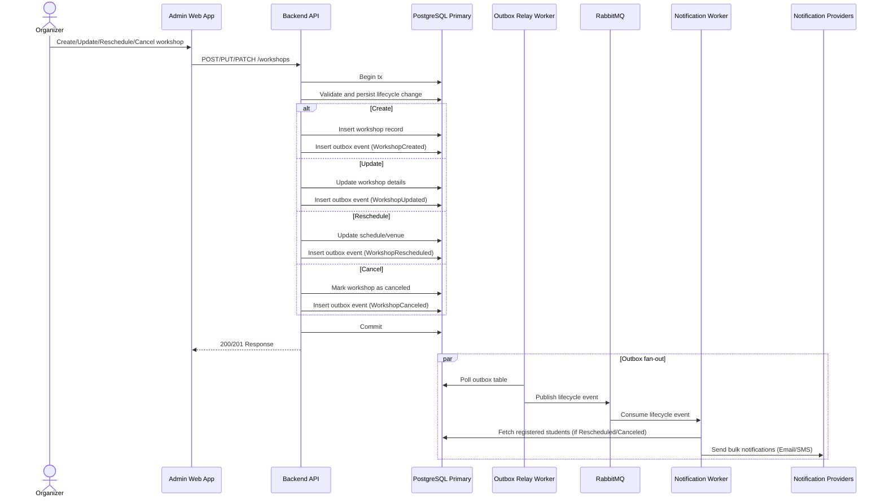

- **Lifecycle coverage:** Admins can create, update, reschedule, or cancel workshops through the web portal.
- **Transactional outbox:** The lifecycle change and outbox event are committed in the same transaction to guarantee consistent state and downstream notification delivery.
- **Asynchronous fan-out:** The notification worker consumes lifecycle events, fetches impacted students, and sends bulk emails without blocking the admin UI.

## 4. Database Design

### Database Technology Stack

- **Core Data Stores (Server-Side):**
  - **PostgreSQL (Primary System of Record):** Provides strict ACID guarantees, pessimistic row-level locking for the 60-seat race condition, and durable storage for Idempotency and Outbox patterns.
  - **Redis (Cache & Rate Limiter):** High-throughput, low-latency storage for Token Bucket rate limiting and cache-aside workshop availability reads during the 12,000-user surge.
  - **S3-Compatible Object Storage (Blob Store):** Cost-effective, scalable persistence for unstructured data, specifically used for storing Organizer-uploaded PDF brochures and nightly CSV drops from the legacy system.
- **Mobile Data Store (Client-Side):**
  - **SQLite via Room:** Local cache for workshop details and an event queue (`PendingCheckIn`) to support offline-first check-in.
- **Database Tooling:**
  - **Flyway (Migration Tool):** Migration-first schema management with deterministic, version-controlled deployments; Hibernate `ddl-auto=update` is explicitly disabled.
  - **HikariCP (Connection Pool):** Efficient JDBC connection management to prevent connection pool exhaustion under burst traffic.

### Entity-Relationship Diagram (ERD)

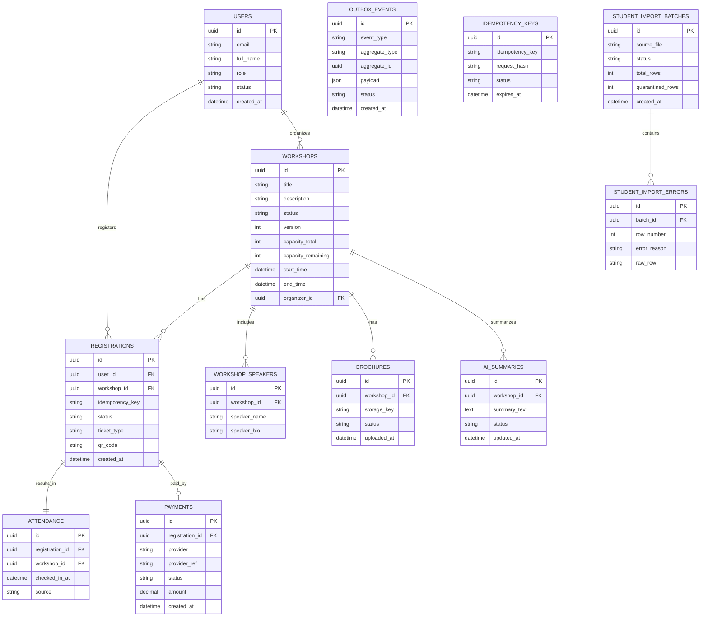

The schema separates core domain tables (users, workshops, registrations, payments, attendance) from technical pattern tables (outbox events and idempotency keys) to keep business logic clean while enabling resilience patterns. Workshop content artifacts (brochures and AI summaries) are modeled as first-class entities for lifecycle tracking, while import batches and errors capture CSV ingestion outcomes without polluting the core domain. This separation supports high-concurrency workflows, reliable async processing, and offline check-in reconciliation without coupling operational metadata directly to transactional records.

### Core Schema & Data Dictionary

**WORKSHOPS**

| Field Name           | Data Type (PostgreSQL) | Business/Technical Purpose                                               |
| :------------------- | :--------------------- | :----------------------------------------------------------------------- |
| `capacity_total`     | INTEGER                | Fixed seat capacity used for demand planning and validations.            |
| `capacity_remaining` | INTEGER                | Live seat counter updated under pessimistic lock to prevent overbooking. |
| `version`            | INTEGER                | Optimistic locking for non-capacity edits (title, schedule).             |
| `status`             | TEXT                   | Lifecycle state: `DRAFT`, `PUBLISHED`, `CANCELED`, `COMPLETED`.          |

**REGISTRATIONS**

| Field Name        | Data Type (PostgreSQL) | Business/Technical Purpose                                                                     |
| :---------------- | :--------------------- | :--------------------------------------------------------------------------------------------- |
| `idempotency_key` | TEXT                   | Correlates retries to the same request for safe deduplication.                                 |
| `status`          | TEXT                   | `PENDING`, `CONFIRMED`, `PAID`, `FAILED`, `CANCELED`; `FAILED` triggers capacity compensation. |

**PAYMENTS**

| Field Name | Data Type (PostgreSQL) | Business/Technical Purpose                                     |
| :--------- | :--------------------- | :------------------------------------------------------------- |
| `status`   | TEXT                   | Payment lifecycle: `PENDING`, `SUCCESS`, `FAILED`, `REFUNDED`. |

**OUTBOX_EVENTS**

| Field Name | Data Type (PostgreSQL) | Business/Technical Purpose                                         |
| :--------- | :--------------------- | :----------------------------------------------------------------- |
| `payload`  | JSONB                  | Flexible event payload for async processing and integration.       |
| `status`   | TEXT                   | `PENDING`, `PROCESSED`, `FAILED`, `DEAD_LETTER` for relay control. |

**IDEMPOTENCY_KEYS**

| Field Name     | Data Type (PostgreSQL) | Business/Technical Purpose                                |
| :------------- | :--------------------- | :-------------------------------------------------------- |
| `request_hash` | TEXT                   | Unique fingerprint of the request payload for validation. |
| `expires_at`   | TIMESTAMP              | TTL cutoff for cleanup to prevent table bloat.            |

### Concurrency & Integrity Constraints

- **Capacity Protection (Race Condition Prevention):** Enforce `CHECK (capacity_remaining >= 0)` on `WORKSHOPS` and use `SELECT ... FOR UPDATE` to lock the workshop row during seat allocation to guarantee no overbooking.
- **Idempotency Barrier (Double-Charge Prevention):** Apply `UNIQUE (idempotency_key)` on both `IDEMPOTENCY_KEYS.idempotency_key` and `REGISTRATIONS.idempotency_key` to prevent duplicate processing on client retries.
- **Offline Sync Deduplication:** Add `UNIQUE (registration_id)` (or `UNIQUE (workshop_id, user_id)`) on `ATTENDANCE` to silently discard duplicate sync attempts from offline clients.
- **Data Consistency:** Enforce `FOREIGN KEY ... ON DELETE RESTRICT` to prevent deleting a workshop that has existing registrations.

### Indexing Strategy

| Table              | Indexed Columns        | Index Type                                  | Business/Performance Rationale                                 |
| :----------------- | :--------------------- | :------------------------------------------ | :------------------------------------------------------------- |
| `IDEMPOTENCY_KEYS` | `idempotency_key`      | B-Tree                                      | Fast lookup during registration surges to deduplicate retries. |
| `OUTBOX_EVENTS`    | `status`               | Partial B-Tree (`WHERE status = 'PENDING'`) | Speeds relay worker polling for pending events.                |
| `WORKSHOPS`        | `status`, `start_time` | Composite B-Tree                            | Accelerates schedule browsing and filtering.                   |
| `REGISTRATIONS`    | `user_id`              | B-Tree                                      | Efficient per-user registration history lookups.               |
| `REGISTRATIONS`    | `workshop_id`          | B-Tree                                      | Efficient workshop roster and capacity checks.                 |

### Mobile Local Database (Room SQLite Schema)

The mobile database is intentionally minimal and is not a replica of the server. It stores a read-only workshop cache for staff selection and a write-optimized event queue for offline check-ins.

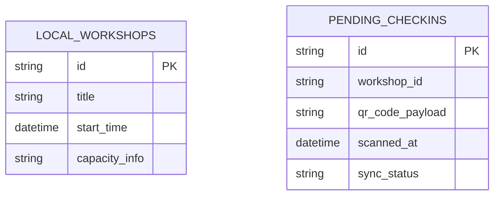

- **LocalWorkshop (Read-Only Cache):** Minimal fields required for staff to select a workshop; refreshed when online.
- **PendingCheckIn (Event Queue):** Offline scans with `sync_status` values `PENDING`, `SYNCED`, `FAILED`, or `REJECTED` to drive deterministic reconciliation.

## 5. Access Control Design

### RBAC Model & User Personas

We use Role-Based Access Control (RBAC) with role claims enforced at the API and UI layers.

| Role             | Access Rights                                                                                      |
| :--------------- | :------------------------------------------------------------------------------------------------- |
| `ROLE_STUDENT`   | View published workshops, register for workshops, view their own QR codes.                         |
| `ROLE_ORGANIZER` | Create/update/cancel workshops, upload PDF brochures, view attendee lists for their own workshops. |
| `ROLE_STAFF`     | View workshop details assigned to them and submit offline check-in sync batches.                   |

### Stateless JWT & Role Claims

The API Gateway and Backend Services do not query PostgreSQL for permissions on every request. They trust a cryptographically signed JWT and perform `O(1)` authorization checks using the embedded role claim.

**Example decoded JWT payload:**

```json
{
  "sub": "1b8f8c7b-2e4b-4f6c-9b3b-6b8d2f0c9a12",
  "role": "ROLE_ORGANIZER",
  "iat": 1767225600,
  "exp": 1767229200,
  "jti": "9c1f6c23-0f5d-4f8b-9f51-2d5f3a2f1d9e"
}
```

- **Client usage (React/Android):** The client decodes the `role` claim to drive the UI, such as hiding the "Create Workshop" action for `ROLE_STUDENT`.
- **Server usage (Spring Boot):** The API enforces access via the `role` claim (for example, `@PreAuthorize("hasRole('ORGANIZER')")`) and uses `sub` for row-level ownership checks.

### Multi-Layer Enforcement Points

- **Layer 1: UI/Client Layer (React & Mobile):** The client decodes the JWT to gate UI elements (hide menus, disable routes) for user experience. This improves UX but is not a security control.
- **Layer 2: API Gateway & Controller Layer (Endpoint Security):** Requests are intercepted, JWT signatures are verified, and endpoint access is enforced by role claims (for example, `@PreAuthorize`). This blocks a Student from calling Organizer endpoints directly.
- **Layer 3: Business/Data Layer (Data Ownership):** Services enforce ownership checks beyond role validation. For example, `PUT /workshops/{id}` verifies `ROLE_ORGANIZER` and confirms `workshops.organizer_id == jwt.sub` to prevent cross-tenant tampering.

### Authorization Sequence Diagram

This diagram illustrates the defense-in-depth strategy using an Organizer attempting to edit a workshop, showing how each layer prevents unauthorized access.

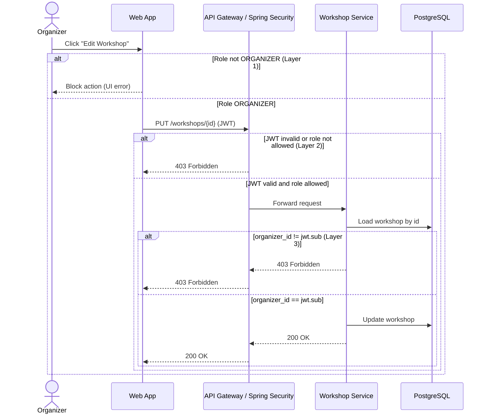

- **Layer 1 (UX/UI Gating):** Provides immediate feedback and hides restricted features from unauthorized users, but is cosmetic and can be bypassed.
- **Layer 2 (Endpoint Gating):** The API gateway and Spring Security boundary require a `ROLE_ORGANIZER` claim for `PUT /workshops/{id}`.
- **Layer 3 (Data Gating):** The service enforces ownership by matching `workshops.organizer_id` with `jwt.sub`, preventing IDOR attacks.

## 7. Architectural Decision Records

### Domain 1: Foundation

#### ADR 001: Backend Language and Framework

- **Context:** The backend must handle 12,000 concurrent users, enforce strict transactional integrity for seat allocation, and be delivered under rapid time-to-market requirements with optimized operational resources.
- **Decision:** Use Java with Spring Boot in a modular monolith architecture.
- **Rationale:** Java and Spring Boot provide mature concurrency support, strong ecosystem libraries for resilience patterns, and straightforward transaction management with PostgreSQL. Compared to Node.js, Java offers more predictable multi-threaded performance under sustained load and a larger set of battle-tested tooling for transactional workloads. Compared to Go, Spring Boot accelerates delivery due to richer scaffolding and familiarity while still meeting throughput requirements.
- **Consequences:** Requires JVM tuning and disciplined module boundaries to avoid monolith sprawl, but reduces operational complexity and time-to-delivery.

#### ADR 002: Web Frontend Framework

- **Context:** The web portal serves two roles (Students and Organizers) with distinct workflows and RBAC controls.
- **Decision:** Use React with TypeScript for the web application.
- **Rationale:** React provides strong component reuse for role-specific views and a broad ecosystem for routing and state management. TypeScript adds compile-time type safety and stronger IDE support, reducing runtime errors when handling complex API payloads and RBAC-driven UI states. Compared to plain React with JavaScript, TypeScript improves refactoring safety and long-term maintainability. Compared to Angular, React + TypeScript avoids the heavier framework surface while still delivering strong typing. Compared to Vue, it offers deeper enterprise tooling maturity and larger hiring pools.
- **Consequences:** Requires disciplined state management and UI architecture to avoid complexity in multi-role experiences.

#### ADR 003: Mobile App Technology

- **Context:** Check-in staff need fast camera scanning and reliable offline-first persistence under poor connectivity.
- **Decision:** Build the mobile app as Android Native using Java and XML.
- **Rationale:** Native Android provides direct access to camera APIs and fine-grained control of scanning performance. Compared to Flutter or React Native, native Java/XML avoids bridging overhead and offers deeper integration with offline storage and background sync constraints. This is essential for rapid QR scanning and deterministic offline behavior.
- **Consequences:** Limits cross-platform reuse, but delivers the highest reliability for the dedicated Android staff workflow.

#### ADR 004: API Design Style

- **Context:** Two clients (web and mobile) must integrate quickly and reliably under accelerated delivery requirements.
- **Decision:** Use RESTful APIs for core services.
- **Rationale:** REST offers clear resource modeling, easier caching, and simpler client integration. Compared to GraphQL, REST avoids additional schema management and resolver performance pitfalls, reducing delivery risk through streamlined development and operations. GraphQL can be introduced later if client flexibility becomes a stronger need.
- **Consequences:** May require multiple endpoints for complex UI screens, but simplifies initial delivery and observability.

### Domain 2: Security & Identity

#### ADR 005: Authentication Mechanism

- **Context:** The system must scale under traffic spikes and support multiple client platforms.
- **Decision:** Use stateless JWT-based authentication with role claims.
- **Rationale:** JWTs reduce server-side session storage and scale horizontally behind a load balancer. Compared to stateful sessions, JWTs avoid shared session stores and simplify API scaling during peak load. RBAC claims embedded in tokens support quick authorization decisions.
- **Consequences:** Requires token rotation and revocation strategy, and careful token lifetime management for security.

#### ADR 006: Authorization Model

- **Context:** The system must enforce clear permissions for three fixed personas across web, admin, and check-in workflows.
- **Decision:** Use Role-Based Access Control (RBAC) with role claims in stateless JWTs and row-level ownership checks in the API.
- **Rationale:** RBAC matches the fixed personas and enables O(1) permission checks during the 12,000-user surge. Compared to ABAC, RBAC avoids complex policy evaluation overhead while still supporting row-level ownership constraints for organizer-scoped data.
- **Consequences:** Less flexible than ABAC for fine-grained policy growth and requires careful role governance as permissions expand.

### Domain 3: Data Infrastructure

#### ADR 007: Primary Database

- **Context:** Seat allocation and payment confirmation must be ACID-compliant to prevent overbooking and double-charging.
- **Decision:** Use PostgreSQL as the primary transactional database.
- **Rationale:** PostgreSQL provides strong ACID guarantees, row-level locking, and mature indexing, which are critical for the 60-seat race condition. Compared to MongoDB, PostgreSQL offers more reliable transactional semantics and consistent constraints for concurrent seat allocation. This aligns with the requirement to prevent the final seat from being claimed by multiple users.
- **Consequences:** Schema evolution requires migrations and careful modeling, but yields predictable consistency and safer concurrency controls.

#### ADR 008: Database Migration Tool

- **Context:** Relying on Hibernate's `ddl-auto=update` is dangerous for production environments, especially under high concurrency, as it can lock tables or drop columns unexpectedly. We need a deterministic way to manage database schema changes (Migration-First approach).
- **Decision:** Use Flyway for database migrations.
- **Rationale:** Flyway uses plain SQL scripts (`.sql`), which are transparent, easier to review, and universally understood by DBAs and developers. Compared to Liquibase, which uses abstracted XML/YAML/JSON formats, Flyway aligns better with our desire for clear, readable database initialization scripts.
- **Consequences:** Developers must write explicit SQL migration scripts (e.g., `V1__init_db.sql`). Hibernate ORM is restricted to `ddl-auto=validate` strictly for mapping data (DML), not modifying schemas (DDL).

#### ADR 009: Database Connection Pooling Strategy

- **Context:** High concurrency requires efficient database connection management to prevent saturation.
- **Decision:** Use HikariCP for JDBC connection pooling.
- **Rationale:** HikariCP offers low-latency pooling and strong observability. Compared to default or older pools, it provides better performance under bursty load, aligning with the 12,000-user surge window.
- **Consequences:** Requires careful tuning of pool sizes to avoid exhausting PostgreSQL resources.

#### ADR 010: Caching and Rate Limiting Storage

- **Context:** The system must absorb a 12,000-user traffic spike and enforce fair rate limiting.
- **Decision:** Use Redis for caching and rate-limiting counters.
- **Rationale:** Redis provides atomic operations, expiring keys, and high throughput for token bucket counters. Compared to Memcached, Redis offers richer data structures and persistence options that simplify rate limiting and short-lived availability caching.
- **Consequences:** Requires memory sizing and eviction policy tuning, but offers reliable performance under peak load.

#### ADR 011: Object Storage

- **Context:** The system must store PDF brochures and nightly CSV drops reliably and cheaply.
- **Decision:** Use S3-compatible object storage.
- **Rationale:** Object storage is cost-effective for large immutable files and integrates well with background processing. Compared to storing files in PostgreSQL, object storage avoids database bloat and improves IO performance for large files.
- **Consequences:** Requires access controls and lifecycle policies, but improves scalability and operational clarity.

### Domain 4: Data Integrity & Concurrency

#### ADR 012: Database Locking Strategy

- **Context:** High-demand workshops can receive hundreds of simultaneous registration attempts for the final seats, and overbooking must be prevented.
- **Decision:** Use pessimistic row-level locking for seat allocation (for example, `SELECT ... FOR UPDATE` on the workshop capacity row).
- **Rationale:** Pessimistic locking serializes competing transactions for the same workshop, guaranteeing only one transaction can claim the final seat. Compared to optimistic locking with version checks, pessimistic locking avoids excessive retries during the 12,000-user spike where contention is expected to be high.
- **Consequences:** Increases lock contention under heavy load and requires careful transaction scoping to keep locks short-lived.

#### ADR 013: Idempotency Mechanism

- **Context:** Payment retries and gateway timeouts can cause duplicate charges without strict idempotency control.
- **Decision:** Use idempotency keys stored in PostgreSQL with a unique constraint and a TTL window (for example, 24 hours).
- **Rationale:** Persisting idempotency records in PostgreSQL ensures durability across restarts and aligns with transactional workflows. Compared to Redis-only storage, PostgreSQL avoids data loss that could lead to double-charging. Keys are hashed with request fingerprints and stored alongside status to safely replay responses.
- **Consequences:** Adds storage overhead and requires cleanup of expired keys, but guarantees exactly-once payment execution.

#### ADR 014: Database Replication Strategy

- **Context:** Read-heavy browse traffic during the surge can overload the primary database if reads and writes are co-located.
- **Decision:** Use a primary-replica PostgreSQL topology with read/write separation.
- **Rationale:** Read replicas offload workshop browsing and analytics queries from the primary, preserving write performance for registration and payments. Compared to a single primary, this reduces contention during traffic spikes. Replication lag is acceptable for browse views, while transactional writes remain on the primary.
- **Consequences:** Introduces eventual consistency on read replicas and requires routing logic to avoid stale reads for critical operations.

#### ADR 015: Caching Strategy Pattern

- **Context:** Workshop browsing and availability checks are read-heavy, especially during the initial surge.
- **Decision:** Use the cache-aside pattern with Redis for workshop listings and non-critical availability reads.
- **Rationale:** Cache-aside allows the backend to control freshness and avoids stale writes. Compared to write-through caching, cache-aside reduces write amplification and keeps the critical write path simple. Stale reads are mitigated with short TTLs and explicit invalidation after capacity updates.
- **Consequences:** Requires cache invalidation logic and accepts brief inconsistencies for non-critical reads.

### Domain 5: Async & Event-Driven

#### ADR 016: Message Broker

- **Context:** Notifications, AI summarization, and CSV ingestion must run asynchronously without blocking registration flows.
- **Decision:** Use RabbitMQ as the message broker.
- **Rationale:** RabbitMQ provides straightforward queue semantics, reliable delivery, and reduced operational overhead. Compared to Kafka, RabbitMQ has lower operational overhead and fits the task-queue model of notifications and ingestion. Kafka is more suitable for high-throughput event streaming, which is not the primary requirement here.
- **Consequences:** Lower throughput than Kafka for stream-heavy workloads, but adequate for async tasks and easier to operate.

#### ADR 017: Event Outbox Pattern

- **Context:** Async processing must remain consistent with transactional writes to prevent lost events.
- **Decision:** Implement a transactional outbox pattern for event publishing.
- **Rationale:** The outbox pattern ensures events are stored with the same transaction as domain changes and later published reliably. Compared to direct broker writes from request threads, it avoids inconsistency when failures occur between database commit and broker publish.
- **Consequences:** Adds a background relay process and operational monitoring for outbox lag.

### Domain 6: Resilience & Traffic Management

#### ADR 018: Rate Limiting Algorithm

- **Context:** Registration can spike to 12,000 concurrent users within minutes, and the backend must ensure fair access while preventing overload.
- **Decision:** Use the Token Bucket algorithm implemented via the Bucket4j library in the Spring Boot backend, with distributed state stored in Redis.
- **Rationale:** Token Bucket smooths bursts while allowing controlled short-term spikes, which aligns with the initial surge profile. Compared to Fixed Window, it avoids boundary spikes, and compared to Sliding Window, it is simpler and cheaper to compute at high scale while still providing fairness. Using Bucket4j provides production-ready, thread-safe integration with Redis without writing custom Lua scripts.
- **Consequences:** Requires careful tuning of refill rates and burst sizes; if misconfigured, legitimate users may see throttling during peak demand.

#### ADR 019: Circuit Breaker Implementation

- **Context:** Payment gateways can fail or time out; the system must protect core functionality and prevent cascading failures during outages.
- **Decision:** Use Resilience4j for circuit breakers in the Java/Spring Boot backend.
- **Rationale:** Resilience4j is actively maintained, Spring Boot friendly, and supports Closed/Open/Half-Open states with metrics and fallback patterns. Compared to Netflix Hystrix (now in maintenance mode), Resilience4j offers lower overhead and modern integration without legacy constraints.
- **Consequences:** Adds dependency configuration and requires explicit fallback design; incorrect thresholds can cause premature open states or delayed recovery.

### Domain 7: Specific Workflows

#### ADR 020: Mobile Local Database

- **Context:** Offline-first check-in requires durable local storage and deterministic sync.
- **Decision:** Use SQLite via Room persistence library.
- **Rationale:** Room offers compile-time schema validation and structured queries over SQLite, which is robust for offline records. Compared to Realm or custom file storage, Room provides predictable query behavior and easier conflict handling, aligning with the need for reliable reconciliation.
- **Consequences:** Requires schema migrations on mobile, but improves data integrity and maintainability.

#### ADR 021: Offline Sync Conflict Resolution

- **Context:** Offline check-in must preserve attendance records and reconcile safely when connectivity returns.
- **Decision:** Use server-authoritative reconciliation with idempotent check-in events keyed by workshop and student identifiers.
- **Rationale:** Server-authoritative reconciliation avoids conflicting outcomes when multiple offline devices sync the same attendee. Compared to client-wins merging, idempotent server-side upserts ensure no duplicate attendance is recorded and preserve auditability.
- **Consequences:** Requires careful event modeling and unique constraints, but guarantees consistent attendance records after offline periods.

#### ADR 022: Batch Processing Strategy

- **Context:** Nightly CSV ingestion must tolerate malformed rows and duplicates without failing the entire pipeline.
- **Decision:** Use Spring Batch with chunk processing, skip policies, and error quarantining.
- **Rationale:** Spring Batch provides structured retries, per-row validation, and fault-tolerant processing. Compared to ad-hoc scripts, it prevents a single bad row from crashing the job and enables reporting on skipped records for audit.
- **Consequences:** Adds configuration complexity and requires job monitoring, but delivers robust ingestion for the legacy system.

#### ADR 023: AI Summarization Integration

- **Context:** Workshop summaries must be generated from PDFs without blocking admin workflows.
- **Decision:** Use an async worker pipeline that extracts text, cleans it, and calls the AI service.
- **Rationale:** An async pipeline isolates AI latency and external failures from the user experience. Compared to synchronous in-request processing, it prevents timeouts and improves reliability under traffic spikes.
- **Consequences:** Introduces eventual consistency for summaries and requires status tracking for processing jobs.

#### ADR 024: Pluggable Notification Architecture

- **Context:** The system must support immediate notifications and allow future channels (for example, Telegram) without core changes.
- **Decision:** Use a provider abstraction with strategy-based adapters for notification channels.
- **Rationale:** A pluggable interface decouples core workflows from delivery mechanisms. Compared to hard-coded email logic, adapters allow new channels to be introduced with minimal changes and consistent retry behavior.
- **Consequences:** Requires adapter contracts and configuration management, but prevents vendor lock-in and reduces future integration cost.
