# UniHub Workshop - Technical Design

## 1. Architectural Overview

### Architectural Paradigm

The system uses **Event-Driven Modular Monolith** powered by **Spring Modulith** and **Clean Architecture** boundaries.

This approach balances high-traffic scalability with simplified operational complexity. The **Event-Driven Modular Monolith** keeps operational complexity low while enforcing strong internal module boundaries. The **Spring Modulith** event registry and broker decouple asynchronous operations, handling high workloads without blocking core synchronous transactions.

**Why this is the best fit?**

- **High concurrency, low ops overhead:** A single deployable unit scales horizontally behind a load balancer while avoiding microservice orchestration burden.
- **Strict data consistency:** Centralized PostgreSQL transactions reduce the risk of overbooking under heavy contention.
- **Clear growth path:** Well-defined module boundaries allow gradual extraction into services if future scale requires it.
- **Simplified CI/CD & Deployment:** Maintaining a single deployment pipeline and avoiding the network latency and distributed tracing overhead associated with microservices.

### Tiered Infrastructure & Components

The system architecture is organized into a strict tiered structure to distribute load and enforce clear operational concerns:

- **Client Tier:** React (TypeScript) for the responsive web portal; React Native (TypeScript) with a local SQLite engine for the offline-first mobile check-in application.
- **API Gateway Layer:** Nginx acting as the reverse proxy, load balancer, and edge router responsible for SSL termination and global rate-limiting.
- **Backend Tier:** Java and Spring Boot leveraging **Spring Modulith** for internal async event publication registry and modular boundary enforcement.
- **Data Persistence Tier:** Serverless Neon PostgreSQL for core relational data and ACID transactions; S3-compatible Object Storage for PDF assets and legacy CSV storage, and Elasticsearch for offloading heavy full-text search queries via the CQRS pattern.
- **Asynchronous & Caching Layer:** Redis for distributed caching; RabbitMQ for reliable, decoupled message brokering.

### Core Resilience Strategies

- **Edge-Level Admission Control (Rate Limiting):** Absorbing sudden traffic spikes directly at the gateway to consistently safeguard backend availability and performance.
- **Fault Isolation (Circuit Breakers):** Preventing unpredictable failures in external integrations (such as payment providers) from cascading and disrupting unrelated core services like workshop browsing.
- **Exactly-Once Processing (Idempotency):** Protecting transactional data integrity comprehensively against network drops, timeout resubmissions, and aggressive client retries.
- **Graceful Degradation:** Offloading heavy, non-critical computations (such as AI document parsing and mass notifications) into deferred background execution threads.

## 2. Static Architecture - C4 Models

### Level 1 - System Context Diagram

<p align="center">
  
  
</p>

| Actor / System                       | Type            | Core Responsibility / Description                                                                                                                                                                                                                                     |
| :----------------------------------- | :-------------- | :-------------------------------------------------------------------------------------------------------------------------------------------------------------------------------------------------------------------------------------------------------------------- |
| **Student**                          | Person          | Browses workshops, registers for sessions (free or paid), pays when required, and checks in on-site using a QR confirmation.                                                                                                                                          |
| **Organizer**                        | Person          | Manages workshops, staff, and schedules strictly within a Logical Multi-tenant Organization (Faculty/Department). All administrative actions and data access are constrained to the Organizer's tenant boundary and enforced by API and service-layer tenancy checks. |
| **Check-in Staff**                   | Person          | Performs on-site QR scanning using the Mobile App, relies on local offline persistence for resilience, and synchronizes batched check-ins when network connectivity is available.                                                                                     |
| **UniHub Workshop System**           | Core System     | Core platform for registration, payment orchestration, event publication, offline-first check-in reconciliation, and orchestration of background workers for deferred processing.                                                                                     |
| **Payment Gateway**                  | External System | Generalized external payment provider for card authorization and capture; invoked over HTTPS/JSON with circuit-breaker protection.                                                                                                                                    |
| **Notification Providers**           | External System | External email and in-app delivery services used to send confirmations and operational notifications; consumed asynchronously via HTTPS/JSON.                                                                                                                         |
| **AI Summarization Service**         | External System | External provider for asynchronous PDF parsing and summarization; jobs are submitted by workers and results consumed via the event-driven pipeline.                                                                                                                   |
| **Legacy Student Management System** | External System | Legacy student management system with no direct API; drops nightly CSV exports into object storage (S3-compatible) for offline batch ingestion and validation.                                                                                                        |

### Level 2 - Container Diagram

<p align="center">
  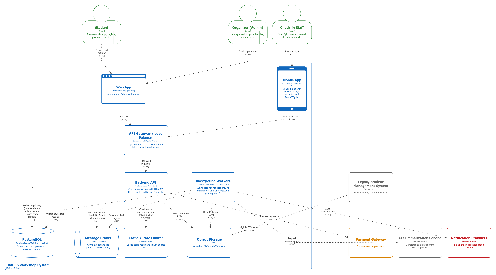
  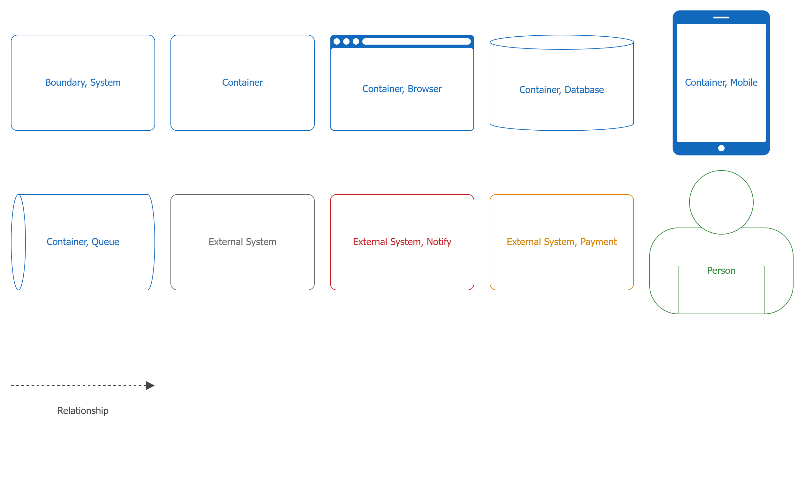
</p>

| Container                       | Technology Stack                   | Deployment Target                 | Architectural Purpose                                                                                                                                                                                                         |
| :------------------------------ | :--------------------------------- | :-------------------------------- | :---------------------------------------------------------------------------------------------------------------------------------------------------------------------------------------------------------------------------- |
| **Web App**                     | React, TypeScript                  | Local Docker                      | Responsive web portal for Students and Organizers; performs client-side validation, renders QR confirmations, authenticates users (JWT), and communicates with the API via the local gateway.                                 |
| **Mobile App**                  | React Native, TypeScript           | Physical Mobile Device / Emulator | Offline-first check-in application for Check-in Staff; captures scans, queues events locally, and syncs batched events to the backend when connectivity permits.                                                              |
| **Local SQLite Database**       | SQLite                             | Local Device Storage              | Offline-first queue for pending check-in events; provides durable local persistence, idempotent upserts, and deterministic reconciliation during batch syncs.                                                                 |
| **API Gateway / Load Balancer** | Nginx                              | Local Docker                      | Edge routing, load balancing, and Token Bucket rate limiting for incoming HTTP traffic inside the local Docker network; forwards validated requests to the Core Backend Monolith.                                             |
| **Core Backend Monolith**       | Java, Spring Boot, Spring Modulith | Local Docker                      | Implements authoritative domain logic, module-level event publication registry, outbox pattern for reliable event externalization, transactional seat allocation, and payment orchestration.                                  |
| **Background Workers**          | Java, Spring Boot, Spring Batch    | Local Docker                      | Executes deferred tasks: AI PDF summarization, notification delivery, and nightly CSV ingestion. Consumes brokered events, interacts with object storage and external APIs, and persists async results to the cloud database. |
| **PostgreSQL**                  | PostgreSQL                         | Neon Cloud Service                | Authoritative transactional datastore for registrations, payments, and attendance. Requires JDBC over SSL/TLS for encrypted access from local services.                                                                       |
| **Search Engine**               | Elasticsearch                      | Local Docker                      | Offloads read-heavy full-text search queries, enabling high-performance workshop discovery without impacting primary database transactions.                                                                                   |
| **Cache / Rate Limiter**        | Redis                              | Local Docker                      | Cache-aside reads for performance and shared token-bucket counters used by the gateway for admission control and rate limiting.                                                                                               |
| **Message Broker**              | RabbitMQ                           | Local Docker                      | Reliable, decoupled queues for event-driven processing, worker retries, and dead-letter handling; integrates with the Core Backend Monolith via the outbox pattern.                                                           |
| **Object Storage**              | MinIO / S3-compatible              | Local Docker                      | Stores unstructured assets (PDFs and nightly CSV drops); accessed via the S3 API by workers and the Core Backend for ingestion and processing.                                                                                |

## 3. High-Level Architecture Diagram

### System Architecture Diagram

**Key architectural characteristics:**

- Horizontally scaled Core Backend Monolith instances (Node 1 and Node 2) behind a Local Docker edge using Nginx for HTTP routing and admission control.
- Local Docker runtime for gateway, backend, workers, cache, broker, and object storage; Neon PostgreSQL is hosted as a Cloud Service requiring encrypted JDBC connections.
- Event-driven decoupling via Spring Modulith event publication registry and RabbitMQ-backed worker pipelines for async AI summarization and CSV ingestion.
- Offline-first mobile check-in with a local SQLite queue and batched reconciliation to the cloud-backed authoritative store.

<p align="center">
  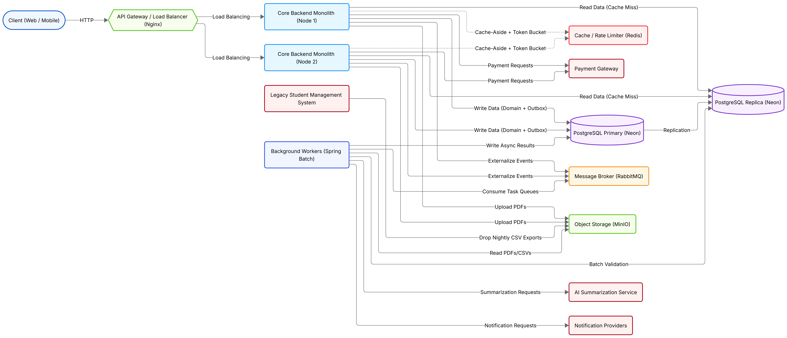
</p>

| Architectural Pattern              | Implementation Details                                                                                                                                                                                                                                                                                         |
| :--------------------------------- | :------------------------------------------------------------------------------------------------------------------------------------------------------------------------------------------------------------------------------------------------------------------------------------------------------------- |
| **Gateway / Traffic Distribution** | Nginx acts as a pure reverse proxy and load balancer, routing incoming HTTP requests across Core Backend Monolith instances.                                                                                                                                                                                   |
| **Cache & Rate Limiting**          | Core Backend Monoliths enforce distributed Token Bucket admission control (via Bucket4j) at the application filter layer, using Redis for shared counters and cache-aside reads.                                                                                                                               |
| **Read / Write Separation**        | Core Backend Monoliths read from Neon PostgreSQL replicas on cache misses and write domain data plus outbox publications to the Neon PostgreSQL primary; all database access uses JDBC over SSL/TLS.                                                                                                           |
| **Worker Responsibilities**        | Background Workers consume brokered events from RabbitMQ, execute AI summarization, notification dispatch, and nightly CSV ingestion, and persist async results to Neon PostgreSQL.                                                                                                                            |
| **Broker Integration**             | Spring Modulith externalizes events to RabbitMQ; workers consume tasks, perform retries/backoff, and route failures to DLQs when necessary.                                                                                                                                                                    |
| **CQRS & Search Optimization**     | To protect the primary PostgreSQL database from CPU-intensive full-text search queries under heavy load, the system utilizes Elasticsearch. The Core Backend writes to PostgreSQL, while Background Workers asynchronously synchronize the data to Elasticsearch, which exclusively serves all search traffic. |

### Workshop Registration Flow

The workshop registration process is designed to handle high-concurrency registration spikes (up to 12,000 requests within a 10-minute window) while ensuring strict zero-overbooking and exactly-once processing guarantees.

**Registration statuses:**

- `PENDING`: Temporary reservation. Slot is deducted in Redis, and the system is awaiting a synchronous payment callback, an asynchronous webhook, or a background reconciliation sweep.
- `CONFIRMED`: Fully finalized registration. The seat is permanently locked in the database, the transaction is verified, and the check-in QR code is activated.
- `FAILED`: Failed or abandoned registration due to payment errors, explicit timeouts, or capacity rejection. Inventory is safely returned.
- `CANCELED`: Registration explicitly canceled by the student or an organizer prior to the event execution.

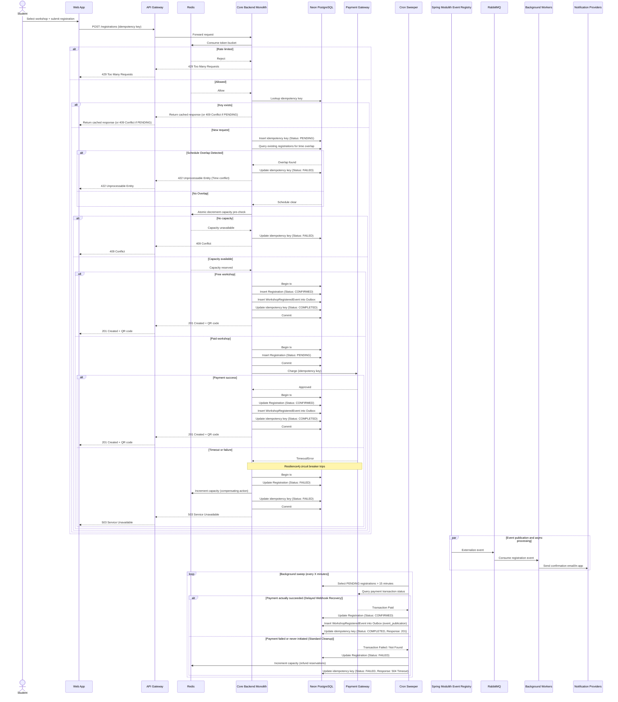

- **Distributed Rate Limiting Location:** The rate limiting logic (via Bucket4j) is evaluated directly within the application filter layer of the Core Backend Monolith using shared Redis nodes for state counters, preventing Nginx from needing direct data tier couplings.
- **Lock-Free Concurrency Chokepoint:** To sustain 12,000 concurrent requests without hitting database row contention or thread pool depletion, capacity checks are offloaded entirely to Redis via an atomic decrement operation. The database transaction is only opened after capacity is verified.
- **Idempotency Lifecycle (Strict State Management):** The system completely guards against double-booking and duplicate charges by tracking the idempotency key state through three phases: `PENDING` (acts as a concurrent lock), `COMPLETED` (serves cached payloads), and `FAILED` (safely releases the lock for client retries).
- **Transactional Outbox Implementation:** To eliminate distributed transaction vulnerability, event emission is tightly integrated with domain operations. The registration record modifications and event storage occur in the same database transaction, natively mapped to Spring Modulith’s `event_publication` table.
- **Dual-Case Reconciliation Sweeper:** The background cleanup job acts as a defensive synchronization boundary. Instead of blindly cancelling expired `PENDING` states, it first issues an API call to the Payment Gateway. If a webhook was lost but payment succeeded, it heals the state to `CONFIRMED`. If the checkout was abandoned, it marks it as `FAILED`, refunds the Redis capacity, and unlocks the idempotency state.

### Workshop Lifecycle Management Flow

This sequence captures the admin-driven workshop lifecycle and the event-driven propagation of changes to downstream services.

**Workshop statuses:**

- `DRAFT`: Initial state upon creation. Visible only to the creating Organizer. No search synchronization or external events.
- `PUBLISHED`: Made public by the Organizer. Active and searchable in Elasticsearch. Open for student registrations.
- `CANCELED`: Aborted mid-lifecycle. Triggers student notifications and removal from active search listings.
- `COMPLETED`: Automatically transitioned by the system sweeper when the current time passes the workshop's end time.

```mermaid
sequenceDiagram
  actor Organizer
  participant Web as Admin Web App
  participant GW as API Gateway (Nginx)
  participant API as Core Backend Monolith
  participant DB as Neon PostgreSQL
  participant Sweeper as Cron Sweeper
  participant Registry as Spring Modulith Event Registry
  participant Broker as Message Broker (RabbitMQ)
  participant Worker as Background Workers
  participant ES as Elasticsearch
  participant Notify as Notification Providers

  Note over Organizer,Notify: CREATE OPERATION
  Organizer->>Web: Click "Save Draft"
  Web->>GW: POST /api/v1/workshops
  GW->>API: Forward Request
  API->>DB: Verify ownership (Bypassed for Create)
  API->>DB: Insert Workshop record (Status: DRAFT)
  DB-->>API: Row persisted
  API-->>GW: 201 Created (Draft Saved)
  GW-->>Web: 201 Created
  Web-->>Organizer: Show Draft Status in UI

  Note over Organizer,Notify: PUBLISH OPERATION
  Organizer->>Web: Click "Publish Workshop"
  Web->>GW: PATCH /api/v1/workshops/{id}/publish
  GW->>API: Forward Request
  API->>DB: Verify ownership (organizer_id == jwt.sub)
  alt Unauthorized
    DB-->>API: Ownership mismatch
    API-->>GW: 403 Forbidden
    GW-->>Web: 403 Forbidden
    Web-->>Organizer: 403 Forbidden
  else Authorized
    API->>DB: Select current_status from workshops
    DB-->>API: current_status: STATUS
    alt current_status == DRAFT
      API->>DB: Update Workshop (Status: PUBLISHED)
      API->>DB: Insert WorkshopPublishedEvent into Outbox
      DB-->>API: Transaction committed
      API-->>GW: 200 OK (Workshop Published)
      GW-->>Web: 200 OK
      Web-->>Organizer: Show Published Status in UI
    else
      API-->>GW: 422 Unprocessable Entity (Invalid State Transition)
      GW-->>Web: 422 Unprocessable Entity
      Web-->>Organizer: 422 Unprocessable Entity
    end
  end

  Note over Organizer,Notify: UPDATE OPERATION
  Organizer->>Web: Click "Save Changes"
  Web->>GW: PUT /api/v1/workshops/{id}
  GW->>API: Forward Request
  API->>DB: Verify ownership (organizer_id == jwt.sub)
  alt Unauthorized
    DB-->>API: Ownership mismatch
    API-->>GW: 403 Forbidden
    GW-->>Web: 403 Forbidden
    Web-->>Organizer: 403 Forbidden
  else Authorized
    API->>DB: Select current_status from workshops
    DB-->>API: current_status: STATUS
    alt current_status == COMPLETED or current_status == CANCELED
      API-->>GW: 422 Unprocessable Entity (Modification Blocked)
      GW-->>Web: 422 Unprocessable Entity
      Web-->>Organizer: 422 Unprocessable Entity
    else
      alt current_status == PUBLISHED
        API->>DB: Query current registered student count
        DB-->>API: registered_count
        API->>API: Validate immutable fields & ensure capacity >= registered_count
        alt Payload modifies immutable core fields or reduces capacity below registered count
          API-->>GW: 422 Unprocessable Entity (Invalid Core Modification)
          GW-->>Web: 422 Unprocessable Entity
          Web-->>Organizer: 422 Unprocessable Entity
        else
          API->>DB: Update Workshop Details (non-core fields)
          API->>DB: Insert WorkshopUpdatedEvent into Outbox
          DB-->>API: Transaction committed
          API-->>GW: 200 OK
          GW-->>Web: 200 OK
        end
      else current_status == DRAFT
        API->>DB: Update Workshop Details (all fields allowed)
        Note over API,DB: DRAFT changes do not generate outbox events
        DB-->>API: Transaction committed
        API-->>GW: 200 OK
        GW-->>Web: 200 OK
      end
    end
  end

  Note over Organizer,Notify: RESCHEDULE OPERATION
  Organizer->>Web: Change Date/Time & Click "Reschedule"
  Web->>GW: PATCH /api/v1/workshops/{id}/reschedule
  GW->>API: Forward Request
  API->>DB: Verify ownership (organizer_id == jwt.sub)
  alt Unauthorized
    DB-->>API: Ownership mismatch
    API-->>GW: 403 Forbidden
    GW-->>Web: 403 Forbidden
    Web-->>Organizer: 403 Forbidden
  else Authorized
    API->>DB: Select current_status from workshops
    DB-->>API: current_status: STATUS
    alt current_status == DRAFT or current_status == COMPLETED or current_status == CANCELED
      API-->>GW: 422 Unprocessable Entity (Reschedule Restricted to Published)
      GW-->>Web: 422 Unprocessable Entity
      Web-->>Organizer: 422 Unprocessable Entity
    else
      API->>API: Validate new_start_time/new_end_time (must be future and start < end)
      alt new_start_time < NOW or new_end_time <= new_start_time
        API-->>GW: 422 Unprocessable Entity (Invalid Temporal Range)
        GW-->>Web: 422 Unprocessable Entity
        Web-->>Organizer: 422 Unprocessable Entity
      else
        API->>DB: Resource Collision Check (location/speaker overlap within time window)
        alt Collision Found
          DB-->>API: Collision Found
          API-->>GW: 422 Unprocessable Entity (Resource Conflict)
          GW-->>Web: 422 Unprocessable Entity
          Web-->>Organizer: 422 Unprocessable Entity
        else Schedule Clear
          DB-->>API: Schedule Clear
          API->>DB: Update Workshop Schedule (Status remains current)
          API->>DB: Insert WorkshopRescheduledEvent into Outbox
          DB-->>API: Transaction committed
          API-->>GW: 200 OK
          GW-->>Web: 200 OK
          Web-->>Organizer: 200 OK
        end
      end
    end
  end

  Note over Organizer,Notify: CANCEL OPERATION
  Organizer->>Web: Click "Cancel Workshop"
  Web->>GW: PATCH /api/v1/workshops/{id}/cancel
  GW->>API: Forward Request
  API->>DB: Verify ownership (organizer_id == jwt.sub)
  alt Unauthorized
    DB-->>API: Ownership mismatch
    API-->>GW: 403 Forbidden
    GW-->>Web: 403 Forbidden
    Web-->>Organizer: 403 Forbidden
  else Authorized
    API->>DB: Select current_status from workshops
    DB-->>API: current_status: STATUS
    alt current_status == CANCELED or current_status == COMPLETED
      API-->>GW: 422 Unprocessable Entity (Invalid State)
      GW-->>Web: 422 Unprocessable Entity
      Web-->>Organizer: 422 Unprocessable Entity
    else
      API->>DB: Update Workshop (Status: CANCELED)
      API->>DB: Insert WorkshopCanceledEvent into Outbox
      DB-->>API: Transaction committed
      API-->>GW: 200 OK
      GW-->>Web: 200 OK
      Web-->>Organizer: Show Canceled Status in UI
    end
  end

  Note over Organizer,Notify: AUTOMATED LIFECYCLE SWEEPER
  loop Hourly Sweep
    Sweeper->>DB: Query PUBLISHED workshops where end_time < NOW
    DB-->>Sweeper: Return expired workshop ids
    Sweeper->>DB: Bulk Update Workshop (Status: COMPLETED)
    DB-->>Sweeper: Acknowledge bulk update
    Sweeper->>DB: Bulk Insert WorkshopCompletedEvent into Outbox
    DB-->>Sweeper: Acknowledge bulk insert
  end

  Note over Organizer,Notify: ASYNCHRONOUS EVENT FAN-OUT
  Note over API,Registry: Events are only externalized by the Registry component which reads event_publication post-commit
  Note over Registry,Broker: Spring Modulith Transactional Outbox Event Fabric
  Registry->>Broker: Externalize domain events from event_publication
  Broker->>Worker: Deliver domain events
  alt Event is Published or Updated or Rescheduled
    Worker->>ES: Sync/Upsert Workshop data to Elasticsearch Index
  else Event is Completed or Canceled
    Worker->>ES: Remove or mark inactive in Elasticsearch Index
  end
  alt Event is Rescheduled or Canceled
    Worker->>DB: Fetch registered student list for this workshop
    DB-->>Worker: Return student list
    Worker->>Notify: Send bulk automated emails/push notifications
  end

  Note over API,ES: DRAFT records are never synchronized to Elasticsearch and generate no external events until transition to PUBLISHED
```

- **State Machine Enforcement:** The system enforces strict transitions: `DRAFT` -> `PUBLISHED` -> `COMPLETED` or `CANCELED`. Once a workshop reaches a terminal state (`COMPLETED` or `CANCELED`), the API layer strictly blocks any further mutations and returns `422 Unprocessable Entity` for attempts to modify the record.
- **Data Ownership & Core Validation:** Modification endpoints validate `jwt.sub` against the workshop's `organizer_id` prior to mutation (skipped for `Create`). The `PUT`/`PATCH` handlers dynamically evaluate the current status: full updates are allowed while in `DRAFT`; once `PUBLISHED`, core fields (for example `price`) are immutable and any attempt to change them or reduce capacity below current registrations is rejected with `422 Unprocessable Entity` to protect active attendees.
- **Automated Event Completion Sweeper:** A dedicated `Sweeper` cron component runs hourly. It queries the database for expired `PUBLISHED` workshops, marks them `COMPLETED`, and writes `WorkshopCompletedEvent` entries into the transactional outbox for downstream processing.
- **Granular Asynchronous Branching:** The `Registry` component (not the API) extracts committed outbox rows and externalizes them to the message broker. Background workers synchronize to Elasticsearch on publication, updates, rescheduling, and completion events (keeping `DRAFT` items completely isolated); mass notification flows are executed only for disruptive events (`RESCHEDULED`, `CANCELED`).
- **Strict Reschedule Guarantees:** The reschedule endpoint is explicitly blocked for `DRAFT`, `COMPLETED`, or `CANCELED` states. Rescheduling requires a `PUBLISHED` workshop, validates that proposed times are future and form a valid range, and runs a PostgreSQL-level resource collision check (location and speaker availability) to prevent double-booking. Any validation failure returns `422 Unprocessable Entity` and the transaction is not committed.

### Workshop Search & Cache-Aside Flow

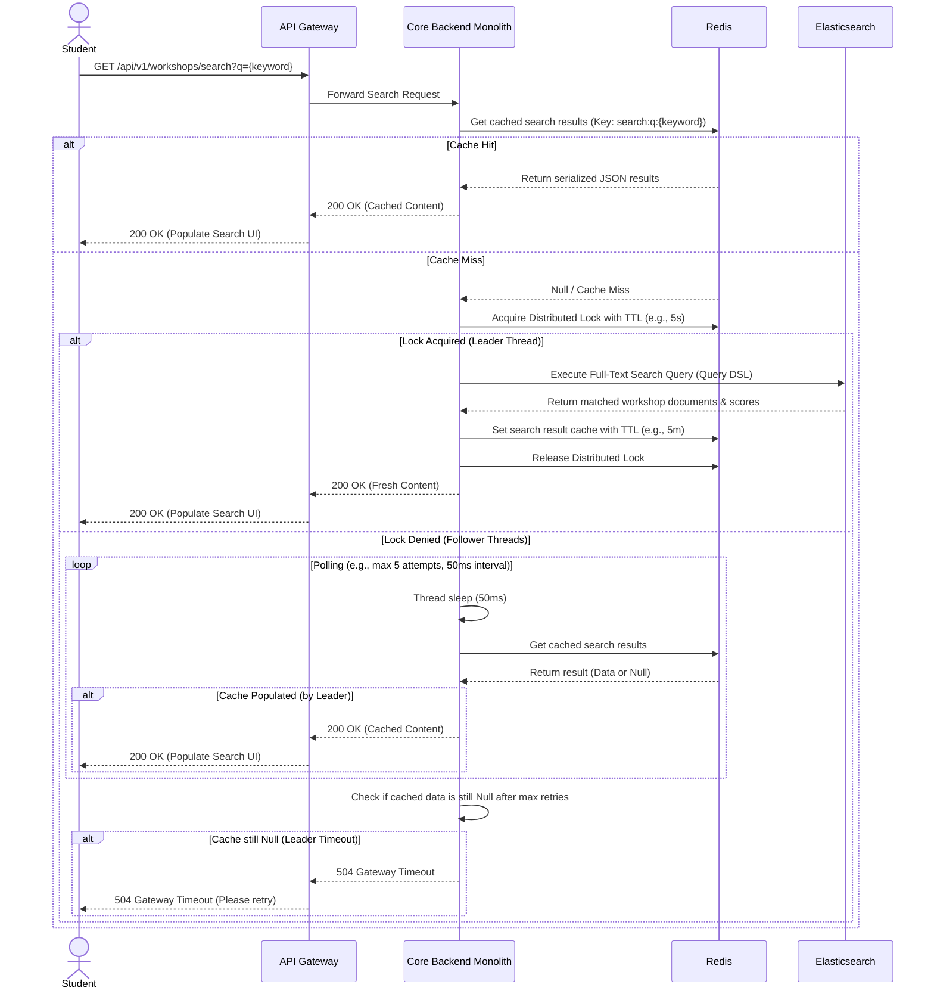

- **Offloading the Transactional Database:** Full-text search is fully decoupled from PostgreSQL. The primary ACID database no longer performs `to_tsvector` searches; instead Elasticsearch serves as the dedicated CQRS read model, protecting Neon PostgreSQL from high-volume read traffic and heavy text vector processing.
- **Multi-Tiered Performance Optimization:** The system implements a Cache-Aside pattern where Redis is the first line of defense for sub-millisecond reads. On a cache miss the API falls back to Elasticsearch Query DSL for powerful, typo-tolerant full-text queries and scoring across large datasets, providing sub-second responses under high concurrency.
- **Cache Invalidation and TTL Strategy:** Search results are cached in Redis with a strict TTL (e.g., 5 minutes) to balance freshness with throughput protection. To prevent "Cache Stampedes" (the Thundering Herd problem) when the TTL expires under heavy load, the system employs a Redis-backed Distributed Lock with a Spin-lock/Polling mechanism for follower threads. On a cache miss, only a single leader thread queries Elasticsearch while concurrent follower threads utilize a polling loop (retrying up to 5 times with a 50ms interval) to repeatedly check the cache until the leader successfully populates it, eliminating race conditions and ensuring stability even during unpredictable search engine latency spikes. Furthermore, the distributed lock is assigned a short TTL (e.g., 5 seconds) to guarantee the system recovers from leader thread crashes, preventing irreversible deadlocks. If follower threads exhaust their polling limits without receiving data, they are designed to fail-fast with a 504 Gateway Timeout rather than hanging the client connection, ensuring predictable degradation. Eviction and invalidation strategies are employed when content changes (publish/reschedule/cancel) to keep read-models consistent.

### Offline Check-in & Synchronization Flow

This sequence illustrates offline capture, local persistence, and server-authoritative reconciliation that prevents duplicate attendance records.

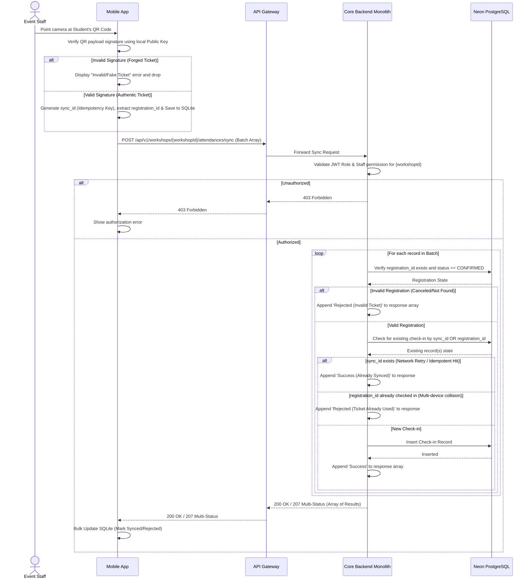

- **Offline-first capture:** The mobile app records scans locally to keep check-in operational during network drops.
- **Gateway-routed synchronization:** When connectivity returns, the mobile app submits sync batches through the API Gateway (Nginx), enabling centralized TLS termination, perimeter controls, and rate limiting before traffic reaches the Core Backend Monolith.
- **Role-based security guard:** The backend explicitly validates cryptographically-signed JWT claims (signed using the system's Asymmetric Private Key) and enforces that only `STAFF` or `ORGANIZER` roles can submit check-in payloads; unauthorized callers are rejected with `403 Forbidden`.
- **Asymmetric Cryptography for Offline Authentication:** To prevent ticket forgery in a disconnected environment, the system utilizes a Public/Private Key Pair. The Core Backend signs the QR code payload (containing the `registration_id`) using its Private Key. The Check-in Mobile App securely stores the corresponding Public Key. During offline scanning, the app cryptographically verifies the signature to instantly drop forged tickets. This delegates the Proof of Issuance to the offline device, while the backend later handles the Proof of Validity (cancellations and ticket sharing) during the online batch synchronization.
- **HTTP bulk consistency pattern:** The mobile client sends an array of records in one request, the API processes each record iteratively against PostgreSQL idempotency checks, and the server returns one unified `200/207` array response, preventing fragmented per-row HTTP replies.
- **Registration Integrity Validation (Zero-Trust Offline Payload):** Because offline mobile payloads are inherently untrusted, the API does not blindly accept check-ins. During batch synchronization, the backend strictly verifies the embedded `registration_id` from the QR code against the authoritative database. If a student attempts to use a forged QR code or a ticket that was explicitly canceled or refunded (status != `CONFIRMED`), the backend silently rejects that specific record within the batch, ensuring absolute on-site security and accurate attendance reconciliation.
- **Multi-Device Collision & Double-Scan Prevention:** In an offline-first environment, a student might share their QR code with another person and both could be scanned by different staff devices while offline. When batches are synced, the API checks both the `sync_id` and the `registration_id`. If the `sync_id` already exists, it is treated as a network retry and returned as success to clear the mobile queue. If a different `sync_id` attempts to claim an already-used `registration_id`, the backend identifies the collision and silently rejects the anomalous record, enforcing one-ticket-one-entry at the point of reconciliation.

### Async AI Summarization Flow

This sequence shows the asynchronous pipeline for PDF processing using the Spring Modulith event publication registry and brokered workers, including error handling when the AI service is unavailable.

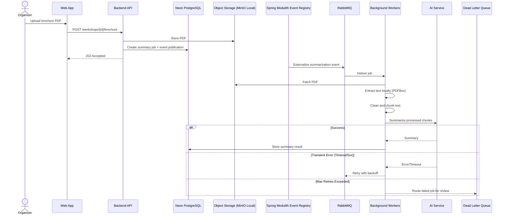

- **Decoupled processing:** The API persists the job and event publication entry, then returns 202 so heavy PDF processing runs asynchronously.
- **Local preprocessing:** The worker extracts, cleans, and chunks text before calling the AI service to avoid oversized payloads and token limit errors.
- **Fault tolerance:** Transient AI failures trigger backoff retries through the broker without blocking other jobs.
- **Dead Letter Queue (DLQ):** Jobs that exceed retry limits are routed to the DLQ for manual review, keeping the main queue healthy.

### Nightly Legacy CSV Ingestion Flow

This flowchart represents the nightly batch pipeline, showing fault-tolerant parsing, validation, and row-level quarantine without failing the entire job.

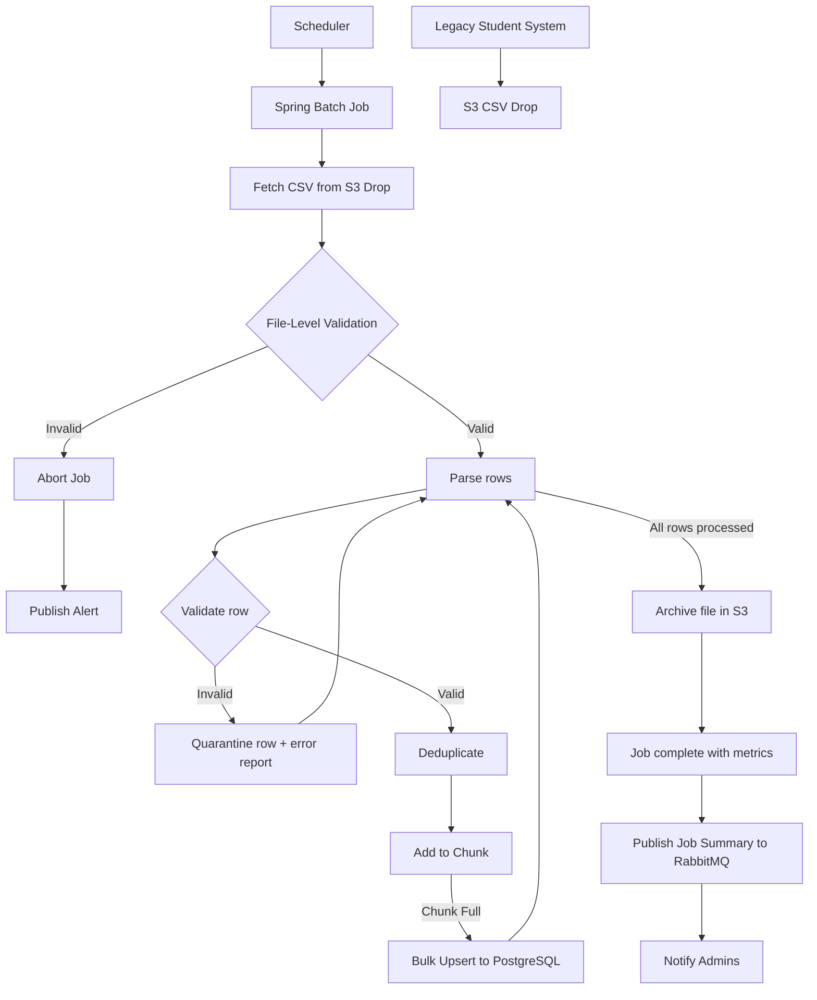

- **File-level guardrails:** Header and size validation prevents corrupted or malformed uploads from crashing the batch job.
- **Chunk-oriented processing:** Valid rows are buffered and upserted in bulk to maximize throughput and avoid connection exhaustion.
- **Fault tolerance & quarantining:** Invalid rows are isolated into a quarantine report while the job continues.
- **Archiving strategy:** Processed files are moved to an archive folder to prevent accidental reprocessing.
- **Proactive alerting:** Job summaries (success and quarantined counts) are published to RabbitMQ to notify administrators.

## 4. Access Control Design

### RBAC Model & User Personas

We use **Role-Based Access Control (RBAC)** with role claims enforced at the API and UI layers.

| Role        | Access Rights                                                                                      |
| :---------- | :------------------------------------------------------------------------------------------------- |
| `STUDENT`   | View published workshops, register for workshops, view their own QR codes.                         |
| `ORGANIZER` | Create/update/cancel workshops, upload PDF brochures, view attendee lists for their own workshops. |
| `STAFF`     | View workshop details assigned to them and submit offline check-in sync batches.                   |

Database roles and Spring Security authorities are stored and processed strictly as plain domain values. The authentication layer **does not** prepend `ROLE_` when issuing JWTs or constructing authorities.

### Stateless JWT & Role Claims

The API Gateway and Backend Services do not query PostgreSQL for permissions on every request. They trust a cryptographically signed JWT and perform `O(1)` authorization checks using the embedded role claim.

**Example decoded JWT payload:**

```json
{
  "sub": "1b8f8c7b-2e4b-4f6c-9b3b-6b8d2f0c9a12",
  "role": "ORGANIZER",
  "iat": 1767225600,
  "exp": 1767229200,
  "jti": "9c1f6c23-0f5d-4f8b-9f51-2d5f3a2f1d9e"
}
```

- **Client usage (React / React Native):** The client decodes the role claim to drive the UI, such as hiding the "Create Workshop" action for STUDENT.
- **Server usage (Spring Boot):** The API enforces access via the role claim using authority checks (for example, `@PreAuthorize("hasAuthority('ORGANIZER')")`) and uses `sub` for row-level ownership checks.

### Multi-Layer Enforcement Points

- **Layer 1: UI/Client Layer (React & Mobile):** The client decodes the JWT to gate UI elements (hide menus, disable routes) for user experience. This improves UX but is not a security control.
- **Layer 2: API Gateway & Controller Layer (Endpoint Security):** Requests are intercepted, JWT signatures are verified, and endpoint access is enforced by role claims (for example, `@PreAuthorize`). This blocks a Student from calling Organizer endpoints directly.
- **Layer 3: Business/Data Layer (Data Ownership):** Services enforce ownership checks beyond role validation. For example, `PUT /workshops/{id}` verifies `ROLE_ORGANIZER` and confirms `workshops.organizer_id == jwt.sub` to prevent cross-tenant tampering.

### Authorization Sequence Diagram

This diagram illustrates the defense-in-depth strategy using an Organizer attempting to edit a workshop, showing how each layer prevents unauthorized access.


- **Layer 1 (UX/UI Gating):** Provides immediate feedback and hides restricted features from unauthorized users, but is cosmetic and can be bypassed.
- **Layer 2 (Endpoint Gating):** The API gateway and Spring Security boundary require a `ROLE_ORGANIZER` claim for `PUT /workshops/{id}`.
- **Layer 3 (Data Gating):** The service enforces ownership by matching `workshops.organizer_id` with `jwt.sub`, preventing IDOR attacks.

## 5. System Protection Mechanisms

### Traffic Spike Management

Registration demand peaks at 12,000 concurrent users within the first 10 minutes, with 60% concentrated in the initial 3-minute window. To keep the backend stable under that burst, the API Gateway enforces a distributed **Token Bucket** rate limiter using **Bucket4j** with **Redis** as the shared state store.

Each user or IP is assigned a bucket with a fixed capacity of tokens. Every `POST /registrations` request consumes a token, and tokens refill at a steady rate. This allows short bursts during the first 3 minutes while still capping sustained throughput, preventing the registration service and database from being overwhelmed.

When a bucket is empty, the gateway rejects the request with HTTP `429 Too Many Requests`. The frontend shows a simple "Please wait" message and retries with backoff, protecting the system while keeping the user informed.

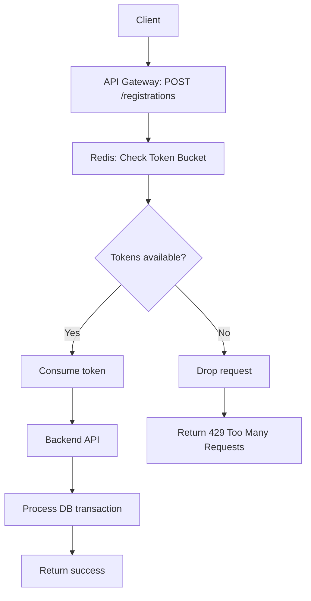

### Third-Party Service Resilience

External payment gateways are inherently unreliable due to network latency, timeouts, and partial outages. If the backend waits on slow payment calls, request threads queue up and can exhaust the Spring Boot thread pool, causing a cascading failure across the UniHub system.

To prevent this, the payment integration uses a Circuit Breaker implemented with Resilience4j. The breaker continuously tracks failure rate and slow-call rate; when thresholds are exceeded, it opens and blocks further payment calls.

When the circuit is open, the system fails fast instead of hanging. It returns an immediate error or places the registration in a "Payment Pending" state so users can retry later, while free workshop registration and browsing remain fully operational.

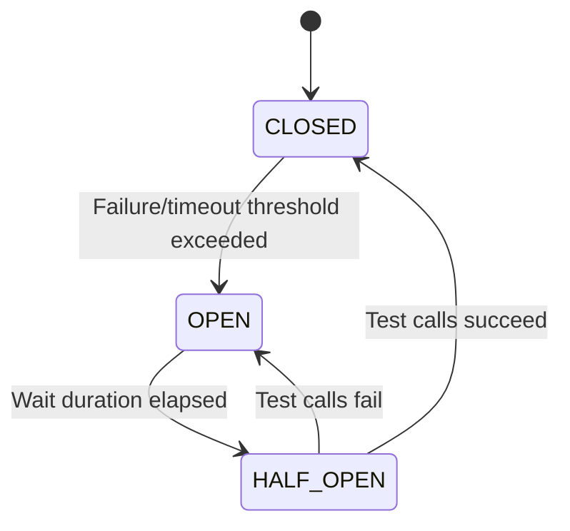

### Transaction Idempotency

Client retries caused by network drops or impatient clicks can create duplicate `POST /registrations` requests, risking double-booking or double-charging. The system enforces exactly-once processing with an idempotency key strategy backed by PostgreSQL.

- **Key generation and transmission:** The React / React Native client generates a UUIDv4 and sends it in the `Idempotency-Key` header.
- **Storage and duplicate detection:** The backend stores keys in `IDEMPOTENCY_KEYS` with a `UNIQUE` constraint, creating a database-level barrier against race conditions.
- **Workflow:** On the first attempt, the key is inserted, the payment is processed, and the final response payload is serialized and stored with the key. On a retry, the API finds the existing key and immediately returns the cached response, bypassing the payment gateway and write logic.
- **TTL configuration:** Each key includes an `expires_at` timestamp (for example, 24 hours), and a scheduled cleanup job deletes expired records to prevent table bloat.


