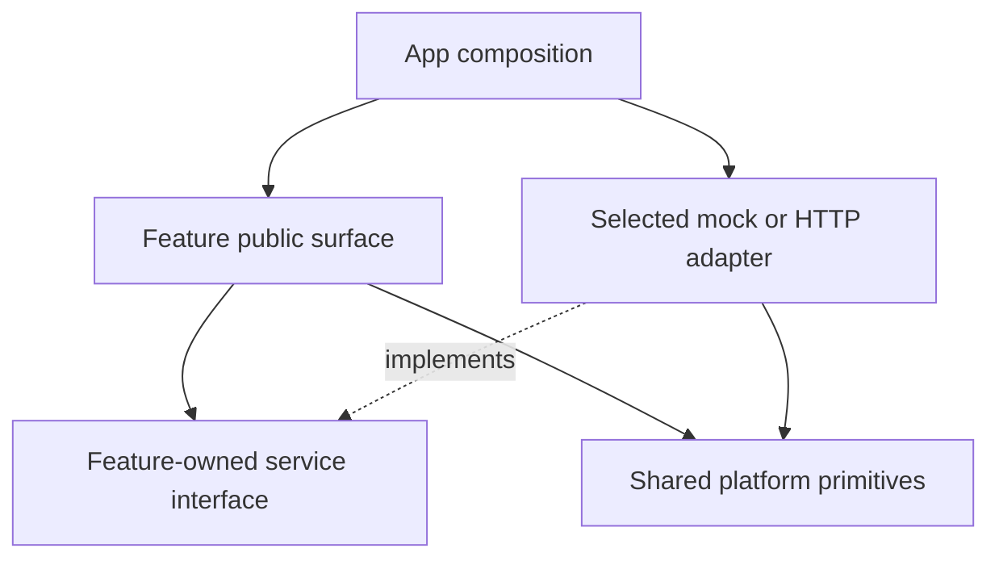

# Mobile Source Structure

> Architecture target for `apps/mobile/`. The source tree is created during application setup and approved capability implementation. Directory names describe responsibilities; build tools, routing, state libraries, styling and test runners are selected in their setup scope.

## Directory Layout

```text
apps/mobile/
├── AGENTS.md
├── src/
│   ├── app/                        # Application composition and lifecycle
│   │   ├── entry/                  # Selected framework entry adapters
│   │   ├── navigation/             # Route/screen composition and access UX
│   │   ├── providers/              # Dependency and context providers
│   │   ├── services/               # Select fake or approved HTTP adapters
│   │   └── config/                 # Validated public runtime configuration
│   ├── features/
│   │   └── <capability>/           # Create only for an approved capability
│   │       ├── index.ts            # Explicit public exports
│   │       ├── screens/              # Feature entry views
│   │       ├── ui/                 # Feature controls and compositions
│   │       ├── model/              # Client types, validation and state transitions
│   │       ├── services/           # Feature operations and owned service interfaces
│   │       ├── data/
│   │       │   ├── mock/           # Deterministic service fake and scenarios
│   │       │   └── http/           # Approved contract adapters and wire mappers
│   │       └── testing/            # Reusable feature fixtures/builders
│   ├── shared/
│   │   ├── ui/                     # Approved reusable platform design primitives
│   │   ├── lib/                    # Small reusable platform-independent helpers
│   │   ├── transport/              # HTTP/SSE mechanics, cancellation, typed errors
│   │   ├── platform/               # Browser/native capability adapters
│   │   └── testing/                # Common rendering and scenario-reset helpers
│   └── assets/                     # App-owned fonts, icons and static assets
└── tests/
    ├── journeys/                   # Persistent cross-feature UI acceptance tests
    └── fixtures/                   # Cross-feature deterministic scenarios
```

Feature-local tests are colocated with their subject as `*.test.ts` or `*.test.tsx`; `testing/` holds reusable helpers rather than all tests. Test filenames/runner adapters are finalized with tooling. Create subfolders when files need them, not empty trees for every capability. The HTTP folder is introduced for approved integration work; mocks remain available for regression.

## Internal Module Communication

- `app/` composes feature entrypoints, providers, navigation and service implementations. Business rules stay with their owning feature.
- A feature may import its own files and deliberate shared exports. Other features' internals are private. Cross-feature journeys are composed in `app/` through named feature exports and explicit callbacks/interfaces; move a concept to shared only after actual reuse demonstrates common ownership.
- `shared/` cannot import `features/` or `app/`. Keep generic transport mechanics separate from feature-specific requests, mappings and error/state decisions. Avoid application-wide dumping folders for types, hooks, stores or utils.
- `index.ts` exports only the intended feature surface. Use direct module imports internally; do not generate broad re-export barrels or state-store dependencies between unrelated features.
- No client code imports backend/worker packages, persistence entities or server DTO implementations. Web and mobile do not import one another's feature code; a shared package requires a separate evidenced ownership decision.



## Client Data and Service Boundary

The feature owns client models, state transitions, service inputs/results and test seams. Views invoke those operations without knowing whether data came from a fake or HTTP. Composition selects implementations; components never branch on a global mock flag. Mock transport cannot leak requests to a real provider. Scenario controls are outside the product flow, resettable and unavailable in production.

During `client-integrate`, the HTTP adapter maps the approved public contract into client models, including errors, pagination, retry and live-update reconciliation where relevant. Keep wire types at this adapter boundary; generate them only from the approved contract/tooling when available. Missing API capability is a contract gap, not permission to redesign accepted UI or change server code.

Keep state as close as possible to its owner. Derive values when practical; share state only for a demonstrated journey requirement. Data transport/caching and screen draft/interaction state have separate owners. Do not select Redux, a cache library or a dependency injection framework from this directory diagram.

## Verification and Design Artifacts

Use the platform ui-design.md and capability prototype for visual/interaction review. Specs/prototypes/approval records live outside app source in `specs/client/mobile/`; experience maps and the UI baseline live in `docs/client/mobile/`. Unit/component tests verify testable model/service/view behavior; journey tests cover composed behavior against resettable fixtures. Mock checks do not certify provider behavior.

Enforce feature/public-surface and shared-dependency rules using tooling selected during app setup. Lint/typecheck and test commands are recorded then; no runner/config is created by this document.

## Native Capabilities, Local Persistence and Sync

Add `data/local/` under the feature that owns durable data: repository implementation, local mappings and feature migrations. Attendance capture and synchronization share an explicitly owned attendance boundary; do not coordinate independent mutable copies of the attendance queue in multiple features. The approved sync/key/attendance requirements determine its interface.

`shared/platform/` owns device capability adapters such as SQLite connection/transaction mechanics, camera access, secure storage and connectivity observation. Feature-specific queries, table ownership, queue rules and conflict handling remain in the owning feature. `app/` composes migration registration, startup/login/logout and foreground/background lifecycle with those feature interfaces. Connectivity signals are hints; operation results determine success/retry, and replay behavior must be deterministic.

Keep Android/iOS differences next to the affected module using platform-specific files when substantial, or a small platform branch when trivial. Navigation/filesystem routing entrypoints belong to the selected framework adapter; if it requires a root `app/` directory, keep that directory thin and map it to the composition responsibilities above. Do not put business logic in route files.

Native acceptance uses physical-device checks for camera/QR, permissions, SQLite durability, offline synchronization, keyboard and relaunch behavior. Component/HTML results do not prove native rendering. Device access and human fallback follow mobile rules; persistent native test tooling is selected during app setup.

## References

- [Product catalog](../../product-features.md)
- [Client ADRs](../adrs/README.md)
- [Shared ADRs](../../adrs/README.md)
- [Public contracts](../../../contracts/http/README.md)
- [Client workflow](../../../.agents/workflows/client.md)
- [Feature folders (Redux documentation)](https://redux.js.org/faq/code-structure/)
- [Component responsibility and minimal state (React)](https://react.dev/learn/thinking-in-react)
- [Platform-specific modules (React Native)](https://reactnative.dev/docs/platform-specific-code.html)
