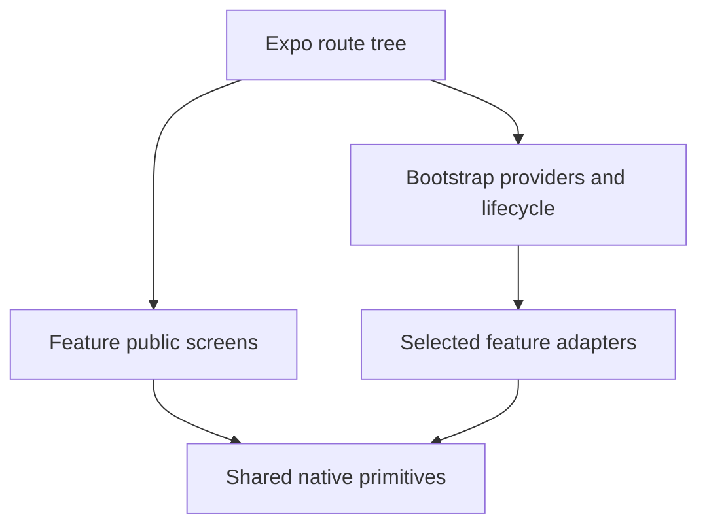

# Mobile Source Structure

## Scope

React Native and TypeScript run through Expo with Expo Router in `apps/mobile/`. This guide defines the target architecture, including offline attendance responsibilities; minimal starter code remains until the owning setup/feature task implements each part. Libraries for forms, persistence and testing follow a separate compatibility/setup plan.

## Directory Layout

```text
apps/mobile/
├── AGENTS.md
├── app.json                        # Expo config stays at app root
├── assets/                         # Native config images/fonts when needed
├── src/
│   ├── app/                        # Expo Router route/layout files only
│   │   ├── _layout.tsx             # Wrap routes with bootstrap providers
│   │   └── index.tsx               # Thin entry route; further routes by scope
│   ├── bootstrap/                  # App composition outside the route tree
│   │   ├── providers/              # Session, persistence and app providers
│   │   ├── services/               # Select/create mock, HTTP and local adapters
│   │   ├── config/                 # Validated public runtime configuration
│   │   ├── navigation/             # Access/deep-link policy helpers
│   │   └── lifecycle/              # Startup, migration and foreground wiring
│   ├── features/
│   │   └── <feature>/
│   │       ├── index.ts            # Explicit public view/type/service exports
│   │       ├── screens/            # Feature screen views
│   │       ├── ui/                 # Feature components and forms
│   │       ├── model/              # Client types, schemas and pure transitions
│   │       ├── services/           # Operation contracts and behavior hooks
│   │       ├── data/
│   │       │   ├── mock/           # Fake provider/scenario adapter
│   │       │   ├── http/           # Approved provider adapter at integration
│   │       │   └── local/          # Owned queries, mappings and migrations
│   │       └── testing/            # Feature test builders/helpers
│   └── shared/
│       ├── ui/                     # Reusable native controls
│       ├── lib/                    # Small reusable pure helpers
│       ├── transport/              # Generic HTTP/SSE infrastructure
│       ├── platform/               # SQLite/camera/secure-storage mechanics
│       └── testing/                # Reusable render/reset helpers
└── tests/
    ├── journeys/                   # Physical-device cross-feature journeys
    └── fixtures/                   # Coordinated platform scenarios
```

Expo Router reserves `src/app/` for routes/layouts. Put providers, configuration, utilities, test files and service factories outside it; route groups organize navigation, not private source modules. Route files select parameters and render exported feature screens. Root `_layout.tsx` mounts bootstrap providers and the navigation shell. There is no second custom `App.tsx` or Vite-style mount. Keep Expo/package/Metro configuration at app root. Use `.android.tsx`/`.ios.tsx` differences beside the affected non-route component when appropriate.



## Source Boundaries

Follow [Client Source Boundaries](../source-boundaries.md) for feature ownership, dependency direction, mock/API seams, state/live updates and testing. Capability plans map approved work to cohesive modules; a spec ID does not require a matching source folder. Platform-specific composition and lifecycle rules below complement those shared boundaries.

## Offline Persistence and Synchronization

Attendance capture, its durable queue and reconciliation belong to one attendance feature boundary. Separate capture/status screens do not own independent mutable queues. The [Mobile Persistence Design](database-schema.md) describes local tables; approved requirements govern fields, key verification, atomic capture, duplicate handling and sync outcomes. This structure does not redefine those semantics.

`shared/platform/` provides SQLite connection/transaction mechanisms, camera access, secure storage and connectivity observations. Features own queries, schema changes, migration definitions, queue rules and conflict handling. `bootstrap/lifecycle/` registers migrations and coordinates startup, session changes, foreground transitions and shutdown through feature interfaces. Expose startup failures rather than opening dependent screens before initialization completes.

In mock mode, retain real local persistence for required durability/offline tests and fake the remote provider boundary. Do not replace durable capture with an in-memory fake when claiming restart/offline safety. Device-network indicators are hints; individual operation outcomes determine retry. Keep capture identity stable across replay and apply approved acknowledgement/reconciliation rules transactionally. Display pending/sent/rejected outcomes from owned durable state rather than a second UI-only queue.

Scope caches and queue access to account/workshop ownership. Logout/account-switch behavior, retention and any pending unsent attendance decision come from approved requirements; never silently discard or send another staff member's queue. Client model types are independent of SQLite rows and provider wire DTOs. Offline behavior must not depend on an active SSE connection.

## Native Verification Focus

Use physical-device evidence for QR/camera, permission denial/recovery, SQLite durability, network loss, duplicate scans, replay/reconciliation, keyboard/back navigation and kill/relaunch where applicable. Mock-provider replay exercises client semantics, not provider correctness. HTML/component checks do not certify native behavior; missing access follows the human-review fallback in mobile rules. Select a packaged runtime for offline cold-start tests when Expo Go/Metro cannot supply the required lifecycle.

## References

- [Product Features](../../product-features.md)
- [Client Decisions](../adrs/README.md)
- [Mobile Persistence Design](database-schema.md)
- [Public Contracts](../../../contracts/http/README.md)
- [Client Workflow](../../../.agents/workflows/client.md)
- [Expo Router Core Concepts](https://docs.expo.dev/router/basics/core-concepts/)
- [Expo Source Directory](https://docs.expo.dev/router/reference/src-directory/)
- [React State Structure](https://react.dev/learn/choosing-the-state-structure)
