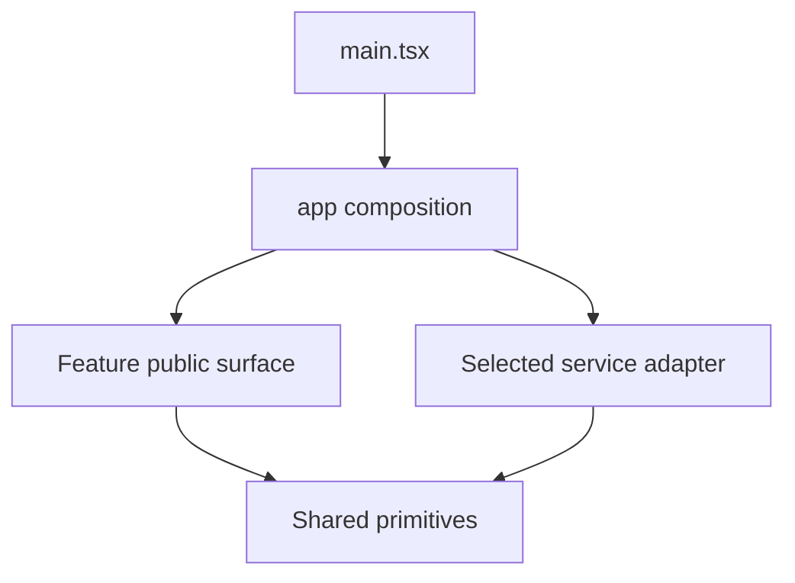

# Web Source Structure

## Scope

React and TypeScript run through Vite in `apps/web/`. This guide defines the target architecture; the application may contain only its minimal starter until the owning setup/feature work creates the modules below. Router, styling, form, validation, state and test packages are selected separately.

## Directory Layout

```text
apps/web/
├── AGENTS.md
├── index.html
├── public/                         # Static files served by URL when needed
├── src/
│   ├── main.tsx                    # Vite/React mount and global stylesheet
│   ├── app/                        # App composition, not feature business logic
│   │   ├── App.tsx                 # App root and top-level fallback
│   │   ├── routes/                 # Route definitions and cross-feature pages
│   │   ├── layouts/                # Role-aware navigation and app shell
│   │   ├── providers/              # App-wide provider composition
│   │   ├── services/               # Select/create feature service adapters
│   │   ├── config/                 # Validated public runtime configuration
│   │   └── styles/                 # Global CSS and approved web UI tokens
│   ├── features/
│   │   └── <feature>/
│   │       ├── index.ts            # Explicit public view/type/service exports
│   │       ├── pages/              # Feature-owned page views
│   │       ├── ui/                 # Feature components and forms
│   │       ├── model/              # Client types, schemas and pure transitions
│   │       ├── services/           # Operation contracts and behavior hooks
│   │       ├── data/
│   │       │   ├── mock/           # Deterministic service fake
│   │       │   └── http/           # Approved wire mappings/adapters at integration
│   │       └── testing/            # Feature test builders/helpers
│   ├── shared/
│   │   ├── ui/                     # Reusable web controls
│   │   ├── lib/                    # Small reusable pure helpers
│   │   ├── transport/              # Generic HTTP/SSE infrastructure
│   │   ├── platform/               # Browser capability adapters
│   │   └── testing/                # Reusable render/reset helpers
│   └── assets/                     # Bundled fonts/images when needed
└── tests/
    ├── journeys/                   # Cross-feature browser journeys
    └── fixtures/                   # Coordinated platform scenarios
```

Root Vite, TypeScript, lint and package configuration stays at app root. Use `src/main.tsx` as the single mount entry; do not add `app/entry/` duplicating it. `public/` is for URL-addressed static resources, `src/assets/` for imported bundled resources. Tailwind or another chosen styling integration connects through app-level styles; shared component appearance follows the approved web baseline.

## Route and Role Composition

`app/routes/` owns URL parsing, route configuration, lazy boundaries and cross-feature page composition. `features/<feature>/pages/` owns cohesive feature views. `app/layouts/` supplies shells and role/access navigation; do not duplicate a feature solely because two roles use it. Keep route state, query parameters and deep links deliberate and validated. Loading, not-found and access/error fallbacks belong to their relevant boundary.



## Source Boundaries

Follow [Client Source Boundaries](../source-boundaries.md) for feature ownership, dependency direction, mock/API seams, state/live updates and testing. Capability plans map approved work to cohesive modules; a spec ID does not require a matching source folder. Platform-specific composition and lifecycle rules below complement those shared boundaries.

## UniHub Web Verification Focus

Exercise discovery/filtering and pagination, login/expiry, free/paid registration, duplicate submissions, payment pending/failure/reconciliation, ticket/cancellation and authorized organizer/staff journeys when in approved scope. Treat displayed seat counts as advisory; provider responses determine reservations. Event-driven counts must reconcile with canonical queries. Test tenant/account transitions and keyboard/responsive flows, not only individual happy-path pages.

## References

- [Product Features](../../product-features.md)
- [Client Decisions](../adrs/README.md)
- [Public Contracts](../../../contracts/http/README.md)
- [Client Workflow](../../../.agents/workflows/client.md)
- [React State Structure](https://react.dev/learn/choosing-the-state-structure)
