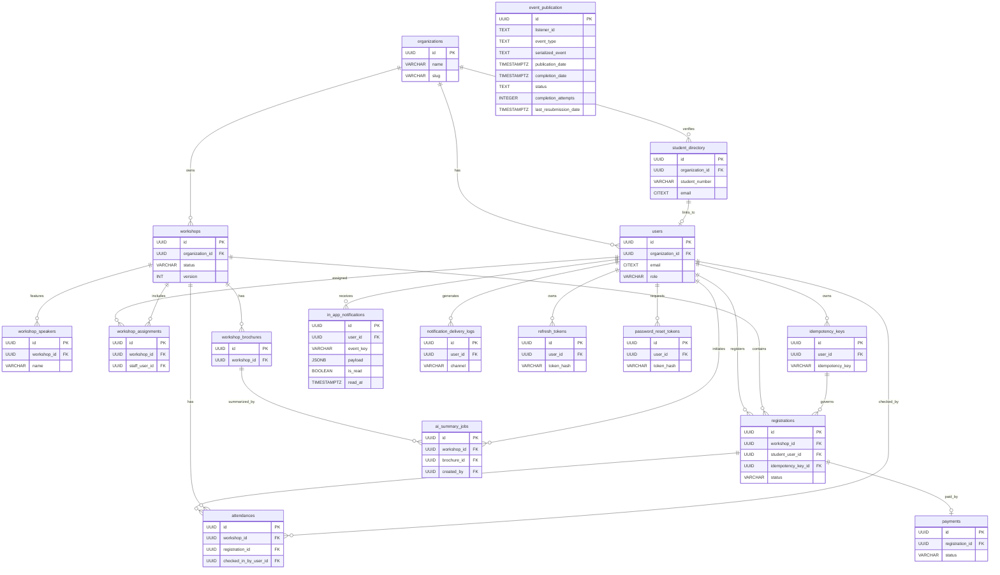

# UniHub Workshop — Database Schema

## 1. Overview & Database Principles

- **Engine:** PostgreSQL (Neon managed service).
- **Normalization:** Data is modeled to **3NF** and **BCNF** to prevent update anomalies and protect exactly-once processing flows.
- **Identifiers:** Use `UUID` (UUIDv4) for all primary keys via `gen_random_uuid()` for safe distributed ID generation.
- **Extensions:** Enable `pgcrypto` for `UUID` generation and `citext` for case-insensitive email storage.
- **Audit Fields:** Every main table includes `created_at`, `updated_at`, `created_by`, and `updated_by`.
- **Automated Timestamps:** Add a standard PostgreSQL trigger function to set `updated_at = now()` on every `UPDATE` operation for all tables to guarantee consistency independently of the application layer.
- **UTC Standardization:** All timestamps are stored in `TIMESTAMPTZ`. The database server, connection pools, and application JVM must be strictly configured to use the **UTC** timezone to prevent scheduling and registration anomalies.
- **TTL Cleanup Jobs:** Implement scheduled TTL cleanup jobs (every 6 hours) in the backend to automatically purge expired records from TTL-managed tables and prevent database bloat. This applies to the `expires_at` column in `idempotency_keys`, `refresh_tokens`, and `password_reset_tokens` tables.
- **No Hard Deletions (Soft Delete & State Machines):** Due to the financial and auditing nature of registrations and attendances, `DELETE` operations are strictly prohibited for core business entities. Use state machine transitions (for example, `status = 'CANCELED'` or `status = 'INACTIVE'`) to preserve data lineage.
- **Strict Role Naming:** Role values across the system must strictly be `STUDENT`, `ORGANIZER`, and `STAFF`. `ROLE_` prefixes are strictly forbidden at both the database and application levels.

## 2. Entity Relationship Diagram (ERD)

> [!NOTE]
> Framework-managed Spring Batch metadata tables are intentionally omitted from the ERD for readability. They are documented in Section 3 under `batch_*`.

## 3. Detailed Table Specifications

### Table: `organizations`

**Table Description & UX Context:** Stores logical tenant organizations (faculties or departments). All data access is scoped by `organization_id` to enforce logical multi-tenancy.

**Schema Definition Table:**

| Column Name | Data Type    | Constraints                                                         | Description/UX Logic                             |
| :---------- | :----------- | :------------------------------------------------------------------ | :----------------------------------------------- |
| id          | UUID         | PK, NOT NULL, DEFAULT gen_random_uuid()                             | Organization identifier.                         |
| name        | VARCHAR(200) | NOT NULL, UNIQUE                                                    | Human-readable organization name.                |
| slug        | VARCHAR(100) | NOT NULL, UNIQUE                                                    | URL-safe identifier for routing and admin UX.    |
| status      | VARCHAR(20)  | NOT NULL, DEFAULT 'ACTIVE', CHECK (status IN ('ACTIVE','INACTIVE')) | Operational status for administrative disabling. |
| created_at  | TIMESTAMPTZ  | NOT NULL, DEFAULT now()                                             | Audit timestamp.                                 |
| updated_at  | TIMESTAMPTZ  | NOT NULL, DEFAULT now()                                             | Audit timestamp.                                 |
| created_by  | UUID         | FK users(id), NULL                                                  | Actor who created the organization.              |
| updated_by  | UUID         | FK users(id), NULL                                                  | Actor who last updated the organization.         |

**Indexing Strategy:**

- Unique B-Tree on `name`.
- Unique B-Tree on `slug`.
- B-Tree on `status` for admin listing and filtering.

> [!NOTE]
>
> - The `created_by` and `updated_by` fields are nullable because root organizations are seeded into the database at server startup (via `.env` configurations) before any `users` exist. A `NULL` value here represents a system-generated record.
> - Every business table must include `organization_id` and be filtered by it to enforce logical multi-tenancy.

### Table: `users`

**Table Description & UX Context:** Stores platform users and their roles (`STUDENT`, `ORGANIZER`, `STAFF`) used for RBAC enforcement across web and mobile clients.

**Schema Definition Table:**

| Column Name           | Data Type    | Constraints                                               | Description/UX Logic                                                             |
| :-------------------- | :----------- | :-------------------------------------------------------- | :------------------------------------------------------------------------------- |
| id                    | UUID         | PK, NOT NULL, DEFAULT gen_random_uuid()                   | User identifier.                                                                 |
| organization_id       | UUID         | FK organizations(id), NOT NULL                            | Tenant boundary for user access.                                                 |
| role                  | VARCHAR(16)  | NOT NULL, CHECK (role IN ('STUDENT','ORGANIZER','STAFF')) | RBAC role used by the API and UI.                                                |
| email                 | CITEXT       | NOT NULL, UNIQUE                                          | Login email (case-insensitive).                                                  |
| phone_number          | VARCHAR(20)  | NULL                                                      | Optional contact number, critical for `ORGANIZER` or `STAFF` emergency contacts. |
| password_hash         | VARCHAR(255) | NOT NULL                                                  | Argon2 or Bcrypt hash.                                                           |
| full_name             | VARCHAR(200) | NOT NULL                                                  | Display name in UI and email templates.                                          |
| avatar_url            | TEXT         | NULL                                                      | Optional profile avatar.                                                         |
| is_active             | BOOLEAN      | NOT NULL, DEFAULT true                                    | Account status.                                                                  |
| is_temporary_password | BOOLEAN      | NOT NULL, DEFAULT false                                   | Enforces first-login password change.                                            |
| last_login_at         | TIMESTAMPTZ  | NULL                                                      | Last successful login timestamp.                                                 |
| student_record_id     | UUID         | FK student_directory(id), UNIQUE, NULL                    | Link to student directory record when applicable.                                |
| created_at            | TIMESTAMPTZ  | NOT NULL, DEFAULT now()                                   | Audit timestamp.                                                                 |
| updated_at            | TIMESTAMPTZ  | NOT NULL, DEFAULT now()                                   | Audit timestamp.                                                                 |
| created_by            | UUID         | FK users(id), NULL                                        | Actor who created the account.                                                   |
| updated_by            | UUID         | FK users(id), NULL                                        | Actor who last updated the account.                                              |

**Indexing Strategy:**

- Unique B-Tree on `email`.
- B-Tree on `organization_id` for tenant filtering.
- B-Tree on `role` for admin queries and assignment lists.
- Unique B-Tree on `student_record_id` (where not null) to enforce the `1-1` mapping with the student directory.

> [!NOTE]
>
> - The `student_record_id` is populated at the application level when a user account is registered. The backend must enforce a strict email format (via Regex or University SSO) and query the `student_directory` table matching the `email`. If a match is found, the `1-1` link is established.
> - If `student_record_id` is `NULL`, students can only update their profile and are not allowed to register for workshops.

### Table: `refresh_tokens`

**Table Description & UX Context:** Stores long-lived refresh tokens used to re-issue access tokens without forcing repeated logins.

**Schema Definition Table:**

| Column Name | Data Type    | Constraints                             | Description/UX Logic                                               |
| :---------- | :----------- | :-------------------------------------- | :----------------------------------------------------------------- |
| id          | UUID         | PK, NOT NULL, DEFAULT gen_random_uuid() | Refresh token identifier.                                          |
| user_id     | UUID         | FK users(id), NOT NULL                  | Owning user for the session.                                       |
| token_hash  | VARCHAR(255) | NOT NULL                                | Hash of the refresh token (never store raw token).                 |
| device_info | VARCHAR(255) | NULL                                    | Stores User-Agent or device name to power an "Active Sessions" UI. |
| ip_address  | VARCHAR(45)  | NULL                                    | Stores the IP address for security audits and anomaly detection.   |
| expires_at  | TIMESTAMPTZ  | NOT NULL                                | Expiration time for TTL cleanup.                                   |
| revoked_at  | TIMESTAMPTZ  | NULL                                    | Revocation timestamp for logout or compromise.                     |
| created_at  | TIMESTAMPTZ  | NOT NULL, DEFAULT now()                 | Audit timestamp.                                                   |
| updated_at  | TIMESTAMPTZ  | NOT NULL, DEFAULT now()                 | Audit timestamp.                                                   |
| created_by  | UUID         | FK users(id), NULL                      | System actor.                                                      |
| updated_by  | UUID         | FK users(id), NULL                      | System actor.                                                      |

**Indexing Strategy:**

- Unique B-Tree on `token_hash`.
- B-Tree on `user_id` for session management.
- B-Tree on `expires_at` for TTL cleanup sweeps.

> [!IMPORTANT]
> Refresh tokens must be stored only as hashes and rotated on each use to reduce replay risk.

### Table: `password_reset_tokens`

**Table Description & UX Context:** Stores one-time password reset tokens for self-service recovery flows.

**Schema Definition Table:**

| Column Name | Data Type    | Constraints                             | Description/UX Logic                             |
| :---------- | :----------- | :-------------------------------------- | :----------------------------------------------- |
| id          | UUID         | PK, NOT NULL, DEFAULT gen_random_uuid() | Password reset token identifier.                 |
| user_id     | UUID         | FK users(id), NOT NULL                  | User requesting the reset.                       |
| token_hash  | VARCHAR(255) | NOT NULL                                | Hash of the reset token (never store raw token). |
| expires_at  | TIMESTAMPTZ  | NOT NULL                                | Expiration time for TTL cleanup.                 |
| used_at     | TIMESTAMPTZ  | NULL                                    | Timestamp when the token was consumed.           |
| created_at  | TIMESTAMPTZ  | NOT NULL, DEFAULT now()                 | Audit timestamp.                                 |
| updated_at  | TIMESTAMPTZ  | NOT NULL, DEFAULT now()                 | Audit timestamp.                                 |
| created_by  | UUID         | FK users(id), NULL                      | System actor.                                    |
| updated_by  | UUID         | FK users(id), NULL                      | System actor.                                    |

**Indexing Strategy:**

- Unique B-Tree on `token_hash`.
- B-Tree on `expires_at` for TTL cleanup sweeps.

> [!CAUTION]
> Tokens are single-use and must be invalidated on first successful password reset.

### Table: `student_directory`

**Table Description & UX Context:** Stores authoritative student records ingested from the nightly CSV. Used to validate student identity and prevent fraudulent registration.

**Schema Definition Table:**

| Column Name     | Data Type    | Constraints                                                         | Description/UX Logic                        |
| :-------------- | :----------- | :------------------------------------------------------------------ | :------------------------------------------ |
| id              | UUID         | PK, NOT NULL, DEFAULT gen_random_uuid()                             | Student directory identifier.               |
| organization_id | UUID         | FK organizations(id), NOT NULL                                      | Tenant boundary for faculty or department.  |
| student_number  | VARCHAR(50)  | NOT NULL                                                            | Institution student identifier.             |
| email           | CITEXT       | NOT NULL                                                            | Official student email.                     |
| full_name       | VARCHAR(200) | NOT NULL                                                            | Student legal or preferred name.            |
| faculty         | VARCHAR(200) | NULL                                                                | Optional faculty/department metadata.       |
| status          | VARCHAR(20)  | NOT NULL, DEFAULT 'ACTIVE', CHECK (status IN ('ACTIVE','INACTIVE')) | Enrollment status used during registration. |
| source_file_key | TEXT         | NULL                                                                | S3 key for source CSV lineage.              |
| imported_at     | TIMESTAMPTZ  | NOT NULL, DEFAULT now()                                             | Import timestamp for audit.                 |
| created_at      | TIMESTAMPTZ  | NOT NULL, DEFAULT now()                                             | Audit timestamp.                            |
| updated_at      | TIMESTAMPTZ  | NOT NULL, DEFAULT now()                                             | Audit timestamp.                            |
| created_by      | UUID         | FK users(id), NULL                                                  | System actor or admin.                      |
| updated_by      | UUID         | FK users(id), NULL                                                  | System actor or admin.                      |

**Student CSV Import Structure:** `student_number, email, full_name, faculty`.

**Indexing Strategy:**

- Unique B-Tree on `(organization_id, student_number)`.
- Unique B-Tree on `(organization_id, email)`.
- B-Tree on `status` for validation queries.
- B-Tree on `imported_at` for audit and retention queries.

> [!NOTE]
>
> - This table is a validation source, not an authentication source. Student login accounts are stored in `users`.
> - The CSV must NOT contain an `organization_id` or `status` column. The Spring Batch job implicitly injects `organization_id` based on the tenant running the job and defaults `status` to `ACTIVE`. The `student_number` and `email` serve as composite deduplication keys during chunk processing.

### Table: `workshops`

**Table Description & UX Context:** Stores workshops created by `ORGANIZER` users, including scheduling, capacity, pricing, and status for lifecycle management.

**Schema Definition Table:**

| Column Name     | Data Type     | Constraints                                                              | Description/UX Logic                                               |
| :-------------- | :------------ | :----------------------------------------------------------------------- | :----------------------------------------------------------------- |
| id              | UUID          | PK, NOT NULL, DEFAULT gen_random_uuid()                                  | Workshop identifier.                                               |
| organization_id | UUID          | FK organizations(id), NOT NULL                                           | Tenant boundary for workshop ownership.                            |
| title           | VARCHAR(255)  | NOT NULL                                                                 | Display title in web catalog.                                      |
| slug            | VARCHAR(255)  | NOT NULL, UNIQUE                                                         | URL-safe identifier for SEO-friendly and shareable workshop links. |
| description     | TEXT          | NOT NULL                                                                 | Long-form details for the workshop page.                           |
| cover_image_url | TEXT          | NOT NULL                                                                 | Catalog image.                                                     |
| location        | VARCHAR(255)  | NOT NULL                                                                 | Physical location for the workshop.                                |
| timezone        | VARCHAR(64)   | NOT NULL                                                                 | IANA time zone (e.g., Asia/Singapore).                             |
| starts_at       | TIMESTAMPTZ   | NOT NULL                                                                 | Start time.                                                        |
| ends_at         | TIMESTAMPTZ   | NOT NULL, CHECK (ends_at > starts_at)                                    | End time.                                                          |
| capacity        | INTEGER       | NOT NULL, CHECK (capacity >= 0)                                          | Maximum seats.                                                     |
| price           | NUMERIC(10,2) | NOT NULL, DEFAULT 0, CHECK (price >= 0)                                  | Price per seat.                                                    |
| currency        | CHAR(3)       | NOT NULL, DEFAULT 'USD'                                                  | ISO 4217 currency code.                                            |
| status          | VARCHAR(20)   | NOT NULL, CHECK (status IN ('DRAFT','PUBLISHED','COMPLETED','CANCELED')) | Workshop lifecycle state.                                          |
| version         | INTEGER       | NOT NULL, DEFAULT 0                                                      | Optimistic locking version.                                        |
| published_at    | TIMESTAMPTZ   | NULL                                                                     | Timestamp of publication.                                          |
| canceled_at     | TIMESTAMPTZ   | NULL                                                                     | Timestamp of cancellation.                                         |
| created_at      | TIMESTAMPTZ   | NOT NULL, DEFAULT now()                                                  | Audit timestamp.                                                   |
| updated_at      | TIMESTAMPTZ   | NOT NULL, DEFAULT now()                                                  | Audit timestamp.                                                   |
| created_by      | UUID          | FK users(id), NOT NULL                                                   | Creator (`ORGANIZER`).                                             |
| updated_by      | UUID          | FK users(id), NOT NULL                                                   | Last editor (`ORGANIZER`).                                         |

**Indexing Strategy:**

- Unique B-Tree on `slug` for fast public catalog lookups and routing.
- B-Tree on `organization_id` for tenant filtering.
- B-Tree on `status` for lifecycle sweeper and admin listings.
- B-Tree on `(organization_id, starts_at)` for calendar views and search filters.

> [!CAUTION]
> Optimistic locking is enforced via `version`. Any update must include the expected version to prevent lost updates.

### Table: `workshop_speakers`

**Table Description & UX Context:** Stores speakers attached to workshops for bios and overlap detection during scheduling.

**Schema Definition Table:**

| Column Name  | Data Type    | Constraints                             | Description/UX Logic                               |
| :----------- | :----------- | :-------------------------------------- | :------------------------------------------------- |
| id           | UUID         | PK, NOT NULL, DEFAULT gen_random_uuid() | Speaker identifier.                                |
| workshop_id  | UUID         | FK workshops(id), NOT NULL              | Workshop featuring the speaker.                    |
| name         | VARCHAR(200) | NOT NULL                                | Speaker display name for the UI.                   |
| bio          | TEXT         | NULL                                    | Speaker biography shown in the catalog.            |
| avatar_url   | TEXT         | NULL                                    | Speaker portrait image for the workshop detail UI. |
| linkedin_url | TEXT         | NULL                                    | Speaker professional profile.                      |
| email        | CITEXT       | NOT NULL                                | Speaker email for scheduling checks.               |
| sort_order   | INTEGER      | NOT NULL, DEFAULT 0                     | Display ordering in the UI.                        |
| created_at   | TIMESTAMPTZ  | NOT NULL, DEFAULT now()                 | Audit timestamp.                                   |
| updated_at   | TIMESTAMPTZ  | NOT NULL, DEFAULT now()                 | Audit timestamp.                                   |
| created_by   | UUID         | FK users(id), NOT NULL                  | `ORGANIZER` who created the speaker record.        |
| updated_by   | UUID         | FK users(id), NOT NULL                  | `ORGANIZER` who last updated the speaker record.   |

**Indexing Strategy:**

- B-Tree on `workshop_id` for workshop page lookups.
- B-Tree on `email` for overlap detection and dedupe checks.

> [!NOTE]
> Use `sort_order` to control consistent speaker ordering across web and mobile clients.

### Table: `workshop_assignments`

**Table Description & UX Context:** Maps `STAFF` users to workshops they can check in. Enforces explicit assignment boundaries.

**Schema Definition Table:**

| Column Name   | Data Type   | Constraints                             | Description/UX Logic                       |
| :------------ | :---------- | :-------------------------------------- | :----------------------------------------- |
| id            | UUID        | PK, NOT NULL, DEFAULT gen_random_uuid() | Assignment identifier.                     |
| workshop_id   | UUID        | FK workshops(id), NOT NULL              | Workshop being assigned.                   |
| staff_user_id | UUID        | FK users(id), NOT NULL                  | `STAFF` user assigned to the workshop.     |
| assigned_by   | UUID        | FK users(id), NOT NULL                  | `ORGANIZER` who assigned the `STAFF` user. |
| assigned_at   | TIMESTAMPTZ | NOT NULL, DEFAULT now()                 | Assignment time.                           |
| created_at    | TIMESTAMPTZ | NOT NULL, DEFAULT now()                 | Audit timestamp.                           |
| updated_at    | TIMESTAMPTZ | NOT NULL, DEFAULT now()                 | Audit timestamp.                           |
| created_by    | UUID        | FK users(id), NOT NULL                  | Actor who created the assignment.          |
| updated_by    | UUID        | FK users(id), NOT NULL                  | Actor who last updated the assignment.     |

**Indexing Strategy:**

- Unique B-Tree on `(workshop_id, staff_user_id)`.
- B-Tree on `staff_user_id` for staff workload views.

> [!IMPORTANT]
> Assignments are required for `STAFF` check-in privileges and must be enforced at the data access layer.

### Table: `workshop_brochures`

**Table Description & UX Context:** Stores metadata for uploaded PDF brochures stored in object storage.

**Schema Definition Table:**

| Column Name     | Data Type    | Constraints                             | Description/UX Logic                   |
| :-------------- | :----------- | :-------------------------------------- | :------------------------------------- |
| id              | UUID         | PK, NOT NULL, DEFAULT gen_random_uuid() | Brochure identifier.                   |
| workshop_id     | UUID         | FK workshops(id), NOT NULL              | Workshop associated with the brochure. |
| storage_key     | TEXT         | NOT NULL                                | S3 object key.                         |
| file_name       | VARCHAR(255) | NOT NULL                                | Original file name.                    |
| content_type    | VARCHAR(100) | NOT NULL                                | MIME type.                             |
| byte_size       | BIGINT       | NOT NULL, CHECK (byte_size >= 0)        | File size in bytes.                    |
| checksum_sha256 | CHAR(64)     | NOT NULL                                | File integrity checksum.               |
| is_active       | BOOLEAN      | NOT NULL, DEFAULT true                  | Marks the current brochure.            |
| uploaded_at     | TIMESTAMPTZ  | NOT NULL, DEFAULT now()                 | Upload timestamp.                      |
| created_at      | TIMESTAMPTZ  | NOT NULL, DEFAULT now()                 | Audit timestamp.                       |
| updated_at      | TIMESTAMPTZ  | NOT NULL, DEFAULT now()                 | Audit timestamp.                       |
| created_by      | UUID         | FK users(id), NOT NULL                  | Uploader (`ORGANIZER`).                |
| updated_by      | UUID         | FK users(id), NOT NULL                  | Uploader (`ORGANIZER`).                |

**Indexing Strategy:**

- B-Tree on `workshop_id`.
- Partial unique B-Tree on `(workshop_id)` where `is_active = true`.

> [!NOTE]
> Only one brochure should be active per workshop to avoid ambiguous AI summarization inputs.

### Table: `registrations`

**Table Description & UX Context:** Records student registrations for workshops and manages the exact-once registration lifecycle.

**Schema Definition Table:**

| Column Name           | Data Type     | Constraints                                                             | Description/UX Logic                                                                                  |
| :-------------------- | :------------ | :---------------------------------------------------------------------- | :---------------------------------------------------------------------------------------------------- |
| id                    | UUID          | PK, NOT NULL, DEFAULT gen_random_uuid()                                 | Registration identifier.                                                                              |
| workshop_id           | UUID          | FK workshops(id), NOT NULL                                              | Workshop being registered.                                                                            |
| student_user_id       | UUID          | FK users(id), NOT NULL                                                  | `STUDENT` user registering.                                                                           |
| status                | VARCHAR(20)   | NOT NULL, CHECK (status IN ('PENDING','CONFIRMED','FAILED','CANCELED')) | Registration state.                                                                                   |
| price_at_registration | NUMERIC(10,2) | NOT NULL, DEFAULT 0                                                     | Price snapshot at time of registration.                                                               |
| currency              | CHAR(3)       | NOT NULL, DEFAULT 'USD'                                                 | ISO 4217 currency code.                                                                               |
| idempotency_key_id    | UUID          | FK idempotency_keys(id), NOT NULL                                       | Idempotency reference for exact-once flow.                                                            |
| qr_payload            | TEXT          | NULL                                                                    | Signed QR payload data. Populated only when status transitions to `CONFIRMED`.                        |
| qr_signature          | TEXT          | NULL                                                                    | QR signature for offline verification. Populated only when status transitions to `CONFIRMED`.         |
| qr_issued_at          | TIMESTAMPTZ   | NULL                                                                    | QR issuance timestamp. Set atomically with `qr_payload` and `qr_signature` on `CONFIRMED` transition. |
| expires_at            | TIMESTAMPTZ   | NULL                                                                    | Expiry for `PENDING` registrations.                                                                   |
| created_at            | TIMESTAMPTZ   | NOT NULL, DEFAULT now()                                                 | Audit timestamp.                                                                                      |
| updated_at            | TIMESTAMPTZ   | NOT NULL, DEFAULT now()                                                 | Audit timestamp.                                                                                      |
| created_by            | UUID          | FK users(id), NOT NULL                                                  | `STUDENT` who registered.                                                                             |
| updated_by            | UUID          | FK users(id), NOT NULL                                                  | Actor who last updated status.                                                                        |

**Indexing Strategy:**

- B-Tree on `workshop_id` for workshop-scoped registration lookups.
- B-Tree on `student_user_id` for student registration history.
- Partial unique B-Tree on `(workshop_id, student_user_id)` where `status IN ('PENDING','CONFIRMED')` to prevent duplicate active registrations.
- Composite partial B-Tree on `(expires_at, workshop_id)` where `status = 'PENDING'` for the Dual-Case Reconciliation Sweeper. This index is small (only `PENDING` rows), supports the exact sweeper query `WHERE status = 'PENDING' AND expires_at < NOW()`, and includes `workshop_id` for efficient per-workshop capacity refund operations within the same sweep.

> [!IMPORTANT]
>
> - All registration creation and idempotency checks must hit the primary database to enforce exactly-once semantics.
> - `qr_payload`, `qr_signature`, and `qr_issued_at` are intentionally nullable. They must **only** be populated inside the `PENDING` -> `CONFIRMED` state transition transaction - never at the initial `PENDING` insert. For free workshops this occurs in the same transaction as the insert. For paid workshops this occurs only after payment gateway confirmation (synchronous callback or webhook). Application code must enforce this invariant; the database columns are nullable to reflect the deferred lifecycle.

### Table: `payments`

**Table Description & UX Context:** Stores payment attempts and reconciliation state for paid workshop registrations.

**Schema Definition Table:**

| Column Name         | Data Type     | Constraints                                                             | Description/UX Logic                           |
| :------------------ | :------------ | :---------------------------------------------------------------------- | :--------------------------------------------- |
| id                  | UUID          | PK, NOT NULL, DEFAULT gen_random_uuid()                                 | Payment identifier.                            |
| registration_id     | UUID          | FK registrations(id), NOT NULL, UNIQUE                                  | One payment per registration.                  |
| provider            | VARCHAR(50)   | NOT NULL                                                                | Payment gateway (e.g., Stripe).                |
| provider_payment_id | VARCHAR(100)  | NOT NULL, UNIQUE                                                        | Gateway payment identifier.                    |
| status              | VARCHAR(20)   | NOT NULL, CHECK (status IN ('PENDING','COMPLETED','FAILED','REFUNDED')) | Payment state.                                 |
| amount              | NUMERIC(10,2) | NOT NULL, CHECK (amount >= 0)                                           | Payment amount.                                |
| currency            | CHAR(3)       | NOT NULL                                                                | ISO 4217 currency code.                        |
| completed_at        | TIMESTAMPTZ   | NULL                                                                    | Timestamp when payment successfully finalized. |
| failed_at           | TIMESTAMPTZ   | NULL                                                                    | Failure timestamp.                             |
| failure_code        | VARCHAR(100)  | NULL                                                                    | Provider error code.                           |
| failure_reason      | TEXT          | NULL                                                                    | Failure description for audits.                |
| created_at          | TIMESTAMPTZ   | NOT NULL, DEFAULT now()                                                 | Audit timestamp.                               |
| updated_at          | TIMESTAMPTZ   | NOT NULL, DEFAULT now()                                                 | Audit timestamp.                               |
| created_by          | UUID          | FK users(id), NULL                                                      | System actor for payment events.               |
| updated_by          | UUID          | FK users(id), NULL                                                      | System actor for payment events.               |

**Indexing Strategy:**

- Unique B-Tree on `provider_payment_id`.
- B-Tree on `status` for reconciliation and sweeper jobs.

> [!CAUTION]
> Payment status transitions must be idempotent and coordinated with registration status updates in the same transaction.

### Table: `attendances`

**Table Description & UX Context:** Records check-ins, including offline sync reconciliation details.

**Schema Definition Table:**

| Column Name           | Data Type    | Constraints                                                          | Description/UX Logic                                             |
| :-------------------- | :----------- | :------------------------------------------------------------------- | :--------------------------------------------------------------- |
| id                    | UUID         | PK, NOT NULL, DEFAULT gen_random_uuid()                              | Attendance identifier.                                           |
| workshop_id           | UUID         | FK workshops(id), NOT NULL                                           | Workshop being checked in.                                       |
| registration_id       | UUID         | FK registrations(id), NOT NULL                                       | Registered attendee.                                             |
| checked_in_by_user_id | UUID         | FK users(id), NOT NULL                                               | `STAFF` user performing the check-in.                            |
| sync_id               | UUID         | NOT NULL                                                             | Mobile sync idempotency key.                                     |
| device_id             | VARCHAR(100) | NULL                                                                 | Optional device identifier.                                      |
| check_in_method       | VARCHAR(20)  | NOT NULL, CHECK (check_in_method IN ('OFFLINE_SYNC','REALTIME_API')) | Source of check-in.                                              |
| status                | VARCHAR(20)  | NOT NULL, DEFAULT 'VALID', CHECK (status IN ('VALID','INVALIDATED')) | Allows admins to soft-delete accidental or fraudulent check-ins. |
| checked_in_at         | TIMESTAMPTZ  | NOT NULL, DEFAULT now()                                              | Check-in time.                                                   |
| created_at            | TIMESTAMPTZ  | NOT NULL, DEFAULT now()                                              | Audit timestamp.                                                 |
| updated_at            | TIMESTAMPTZ  | NOT NULL, DEFAULT now()                                              | Audit timestamp.                                                 |
| created_by            | UUID         | FK users(id), NOT NULL                                               | `STAFF` user or system process.                                  |
| updated_by            | UUID         | FK users(id), NOT NULL                                               | `STAFF` user or system process.                                  |

**Indexing Strategy:**

- Unique B-Tree on `(workshop_id, registration_id)` to prevent duplicate check-ins.
- Unique B-Tree on `(workshop_id, sync_id)` to guarantee offline idempotency.
- B-Tree on `status` to filter out invalidated records during attendance reporting.
- B-Tree on `checked_in_at` for reporting.

> [!IMPORTANT]
> Offline sync must use the `(workshop_id, sync_id)` uniqueness constraint to deterministically resolve `ALREADY_USED` responses.

### Table: `idempotency_keys`

**Table Description & UX Context:** Stores idempotency keys and cached responses to enforce exactly-once processing for payment and registration flows.

**Schema Definition Table:**

| Column Name      | Data Type    | Constraints                                                  | Description/UX Logic                                                                  |
| :--------------- | :----------- | :----------------------------------------------------------- | :------------------------------------------------------------------------------------ |
| id               | UUID         | PK, NOT NULL, DEFAULT gen_random_uuid()                      | Idempotency record identifier.                                                        |
| user_id          | UUID         | FK users(id), NOT NULL                                       | Owning user for the key.                                                              |
| idempotency_key  | VARCHAR(64)  | NOT NULL                                                     | Client-supplied idempotency key.                                                      |
| request_method   | VARCHAR(10)  | NOT NULL                                                     | HTTP method (`POST`, `PUT`).                                                          |
| request_path     | VARCHAR(255) | NOT NULL                                                     | Request path for scope.                                                               |
| request_hash     | CHAR(64)     | NOT NULL                                                     | SHA-256 of request body to prevent reuse with different payloads.                     |
| status           | VARCHAR(20)  | NOT NULL, CHECK (status IN ('PENDING','COMPLETED','FAILED')) | Idempotency lifecycle state.                                                          |
| response_code    | INTEGER      | NULL                                                         | Cached HTTP response code.                                                            |
| response_body    | JSONB        | NULL                                                         | Cached response payload.                                                              |
| response_headers | JSONB        | NULL                                                         | Cached HTTP response headers (e.g., Location) required for perfectly accurate replay. |
| expires_at       | TIMESTAMPTZ  | NOT NULL                                                     | TTL for cleanup.                                                                      |
| created_at       | TIMESTAMPTZ  | NOT NULL, DEFAULT now()                                      | Audit timestamp.                                                                      |
| updated_at       | TIMESTAMPTZ  | NOT NULL, DEFAULT now()                                      | Audit timestamp.                                                                      |
| created_by       | UUID         | FK users(id), NULL                                           | System actor.                                                                         |
| updated_by       | UUID         | FK users(id), NULL                                           | System actor.                                                                         |

**Indexing Strategy:**

- Unique B-Tree on `(user_id, idempotency_key)`.
- B-Tree on `status` for sweeper queries.
- B-Tree on `expires_at` for TTL cleanup.

> [!CAUTION]
> Reads and writes for idempotency must always be routed to the primary database to prevent replication lag anomalies.

### Table: `ai_summary_jobs`

**Table Description & UX Context:** Tracks asynchronous AI summarization jobs and their results.

**Schema Definition Table:**

| Column Name   | Data Type   | Constraints                                                     | Description/UX Logic                             |
| :------------ | :---------- | :-------------------------------------------------------------- | :----------------------------------------------- |
| id            | UUID        | PK, NOT NULL, DEFAULT gen_random_uuid()                         | Job identifier.                                  |
| workshop_id   | UUID        | FK workshops(id), NOT NULL                                      | Workshop being summarized.                       |
| brochure_id   | UUID        | FK workshop_brochures(id), NOT NULL                             | Brochure used for summarization.                 |
| status        | VARCHAR(20) | NOT NULL, CHECK (status IN ('PROCESSING','COMPLETED','FAILED')) | Job state.                                       |
| result_text   | TEXT        | NULL                                                            | Summary text output.                             |
| error_message | TEXT        | NULL                                                            | Failure details for review.                      |
| attempts      | INTEGER     | NOT NULL, DEFAULT 0                                             | Retry attempt counter.                           |
| next_retry_at | TIMESTAMPTZ | NULL                                                            | Scheduled retry time.                            |
| completed_at  | TIMESTAMPTZ | NULL                                                            | Completion time.                                 |
| created_at    | TIMESTAMPTZ | NOT NULL, DEFAULT now()                                         | Audit timestamp.                                 |
| updated_at    | TIMESTAMPTZ | NOT NULL, DEFAULT now()                                         | Audit timestamp.                                 |
| created_by    | UUID        | FK users(id), NOT NULL                                          | Requesting `ORGANIZER` who initiated the AI job. |
| updated_by    | UUID        | FK users(id), NOT NULL                                          | System actor.                                    |

**Indexing Strategy:**

- B-Tree on `status` for worker polling and monitoring.
- B-Tree on `next_retry_at` for retry scheduling.
- B-Tree on `(workshop_id, created_at)` for admin history views.

> [!WARNING]
> AI job transitions must be handled by workers only, never by the web client, to preserve integrity.

### Table: `in_app_notifications`

**Table Description & UX Context:** Stores user-facing in-app notifications for the web and mobile UI.

**Schema Definition Table:**

| Column Name | Data Type    | Constraints                             | Description/UX Logic                                 |
| :---------- | :----------- | :-------------------------------------- | :--------------------------------------------------- |
| id          | UUID         | PK, NOT NULL, DEFAULT gen_random_uuid() | Notification identifier.                             |
| user_id     | UUID         | FK users(id), NOT NULL                  | Recipient user.                                      |
| event_key   | VARCHAR(100) | NOT NULL                                | Domain event key that generated the UI notification. |
| payload     | JSONB        | NOT NULL                                | Notification data payload.                           |
| is_read     | BOOLEAN      | NOT NULL, DEFAULT false                 | UI state for unread badge indicators.                |
| read_at     | TIMESTAMPTZ  | NULL                                    | Timestamp when the user viewed the notification.     |
| action_url  | VARCHAR(255) | NULL                                    | Deep link or URL to navigate when clicked.           |
| created_at  | TIMESTAMPTZ  | NOT NULL, DEFAULT now()                 | Audit timestamp.                                     |
| updated_at  | TIMESTAMPTZ  | NOT NULL, DEFAULT now()                 | Audit timestamp.                                     |
| created_by  | UUID         | FK users(id), NULL                      | System actor.                                        |
| updated_by  | UUID         | FK users(id), NULL                      | System actor.                                        |

**Indexing Strategy:**

- Composite B-Tree on `(user_id, is_read)` to heavily optimize the unread badge counter queries for the UI.

### Table: `notification_delivery_logs`

**Table Description & UX Context:** System-level audit log for asynchronous workers tracking the actual delivery of Emails, Push notifications, and SMS messages. Used by admins and DevOps for debugging, not shown in the user's UI.

**Schema Definition Table:**

| Column Name         | Data Type    | Constraints                                             | Description/UX Logic                                    |
| :------------------ | :----------- | :------------------------------------------------------ | :------------------------------------------------------ |
| id                  | UUID         | PK, NOT NULL, DEFAULT gen_random_uuid()                 | Delivery log identifier.                                |
| user_id             | UUID         | FK users(id), NULL                                      | Recipient user when the message belongs to a user.      |
| channel             | VARCHAR(20)  | NOT NULL, CHECK (channel IN ('EMAIL','PUSH','SMS'))     | Delivery channel.                                       |
| recipient_address   | VARCHAR(255) | NOT NULL                                                | Actual email address or device token.                   |
| status              | VARCHAR(20)  | NOT NULL, CHECK (status IN ('PENDING','SENT','FAILED')) | Worker delivery state.                                  |
| provider_message_id | VARCHAR(200) | NULL                                                    | External provider message identifier.                   |
| error_reason        | TEXT         | NULL                                                    | Failure reason for audits and debugging.                |
| sent_at             | TIMESTAMPTZ  | NULL                                                    | Timestamp when the delivery was attempted or completed. |
| created_at          | TIMESTAMPTZ  | NOT NULL, DEFAULT now()                                 | Audit timestamp.                                        |
| updated_at          | TIMESTAMPTZ  | NOT NULL, DEFAULT now()                                 | Audit timestamp.                                        |
| created_by          | UUID         | FK users(id), NULL                                      | System actor.                                           |
| updated_by          | UUID         | FK users(id), NULL                                      | System actor.                                           |

**Indexing Strategy:**

- B-Tree on `status` and `channel` for worker retry queries.
- B-Tree on `user_id` for admin audit history.

### Table: `event_publication`

**Table Description & UX Context:** Transactional outbox table used by Spring Modulith to externalize events reliably and validated strictly at startup.

**Schema Definition Table:**

| Column Name            | Data Type   | Constraints                                       | Description/UX Logic                                      |
| :--------------------- | :---------- | :------------------------------------------------ | :-------------------------------------------------------- |
| id                     | UUID        | PK, NOT NULL                                      | Publication event identifier.                             |
| listener_id            | TEXT        | NOT NULL                                          | Listener identifier processing the event.                 |
| event_type             | TEXT        | NOT NULL                                          | Fully qualified class name of the event.                  |
| serialized_event       | TEXT        | NOT NULL                                          | Serialized serialized event payload.                      |
| publication_date       | TIMESTAMPTZ | NOT NULL, DEFAULT now()                           | Timestamp when the event was published.                   |
| completion_date        | TIMESTAMPTZ | NULL                                              | Timestamp when processing completed.                      |
| status                 | TEXT        | NULL                                              | Publication status (`INCOMPLETE`, `COMPLETED`, `FAILED`). |
| completion_attempts    | INTEGER     | NULL, DEFAULT 0, CHECK (completion_attempts >= 0) | Number of completion attempts.                            |
| last_resubmission_date | TIMESTAMPTZ | NULL                                              | Timestamp of the last retry resubmission.                 |

**Indexing Strategy:**

- Composite B-Tree on `(status, publication_date)` for resubmission sweeps and backlog ordering.

> [!WARNING]
>
> - Do not alter these column names or add custom constraints. This table is strictly managed and validated by Spring Modulith's internal JDBC registry. Schema validation will fail on application startup if this structure is modified.
> - This table is write-heavy; keep indexes minimal and monitor bloat to preserve outbox throughput.

### Table Group: `batch_*` (Framework-Managed)

**Table Description & UX Context:** Spring Batch `JobRepository` metadata tables required for restartability and audit history of the nightly CSV ingestion pipeline.

**Schema Definition Table:**

| Table Name                   | Purpose                                            |
| :--------------------------- | :------------------------------------------------- |
| batch_job_instance           | Unique job definition per job name and parameters. |
| batch_job_execution          | Job execution lifecycle and status.                |
| batch_job_execution_params   | Parameter snapshot for a job execution.            |
| batch_step_execution         | Step execution metrics and status.                 |
| batch_job_execution_context  | Serialized execution context for a job.            |
| batch_step_execution_context | Serialized execution context for a step.           |
| batch_job_execution_seq      | Sequence generator for job execution IDs.          |
| batch_job_seq                | Sequence generator for job IDs.                    |
| batch_step_execution_seq     | Sequence generator for step execution IDs.         |

**Indexing Strategy:**

- Use the standard indexes defined in Spring Batch's PostgreSQL schema for `JobRepository`.

> [!NOTE]
> These tables are created from Spring Batch's official `schema-postgresql.sql` and should not be customized.

## 4. Replication Lag & Read-After-Write Consistency

Neon PostgreSQL uses a primary-replica topology. Replication lag is expected and must be explicitly handled by the application layer.

**Tables and Operations Sensitive to Replication Lag:**

- `idempotency_keys`: Insert-and-replay for idempotent requests.
- `registrations`: Status transitions (`PENDING` -> `CONFIRMED`/`FAILED`) and duplicate prevention.
- `payments`: Status transitions (`PENDING` -> `COMPLETED`/`FAILED`/`REFUNDED`) and reconciliation.
- `workshops`: Optimistic locking reads (`version`) before admin mutations.
- `attendances`: Offline sync upserts and duplicate check-in detection.
- `workshop_assignments`: `STAFF` assignment validation during check-in authorization.
- `event_publication`: Spring Modulith's internal event registry polling and status updates.

**Primary Routing Requirements:**

- All idempotency reads and writes must be routed to the primary.
- Any operation that reads a value and immediately writes based on it (check-then-act) must use the primary.
- Admin mutation flows that rely on `version` must read from the primary to avoid stale versions.
- Offline sync reconciliation must read and write against the primary to avoid double check-ins.
- The Spring Modulith event publication registry (`event_publication`) must be strictly routed to the Primary DB to prevent missed events or duplicate broker publishing caused by replica read delays.

**Replica Routing Requirements:**

- Heavy background read operations, such as synchronizing workshop data to Elasticsearch or batch reading for reporting, should be explicitly routed to Read Replicas to protect the Primary DB's transaction throughput during high-concurrency spikes.

> [!CAUTION]
> Replica reads on the tables above can produce stale states and break exactly-once guarantees. Restrict replicas to non-critical browsing queries (catalog listing, public workshop discovery) where eventual consistency is acceptable.

## 5. Mobile SQLite Schema (Offline-First)

These tables live only in the React Native mobile app's local SQLite database and are not part of the PostgreSQL backend.

### Table: `mobile_assigned_workshops`

**Table Description & UX Context:** Caches the workshops assigned to the STAFF user so they can select an event to scan for while offline.

**Schema Definition Table:**

| Column Name | Data Type | Constraints  | Description/UX Logic                  |
| :---------- | :-------- | :----------- | :------------------------------------ |
| id          | TEXT      | PK, NOT NULL | Workshop identifier (UUIDv4 as text). |
| title       | TEXT      | NOT NULL     | Workshop title for offline selection. |
| starts_at   | TEXT      | NOT NULL     | Start time in ISO8601 format.         |
| location    | TEXT      | NOT NULL     | Location display string.              |

### Table: `mobile_public_keys`

**Table Description & UX Context:** Stores the backend's asymmetric public keys to verify student QR codes offline (Zero-Trust).

**Schema Definition Table:**

| Column Name    | Data Type | Constraints  | Description/UX Logic                  |
| :------------- | :-------- | :----------- | :------------------------------------ |
| key_id         | TEXT      | PK, NOT NULL | Key identifier used for rotation.     |
| public_key_pem | TEXT      | NOT NULL     | PEM-encoded public key material.      |
| issued_at      | TEXT      | NOT NULL     | Issuance timestamp in ISO8601 format. |

### Table: `mobile_sync_queue`

**Table Description & UX Context:** Offline queue for attendance scans; records are stored immediately upon scan and synced in bulk when connectivity returns.

**Schema Definition Table:**

| Column Name     | Data Type | Constraints  | Description/UX Logic                                                          |
| :-------------- | :-------- | :----------- | :---------------------------------------------------------------------------- |
| sync_id         | TEXT      | PK, NOT NULL | UUIDv4 generated on device.                                                   |
| workshop_id     | TEXT      | NOT NULL     | Workshop identifier from QR context.                                          |
| registration_id | TEXT      | NOT NULL     | Registration identifier extracted from QR.                                    |
| scanned_at      | TEXT      | NOT NULL     | Scan timestamp in ISO8601 format.                                             |
| sync_status     | TEXT      | NOT NULL     | Sync state: `PENDING`, `SUCCESS`, `ALREADY_USED`, `INVALID_TICKET`, `FAILED`. |
