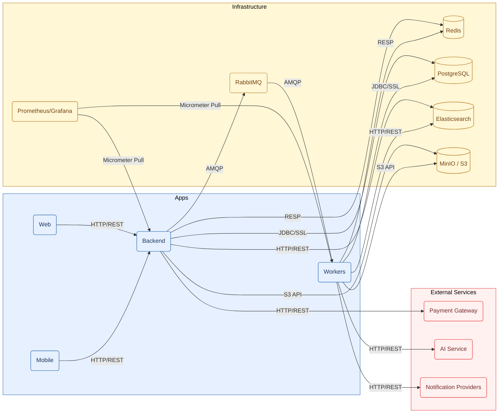
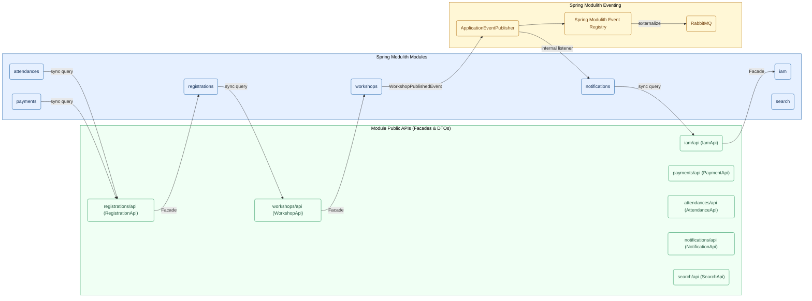
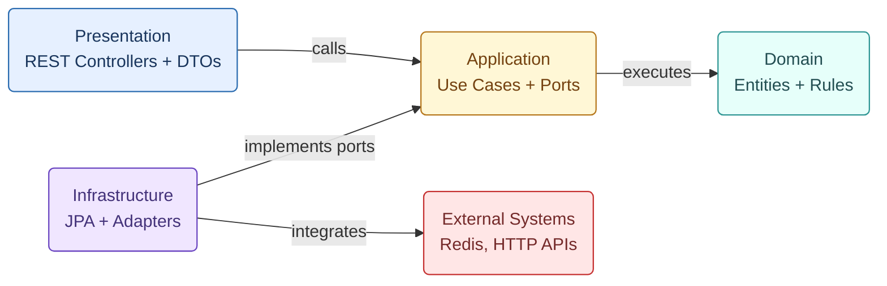
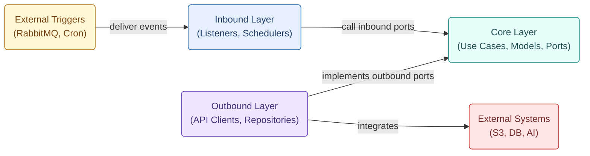
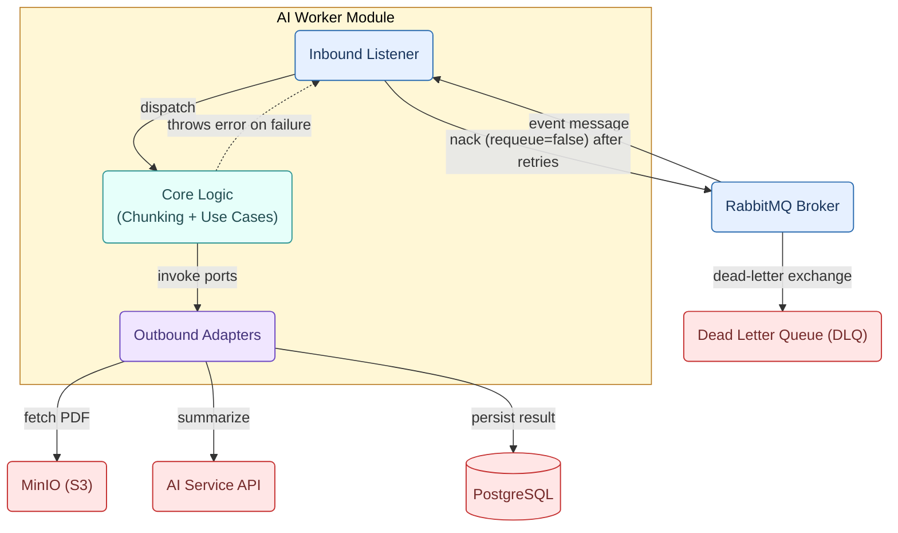

# UniHub Workshop — Project Structure

## 1. Root Workspace Structure

This repository uses a monorepo approach to separate deliverable applications (Core Backend, Background Workers, Web Portal, and Mobile Check-in) from infrastructure and architecture blueprints. This keeps the Event-Driven Modular Monolith, offline-first JSI SQLite mobile stack, Redis-based SWR caching, RabbitMQ workers, and the Prometheus/Grafana observability stack easy to discover while preserving clean ownership boundaries for each runtime concern. Agent-assisted development is structured through `.agents/`, which defines reusable skills and slash-command workflows that enforce Spec-Driven and Test-Driven Development across the monorepo.

```text
UniHub/
├── AGENTS.md           # Agent rules + Documentation Map (always loaded)
├── .agents/            # Agent skills infrastructure
│   ├── skills/         # Reusable, language-agnostic skill definitions
│   └── commands/       # Slash commands (/spec, /plan, /build, /review, /fix)
├── apps/               # Product applications in the monorepo
│   ├── backend/        # Spring Boot Modulith core backend API
│   ├── workers/        # Background workers (batch, notifications, AI)
│   ├── web/            # React web portal for students and organizers
│   └── mobile/         # React Native offline-first check-in app
├── docs/               # Architecture, design, database, and API documentation
├── infra/              # Local Docker, data services, observability configs
├── scripts/            # Executable scripts (Docker deploy, DB seeding, test scenarios)
└── specs/              # Per-feature spec artifacts produced by the SDD workflow
```

This physical separation mirrors Clean Architecture boundaries: `apps/` holds the deployable units, `infra/` defines the local runtime environment (Redis, RabbitMQ, Elasticsearch, MinIO, Prometheus, Grafana), and `docs/` anchors the system's authoritative architectural and schema decisions referenced during implementation. `specs/` captures the living, per-feature artifacts (`SPEC.md`, `API_CONTRACT.md`, `tasks.md`) produced when a feature goes through the `/spec` → `/plan` → `/build` → `/review` workflow.

Note that PostgreSQL is intentionally omitted from the local `infra/` stack as the system strictly connects to the serverless Neon PostgreSQL Cloud via encrypted JDBC. Operational automation is centralized in `scripts/`, keeping the root directory clean.



## 2. Agent Skills Infrastructure (`.agents/`)

UniHub uses Agent Skills to enforce Spec-Driven Development (SDD) combined with Test-Driven Development (TDD) across the backend and workers codebases.

```text
.agents/
├── skills/                                 # Language-agnostic skill definitions
│   ├── spec-driven-development/
│   ├── api-contract-design/
│   ├── task-planning-and-breakdown/
│   ├── incremental-implementation/
│   ├── test-driven-development/
│   ├── modular-boundary-enforcement/
│   ├── database-schema-evolution/
│   ├── idempotency-and-exactly-once-design/
│   ├── security-and-hardening/
│   ├── performance-and-efficiency-engineering/
│   ├── code-review-and-quality/
│   ├── debugging-and-root-cause-analysis/
│   ├── context-priming/
│   ├── grilling/
│   └── handoff/
└── commands/                               # Slash commands
    ├── spec.md                             # /spec
    ├── plan.md                             # /plan
    ├── build.md                            # /build
    ├── review.md                           # /review
    └── fix.md                              # /fix

specs/                                      # Per-feature artifacts
└── <feature-name>/
    ├── SPEC.md
    ├── API_CONTRACT.md
    ├── tasks.md
    └── review-notes.md
```

## 3. Detailed Application Structures

### Core Backend (`apps/backend/`)

#### Directory Layout

```text
apps/backend/
├── src/
│   ├── main/
│   │   ├── java/
│   │   │   └── com/unihub/workshop/
│   │   │       ├── WorkshopApplication.java
│   │   │       ├── shared/                   # Shared kernel (cross-cutting platform concerns)
│   │   │       │   ├── config/               # Common infrastructure configuration (Redis, RabbitMQ, S3/MinIO)
│   │   │       │   ├── database/             # Read-replica dynamic routing datasource configuration
│   │   │       │   ├── events/               # Transactional Outbox integration events (@Externalized to RabbitMQ)
│   │   │       │   ├── exception/            # RFC 7807 problem details and domain exception mappers
│   │   │       │   ├── ratelimit/            # Token-bucket distributed rate limiting filter via Bucket4j and Redis
│   │   │       │   ├── realtime/             # Server-Sent Events (SSE) streaming hub, emitter registry, Redis Pub/Sub
│   │   │       │   │   ├── api/              # Public streaming interfaces (RealtimeEvent, RealtimeEventType, RealtimeEventPublisher)
│   │   │       │   │   ├── application/      # Stream subscription service and outbound ports
│   │   │       │   │   ├── config/           # Realtime Redis and scheduler properties
│   │   │       │   │   ├── infrastructure/   # SseEmitter registry, heartbeat scheduler, Redis publisher/subscriber
│   │   │       │   │   └── presentation/     # StreamController (GET /api/v1/stream/events)
│   │   │       │   ├── resilience/           # Resilience4j circuit breakers and chaos testing adapters
│   │   │       │   ├── security/             # JWT RS256, JTI blacklist, Public Key distribution, auth utilities
│   │   │       │   ├── seed/                 # Startup database seeding for organizations and root organizers
│   │   │       │   ├── web/                  # Standard ApiResponse envelope and HTTP web formatting
│   │   │       │   └── package-info.java     # @ApplicationModule(type = OPEN)
│   │   │       ├── iam/                      # Identity & Access Management (STANDARD REFERENCE TEMPLATE)
│   │   │       │   ├── package-info.java     # @ApplicationModule(displayName = "IAM Module", allowedDependencies = {"shared"})
│   │   │       │   ├── api/                  # Public Module Surface (Facade boundary exposed to other modules)
│   │   │       │   │   ├── IamApi.java       # Public Facade interface (synchronous queries for other modules; created per YAGNI)
│   │   │       │   │   ├── dto/              # Immutable public DTOs (Java records) for cross-module exchange
│   │   │       │   │   │   └── UserSummaryDto.java
│   │   │       │   │   ├── events/           # Public in-process module events for peer modules via @ApplicationModuleListener
│   │   │       │   │   └── package-info.java # @NamedInterface("api") declaring the exposed surface
│   │   │       │   ├── domain/               # 100% Pure Java (no Spring, JPA, or Servlet annotations)
│   │   │       │   │   ├── model/            # Business entities and value objects (User, Session, Token)
│   │   │       │   │   ├── events/           # Internal Domain Events (pure Java records, scoped strictly to aggregate internals)
│   │   │       │   │   └── exceptions/       # Pure domain business exceptions
│   │   │       │   ├── application/          # Use case orchestration and port definitions
│   │   │       │   │   ├── facade/           # Facade implementation (implements IamApi, coordinates use cases)
│   │   │       │   │   │   └── IamFacade.java
│   │   │       │   │   ├── usecases/         # Business use case implementations
│   │   │       │   │   └── ports/            # Port interfaces for dependency inversion
│   │   │       │   │       ├── in/           # Inbound port contracts (Use Case interfaces)
│   │   │       │   │       └── out/          # Outbound port contracts (Repositories, external adapters)
│   │   │       │   ├── infrastructure/       # Technical adapters, persistence, and external clients
│   │   │       │   │   ├── persistence/      # Spring Data JPA repositories, JPA entities, database adapters
│   │   │       │   │   ├── security/         # Redis token blacklist, active session tracker adapters
│   │   │       │   │   └── config/           # Module-specific Spring configuration beans
│   │   │       │   └── presentation/         # External REST HTTP interface
│   │   │       │       ├── controllers/      # Spring @RestController classes
│   │   │       │       └── dto/              # REST request/response DTOs and validation constraints
│   │   │       ├── workshops/                # Workshops, assignments, brochures (follows identical iam template above)
│   │   │       ├── registrations/            # Registrations lifecycle and idempotency (follows identical iam template above)
│   │   │       ├── payments/                 # Stripe payments and checkout (follows identical iam template above)
│   │   │       ├── attendances/              # Check-ins and offline sync (follows identical iam template above)
│   │   │       ├── notifications/            # In-app notification management (follows identical iam template above)
│   │   │       └── search/                   # Elasticsearch CQRS read model (follows identical iam template above)
│   │   └── resources/
│   │       ├── application.yml
│   │       ├── application-dev.yml
│   │       ├── application-prod.yml
│   │       ├── security/                     # RSA key pair
│   │       │   ├── private.pem
│   │       │   └── public.pem
│   │       └── db/
│   │           └── migration/                # Flyway migration scripts
│   │               └── V1__init_schema.sql
│   └── test/
│       └── java/
│           └── com/unihub/workshop/
│               └── ModulithArchitectureTest.java
├── .env                                      # Local dev env vars (DB, Redis, RabbitMQ, etc.)
├── .env.example                              # Env var template committed to source control
├── build.gradle                              # Gradle build definition
└── settings.gradle                           # Gradle settings for the backend module
```

#### Internal Module Communication & Architecture

##### 1. Inter-Module Communication (Spring Modulith)

**A. Synchronous Queries via Facade Pattern**

For synchronous inter-module queries, modules communicate exclusively via the **Facade Pattern**:

- **Public API Surface (`<module>/api/`):**
  - `<Module>Api.java`: Minimal public interface defining synchronous queries offered to other modules. Created strictly on demand **YAGNI** when another module genuinely needs it; speculative facade methods are prohibited.
  - `dto/`: Pure, immutable Java records for cross-module data exchange (e.g. `UserSummaryDto`). **Domain entities and JPA `@Entity` persistence models must never escape the module boundary.**
  - `events/`: Public module events published for peer modules in the monolith.
  - `package-info.java`: Annotated with `@NamedInterface("api")` declaring the package as the module's exposed surface.
- **Private Facade Implementation (`<module>/application/facade/`):**
  - `<Module>Facade.java` (or `<Module>ApiImpl.java`): Implements the `<Module>Api` interface. Lives privately inside `application/facade/` and injects internal use cases or repository ports to satisfy requests, mapping internal types to public DTOs.
- **Encapsulation Enforcement:** Enforced by Spring Modulith `@ApplicationModule` and static ArchUnit fitness functions in `ModulithArchitectureTest`. Any direct access to another module's `domain/`, `application/`, `infrastructure/`, or `presentation/` breaks the build.

**B. Event Architecture & Categorization**

The UniHub platform classifies events into four explicit, non-overlapping categories to guarantee layer purity, prevent circular dependencies, and support horizontal scaling:

| Event Category                                | Location                  | Purity / Annotations                                         | Scope & Transport                                          | Publishing & Consumption Pattern                                                                                                           | Purpose & Real-World Example                                                                                                                                                                                                                                                                                                                        |
| :-------------------------------------------- | :------------------------ | :----------------------------------------------------------- | :--------------------------------------------------------- | :----------------------------------------------------------------------------------------------------------------------------------------- | :-------------------------------------------------------------------------------------------------------------------------------------------------------------------------------------------------------------------------------------------------------------------------------------------------------------------------------------------------- |
| **1. Internal Domain Event**                  | `<module>/domain/events/` | **100% Pure Java** (Zero framework, zero Spring annotations) | Intra-module (Internal to Aggregate)                       | Created by Domain Entities; handled synchronously within the same Use Case.                                                                | Captures state transitions internal to an aggregate (e.g., `UserRegisteredInternalEvent`). Never exposed outside the module.                                                                                                                                                                                                                        |
| **2. Public In-Process Module Event**         | `<module>/api/events/`    | Pure Java records (Optional Modulith metadata)               | Inter-module (In-process inside Monolith)                  | Published via Spring `ApplicationEventPublisher`. Peer modules listen via `@ApplicationModuleListener`.                                    | Decoupled cross-module reactive side effects inside the monolith (e.g., `WorkshopPublishedEvent` triggering search index synchronization).                                                                                                                                                                                                          |
| **3. Transactional Outbox Integration Event** | `shared/events/`          | Spring Modulith `@Externalized("unihub.events::<key>")`      | Monolith → RabbitMQ → Background Workers (`apps/workers/`) | Persisted to PostgreSQL `event_publication` table in the same DB transaction; dispatched to RabbitMQ exchange `unihub.events`.             | Asynchronous worker processing (e.g., `UserProvisionedEvent`, `UserStatusChangedEvent`, `OtpRequestedEvent` consumed by notifications worker for email sending). Centralized in `shared/events/` to allow both business modules (`iam`) and startup seeders (`shared.seed.SeedRunner`) to publish without circular dependencies (`shared <-> iam`). |
| **4. Real-Time Stream Event**                 | `shared/realtime/api/`    | `RealtimeEvent<T>` generic record + `RealtimeEventType` enum | Monolith → Redis Pub/Sub → Web/Mobile SSE Stream           | Injected via `RealtimeEventPublisher`, distributed across backend nodes via Redis Pub/Sub, streamed via SSE (`GET /api/v1/stream/events`). | Instant client-side UI push updates (e.g., in-app notification bell `notification.new`, payment confirmation `payment.confirmed`, live check-in counters `attendance.updated`).                                                                                                                                                                     |



##### 2. Intra-Module Architecture (Clean Architecture)

**A. Inward Dependency Rule**

In Clean Architecture, intra-module dependencies point strictly inward (`Presentation` → `Application` → `Domain`), while `Infrastructure` implements outbound ports defined by `Application` (Dependency Inversion Principle) and encapsulates all external technical integrations. The Domain model remains 100% Pure Java with zero framework leakage.



**B. Taxonomy of `infrastructure/` Adapters**

In Clean Architecture, `infrastructure/` houses all **Outbound Adapters** that implement the outbound port interfaces defined in `application/ports/out/`. Depending on the external technologies a module interacts with, `infrastructure/` is organized into standard, single-responsibility subpackages:

| Subpackage              | Technology / Integration                   | Role & Typical Contents                                                                                                        |
| :---------------------- | :----------------------------------------- | :----------------------------------------------------------------------------------------------------------------------------- |
| `persistence/`          | Relational DB (Neon PostgreSQL, JPA, JDBC) | Spring Data JPA repositories, JPA `@Entity` classes, database port adapters (`*RepositoryAdapter`), keyset pagination cursors. |
| `security/` or `cache/` | In-Memory Key-Value Store (Redis)          | Redis JTI token blacklist adapters, active session tracker adapters, cache-aside stores.                                       |
| `storage/`              | Object Storage (MinIO / AWS S3)            | MinIO/S3 client adapters, pre-signed download/upload URL generators, file stream handlers.                                     |
| `gateway/`              | Third-Party External APIs                  | Payment provider adapters (Stripe SDK), webhook signature verification, external HTTP clients.                                 |
| `messaging/`            | Asynchronous Message Broker (RabbitMQ)     | AMQP consumers, listener containers, dead-letter queue handlers.                                                               |
| `search/`               | Search Engine Read Model (Elasticsearch)   | Elasticsearch client adapters, CQRS query repositories, JSON document mappers.                                                 |
| `config/`               | Module Spring Infrastructure Beans         | `@Configuration` classes configuring module-specific adapters, properties, or third-party client beans.                        |

### Background Workers (`apps/workers/`)

#### Directory Layout

```text
apps/workers/
├── src/
│   ├── main/
│   │   ├── java/
│   │   │   └── com/unihub/workshop/workers/
│   │   │       ├── WorkersApplication.java
│   │   │       ├── shared/                   # Shared worker infrastructure
│   │   │       │   ├── config/               # MinIO S3 and Micrometer/Prometheus observability beans
│   │   │       │   └── database/             # Read/write replica-routing data source and configuration
│   │   │       ├── batch_ingestion/          # Nightly CSV ingestion worker (concrete Hexagonal reference template)
│   │   │       │   ├── inbound/              # Schedulers (NightlyIngestionScheduler) and Spring Batch job configurations
│   │   │       │   ├── core/                 # Pure domain models, pipeline logic, and port interfaces
│   │   │       │   │   ├── models/           # Domain records (SourceFile, StudentDirectoryRow, RejectedStudentRow, IngestionMetrics, IngestionJobReport)
│   │   │       │   │   ├── pipeline/         # Streaming CSV reader, row validator, chunk duplicate resolver
│   │   │       │   │   ├── ports/            # Port contracts isolating core from adapters
│   │   │       │   │   │   ├── in/           # Inbound ports (IngestStudentCsv, RunFileAdmission)
│   │   │       │   │   │   └── out/          # Outbound ports (ObjectStore, RejectArtifactStore, DirectoryWriter, CheckpointStore, EventPublisher)
│   │   │       │   │   └── usecases/         # Job orchestration services (CsvIngestionWithQuarantineService, FileAdmissionService)
│   │   │       │   └── outbound/             # Technology-specific outbound adapters
│   │   │       │       ├── persistence/      # Spring Data JPA repositories & Postgres adapters (IngestionJobReportWriter, StudentDirectoryWriter)
│   │   │       │       ├── storage/          # MinIO S3 object store, reject artifact store, Redis checkpoint store
│   │   │       │       ├── ai_providers/     # External AI API adapters
│   │   │       │       ├── messaging/        # RabbitMQ AMQP event publisher (FileCompletedEvent, FileRejectedEvent)
│   │   │       │       └── config/           # Module-specific properties (BatchIngestionProperties) and Spring beans
│   │   │       ├── maintenance/              # Recurring TTL cleanup & database maintenance workers (follows batch_ingestion template)
│   │   │       ├── notifications/            # Notification fan-out workers (follows batch_ingestion template)
│   │   │       ├── search_sync/              # Elasticsearch CQRS sync workers (follows batch_ingestion template)
│   │   │       └── ai_processing/            # AI summarization pipeline (follows batch_ingestion template)
│   │   └── resources/
│   │       ├── application.yml
│   │       ├── application-dev.yml
│   │       └── application-prod.yml
│   └── test/
│       └── java/
│           └── com/unihub/workshop/workers/
├── .env                                      # Local dev env vars (DB, RabbitMQ, S3, AI API key)
├── .env.example                              # Env var template committed to source control
├── build.gradle                              # Gradle build definition
├── settings.gradle                           # Gradle settings for the workers module
└── README.md                                 # Worker-specific run and troubleshooting notes
```

#### Internal Module Communication

**A. Hexagonal Architecture (Intra-Module Flow):**

- Both `inbound` and `outbound` adapters depend inward on `core` via ports; `core` has zero outward dependencies.
- External triggers and systems are isolated behind adapters to keep task logic deterministic and testable.



**B. Task-Driven Async Pipeline (AI Processing Example):**

- Worker consumes brokered events, performs local chunking to protect payload limits, and writes results to PostgreSQL.
- On repeated failures, the broker routes the message to the DLQ for inspection and replay.



### Web Portal (`apps/web/`)

#### Directory Layout

#### Internal Module Communication

### Mobile Check-in App (`apps/mobile/`)

#### Directory Layout

#### Internal Module Communication

### Infrastructure & Observability (`infra/`)

```text
infra/                                        # Local Docker runtime and observability stack
├── docker-compose.yml                        # Orchestrates Nginx, Redis, RabbitMQ, ES, MinIO, Prometheus, Grafana
├── .env                                      # Infra-only docker-compose variables (ports, admin passwords)
├── .env.example                              # Sample infra-only variables (apps keep separate .env files)
├── nginx/                                    # API gateway and load balancer config
│   ├── nginx.conf                            # Base Nginx configuration
│   └── templates/                            # envsubst templates for dynamic routing
│       └── default.conf.template             # Reverse proxy and upstream load balancing template
├── redis/                                    # Redis configuration and init scripts
│   └── redis.conf                            # Cache and rate limiting defaults
├── rabbitmq/                                 # RabbitMQ configuration and definitions
│   ├── definitions.json.template             # Exchanges, queues, and bindings
│   ├── enabled_plugins                       # Management and Prometheus plugin activation
│   └── rabbitmq.conf                         # Broker configuration
├── elasticsearch/                            # Elasticsearch configuration
│   └── elasticsearch.yml                     # Node and index settings for CQRS search
├── minio/                                    # MinIO (S3-compatible) configuration
│   └── init/                                 # Bucket bootstrap scripts
│       └── create-buckets.sh                 # Creates required buckets for PDFs and CSVs
├── prometheus/                               # Prometheus configuration
│   └── prometheus.yml                        # Scrape config for backend and workers
└── grafana/                                  # Grafana provisioning and dashboards
    ├── provisioning/                         # Datasources and dashboards provisioning
    │   ├── datasources/                      # Grafana datasources (IaC)
    │   │   └── prometheus.yml                # Prometheus datasource definition
    │   └── dashboards/                       # Dashboard providers (IaC)
    │       └── dashboards.yml                # File-based dashboard loader
    └── dashboards/                           # Dashboard JSON templates
        ├── jvm-spring-boot.json              # JVM and Spring Boot Micrometer metrics
        ├── database-hikaricp.json            # HikariCP pool saturation and connection health
        ├── redis-bucket4j.json               # Redis cache and Bucket4j rate limit telemetry
        ├── rabbitmq-metrics.json             # Queue depth, consumer lag, and DLQ signals
        ├── resilience4j-circuit-breaker.json # Circuit breaker state and failure rates
        ├── minio-storage.json                # MinIO object storage health and capacity
        └── nginx-api-gateway.json            # Nginx connection status, throughput, and upstream latencies
```
