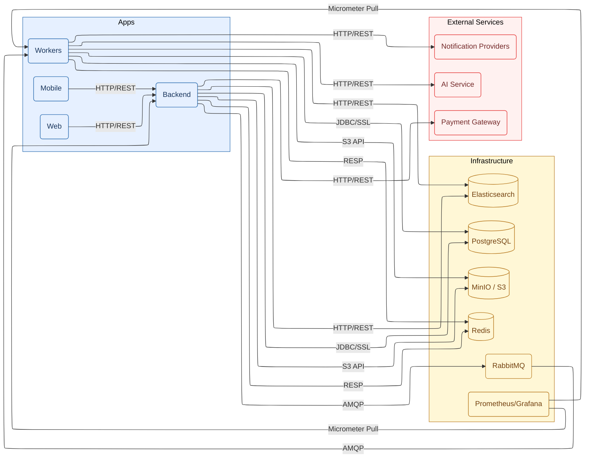
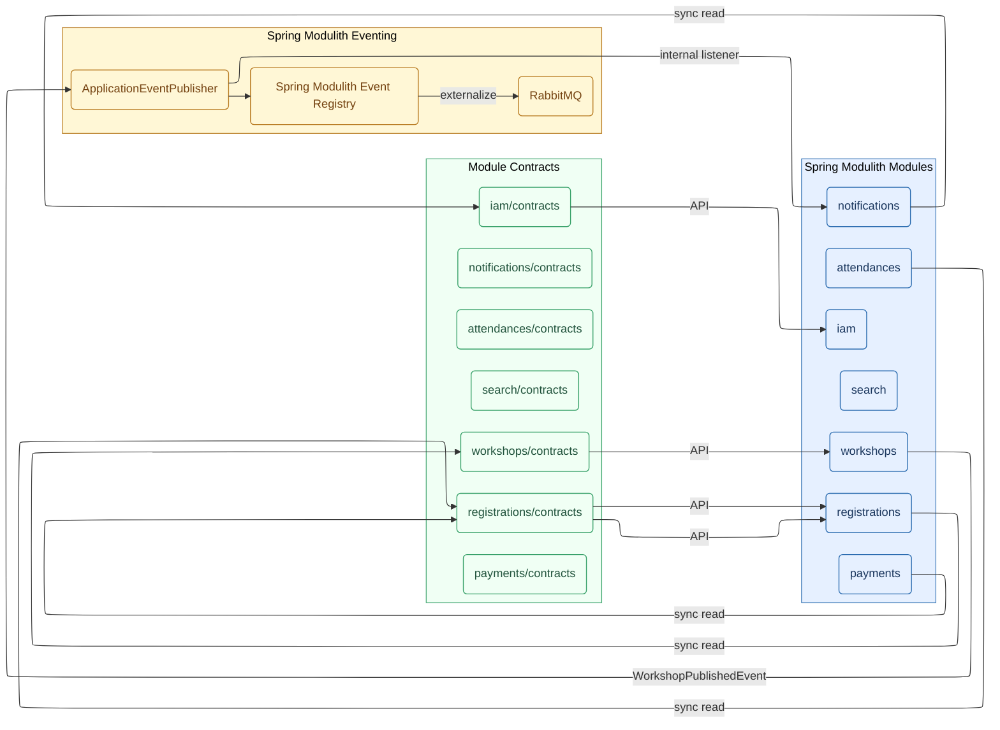
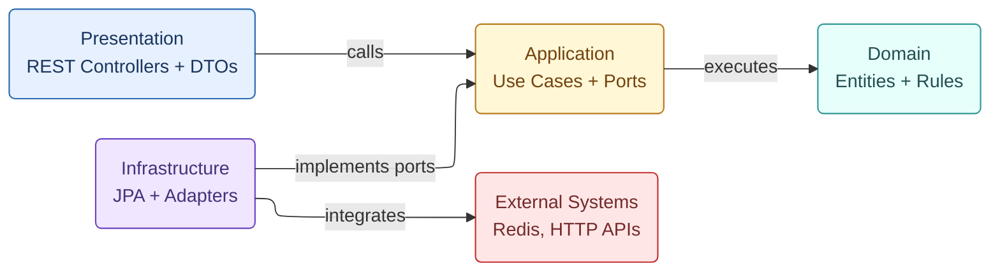
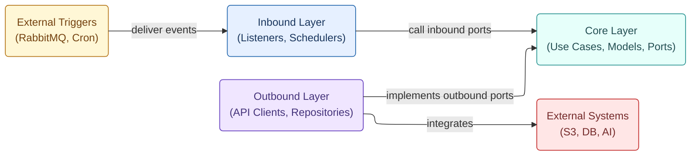
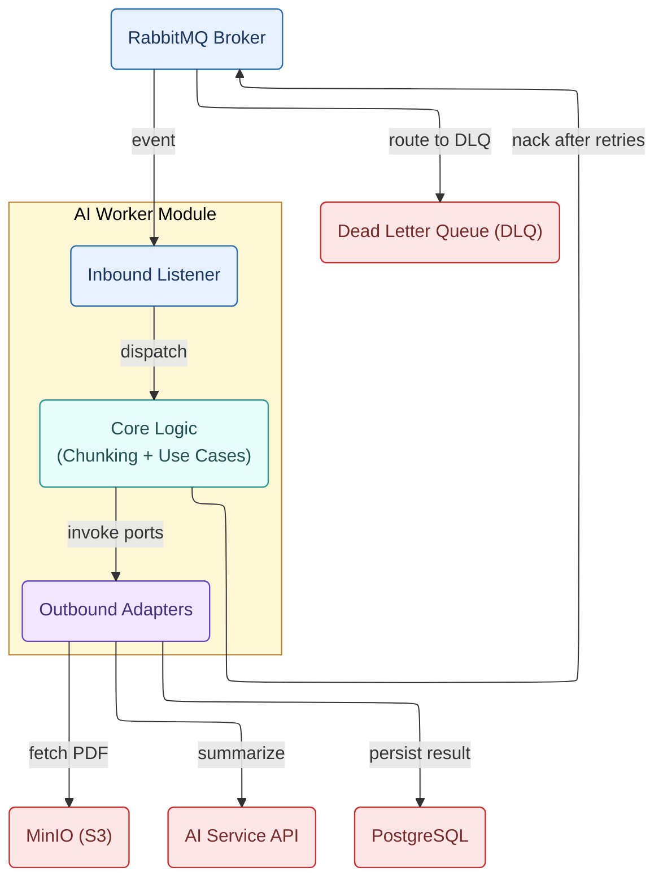

# UniHub Workshop — Project Structure

## 1. Root Workspace Structure

This repository uses a monorepo approach to separate deliverable applications (Core Backend, Background Workers, Web Portal, and Mobile Check-in) from infrastructure and architecture blueprints. This keeps the Event-Driven Modular Monolith, offline-first JSI SQLite mobile stack, Redis-based SWR caching, RabbitMQ workers, and the Prometheus/Grafana observability stack easy to discover while preserving clean ownership boundaries for each runtime concern. Agent-assisted development is structured through `.agents/`, which defines reusable skills and slash-command workflows that enforce Spec-Driven and Test-Driven Development across the monorepo.

```text
UniHub/
├── AGENTS.md           # Agent rules + Documentation Map (always loaded)
├── .agents/            # Agent skills infrastructure
│   ├── skills/         # Reusable, language-agnostic skill definitions
│   └── commands/       # Slash commands (/spec, /plan, /build, /review, /fix)
├── apps/               # Product applications in the monorepo
│   ├── backend/        # Spring Boot Modulith core backend API
│   ├── workers/        # Background workers (batch, notifications, AI)
│   ├── web/            # React web portal for students and organizers
│   └── mobile/         # React Native offline-first check-in app
├── infra/              # Local Docker, data services, observability configs
├── scripts/            # Executable scripts (Docker deploy, DB seeding, test scenarios)
├── docs/               # Architecture, design, database, and API documentation
└── specs/              # Per-feature spec artifacts produced by the SDD workflow
```

This physical separation mirrors Clean Architecture boundaries: `apps/` holds the deployable units, `infra/` defines the local runtime environment (Redis, RabbitMQ, Elasticsearch, MinIO, Prometheus, Grafana), and `docs/` anchors the system's authoritative architectural and schema decisions referenced during implementation. `specs/` captures the living, per-feature artifacts (`SPEC.md`, `API_CONTRACT.md`, `tasks.md`) produced when a feature goes through the `/spec → /plan → /build → /review` workflow.

Note that PostgreSQL is intentionally omitted from the local `infra/` stack as the system strictly connects to the serverless Neon PostgreSQL Cloud via encrypted JDBC. Operational automation is centralized in `scripts/`, keeping the root directory clean.



## 2. Agent Skills Infrastructure (`.agents/`)

UniHub uses Agent Skills to enforce Spec-Driven Development (SDD) combined with Test-Driven Development (TDD) across the backend and workers codebases.

```text
.agents/
├── skills/                                 # Language-agnostic skill definitions
│   ├── spec-driven-development/
│   ├── api-contract-design/
│   ├── task-planning-and-breakdown/
│   ├── incremental-implementation/
│   ├── test-driven-development/
│   ├── modular-boundary-enforcement/
│   ├── database-schema-evolution/
│   ├── idempotency-and-exactly-once-design/
│   ├── security-and-hardening/
│   ├── performance-and-efficiency-engineering/
│   ├── code-review-and-quality/
│   └── debugging-and-root-cause-analysis/
└── commands/                               # Slash commands
    ├── spec.md                             # /spec
    ├── plan.md                             # /plan
    ├── build.md                            # /build
    ├── review.md                           # /review
    └── fix.md                              # /fix

specs/                                      # Per-feature artifacts
└── <feature-name>/
    ├── SPEC.md
    ├── API_CONTRACT.md
    ├── tasks.md
    └── review-notes.md
```

## 3. Detailed Application Structures

### Core Backend (`apps/backend/`)

#### Directory Layout

```text
apps/backend/
├── src/
│   ├── main/
│   │   ├── java/
│   │   │   └── com/unihub/workshop/
│   │   │       ├── WorkshopApplication.java
│   │   │       ├── shared/                   # Shared kernel (cross-cutting concerns)
│   │   │       │   ├── config/               # Infrastructure configuration (Redis, RabbitMQ, MinIO, Elasticsearch, Observability)
│   │   │       │   ├── security/             # JWT RS256, RBAC, auth utilities
│   │   │       │   ├── idempotency/          # Idempotency storage and replay helpers
│   │   │       │   ├── events/               # Domain event markers and base contracts
│   │   │       │   ├── web/                  # HTTP filters, exception mappers, API utilities
│   │   │       │   └── observability/        # Micrometer metrics, logging context, tracing
│   │   │       ├── iam/                      # Auth, organizations, users, student directory validation
│   │   │       │   ├── contracts/            # Public module interfaces for other modules
│   │   │       │   ├── domain/               # Pure Java entities, value objects, domain events, business rules (no Spring/JPA annotations)
│   │   │       │   │   ├── models/           # Domain entities and value objects
│   │   │       │   │   ├── events/           # Domain events
│   │   │       │   │   └── exceptions/       # Domain exceptions and rules
│   │   │       │   ├── application/          # Use cases (inbound ports) and repository interfaces (outbound ports)
│   │   │       │   │   ├── usecases/         # Application use case orchestration
│   │   │       │   │   └── ports/            # Port definitions for dependency inversion
│   │   │       │   │       ├── in/           # Inbound port contracts
│   │   │       │   │       └── out/          # Outbound port contracts
│   │   │       │   ├── infrastructure/       # JPA entities, Spring Data repositories, external adapters (Redis, HTTP clients)
│   │   │       │   │   ├── persistence/      # JPA entities and Spring Data repositories
│   │   │       │   │   ├── messaging/        # Messaging and integration adapters
│   │   │       │   │   └── config/           # Module-specific infrastructure configuration
│   │   │       │   └── presentation/         # REST controllers and DTOs
│   │   │       │       ├── controllers/      # REST controllers
│   │   │       │       └── dto/              # Request/response DTOs
│   │   │       ├── workshops/                # Workshops, speakers, assignments, brochures, AI job tracking (follows iam template)
│   │   │       │   ├── contracts/            # Public module interfaces for other modules
│   │   │       │   ├── domain/               # Pure Java entities, value objects, domain events, business rules (no Spring/JPA annotations)
│   │   │       │   ├── application/          # Use cases (inbound ports) and repository interfaces (outbound ports)
│   │   │       │   ├── infrastructure/       # JPA entities, Spring Data repositories, external adapters (Redis, HTTP clients)
│   │   │       │   └── presentation/         # REST controllers and DTOs
│   │   │       ├── registrations/            # Registration lifecycle and idempotency tracking (follows iam template)
│   │   │       │   ├── contracts/            # Public module interfaces for other modules
│   │   │       │   ├── domain/               # Pure Java entities, value objects, domain events, business rules (no Spring/JPA annotations)
│   │   │       │   ├── application/          # Use cases (inbound ports) and repository interfaces (outbound ports)
│   │   │       │   ├── infrastructure/       # JPA entities, Spring Data repositories, external adapters (Redis, HTTP clients)
│   │   │       │   └── presentation/         # REST controllers and DTOs
│   │   │       ├── payments/                 # Stripe integration and payment state transitions (follows iam template)
│   │   │       │   ├── contracts/            # Public module interfaces for other modules
│   │   │       │   ├── domain/               # Pure Java entities, value objects, domain events, business rules (no Spring/JPA annotations)
│   │   │       │   ├── application/          # Use cases (inbound ports) and repository interfaces (outbound ports)
│   │   │       │   ├── infrastructure/       # JPA entities, Spring Data repositories, external adapters (Redis, HTTP clients)
│   │   │       │   └── presentation/         # REST controllers and DTOs
│   │   │       ├── attendances/              # Check-ins and offline sync reconciliation (follows iam template)
│   │   │       │   ├── contracts/            # Public module interfaces for other modules
│   │   │       │   ├── domain/               # Pure Java entities, value objects, domain events, business rules (no Spring/JPA annotations)
│   │   │       │   ├── application/          # Use cases (inbound ports) and repository interfaces (outbound ports)
│   │   │       │   ├── infrastructure/       # JPA entities, Spring Data repositories, external adapters (Redis, HTTP clients)
│   │   │       │   └── presentation/         # REST controllers and DTOs
│   │   │       ├── notifications/            # In-app notification APIs for web and mobile (follows iam template)
│   │   │       │   ├── contracts/            # Public module interfaces for other modules
│   │   │       │   ├── domain/               # Pure Java entities, value objects, domain events, business rules (no Spring/JPA annotations)
│   │   │       │   ├── application/          # Use cases (inbound ports) and repository interfaces (outbound ports)
│   │   │       │   ├── infrastructure/       # JPA entities, Spring Data repositories, external adapters (Redis, HTTP clients)
│   │   │       │   └── presentation/         # REST controllers and DTOs
│   │   │       └── search/                   # Elasticsearch CQRS read model (follows iam template)
│   │   │           ├── contracts/            # Public module interfaces for other modules
│   │   │           ├── domain/               # Pure Java entities, value objects, domain events, business rules (no Spring/JPA annotations)
│   │   │           ├── application/          # Use cases (inbound ports) and repository interfaces (outbound ports)
│   │   │           ├── infrastructure/       # JPA entities, Spring Data repositories, external adapters (Redis, HTTP clients)
│   │   │           └── presentation/         # REST controllers and DTOs
│   │   └── resources/
│   │       ├── application.yml
│   │       ├── application-dev.yml
│   │       ├── application-prod.yml
│   │       ├── security/                     # RSA key pair
│   │       │   ├── private.pem
│   │       │   └── public.pem
│   │       └── db/
│   │           └── migration/                # Flyway migration scripts
│   │               └── V1__init_schema.sql
│   └── test/
│       └── java/
│           └── com/unihub/workshop/
│               └── ModulithArchitectureTest.java
├── .env                                      # Local dev env vars (DB, Redis, RabbitMQ, etc.)
├── .env.example                              # Env var template committed to source control
├── build.gradle                              # Gradle build definition
└── settings.gradle                           # Gradle settings for the backend module
```

#### Internal Module Communication

- **Cross-module:** synchronous calls go through module `contracts`, and domain events flow through `ApplicationEventPublisher` into the Modulith registry and out to RabbitMQ.



- **Intra-module:** dependencies point inward (Presentation -> Application -> Domain), while Infrastructure implements ports defined by Application and owns external integrations.



### Background Workers (`apps/workers/`)

#### Directory Layout

```text
apps/workers/
├── src/
│   ├── main/
│   │   ├── java/
│   │   │   └── com/unihub/workshop/workers/
│   │   │       ├── WorkersApplication.java
│   │   │       ├── shared/                   # Shared worker infrastructure
│   │   │       │   ├── config/               # RabbitMQ, S3, Elasticsearch, DB, and observability beans
│   │   │       │   ├── messaging/            # Common AMQP configuration and message utilities
│   │   │       │   └── observability/        # Metrics and logging context
│   │   │       ├── batch_ingestion/          # Nightly CSV ingestion workers (follows ai_processing template)
│   │   │       ├── maintenance/              # Recurring TTL cleanup & database maintenance workers
│   │   │       ├── notifications/            # Notification fan-out workers (follows ai_processing template)
│   │   │       ├── search_sync/              # Elasticsearch CQRS sync workers (follows ai_processing template)
│   │   │       └── ai_processing/            # AI summarization pipeline (hexagonal template)
│   │   │           ├── inbound/              # RabbitMQ listeners and job triggers
│   │   │           ├── core/                 # Use cases, batch jobs, and port interfaces
│   │   │           │   ├── models/           # Internal domain records and data structures (e.g., PdfChunk, JobState)
│   │   │           │   ├── usecases/         # Job orchestration and retry policies
│   │   │           │   ├── ports/            # Port interfaces for adapters
│   │   │           │   │   ├── in/           # Inbound port contracts
│   │   │           │   │   └── out/          # Outbound port contracts
│   │   │           │   └── pipeline/         # PDF extraction, chunking, summarization steps
│   │   │           └── outbound/             # External integrations and persistence
│   │   │               ├── persistence/      # JPA repositories for ai_summary_jobs
│   │   │               ├── storage/          # S3 clients for brochure retrieval
│   │   │               ├── ai_providers/     # External AI API adapters
│   │   │               ├── messaging/        # RabbitMQ publishers for status events
│   │   │               └── config/           # Module-specific adapter configuration
│   │   └── resources/
│   │       ├── application.yml
│   │       ├── application-dev.yml
│   │       └── application-prod.yml
│   └── test/
│       └── java/
│           └── com/unihub/workshop/workers/
├── .env                                      # Local dev env vars (DB, RabbitMQ, S3, AI API key)
├── .env.example                              # Env var template committed to source control
├── build.gradle                              # Gradle build definition
├── settings.gradle                           # Gradle settings for the workers module
└── README.md                                 # Worker-specific run and troubleshooting notes
```

#### Internal Module Communication

**Hexagonal Architecture (Intra-Module Flow):**

- Both `inbound` and `outbound` adapters depend inward on `core` via ports; `core` has zero outward dependencies.
- External triggers and systems are isolated behind adapters to keep task logic deterministic and testable.



**Task-Driven Async Pipeline (AI Processing Example):**

- Worker consumes brokered events, performs local chunking to protect payload limits, and writes results to PostgreSQL.
- On repeated failures, the broker routes the message to the DLQ for inspection and replay.



### Web Portal (`apps/web/`)

#### Directory Layout

#### Internal Module Communication

### Mobile Check-in App (`apps/mobile/`)

#### Directory Layout

#### Internal Module Communication

### Infrastructure & Observability (`infra/`)

```text
infra/                                        # Local Docker runtime and observability stack
├── docker-compose.yml                        # Orchestrates Nginx, Redis, RabbitMQ, ES, MinIO, Prometheus, Grafana
├── .env                                      # Infra-only docker-compose variables (ports, admin passwords)
├── .env.example                              # Sample infra-only variables (apps keep separate .env files)
├── nginx/                                    # API gateway and load balancer config
│   ├── nginx.conf                            # Base Nginx configuration
│   └── templates/                            # envsubst templates for dynamic routing
│       └── default.conf.template             # Reverse proxy and upstream load balancing template
├── redis/                                    # Redis configuration and init scripts
│   └── redis.conf                            # Cache and rate limiting defaults
├── rabbitmq/                                 # RabbitMQ configuration and definitions
│   ├── definitions.json.template             # Exchanges, queues, and bindings
│   └── rabbitmq.conf                         # Broker configuration
├── elasticsearch/                            # Elasticsearch configuration
│   └── elasticsearch.yml                     # Node and index settings for CQRS search
├── minio/                                    # MinIO (S3-compatible) configuration
│   └── init/                                 # Bucket bootstrap scripts
│       └── create-buckets.sh                 # Creates required buckets for PDFs and CSVs
├── prometheus/                               # Prometheus configuration
│   └── prometheus.yml                        # Scrape config for backend and workers
└── grafana/                                  # Grafana provisioning and dashboards
    ├── provisioning/                         # Datasources and dashboards provisioning
    │   ├── datasources/                      # Grafana datasources (IaC)
    │   │   └── prometheus.yml                # Prometheus datasource definition
    │   └── dashboards/                       # Dashboard providers (IaC)
    │       └── dashboards.yml                # File-based dashboard loader
    └── dashboards/                           # Dashboard JSON templates
        ├── jvm-spring-boot.json              # JVM and Spring Boot Micrometer metrics
        ├── database-hikaricp.json            # HikariCP pool saturation and connection health
        ├── redis-bucket4j.json               # Redis cache and Bucket4j rate limit telemetry
        ├── rabbitmq-metrics.json             # Queue depth, consumer lag, and DLQ signals
        ├── resilience4j-circuit-breaker.json # Circuit breaker state and failure rates
        └── minio-storage.json                # MinIO object storage health and capacity
```
