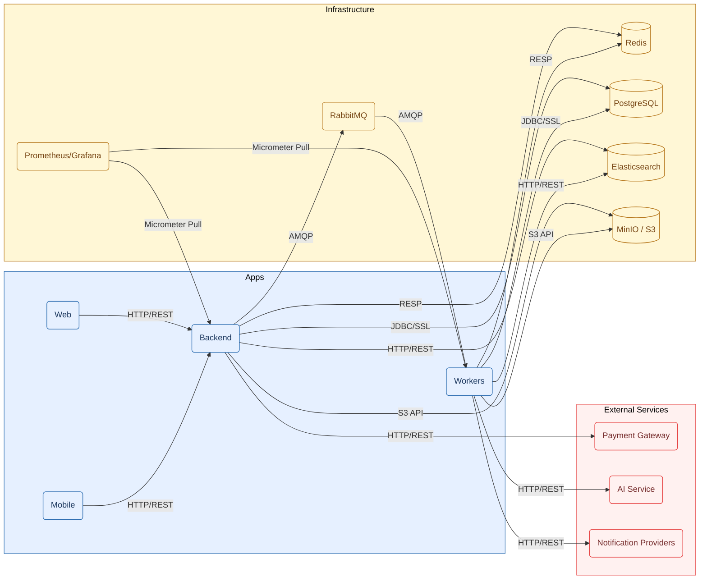

# UniHub Workshop — Repository Structure

## 1. Root Repository Structure

This repository uses a monorepo approach to separate deliverable applications (Core Backend, Background Workers, Web Portal, and Mobile Check-in) from infrastructure and architecture blueprints. This keeps the Event-Driven Modular Monolith, offline-first JSI SQLite mobile stack, Redis-based SWR caching, RabbitMQ workers, and the Prometheus/Grafana observability stack easy to discover while preserving clean ownership boundaries for each runtime concern. Agent-assisted development is structured through `.agents/`, which defines scoped reusable skills and workflow entrypoints that enforce Spec-Driven and Test-Driven Development across the monorepo.

```text
UniHub/
├── AGENTS.md
├── .agents/
│   ├── rules/
│   ├── workflows/
│   ├── skills/{shared,server,client}/
│   ├── templates/{shared,server,client}/
│   └── skill-catalog.md
├── apps/{backend,workers,web,mobile}/
├── docs/{adrs,server,client,data,diagrams}/
├── contracts/http/
├── specs/{server,client}/
├── infra/
└── scripts/
```

This physical separation mirrors Clean Architecture boundaries: `apps/` holds the deployable units, `infra/` defines the local runtime environment (Redis, RabbitMQ, Elasticsearch, MinIO, Prometheus, Grafana), and `docs/` anchors the system's authoritative architectural and schema decisions referenced during implementation. `specs/` captures the living, per-feature artifacts (specifications and task history; public contracts live in contracts/) produced when a feature goes through the `$server-spec` → `$server-plan` → `$server-build` → `$server-review` workflow.

Note that PostgreSQL is intentionally omitted from the local `infra/` stack as the system strictly connects to the serverless Neon PostgreSQL Cloud via encrypted JDBC. Operational automation is centralized in `scripts/`, keeping the root directory clean.



## 2. Tech Stack

| Layer                 | Technology                                                                 |
| :-------------------- | :------------------------------------------------------------------------- |
| Backend runtime       | Java 25, Spring Boot 4.0.6, Gradle Groovy                                  |
| Backend architecture  | Event-Driven Modular Monolith via Spring Modulith                          |
| Workers architecture  | Hexagonal Architecture (inbound/core/outbound)                             |
| Web                   | React (TypeScript)                                                         |
| Mobile                | React Native (TypeScript) + SQLite (offline-first)                         |
| API Gateway           | Nginx (pure reverse proxy + load balancer; no rate limiting at this layer) |
| Primary database      | PostgreSQL on Neon (serverless, primary + read replica)                    |
| Cache / rate limiting | Redis (Bucket4j Token Bucket, cache-aside, JTI blacklist)                  |
| Message broker        | RabbitMQ                                                                   |
| Search                | Elasticsearch (CQRS read model)                                            |
| Object storage        | MinIO (S3-compatible)                                                      |
| Resilience            | Resilience4j (circuit breaker)                                             |
| Auth                  | JWT RS256 (asymmetric), Redis-backed `jti` revocation                      |
| Observability         | Micrometer → Prometheus → Grafana                                          |
| Payments              | Stripe (sandbox, with `ChaosMockAdapter` for resilience testing)           |

The repository is a monorepo: `apps/backend/`, `apps/workers/`, `apps/web/`, `apps/mobile/` — each independently deployable.

## Application Structures

- [Backend/Workers](server/source-structure.md)
- [Web](client/web/source-structure.md)
- [Mobile](client/mobile/source-structure.md)
- [Infrastructure](../infra/README.md)

## Artifact Guides

- [Specifications](../specs/README.md)
- [Contracts](../contracts/README.md)
- [Agent Configuration](../.agents/README.md)
