# UniHub Workshop — System Design

## 1. Architectural Overview

### Architectural Paradigm

The system uses **Event-Driven Modular Monolith** powered by **Spring Modulith** and **Clean Architecture** boundaries.

This approach balances high-traffic scalability with simplified operational complexity. The **Event-Driven Modular Monolith** keeps operational complexity low while enforcing strong internal module boundaries. The **Spring Modulith** event registry and broker decouple asynchronous operations, handling high workloads without blocking core synchronous transactions.

**Why this is the best fit?**

- **High concurrency, low ops overhead:** A single deployable unit scales horizontally behind a load balancer while avoiding microservice orchestration burden.
- **Strict data consistency:** Centralized PostgreSQL transactions reduce the risk of overbooking under heavy contention.
- **Clear growth path:** Well-defined module boundaries allow gradual extraction into services if future scale requires it.
- **Simplified CI/CD & Deployment:** Maintaining a single deployment pipeline and avoiding the network latency and distributed tracing overhead associated with microservices.

### Tiered Infrastructure & Components

The system architecture is organized into a strict tiered structure to distribute load and enforce clear operational concerns:

- **Client Tier:** React (TypeScript) for the responsive web portal; React Native (TypeScript) with a local SQLite engine for the offline-first mobile check-in application.
- **API Gateway Layer:** Nginx acting as the reverse proxy, load balancer, and edge router responsible for SSL termination and request forwarding. Token Bucket rate limiting is enforced inside the Core Backend Monolith filter layer (Bucket4j + Redis), not at the gateway.
- **Backend Tier:** Java and Spring Boot leveraging **Spring Modulith** for internal async event publication registry and modular boundary enforcement.
- **Data Persistence Tier:** Serverless Neon PostgreSQL for core relational data and ACID transactions; S3-compatible Object Storage for PDF assets and legacy CSV storage, and Elasticsearch for offloading heavy full-text search queries via the CQRS pattern.
- **Asynchronous & Caching Layer:** Redis for distributed caching; RabbitMQ for reliable, decoupled message brokering.
- **Observability Stack:** Prometheus (Metrics Scraping & TSDB), Grafana (Centralized Telemetry Dashboards).

### Core Resilience Strategies

- **Application-Level Admission Control (Rate Limiting):** Absorbing sudden traffic spikes via a distributed Token Bucket (Bucket4j + Redis) enforced inside the Core Backend Monolith filter layer, providing authenticated, per-user traffic shaping with full observability. Nginx remains a pure forwarding proxy and does not perform rate limiting.
- **Fault Isolation (Circuit Breakers):** Preventing unpredictable failures in external integrations (such as payment providers) from cascading and disrupting unrelated core services like workshop browsing.
- **Exactly-Once Processing (Idempotency):** Protecting transactional data integrity comprehensively against network drops, timeout resubmissions, and aggressive client retries.
- **Graceful Degradation:** Offloading heavy, non-critical computations (such as AI document parsing and mass notifications) into deferred background execution threads.

## 2. Static Architecture - C4 Models

### Level 1 - System Context Diagram

<p align="center">
  
  
</p>

| Actor / System                       | Type            | Core Responsibility / Description                                                                                                                                                                                                                                     |
| :----------------------------------- | :-------------- | :-------------------------------------------------------------------------------------------------------------------------------------------------------------------------------------------------------------------------------------------------------------------- |
| **Student**                          | Person          | Browses workshops, registers for sessions (free or paid), pays when required, and checks in on-site using a QR confirmation.                                                                                                                                          |
| **Organizer**                        | Person          | Manages workshops, staff, and schedules strictly within a Logical Multi-tenant Organization (Faculty/Department). All administrative actions and data access are constrained to the Organizer's tenant boundary and enforced by API and service-layer tenancy checks. |
| **Check-in Staff**                   | Person          | Performs on-site QR scanning using the Mobile App, relies on local offline persistence for resilience, and synchronizes batched check-ins when network connectivity is available.                                                                                     |
| **UniHub Workshop System**           | Core System     | Core platform for registration, payment orchestration, event publication, offline-first check-in reconciliation, and orchestration of background workers for deferred processing.                                                                                     |
| **Payment Gateway**                  | External System | Generalized external payment provider for card authorization and capture; invoked over HTTPS/JSON with circuit-breaker protection.                                                                                                                                    |
| **Notification Providers**           | External System | External email and in-app delivery services used to send confirmations and operational notifications; consumed asynchronously via HTTPS/JSON.                                                                                                                         |
| **AI Summarization Service**         | External System | External provider for asynchronous PDF parsing and summarization; jobs are submitted by workers and results consumed via the event-driven pipeline.                                                                                                                   |
| **Legacy Student Management System** | External System | Legacy student management system with no direct API; drops nightly CSV exports into object storage (S3-compatible) for offline batch ingestion and validation.                                                                                                        |

### Level 2 - Container Diagram

<p align="center">
  
  
</p>

| Container                       | Technology Stack                   | Deployment Target                 | Architectural Purpose                                                                                                                                                                                                                     |
| :------------------------------ | :--------------------------------- | :-------------------------------- | :---------------------------------------------------------------------------------------------------------------------------------------------------------------------------------------------------------------------------------------- |
| **Web App**                     | React, TypeScript                  | Local Docker                      | Responsive web portal for Students and Organizers; performs client-side validation, renders QR confirmations, authenticates users (JWT), and communicates with the API via the local gateway.                                             |
| **Mobile App**                  | React Native, TypeScript           | Physical Mobile Device / Emulator | Offline-first check-in application for Check-in Staff; captures scans, queues events locally, and syncs batched events to the backend when connectivity permits.                                                                          |
| **Local SQLite Database**       | SQLite                             | Local Device Storage              | Offline-first queue for pending check-in events; provides durable local persistence, idempotent upserts, and deterministic reconciliation during batch syncs.                                                                             |
| **API Gateway / Load Balancer** | Nginx                              | Local Docker                      | Edge routing, SSL termination, and least-connections load balancing. Acts as a pure forwarding proxy; does not perform rate limiting. All Token Bucket enforcement (Bucket4j + Redis) runs inside the Core Backend Monolith filter layer. |
| **Core Backend Monolith**       | Java, Spring Boot, Spring Modulith | Local Docker                      | Implements authoritative domain logic, module-level event publication registry, outbox pattern for reliable event externalization, transactional seat allocation, and payment orchestration.                                              |
| **Background Workers**          | Java, Spring Boot, Spring Batch    | Local Docker                      | Executes deferred tasks: AI PDF summarization, notification delivery, and nightly CSV ingestion. Consumes brokered events, interacts with object storage and external APIs, and persists async results to the cloud database.             |
| **PostgreSQL**                  | PostgreSQL                         | Neon Cloud Service                | Authoritative transactional datastore for registrations, payments, and attendance. Requires JDBC over SSL/TLS for encrypted access from local services.                                                                                   |
| **Search Engine**               | Elasticsearch                      | Local Docker                      | Offloads read-heavy full-text search queries, enabling high-performance workshop discovery without impacting primary database transactions.                                                                                               |
| **Cache / Rate Limiter**        | Redis                              | Local Docker                      | Cache-aside reads for performance, shared Token Bucket counters for Bucket4j admission control, and `jti` blacklist for JWT revocation. Counters are consumed by the Core Backend Monolith filter layer, not the gateway.                 |
| **Message Broker**              | RabbitMQ                           | Local Docker                      | Reliable, decoupled queues for event-driven processing, worker retries, and dead-letter handling; integrates with the Core Backend Monolith via the outbox pattern.                                                                       |
| **Object Storage**              | MinIO / S3-compatible              | Local Docker                      | Stores unstructured assets (PDFs and nightly CSV drops); accessed via the S3 API by workers and the Core Backend for ingestion and processing.                                                                                            |
| **Prometheus**                  | Prometheus TSDB                    | Local Docker                      | Periodically scrapes micrometer metrics from the Core Monolith and Background Workers via HTTP; stores time-series data for analysis.                                                                                                     |
| **Grafana**                     | Grafana UI                         | Local Docker                      | Provides a web-based dashboard interface for DevOps and Admins to monitor system health, connection pool saturation, and error rates in real-time.                                                                                        |

## 3. System Architecture

**Key architectural characteristics:**

- Horizontally scaled Core Backend Monolith instances (Node 1 and Node 2) behind a Local Docker edge using Nginx for HTTP routing and admission control.
- Local Docker runtime for gateway, backend, workers, cache, broker, and object storage; Neon PostgreSQL is hosted as a Cloud Service requiring encrypted JDBC connections.
- Event-driven decoupling via Spring Modulith event publication registry and RabbitMQ-backed worker pipelines for async AI summarization and CSV ingestion.
- Offline-first mobile check-in with a local SQLite queue and batched reconciliation to the cloud-backed authoritative store.

<p align="center">
  
</p>

| Architectural Pattern              | Implementation Details                                                                                                                                                                                                                                                                                         |
| :--------------------------------- | :------------------------------------------------------------------------------------------------------------------------------------------------------------------------------------------------------------------------------------------------------------------------------------------------------------- |
| **Gateway / Traffic Distribution** | Nginx acts as a pure reverse proxy and load balancer, routing incoming HTTP requests across Core Backend Monolith instances.                                                                                                                                                                                   |
| **Cache & Rate Limiting**          | Core Backend Monoliths enforce distributed Token Bucket admission control (via Bucket4j) at the application filter layer, using Redis for shared counters and cache-aside reads.                                                                                                                               |
| **Read / Write Separation**        | Core Backend Monoliths read from Neon PostgreSQL replicas on cache misses and write domain data plus outbox publications to the Neon PostgreSQL primary; all database access uses JDBC over SSL/TLS.                                                                                                           |
| **Worker Responsibilities**        | Background Workers consume brokered events from RabbitMQ, execute AI summarization, notification dispatch, and nightly CSV ingestion, and persist async results to Neon PostgreSQL.                                                                                                                            |
| **Broker Integration**             | Spring Modulith externalizes events to RabbitMQ; workers consume tasks, perform retries/backoff, and route failures to DLQs when necessary.                                                                                                                                                                    |
| **CQRS & Search Optimization**     | To protect the primary PostgreSQL database from CPU-intensive full-text search queries under heavy load, the system utilizes Elasticsearch. The Core Backend writes to PostgreSQL, while Background Workers asynchronously synchronize the data to Elasticsearch, which exclusively serves all search traffic. |

## 4. Core System Flows

### Workshop Registration Flow

The workshop registration process is designed to handle high-concurrency registration spikes (up to 12,000 requests within a 10-minute window). To achieve this it combines distributed Token-Bucket rate limiting (Bucket4j + Redis) at the application filter layer, lock-free Redis atomic capacity pre-checks to avoid database contention, and a strict idempotency lifecycle tightly integrated with payment confirmation to guarantee exactly-once processing and prevent double-booking.

- `PENDING`: Temporary reservation. Slot is deducted in Redis, and the system is awaiting a synchronous payment callback, an asynchronous webhook, or a background reconciliation sweep.
- `CONFIRMED`: Fully finalized registration. The seat is permanently locked in the database, the transaction is verified, and the check-in QR code is activated.
- `FAILED`: Failed or abandoned registration due to payment errors, explicit timeouts, or capacity rejection. Inventory is safely returned.
- `CANCELED`: Registration explicitly canceled by the student or an organizer prior to the event execution.

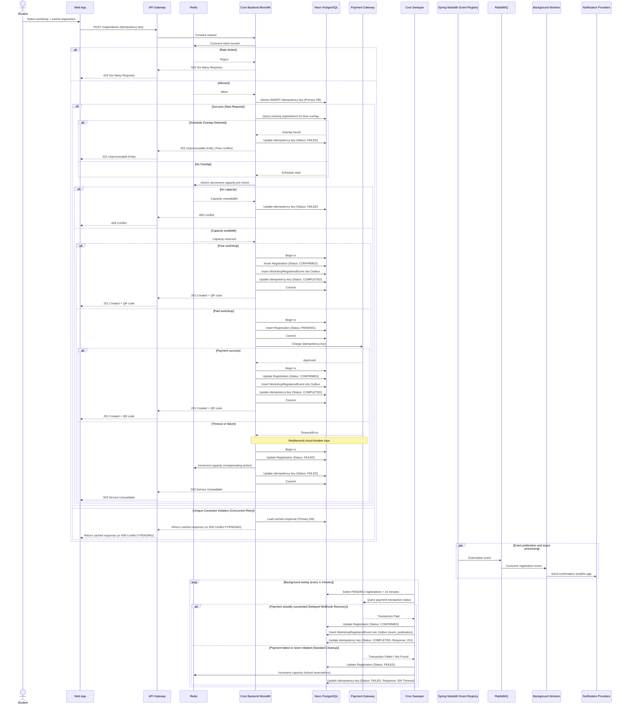

- **Distributed Rate Limiting Location:** The rate limiting logic (via Bucket4j) is evaluated directly within the application filter layer of the Core Backend Monolith using shared Redis nodes for state counters, preventing Nginx from needing direct data tier couplings.
- **Lock-Free Concurrency Chokepoint:** To sustain 12,000 concurrent requests without hitting database row contention or thread pool depletion, capacity checks are offloaded entirely to Redis via an atomic decrement operation. The database transaction is only opened after capacity is verified.
- **Idempotency Lifecycle (Strict State Management):** The system completely guards against double-booking and duplicate charges by tracking the idempotency key state through three phases: `PENDING` (acts as a concurrent lock), `COMPLETED` (serves cached payloads), and `FAILED` (safely releases the lock for client retries).
- **Transactional Outbox Implementation:** To eliminate distributed transaction vulnerability, event emission is tightly integrated with domain operations. The registration record modifications and event storage occur in the same database transaction, natively mapped to Spring Modulith’s `event_publication` table.
- **Deferred QR Code Generation:** QR payload and signature are generated and persisted only when a registration transitions to `CONFIRMED` status - never at the `PENDING` insert step. For free workshops, this happens atomically within the single confirmation transaction. For paid workshops, it happens inside the payment-confirmation transaction after the gateway returns `Approved`. This ensures that a cryptographically valid QR code can never be extracted from a `PENDING` record prior to payment completion. The `qr_payload`, `qr_signature`, and `qr_issued_at` columns in the `registrations` table are therefore nullable and are only populated on the `PENDING` -> `CONFIRMED` state transition.
- **Dual-Case Reconciliation Sweeper:** The background cleanup job acts as a defensive synchronization boundary. Instead of blindly cancelling expired `PENDING` states, it first issues an API call to the Payment Gateway. If a webhook was lost but payment succeeded, it heals the state to `CONFIRMED`. If the checkout was abandoned, it marks it as `FAILED`, refunds the Redis capacity, and unlocks the idempotency state.

### Payment Webhook Handling Flow

The payment gateway sends asynchronous webhook events (for example, `payment_intent.succeeded`, `payment_intent.payment_failed`) to notify the platform of payment outcomes after the synchronous API call returns. This is the **primary confirmation path** for paid registrations. The Dual-Case Reconciliation Sweeper described in the Registration Flow is a **fallback** for lost webhooks only - it must not be the normal path.

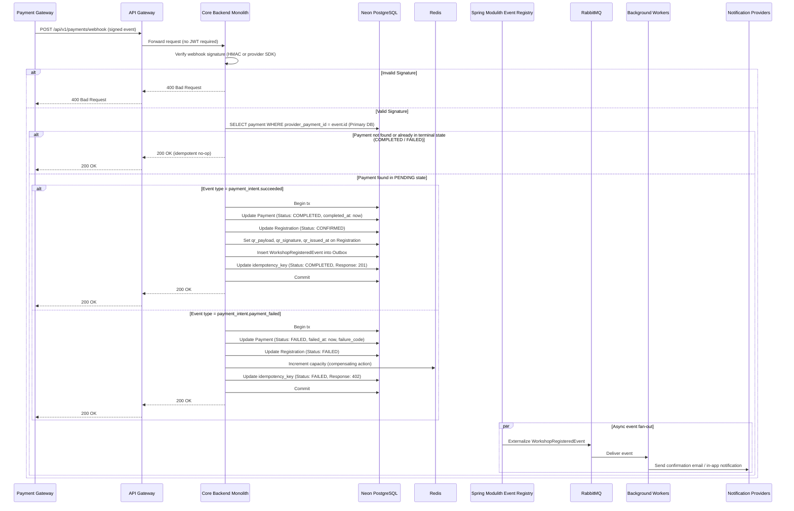

- **No JWT authentication:** The webhook endpoint is called by the payment gateway, not a user. Authentication is performed via **webhook signature verification** using the provider's signing secret (for example, Stripe's `Stripe-Signature` header with `HMAC-SHA256`). This secret is stored as an environment variable and never committed to source control.
- **Idempotent by `provider_payment_id`:** The `payments` table has a `UNIQUE` constraint on `provider_payment_id`. If the gateway retries a webhook, the handler finds the record already in a terminal state and returns `200 OK` immediately without reprocessing - guaranteeing exactly-once state transitions.
- **Always return 200 OK to the gateway:** Returning any non-2xx response causes the payment gateway to retry the webhook, potentially flooding the endpoint. Even on internal processing errors, the handler should return `200 OK` after logging the failure and routing the event to a dead-letter mechanism for investigation.
- **Sweeper becomes fallback only:** With the webhook endpoint in place, the Dual-Case Reconciliation Sweeper (described in the Registration Flow) is demoted to a safety net. It handles only cases where webhooks were genuinely lost (network partition, gateway outage). The sweeper's poll interval (every 15 minutes) is acceptable when it is not the primary path.
- **Timeout window alignment:** Because the webhook is now the primary path, the sweeper timeout for `PENDING` registrations should be extended from 15 minutes to 30 minutes to reduce false-positive sweeper interventions during transient gateway delays, while still providing a reasonable UX recovery window.

### Workshop Lifecycle Management Flow

This sequence captures the admin-driven workshop lifecycle and the event-driven propagation of changes to downstream services. The flow enforces a strict workshop state machine (`DRAFT`-> `PUBLISHED` -> `COMPLETED`/`CANCELED`), applies ownership and RBAC validations at mutation boundaries, and uses a Transactional Outbox pattern to reliably publish domain events only after successful commits.

- `DRAFT`: Initial state upon creation. Visible only to the creating Organizer. No search synchronization or external events.
- `PUBLISHED`: Made public by the Organizer. Active and searchable in Elasticsearch. Open for student registrations.
- `CANCELED`: Aborted mid-lifecycle. Triggers student notifications and removal from active search listings.
- `COMPLETED`: Automatically transitioned by the system sweeper when the current time passes the workshop's end time.

```mermaid
sequenceDiagram
  actor Organizer
  participant Web as Admin Web App
  participant GW as API Gateway (Nginx)
  participant API as Core Backend Monolith
  participant DB as Neon PostgreSQL
  participant Sweeper as Cron Sweeper
  participant Registry as Spring Modulith Event Registry
  participant Broker as RabbitMQ
  participant Worker as Background Workers
  participant ES as Elasticsearch
  participant Notify as Notification Providers

  Note over Organizer,Notify: CREATE OPERATION
  Organizer->>Web: Click "Save Draft"
  Web->>GW: POST /api/v1/workshops
  GW->>API: Forward Request
  API->>DB: Verify ownership (Bypassed for Create)
  API->>DB: Insert Workshop record (Status: DRAFT)
  DB-->>API: Row persisted
  API-->>GW: 201 Created (Draft Saved)
  GW-->>Web: 201 Created
  Web-->>Organizer: Show Draft Status in UI

  Note over Organizer,Notify: PUBLISH OPERATION
  Organizer->>Web: Click "Publish Workshop"
  Web->>GW: PATCH /api/v1/workshops/{id}/publish
  GW->>API: Forward Request
  API->>DB: Verify ownership (workshop.organization_id == jwt.org)
  alt Unauthorized
    DB-->>API: Ownership mismatch
    API-->>GW: 403 Forbidden
    GW-->>Web: 403 Forbidden
    Web-->>Organizer: 403 Forbidden
  else Authorized
    API->>DB: Select current_status from workshops
    DB-->>API: current_status: STATUS
    alt current_status == DRAFT
      API->>DB: Update Workshop (Status: PUBLISHED, Optimistic Locking check)
      API->>DB: Insert WorkshopPublishedEvent into Outbox
      DB-->>API: Transaction committed (Optimistic Locking check)
      API-->>GW: 200 OK (Workshop Published)
      GW-->>Web: 200 OK
      Web-->>Organizer: Show Published Status in UI
    else
      API-->>GW: 422 Unprocessable Entity (Invalid State Transition)
      GW-->>Web: 422 Unprocessable Entity
      Web-->>Organizer: 422 Unprocessable Entity
    end
  end

  Note over Organizer,Notify: UPDATE OPERATION
  Organizer->>Web: Click "Save Changes"
  Web->>GW: PUT /api/v1/workshops/{id}
  GW->>API: Forward Request
  API->>DB: Verify ownership (workshop.organization_id == jwt.org)
  alt Unauthorized
    DB-->>API: Ownership mismatch
    API-->>GW: 403 Forbidden
    GW-->>Web: 403 Forbidden
    Web-->>Organizer: 403 Forbidden
  else Authorized
    API->>DB: Select current_status from workshops
    DB-->>API: current_status: STATUS
    alt current_status == COMPLETED or current_status == CANCELED
      API-->>GW: 422 Unprocessable Entity (Modification Blocked)
      GW-->>Web: 422 Unprocessable Entity
      Web-->>Organizer: 422 Unprocessable Entity
    else
      alt current_status == PUBLISHED
        API->>DB: Query current registered student count
        DB-->>API: registered_count
        API->>API: Validate immutable fields & ensure capacity >= registered_count
        alt Payload modifies immutable core fields or reduces capacity below registered count
          API-->>GW: 422 Unprocessable Entity (Invalid Core Modification)
          GW-->>Web: 422 Unprocessable Entity
          Web-->>Organizer: 422 Unprocessable Entity
        else
          API->>DB: Update Workshop Details (non-core fields, Optimistic Locking check)
          API->>DB: Insert WorkshopUpdatedEvent into Outbox
          DB-->>API: Transaction committed (Optimistic Locking check)
          API-->>GW: 200 OK
          GW-->>Web: 200 OK
        end
      else current_status == DRAFT
        API->>DB: Update Workshop Details (all fields allowed, Optimistic Locking check)
        Note over API,DB: DRAFT changes do not generate outbox events
        DB-->>API: Transaction committed (Optimistic Locking check)
        API-->>GW: 200 OK
        GW-->>Web: 200 OK
      end
    end
  end

  Note over Organizer,Notify: RESCHEDULE OPERATION
  Organizer->>Web: Change Date/Time & Click "Reschedule"
  Web->>GW: PATCH /api/v1/workshops/{id}/reschedule
  GW->>API: Forward Request
  API->>DB: Verify ownership (workshop.organization_id == jwt.org)
  alt Unauthorized
    DB-->>API: Ownership mismatch
    API-->>GW: 403 Forbidden
    GW-->>Web: 403 Forbidden
    Web-->>Organizer: 403 Forbidden
  else Authorized
    API->>DB: Select current_status from workshops
    DB-->>API: current_status: STATUS
    alt current_status == DRAFT or current_status == COMPLETED or current_status == CANCELED
      API-->>GW: 422 Unprocessable Entity (Reschedule Restricted to Published)
      GW-->>Web: 422 Unprocessable Entity
      Web-->>Organizer: 422 Unprocessable Entity
    else
      API->>API: Validate new_start_time/new_end_time (must be future and start < end)
      alt new_start_time < NOW or new_end_time <= new_start_time
        API-->>GW: 422 Unprocessable Entity (Invalid Temporal Range)
        GW-->>Web: 422 Unprocessable Entity
        Web-->>Organizer: 422 Unprocessable Entity
      else
        API->>DB: Resource Collision Check (location/speaker overlap within time window)
        alt Collision Found
          DB-->>API: Collision Found
          API-->>GW: 422 Unprocessable Entity (Resource Conflict)
          GW-->>Web: 422 Unprocessable Entity
          Web-->>Organizer: 422 Unprocessable Entity
        else Schedule Clear
          DB-->>API: Schedule Clear
          API->>DB: Update Workshop Schedule (Status remains current, Optimistic Locking check)
          API->>DB: Insert WorkshopRescheduledEvent into Outbox
          DB-->>API: Transaction committed (Optimistic Locking check)
          API-->>GW: 200 OK
          GW-->>Web: 200 OK
          Web-->>Organizer: 200 OK
        end
      end
    end
  end

  Note over Organizer,Notify: CANCEL OPERATION
  Organizer->>Web: Click "Cancel Workshop"
  Web->>GW: PATCH /api/v1/workshops/{id}/cancel
  GW->>API: Forward Request
  API->>DB: Verify ownership (workshop.organization_id == jwt.org)
  alt Unauthorized
    DB-->>API: Ownership mismatch
    API-->>GW: 403 Forbidden
    GW-->>Web: 403 Forbidden
    Web-->>Organizer: 403 Forbidden
  else Authorized
    API->>DB: Select current_status from workshops
    DB-->>API: current_status: STATUS
    alt current_status == CANCELED or current_status == COMPLETED
      API-->>GW: 422 Unprocessable Entity (Invalid State)
      GW-->>Web: 422 Unprocessable Entity
      Web-->>Organizer: 422 Unprocessable Entity
    else
      API->>DB: Update Workshop (Status: CANCELED, Optimistic Locking check)
      API->>DB: Insert WorkshopCanceledEvent into Outbox
      DB-->>API: Transaction committed (Optimistic Locking check)
      API-->>GW: 200 OK
      GW-->>Web: 200 OK
      Web-->>Organizer: Show Canceled Status in UI
    end
  end

  Note over Organizer,Notify: AUTOMATED LIFECYCLE SWEEPER
  loop Hourly Sweep
    Sweeper->>DB: Query PUBLISHED workshops where end_time < NOW
    DB-->>Sweeper: Return expired workshop ids
    Sweeper->>DB: Bulk Update Workshop (Status: COMPLETED)
    DB-->>Sweeper: Acknowledge bulk update
    Sweeper->>DB: Bulk Insert WorkshopCompletedEvent into Outbox
    DB-->>Sweeper: Acknowledge bulk insert
  end

  Note over Organizer,Notify: ASYNCHRONOUS EVENT FAN-OUT
  Note over API,Registry: Events are only externalized by the Registry component which reads event_publication post-commit
  Note over Registry,Broker: Spring Modulith Transactional Outbox Event Fabric
  Registry->>Broker: Externalize domain events from event_publication
  Broker->>Worker: Deliver domain events
  alt Event is Published or Updated or Rescheduled
    Worker->>ES: Sync/Upsert Workshop data to Elasticsearch Index
  else Event is Completed or Canceled
    Worker->>ES: Remove or mark inactive in Elasticsearch Index
  end
  alt Event is Rescheduled or Canceled
    Worker->>DB: Fetch registered student list for this workshop
    DB-->>Worker: Return student list
    Worker->>Notify: Send bulk automated emails/push notifications
  end

  Note over API,ES: DRAFT records are never synchronized to Elasticsearch and generate no external events until transition to PUBLISHED
```

- **State Machine Enforcement:** The system enforces strict transitions: `DRAFT` -> `PUBLISHED` -> `COMPLETED`/`CANCELED`. Once a workshop reaches a terminal state (`COMPLETED` or `CANCELED`), the API layer strictly blocks any further mutations and returns `422 Unprocessable Entity` for attempts to modify the record.
- **Data Ownership & Core Validation:** Modification endpoints validate `jwt.org` against `workshop.organization_id` to enforce logical multi-tenancy (skipped for `Create`). Any ORGANIZER within the same organization can manage its workshops. The `PUT`/`PATCH` handlers dynamically evaluate the current status: full updates are allowed while in `DRAFT`; once `PUBLISHED`, core fields (for example `price`) are immutable and any attempt to change them or reduce capacity below current registrations is rejected with `422 Unprocessable Entity` to protect active attendees.
- **Optimistic Locking (Concurrent Admin Mutations):** The service uses optimistic concurrency control via a `@Version` field on the workshop entity. If the version has changed between read and update, the database raises a conflict and the API returns `409 Conflict`, preventing lost updates when multiple ORGANIZERs edit or publish the same workshop concurrently.
- **Automated Event Completion Sweeper:** A dedicated `Sweeper` cron component runs hourly. It queries the database for expired `PUBLISHED` workshops, marks them `COMPLETED`, and writes `WorkshopCompletedEvent` entries into the transactional outbox for downstream processing.
- **Granular Asynchronous Branching:** The `Registry` component (not the API) extracts committed outbox rows and externalizes them to the message broker. Background workers synchronize to Elasticsearch on publication, updates, rescheduling, and completion events (keeping `DRAFT` items completely isolated); mass notification flows are executed only for disruptive events (Rescheduled, Canceled).
- **Strict Reschedule Guarantees:** The reschedule endpoint is explicitly blocked for `DRAFT`, `COMPLETED`, or `CANCELED` states. Rescheduling requires a `PUBLISHED` workshop, validates that proposed times are future and form a valid range, and runs a PostgreSQL-level resource collision check (location and speaker availability) to prevent double-booking. Any validation failure returns `422 Unprocessable Entity` and the transaction is not committed.

### Workshop Search & Cache-Aside Flow

This flow offloads full-text search to Elasticsearch following a CQRS pattern that the Core Backend remains the authoritative source while background workers maintain the ES read model. The API implements a non-blocking Stale-While-Revalidate cache-aside strategy with dual soft/hard TTLs and a circuit-breaker-protected synchronous fallback to Elasticsearch, ensuring the Tomcat thread pool is never exhausted during large-scale traffic spikes.

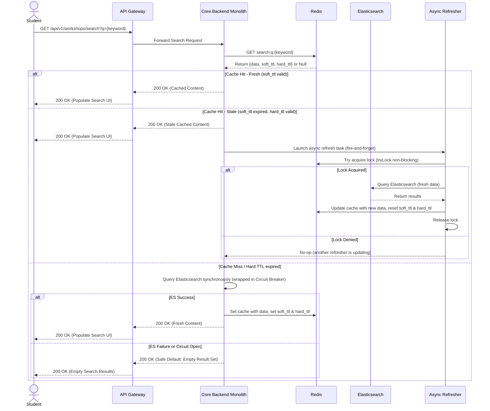

- **Stale-While-Revalidate (SWR) Pattern:** The API returns cached results immediately whenever possible. If data is stale (soft TTL expired) but within a permissible hard TTL, the system returns the stale payload instantly and triggers an asynchronous refresh. This non-blocking SWR approach prevents request threads from waiting on backend refreshes and avoids exhausting the Tomcat thread pool during surges (12,000+ concurrent users).
- **Dual TTL Semantics:** Cache entries contain a soft TTL (short, e.g., 5 minutes) and a hard TTL (longer, e.g., 24 hours). The soft TTL controls freshness for immediate revalidation decisions; the hard TTL bounds how long stale data may be served before requiring a synchronous circuit-protected fetch from Elasticsearch.
- **Non-blocking Refresh with `tryLock`:** Stale responses initiate a fire-and-forget background task that attempts a non-blocking `tryLock` in Redis. Only the task that obtains the lock performs the expensive ES query and writes the updated payload and new TTLs. If the lock is denied, the refresher does nothing - avoiding any synchronous follower blocking or spin-waiting on application request threads.
- **Circuit Breaker & Graceful Degradation:** Any synchronous call to Elasticsearch (cache miss or hard TTL expiry) is protected by a Resilience4j-like Circuit Breaker and appropriate timeouts. On ES timeouts or when the circuit is `OPEN`, the API returns a safe default (empty result set) instead of a `5xx` error, ensuring graceful degradation and predictable client behavior.
- **Operational Benefits:** This design eliminates Thread.sleep-based polling and prevents thread pool starvation, reduces end-to-end tail latency during cache churn, and minimizes stampede risk while maintaining eventual freshness. It also simplifies capacity planning and allows the search path to degrade safely when external systems are impaired.
- **Cache Invalidation:** Writers (publish/reschedule/cancel) invalidate or update the Redis key and, where necessary, emit events to the background refresher to eagerly repopulate critical search slices. Cache updates always reset both TTLs to maintain correct SWR semantics.
- **Telemetry & Observability:** Instrument refresh attempts, lock acquisition rate, cache hit/stale/miss ratios, ES response latencies, and circuit-breaker state transitions. Alert on elevated lock contention, high stale-serving ratios, or prolonged circuit-open periods to drive operational responses.

### Offline Check-in & Synchronization Flow

This sequence illustrates offline capture, local persistence, and server-authoritative reconciliation. It enforces zero-trust by verifying QR signatures on-device, then reconciles sync batches using workshop-scoped bulk fetch and bulk upsert operations to eliminate N+1 queries. Database-level unique constraints and atomic upsert mechanisms deterministically resolve micro-second double-scan races.

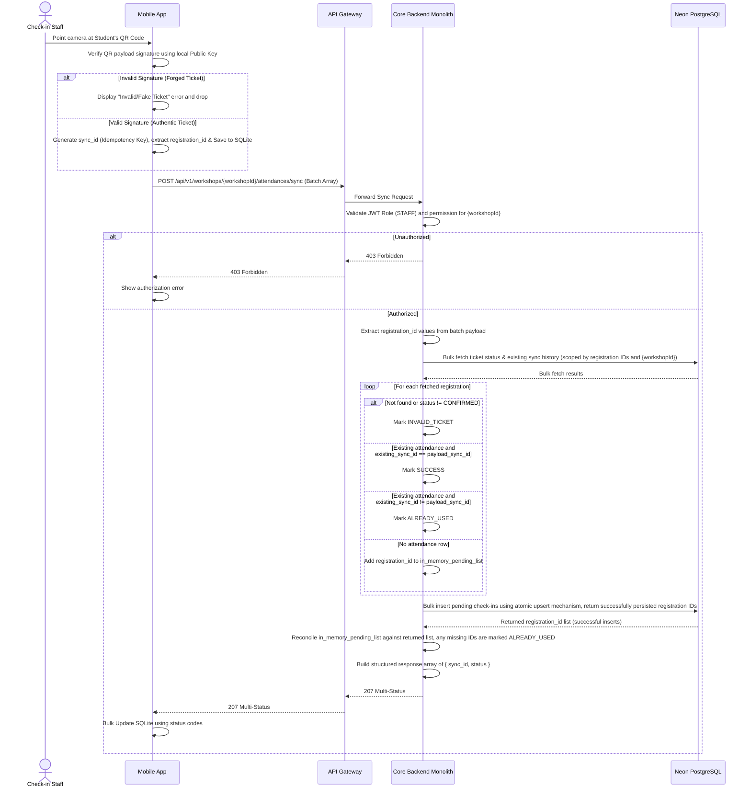

- **Zero-Trust Offline Payload:** The mobile app verifies the QR signature locally before any record is queued for synchronization. This blocks forged tickets at the edge and ensures the backend only reconciles payloads that were cryptographically issued by the platform.
- **Bulk Operations:** The API resolves all `registration_id` values with one workshop-scoped bulk fetch and then performs a single bulk upsert for pending inserts. This eliminates per-row database chatter, protects the PostgreSQL connection pool, and keeps the sync path stable under high concurrency.
- **Workshop Boundary Enforcement:** Every read and write is constrained by `{workshopId}`, so a valid ticket from one workshop cannot be synchronized against another workshop. This closes the Cross-Workshop Ticket Spoofing gap at the data-access layer, not just at the endpoint layer.
- **In-Memory Idempotent Filter:** The API classifies each fetched record in RAM before writing anything. Existing rows with the same `sync_id` are treated as `SUCCESS` for legitimate retries, while a different `sync_id` against the same `registration_id` is treated as `ALREADY_USED` for a real double scan.
- **Pessimistic DB Constraints with Returned Identifiers:** The system relies on database-level unique constraints and atomic upsert mechanisms provided by the storage engine. Bulk writes return the identifiers that were successfully persisted; the API reconciles this returned list against the attempted inserts. Any attempted insert missing from the returned set lost the micro-second race and is marked `ALREADY_USED`. This approach avoids relying on exception-based control flow and keeps the reconciliation deterministic.
- **Structured 207 Multi-Status Reconciliation:** The API returns a single `207 Multi-Status` payload with explicit `{ sync_id, status }` objects such as `SUCCESS`, `INVALID_TICKET`, and `ALREADY_USED`. The mobile client uses those exact status codes to reconcile local SQLite state without parsing free-form messages.

### Async AI Summarization Flow

This sequence shows the asynchronous pipeline for PDF processing using Spring Modulith event publication and brokered workers. The design decouples heavy AI workloads from the core API via event-driven handoff, performs local extraction and chunking to bound payload sizes, and relies on broker retries plus a Dead Letter Queue (DLQ) for fault-tolerant processing and operational visibility.

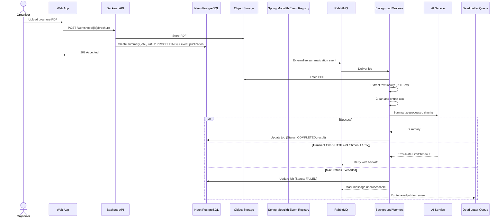

- **Decoupled Processing:** The API persists the job and event publication entry, then returns `202` so heavy PDF processing runs asynchronously.
- **Local Preprocessing:** The worker extracts, cleans, and chunks text before calling the AI service to avoid oversized payloads and token limit errors.
- **Job State Tracking:** The database explicitly tracks `PROCESSING`, `COMPLETED`, and `FAILED` states so the Web App can poll or subscribe via WebSockets/SSE and notify the Organizer when the summary is ready or has failed.
- **Rate Limiting Resilience:** The worker treats AI provider `HTTP 429` responses the same as transient timeouts and `5xx` failures, using broker-backed backoff retries to absorb temporary throttling without losing the job.
- **Dead Letter Queue (DLQ) and Failure Handling:** When max retries are exhausted, the worker marks the database job as `FAILED` before the broker routes the unprocessable payload to the DLQ. This prevents zombie `PROCESSING` jobs and frontend infinite loading while preserving the event for monitoring or manual replay by Ops.

### Nightly Legacy CSV Ingestion Flow

This flowchart represents the nightly batch pipeline for legacy CSV ingestion. It follows Spring Batch semantics (ItemReader / ItemProcessor / ItemWriter), streams input to avoid OOM, stages rejects locally during chunk processing, and uploads reject artifacts to S3 on job completion for operational review.

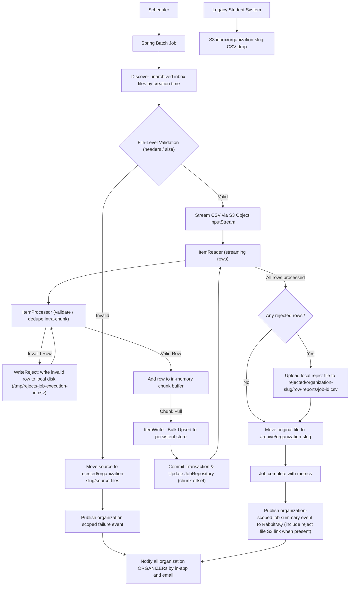

- **File Discovery and Guardrails:** The job discovers only unarchived files in each `inbox/<organization-slug>/` prefix, ordered by object creation time. It resolves the unique slug through the seeded organization registry before validating headers, required columns, and size limits. Invalid source files are moved to `rejected/<organization-slug>/source-files/` and alerted immediately to avoid partial processing and repeated attempts.
- **Streaming File Reader:** The pipeline streams the CSV from S3 via an Object InputStream into the Spring Batch `ItemReader`, ensuring a flat memory footprint and eliminating OOM risk for large files.
- **ItemReader / ItemProcessor / ItemWriter:** The job follows Spring Batch patterns: `ItemReader` streams rows; `ItemProcessor` validates that each `student_number` matches `23` plus six digits (faculty code plus student sequence), that each email is exactly `<student_number>@student.hcmus.edu.vn`, resolves the organization slug from the prefix to its seeded ID and name, requires that name in the Workers-only `INGESTION_EXPECTED_FACULTIES` allow-list, verifies that row faculty matches it, and performs intra-chunk deduplication; and `ItemWriter` performs bulk upserts for committed chunks.
- **Persistent Quarantine (Local Staging then Upload):** Reject rows are appended to a local ephemeral file unique to the job execution (for example, `/tmp/rejects-<job-execution-id>.csv`) during chunk processing. When one or more rows were rejected, the worker uploads that file once to `rejected/<organization-slug>/row-reports/<job-execution-id>.csv`; the organization-scoped completion event includes the key for organizer reporting. Clean runs do not upload an empty row report. This avoids unsupported S3 append operations and filename collisions between concurrent jobs.
- **Chunk Commit & JobRepository (Restartability and Reporting):** Transactions and chunk offsets are committed at the chunk boundary. If the pod crashes after chunk N, the next execution resumes at chunk N+1 based on JobRepository state, preventing duplicate processing. On a final outcome, the worker writes an application-owned `ingestion_job_reports` record with the organization ID, source key, metrics, and exactly one applicable rejection key: a moved source-file key or a row-report key. The organizer report uses this indexed tenant-bound record rather than serialized Spring Batch context or an object key supplied by the client.
- **Intra-chunk Deduplication vs Bulk Upsert:** The `ItemProcessor` de-duplicates rows within the chunk in-memory to avoid intra-chunk constraint conflicts; the `ItemWriter` uses atomic bulk upserts to safely handle inter-chunk duplicates.
- **Archiving & Retention:** Successfully processed source files move from `inbox/<organization-slug>/` to `archive/<organization-slug>/`; file-level validation failures move to `rejected/<organization-slug>/source-files/`; and row-level reports are retained at `rejected/<organization-slug>/row-reports/`. Job summaries include the applicable rejection key for remediation.
- **Organizer Notification Routing:** The ingestion worker publishes an organization-scoped completion event after each successful attempt and a failure event after each file-level rejection. The downstream notifications worker is responsible for broadcasting both event types to every `ORGANIZER` in the target organization through in-app and email channels; the ingestion worker never delivers those channels directly. Until that worker is implemented, the event-publication boundary must carry a code comment documenting the deferred fan-out responsibility.

## 5. Access Control Design

### RBAC Model & Logical Multi-Tenancy

We use **Role-Based Access Control (RBAC)** with three roles:

- **STUDENT:** Browse workshops, register, and access their own QR codes.
- **ORGANIZER:** Create and manage workshops for their organization, including publishing, rescheduling, and cancellations.
- **STAFF:** Perform check-ins only for workshops they are explicitly assigned to.

The system enforces **Logical Multi-Tenancy** that each workshop belongs to an `organization_id` (for example, a Faculty). Authorization is scoped to the organization, not an individual user, so any `ORGANIZER` in the same organization can administer that organization's workshops.

JWTs are strictly signed using **Asymmetric Cryptography (for example, RS256)**. The core Identity/Auth module securely holds the **private key** and generates signed JWTs during login; verifiers only need the public key.

**Example decoded JWT payload:**

```json
{
  "sub": "1b8f8c7b-2e4b-4f6c-9b3b-6b8d2f0c9a12",
  "role": "ORGANIZER",
  "org": "b4d3f9b7-1c2a-4b8d-9e61-2e5f6a7b8c90",
  "jti": "9c1f6c23-0f5d-4f8b-9f51-2d5f3a2f1d9e",
  "sid": "7b123456-1234-1234-1234-1234567890ab",
  "iat": 1767225600,
  "exp": 1767229200
}
```

- The `jti` claim is mandatory to support secure logout and token revocation. Revoked tokens are blocked by storing their `jti` in a Redis blacklist and checking it on every request.
- The `sid` (Session ID) claim binds the access token to its corresponding `refresh_tokens.id` row in PostgreSQL. This allows the active session management flow (`GET /api/v1/auth/sessions`) to identify the caller's current session (`isCurrentSession = true`) and enables selective revocation (`DELETE /api/v1/auth/sessions`) across distributed backend nodes without sticky sessions.

### Account Provisioning & Security

- **Bootstrapping:** Root organizations and initial root `ORGANIZER` accounts are seeded from JSON arrays defined in environment variables (for example, values loaded from a `.env` configuration). On startup, a Spring Boot initializer (for example, `ApplicationRunner`) parses the JSON, checks the database for existing organizations and accounts, and creates only missing records (idempotent). This avoids migration failures and allows new root tenants to be added by updating the environment configuration.
- **Self-Service Student Registration & OTP Activation:** New `STUDENT` accounts are registered in an inactive state (`is_active = false`). The system generates a 6-digit numeric OTP, persists its HMAC-SHA256 hash in `user_verification_tokens` (`token_type = 'ACTIVATION_OTP'`) with a 15-minute TTL, and triggers email delivery via the notifications worker. Upon OTP submission (`POST /api/v1/auth/activate`), the token is marked `used_at = now()` and `is_active` becomes `true`.
- **Self-Service Password Reset:** When a user forgets their password, a 6-digit OTP is generated and stored in `user_verification_tokens` (`token_type = 'PASSWORD_RESET_OTP'`). The user submits their email, OTP, and new password in a single atomic request (`POST /api/v1/auth/password/reset`), which verifies and consumes the OTP (`used_at = now()`), updates the password hash, and revokes all active refresh tokens and sessions.
- **Delegated Creation & Zero-Trust:** When an `ORGANIZER` creates `STAFFs` or invites other `ORGANIZERs` (`POST /api/v1/organizations/users`), they cannot set passwords. The system generates a temporary password, emails it directly to the new user, and sets `is_temporary_password = true`. On first login, the user exchanges the temporary password for a new permanent one via `POST /api/v1/auth/password/temporary`, which clears `is_temporary_password` and immediately issues a full authentication session (tokens + profile).
- **Organization Member Management & Status Gating:** Organizers manage organization users via `GET /api/v1/organizations/users` (keyset cursor pagination, excluding the active organizer) and can deactivate/ban accounts via `PATCH /api/v1/organizations/users/{userId}/status`. Deactivation immediately revokes all refresh tokens and blacklists active JTIs in Redis across all devices.
- **Explicit Staff Assignment & Conflict Prevention:** `STAFF` access is scoped by explicit assignment. A bridging table (`workshop_assignments`) maps `STAFF` to specific workshops. Organizers query available staff without schedule conflicts (`GET /api/v1/workshops/{id}/staff/available`, ignoring canceled workshops) and perform batch assignments (`POST /api/v1/workshops/{id}/staff`). Unassigned `STAFF` cannot scan or sync attendance for other workshops, even within the same organization.
- **Active Session Tracking & Revocation:** Users of any role can inspect their active login sessions (`GET /api/v1/auth/sessions`) with device info and IP addresses, and revoke individual sessions (`DELETE /api/v1/auth/sessions/{id}`) or all other remote sessions (`DELETE /api/v1/auth/sessions`), immediately invalidating tokens via Redis blacklist. The caller's current session is identified across stateless backend nodes using the `sid` claim in the access token. Remote session revocation pairs PostgreSQL `revoked_at` updates with centralized Redis `jti` blacklisting via temporary `session:jti:{sessionId}` tracking, guaranteeing immediate revocation across all horizontally scaled backend instances.

### Multi-Layer Enforcement Points

- **Layer 1 (UI):** Client-side gating hides or disables restricted actions based on the JWT role for user experience only.
- **Layer 2 (API Gateway & Security):** The gateway verifies the JWT signature using the system's public key (typically exposed via a JWKS endpoint), checks the Redis blacklist for the `jti`, and enforces role claims on endpoints.
- **Layer 3 (Data Gating):** The service layer enforces logical multi-tenancy by requiring `workshop.organization_id == jwt.org` on every mutable workshop operation.

**Authorization Sequence Diagram:**

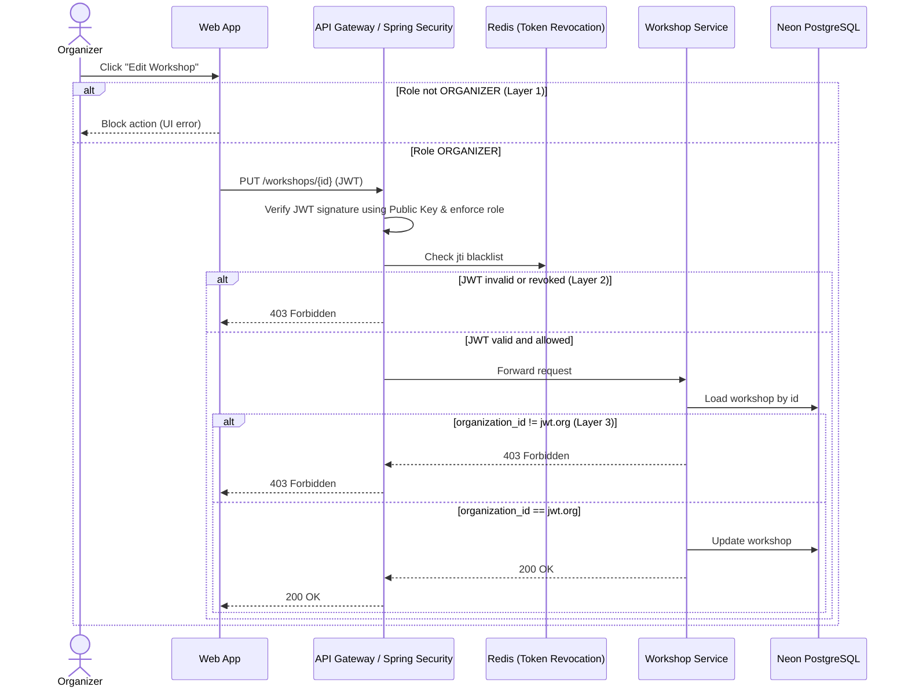

### Offline PKI & Cryptography

The backend securely holds the private key used to sign QR codes. QR payloads are signed server-side and verified offline by the mobile app to prevent forged tickets.

- **Key Distribution:** When a `STAFF` member logs in online, the mobile app fetches the latest public key via the dedicated distribution endpoint. The mobile app stores this key locally (SQLite or secure storage) and uses it to verify signatures while offline.
- **Key Rotation**: Rotating the signing key invalidates compromised signatures globally while allowing the platform to distribute the new public key on the next authenticated session.

## 6. System Protection Mechanisms

### Traffic Spike Management

Registration demand peaks at 12,000 concurrent users within the first 10 minutes, with 60% concentrated in the initial 3-minute window. To keep the backend stable under that burst, the Core Backend Monolith enforces a distributed **Token Bucket** rate limiter at the application filter layer using **Bucket4j** with **Redis** as the shared state store. The API Gateway remains a forwarding proxy and does not perform rate limiting.

Each user or IP is assigned a bucket with a fixed capacity of tokens. Every `POST /registrations` request consumes a token, and tokens refill at a steady rate. This allows short bursts during the first 3 minutes while still capping sustained throughput, preventing the registration service and database from being overwhelmed.

When a bucket is empty, the Core Backend Monolith returns HTTP `429 Too Many Requests` to the gateway, which relays the response to the client. The frontend shows a simple "Please wait" message and retries with backoff, protecting the system while keeping the user informed.

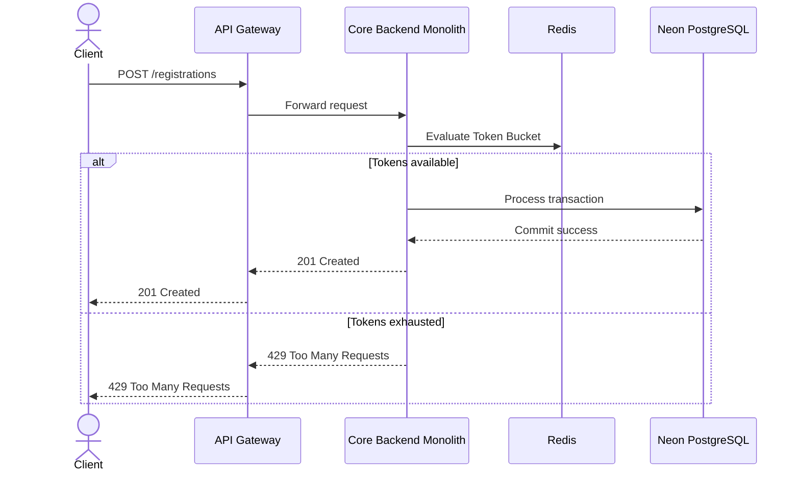

### Third-Party Service Resilience

External payment gateways are inherently unreliable due to network latency, timeouts, and partial outages. If the backend waits on slow payment calls, request threads queue up and can exhaust the Spring Boot thread pool, causing a cascading failure across the system.

To prevent this, the payment integration uses a **Circuit Breaker** implemented with **Resilience4j**. The breaker continuously tracks failure rate and slow-call rate; when thresholds are exceeded, it opens and blocks further payment calls.

When the circuit is open, the system fails fast instead of hanging. Calls intercepted by Resilience4j throw `CallNotPermittedException`, which `GlobalExceptionHandler` maps to `503 Service Unavailable` (`urn:unihub:error:service-unavailable`) accompanied by a `Retry-After` HTTP header matching the configured open-state wait duration. This prevents thread pool exhaustion and informs clients exactly when downstream recovery attempts will begin.

#### Circuit Breaker Configuration

All Circuit Breaker thresholds and state parameters are configurable via environment variables in `application.yml`:

| Configuration Property                                | Default Value | Purpose                                                                         |
| :---------------------------------------------------- | :------------ | :------------------------------------------------------------------------------ |
| `sliding-window-type`                                 | `COUNT_BASED` | Sliding window evaluation type (`COUNT_BASED` or `TIME_BASED`)                  |
| `sliding-window-size`                                 | `10`          | Number of calls recorded in closed state                                        |
| `minimum-number-of-calls`                             | `5`           | Minimum calls required before calculating error rates                           |
| `failure-rate-threshold`                              | `50`          | Percentage of failures to trip breaker to `OPEN` (50%)                          |
| `slow-call-rate-threshold`                            | `50`          | Percentage of slow calls to trip breaker to `OPEN` (50%)                        |
| `slow-call-duration-threshold`                        | `2s`          | Latency beyond which a call is marked slow                                      |
| `wait-duration-in-open-state`                         | `10s`         | Time breaker remains in `OPEN` before entering `HALF_OPEN`                      |
| `permitted-number-of-calls-in-half-open-state`        | `3`           | Trial calls permitted in `HALF_OPEN` to test recovery                           |
| `register-health-indicator`                           | `true`        | Exposes breaker health in Spring Boot Actuator                                  |
| `automatic-transition-from-open-to-half-open-enabled` | `true`        | Automatically transitions from `OPEN` to `HALF_OPEN` when wait duration expires |

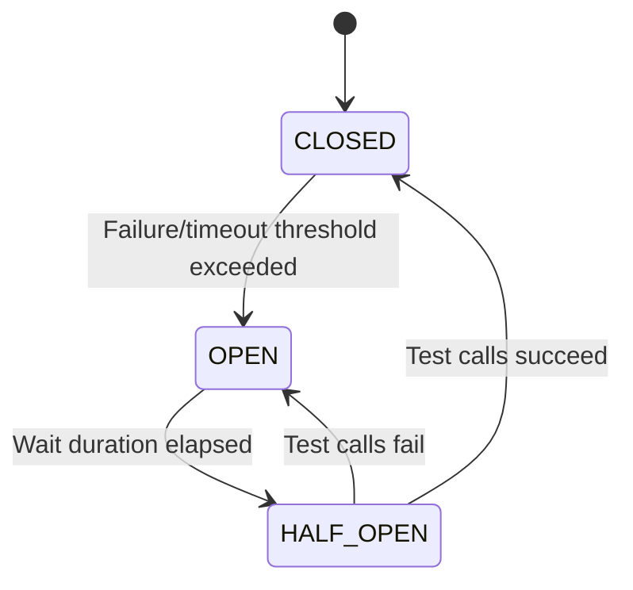

### Transaction Idempotency

Client retries caused by network drops or impatient clicks can create duplicate mutating requests (such as workshop registrations or payment charges), risking double-booking or duplicate charges. The platform implements a **2-Tier Cache-Aside Idempotency Architecture** combining Redis (L1 distributed in-memory cache) for sub-millisecond deduplication and replay with PostgreSQL (`idempotency_keys` table, L2 durable source-of-truth) for atomic exactly-once execution guarantees across horizontally-scaled backend nodes.

#### Architecture & Scoping

- **Key Generation & Header Format:** The authenticated client (React / React Native) generates a UUIDv4 (max 64 chars) and sends it in the `Idempotency-Key` header.
- **Mandatory Endpoints:** Required for business-critical mutating operations with severe financial or capacity risk:
  - Workshop registrations
  - Payment authorizations and charges
  - Offline check-in batch synchronization
  - _Missing header behavior:_ The server immediately rejects the request with `400 Bad Request`.
- **User Scoping & Multi-Tenant Isolation:** The backend stores and caches keys strictly scoped by `(user_id, idempotency_key)`:
  - **Redis L1 Key:** `idempotency:<user_id>:<idempotency_key>`
  - **PostgreSQL L2 Constraint:** `UNIQUE (user_id, idempotency_key)`
  - This prevents key collisions across different users even if two clients generate identical UUIDs coincidentally.
- **Primary DB Routing (ADR-015):** All L2 idempotency reads, claims, and updates route strictly to the **Primary PostgreSQL DB**, never read replicas, eliminating replication-lag anomalies on immediate retries.
- **Horizontal Scaling Consistency:** Node 1 and Node 2 behind Nginx share the centralized Redis cluster and Primary PostgreSQL database. No sticky sessions are required; retries can hit any backend node interchangeably.

#### Cache Hit, Cache Miss, and Cache Invalidation Semantics

1. **L1 Cache Hit (Redis):**
   - **Payload Hash Validation:** The cached entry contains `{status, request_hash, response_code, response_headers, response_body}`. The incoming request computes `SHA-256(method + path + body)`. If the hash does not match the cached `request_hash`, the request is rejected with `409 Conflict` (key reused with different payload).
   - **Status `PENDING`:** Another request with this key is actively processing in flight. Return `409 Conflict` immediately with header `Retry-After: 2` without touching PostgreSQL.
   - **Status `COMPLETED`:** The request was already processed successfully. Return the cached `response_code`, `response_headers`, and `response_body` immediately (instant replay, bypassing all business logic and database queries).
2. **L1 Cache Miss (Fallback to L2 & Cache Backfill):**
   - On an L1 miss (e.g., Redis restart, key eviction under memory pressure, or genuinely new request), the application falls back to Primary PostgreSQL and attempts an atomic claim: `INSERT INTO idempotency_keys (user_id, idempotency_key, request_method, request_path, request_hash, status, expires_at) VALUES (...) ON CONFLICT (user_id, idempotency_key) DO NOTHING RETURNING *;`
   - **Conflict Detected (L2 Hit — Key exists in DB):** The application fetches the existing row from `idempotency_keys`:
     - If `request_hash` does not match: return `409 Conflict`.
     - If `status == 'PENDING'`: return `409 Conflict` (request in progress).
     - If `status == 'COMPLETED'`: **Backfill L1 Cache** by writing `{status: COMPLETED, request_hash, response_code, response_body}` into Redis with the remaining TTL (up to 24h), then replay the stored response to the client (`200/201 OK`).
     - If `status == 'FAILED'`: replay the terminal failure or allow a fresh retry based on the failure category.
   - **Genuinely New Request (Claim Succeeded):** The new row is created in DB with `status = 'PENDING'`. The application sets a short-lived transient claim in Redis: `SET idempotency:<user_id>:<key> {status: PENDING, hash: H} EX 60s` to protect against microsecond concurrent races across nodes, then proceeds to execute the business transaction.
3. **Transaction Completion & Cache Population:**
   - When the business mutation commits successfully, the application updates PostgreSQL within the same transaction: `status = 'COMPLETED'`, `response_code`, `response_body`, `response_headers`, `updated_at = now()`.
   - Redis L1 is populated: `SET idempotency:<user_id>:<key> {status: COMPLETED, ...} EX 86400` (24-hour TTL).
   - The success response is returned to the client.
4. **Cache Invalidation on Failure / Rollback:**
   - **Transient / Retryable Failure (Downstream timeout, circuit breaker open, connection failure):**
     - The application immediately executes **Cache Invalidation** on Redis: `DEL idempotency:<user_id>:<key>`.
     - In PostgreSQL, the `PENDING` row is deleted (or rolled back) so that the client is not locked out and can retry immediately.
   - **Deterministic Business Failure (Validation error, permanent condition):**
     - In PostgreSQL, the record transitions to `status = 'FAILED'`.
     - In Redis, the key is invalidated (`DEL`) or updated to `FAILED` depending on whether fresh attempts with the same key are permitted.
5. **TTL & Cleanup Strategy:**
   - Keys in `idempotency_keys` carry `expires_at = now() + interval '24 hours'`.
   - A scheduled TTL Cleanup Job in the Workers app purges expired rows every 6 hours.
   - The Dual-Case Reconciliation Sweeper (ADR-014 / ADR-022) acts as a fallback for orphaned `PENDING` payment keys after 30 minutes.

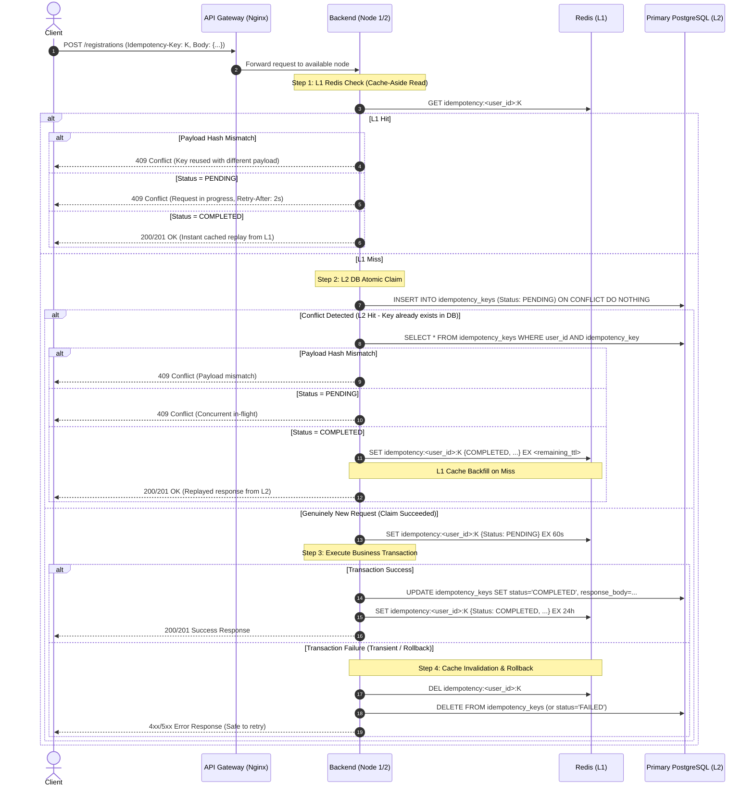

### Overbooking Prevention & Race Condition Mitigation

During high-concurrency spikes (12,000+ requests), the "last seat" scenario can trigger a race condition where multiple requests attempt to claim the final slot simultaneously. Relying on database pessimistic locking (for example, `SELECT ... FOR UPDATE`) is an anti-pattern at this scale because it holds database connections open, blocks request threads, and can exhaust the connection pool under burst traffic.

The platform uses a **lock-free atomic pre-check via Redis**. The Core Backend Monolith issues a `DECR` on the workshop capacity key before opening a database transaction. Redis processes the decrement sequentially in microseconds without blocking backend threads. If the returned value is less than zero, the API immediately returns `409 Conflict` and never touches PostgreSQL, preserving database capacity for legitimate requests.

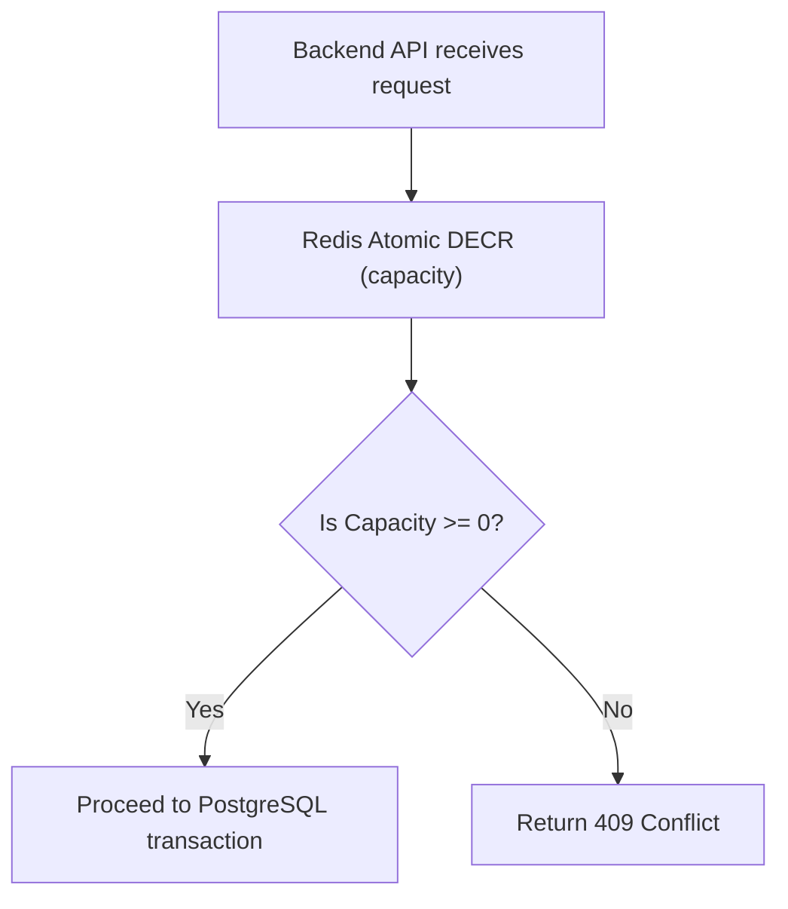

#### Database Constraint as Last-Resort Guard

Redis `DECR` is the first-line defense but is not infallible. The database-level partial unique index on `(workshop_id, student_user_id) WHERE status IN ('PENDING', 'CONFIRMED')` acts as the final safety net. If Redis state is inconsistent during an edge-case concurrent window, the DB constraint will catch the duplicate and the API must handle the resulting unique constraint violation as a `409 Conflict` - identical to a Redis rejection - without propagating a `500` error. This defense-in-depth layering must be explicitly handled in the registration use case implementation.

#### Redis-DB Capacity Reconciliation Job

Redis counter state can drift from the database due to JVM crashes or network interruptions occurring between a successful `DECR` and its corresponding compensating `INCR` on rollback paths (e.g., failed payment, circuit breaker trip). Left unaddressed, this drift causes Redis to permanently under-report available seats even when real capacity exists in PostgreSQL.

A **periodic Capacity Reconciliation Job** runs every 5 minutes to detect and correct drift. It computes ground-truth availability from the database and resets the Redis counter accordingly:

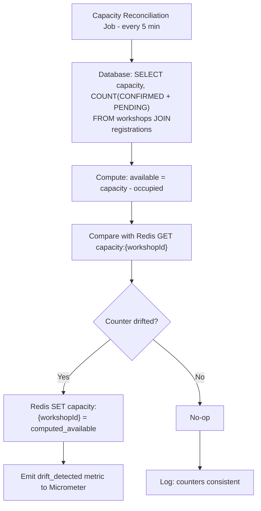

- **Scope:** Runs only against `PUBLISHED` workshops where Redis counter key exists.
- **Atomicity:** The Redis `SET` is unconditional - the computed database value is always authoritative. This is safe because the reconciler runs infrequently and the drift window is bounded.
- **Observability:** Emit a `capacity.drift.detected` counter metric via Micrometer each time a correction is applied. Alert on sustained drift frequency as a signal of systemic rollback failures.
- **Complementary to Sweeper:** The existing Dual-Case Reconciliation Sweeper already performs `INCR` on `FAILED`/timed-out `PENDING` registrations. This reconciliation job is an additional safety net that resets counters to ground truth regardless of what caused the drift.

### System Telemetry & Core Metrics to Track

Micrometer and Grafana MUST track the following telemetry vectors:

- **Database Health:** HikariCP active connections, connection acquisition latency, and lease timeouts.
- **Traffic & Admission Control:** Bucket4j rate-limiting drop rate (HTTP 429 counts) tracked via Redis counter limits.
- **Concurrency & Locks:** Frequency of HTTP 409 Conflicts caused by Redis capacity exhaustion or PostgreSQL `@Version` optimistic locking mismatches.
- **Resilience States:** Resilience4j circuit breaker state transitions (Closed/Open/Half-Open) surrounding the Stripe payment gateway integration.
- **Message Fabric:** RabbitMQ queue depth and processing lag for transactional outbox externalization.
