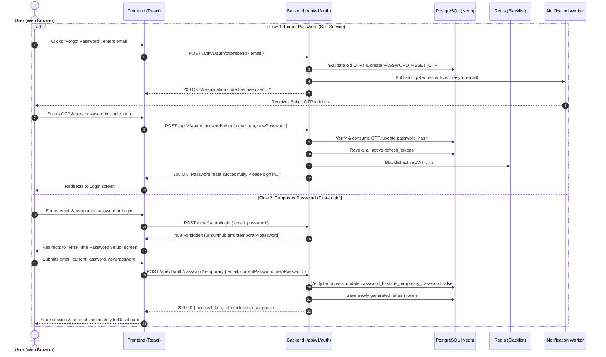

# API Contract: Password Reset

> **Status:** APPROVED  
> **Spec Reference:** `specs/password-reset/SPEC.md`  
> **Last Revised:** 2026-09-06

## 1. Overview

This contract defines the network interfaces for password recovery and initial credential setup under Feature 1.4:

1. `POST /api/v1/auth/otp/resend`: Shared endpoint to request a 6-digit `PASSWORD_RESET_OTP` for an active account.
2. `POST /api/v1/auth/password/reset`: Single-step atomic endpoint to verify the reset OTP, update the password hash, revoke all active refresh tokens in PostgreSQL, and blacklist active JWT JTIs in Redis.
3. `POST /api/v1/auth/password/temporary`: Dedicated first-login endpoint for provisioned Staff/Organizers to exchange their initial temporary password for a permanent password and immediately receive a full authentication session.

## 2. Global Standards Applied

- **URI Convention:** Lowercase, kebab-case prefixed with `/api/v1`.
- **Response Format:** Uniform `ApiResponse<T>` envelope for success:
  ```json
  {
    "success": true,
    "message": "Human-readable message for UI toast",
    "data": { ... },
    "metadata": {
      "processedBy": "unihub-app-1",
      "traceId": "7f6f7c9b2d0b4d8c"
    }
  }
  ```
- **Error Format:** Strict RFC 7807 Problem Details (`application/problem+json`):
  ```json
  {
    "success": false,
    "error": {
      "type": "urn:unihub:error:<category>",
      "title": "Short Title",
      "status": 4xx | 5xx,
      "detail": "Detailed explanation",
      "instance": "/api/v1/auth/..."
    },
    "metadata": {
      "processedBy": "unihub-app-1",
      "traceId": "7f6f7c9b2d0b4d8c"
    }
  }
  ```
- **Public Endpoints:** All three endpoints are public (unauthenticated, no `Authorization` header required).

## 3. Endpoints

### 3.1. POST /api/v1/auth/otp/resend

**Description:** Shared OTP resend endpoint. When called for an active account (`is_active = true`), it invalidates previous unconsumed `PASSWORD_RESET_OTP` records, generates a new 6-digit numeric OTP with a 15-minute TTL, and triggers asynchronous email delivery.  
**Required Role / Auth:** PUBLIC

#### Request

**Headers:**

| Header             | Required | Description                                         |
| :----------------- | :------: | :-------------------------------------------------- |
| `Content-Type`     |   Yes    | Must be `application/json`                          |
| `X-Correlation-ID` |    No    | Client-generated UUID for distributed tracing       |
| `Accept-Language`  |    No    | Preferred locale for error messages (default: `en`) |

**Request Body:**

```json
{
  "email": "student.alice@university.edu"
}
```

**Validation Rules:**

- `email`: Required, valid email format, max 254 characters.

#### Response

**Success — 200 OK:**

```json
{
  "success": true,
  "message": "A verification code has been sent to your email.",
  "metadata": {
    "processedBy": "unihub-app-1",
    "traceId": "7f6f7c9b2d0b4d8c"
  }
}
```

_(Note: `data` is omitted/null per `@JsonInclude(NON_NULL)`)._

**Error Responses (RFC 7807):**

| Status | Error Type (`error.type`)       | Title                 | Condition                                              |
| :----: | :------------------------------ | :-------------------- | :----------------------------------------------------- |
| `400`  | `urn:unihub:error:bad-request`  | Bad Request           | Malformed JSON payload syntax.                         |
| `404`  | `urn:unihub:error:not-found`    | Not Found             | No account exists for the submitted email.             |
| `422`  | `urn:unihub:error:validation`   | Unprocessable Content | Validation error (`email` is blank or invalid format). |
| `429`  | `urn:unihub:error:rate-limited` | Too Many Requests     | Rate limit exceeded (header `Retry-After` present).    |
| `500`  | `urn:unihub:error:internal`     | Internal Server Error | Unexpected server error.                               |

**Side Effects:**

- Invalidates prior unconsumed `PASSWORD_RESET_OTP` tokens in `user_verification_tokens`.
- Inserts new `user_verification_tokens` record with `token_type = 'PASSWORD_RESET_OTP'`, 15-minute TTL, and SHA-256 token hash.
- Publishes `OtpRequestedEvent` (purpose: `PASSWORD_RESET`) to the Transactional Outbox.

### 3.2. POST /api/v1/auth/password/reset

**Description:** Performs an atomic single-step forgot password reset. Validates the submitted 6-digit OTP, updates the user's password hash with Argon2id, revokes all active refresh tokens in PostgreSQL, and blacklists active JWT access token JTIs in Redis.  
**Required Role / Auth:** PUBLIC

#### Request

**Headers:**

| Header             | Required | Description                                         |
| :----------------- | :------: | :-------------------------------------------------- |
| `Content-Type`     |   Yes    | Must be `application/json`                          |
| `X-Correlation-ID` |    No    | Client-generated UUID for distributed tracing       |
| `Accept-Language`  |    No    | Preferred locale for error messages (default: `en`) |

**Request Body:**

```json
{
  "email": "student.alice@university.edu",
  "otp": "849201",
  "newPassword": "BrandNewSecurePassword2026!"
}
```

**Validation Rules:**

- `email`: Required, valid email format, max 254 characters (automatically trimmed of whitespace).
- `otp`: Required, exactly 6 numeric digits matching `^[0-9]{6}$` (automatically trimmed of whitespace).
- `newPassword`: Required, length 8 to 255 characters, contains at least 1 uppercase letter, 1 lowercase letter, 1 digit, and 1 special character (`[!@#$%^&*(),.?":{}|<>]`).

#### Response

**Success — 200 OK:**

```json
{
  "success": true,
  "message": "Password reset successfully. Please sign in with your new password.",
  "metadata": {
    "processedBy": "unihub-app-1",
    "traceId": "7f6f7c9b2d0b4d8c"
  }
}
```

_(Note: `data` is omitted/null per `@JsonInclude(NON_NULL)`. The user is instructed to navigate to Login)._

**Error Responses (RFC 7807):**

| Status | Error Type (`error.type`)                 | Title                  | Condition                                                                                                     |
| :----: | :---------------------------------------- | :--------------------- | :------------------------------------------------------------------------------------------------------------ |
| `400`  | `urn:unihub:error:bad-request`            | Bad Request            | Malformed JSON payload syntax.                                                                                |
| `404`  | `urn:unihub:error:not-found`              | Not Found              | No account exists for the submitted email.                                                                    |
| `415`  | `urn:unihub:error:unsupported-media-type` | Unsupported Media Type | Request `Content-Type` is not `application/json`.                                                             |
| `422`  | `urn:unihub:error:validation`             | Unprocessable Content  | Payload format validation failure (`@Valid`), OR uniform error when the OTP is invalid, expired, or consumed. |
| `429`  | `urn:unihub:error:rate-limited`           | Too Many Requests      | Rate limit exceeded (header `Retry-After` present).                                                           |
| `500`  | `urn:unihub:error:internal`               | Internal Server Error  | Unexpected server error.                                                                                      |

**Error Response Example (404 Not Found):**

```json
{
  "success": false,
  "error": {
    "type": "urn:unihub:error:not-found",
    "title": "Not Found",
    "status": 404,
    "detail": "No account found for this email.",
    "instance": "/api/v1/auth/password/reset"
  },
  "metadata": {
    "processedBy": "unihub-app-1",
    "traceId": "7f6f7c9b2d0b4d8c"
  }
}
```

**Error Response Example (422 Invalid or Expired OTP):**

```json
{
  "success": false,
  "error": {
    "type": "urn:unihub:error:validation",
    "title": "Unprocessable Content",
    "status": 422,
    "detail": "Invalid or expired verification code.",
    "instance": "/api/v1/auth/password/reset",
    "validationErrors": ["otp: Invalid or expired verification code."]
  },
  "metadata": {
    "processedBy": "unihub-app-1",
    "traceId": "7f6f7c9b2d0b4d8c"
  }
}
```

**Side Effects:**

- Consumes the matched OTP record: `used_at = now()`.
- Updates `users.password_hash` with the Argon2id hash of `newPassword`, `users.updated_at = now()`.
- If `is_temporary_password = true`, clears it to `false`.
- Revokes all active refresh tokens for the user in `refresh_tokens` (`revoked_at = now()`).
- Blacklists active JWT access token JTIs in Redis.
- No session or tokens issued.

### 3.3. POST /api/v1/auth/password/temporary

**Description:** Dedicated first-login endpoint for provisioned Staff, Organizers, or seeded accounts where `is_temporary_password = true`. Exchanging the temporary password for a permanent password clears the temporary flag, updates credentials, and directly issues a full authentication session (JWT RS256 access token, refresh token, and user profile data) so the user enters their dashboard immediately.  
**Required Role / Auth:** PUBLIC  
**Reliability & State Transition:** Enforces single-use activation via `is_temporary_password`. Once transitioned to `false`, subsequent retries with the old temporary password fail with `401 Unauthorized` (or `400 Bad Request` if user is already authenticated and permanent password has taken effect).

#### Request

**Headers:**

| Header             | Required | Description                                         |
| :----------------- | :------: | :-------------------------------------------------- |
| `Content-Type`     |   Yes    | Must be `application/json`                          |
| `X-Correlation-ID` |    No    | Client-generated UUID for distributed tracing       |
| `Accept-Language`  |    No    | Preferred locale for error messages (default: `en`) |

**Request Body:**

```json
{
  "email": "staff.bob@unihub.edu",
  "currentPassword": "TempPassword123!",
  "newPassword": "MyOfficialSecurePassword2026!"
}
```

**Validation Rules:**

- `email`: Required, valid email format, max 254 characters (surrounding whitespace is trimmed automatically).
- `currentPassword`: Required, non-blank string.
- `newPassword`: Required, length 8 to 255 characters, contains at least 1 uppercase letter, 1 lowercase letter, 1 digit, and 1 special character (`[!@#$%^&*(),.?":{}|<>]`). Must not be equal to `currentPassword`.

#### Response

**Success — 200 OK (Full Session Issued):**

```json
{
  "success": true,
  "message": "Password updated successfully. Welcome to UniHub!",
  "data": {
    "accessToken": "eyJhbGciOiJSUzI1NiIsInR5cCI6IkpXVCIsImtpZCI6InVuaWh1Yi0yMDI2In0...",
    "refreshToken": "a1b2c3d4e5f67890a1b2c3d4e5f67890a1b2c3d4e5f67890a1b2c3d4e5f67890",
    "tokenType": "Bearer",
    "expiresIn": 3600,
    "user": {
      "id": "e3a89110-534b-4780-928d-192837465012",
      "email": "staff.bob@unihub.edu",
      "fullName": "Bob Tran",
      "role": "STAFF",
      "phoneNumber": "+84901234567",
      "avatarUrl": null,
      "lastLoginAt": "2026-09-06T00:20:00Z",
      "organizationId": "a0eebc99-9c0b-4ef8-bb6d-6bb9bd380a11",
      "studentRecordId": null
    }
  },
  "metadata": {
    "processedBy": "unihub-app-1",
    "traceId": "7f6f7c9b2d0b4d8c"
  }
}
```

**Error Responses (RFC 7807):**

| Status | Error Type (`error.type`)                 | Title                  | Condition                                                                                                           |
| :----: | :---------------------------------------- | :--------------------- | :------------------------------------------------------------------------------------------------------------------ |
| `400`  | `urn:unihub:error:bad-request`            | Bad Request            | Account does not have a temporary password (`is_temporary_password = false`), OR malformed JSON payload syntax.     |
| `401`  | `urn:unihub:error:unauthorized`           | Unauthorized           | Non-existent user, inactive account, or `currentPassword` does not match current password hash.                     |
| `415`  | `urn:unihub:error:unsupported-media-type` | Unsupported Media Type | Request `Content-Type` header is not `application/json`.                                                            |
| `422`  | `urn:unihub:error:validation`             | Unprocessable Content  | Payload validation failure (missing required fields, format violations), or `newPassword` equals `currentPassword`. |
| `429`  | `urn:unihub:error:rate-limited`           | Too Many Requests      | Rate limit exceeded (header `Retry-After` present).                                                                 |
| `500`  | `urn:unihub:error:internal`               | Internal Server Error  | Unexpected server error.                                                                                            |

**Error Response Example (400 Bad Request — Not a Temporary Password):**

```json
{
  "success": false,
  "error": {
    "type": "urn:unihub:error:bad-request",
    "title": "Bad Request",
    "status": 400,
    "detail": "Account does not have a temporary password.",
    "instance": "/api/v1/auth/password/temporary"
  },
  "metadata": {
    "processedBy": "unihub-app-1",
    "traceId": "7f6f7c9b2d0b4d8c"
  }
}
```

**Error Response Example (401 Unauthorized — Invalid Credentials):**

```json
{
  "success": false,
  "error": {
    "type": "urn:unihub:error:unauthorized",
    "title": "Unauthorized",
    "status": 401,
    "detail": "Invalid email or current password",
    "instance": "/api/v1/auth/password/temporary"
  },
  "metadata": {
    "processedBy": "unihub-app-1",
    "traceId": "7f6f7c9b2d0b4d8c"
  }
}
```

**Error Response Example (415 Unsupported Media Type):**

```json
{
  "success": false,
  "error": {
    "type": "urn:unihub:error:unsupported-media-type",
    "title": "Unsupported Media Type",
    "status": 415,
    "detail": "Content-Type must be application/json",
    "instance": "/api/v1/auth/password/temporary"
  },
  "metadata": {
    "processedBy": "unihub-app-1",
    "traceId": "7f6f7c9b2d0b4d8c"
  }
}
```

**Error Response Example (422 Unprocessable Content — Identical Password):**

```json
{
  "success": false,
  "error": {
    "type": "urn:unihub:error:validation",
    "title": "Unprocessable Content",
    "status": 422,
    "detail": "Validation failed for one or more fields.",
    "instance": "/api/v1/auth/password/temporary",
    "validationErrors": [
      "newPassword: New password must be different from the temporary password."
    ]
  },
  "metadata": {
    "processedBy": "unihub-app-1",
    "traceId": "7f6f7c9b2d0b4d8c"
  }
}
```

**Side Effects:**

- Updates `users.password_hash` with Argon2id hash of `newPassword`.
- Sets `users.is_temporary_password = false`.
- Sets `users.last_login_at = now()`, `users.updated_at = now()`.
- Generates a new RS256 JWT access token (valid 3600 seconds) containing standard claims (`sub`, `role`, `org`, `jti`, `sid`, `iat`, `exp`).
- Persists a new refresh token record in `refresh_tokens` table and tracks the active session in Redis (`session:jti:{sessionId}`).
- Emits audit log for successful first-time credential activation.

## 4. Rate Limiting Behavior

All unauthenticated endpoints in this feature (`POST /api/v1/auth/otp/resend`, `POST /api/v1/auth/password/reset`, `POST /api/v1/auth/password/temporary`) are subject to the dedicated Bucket4j `auth-tier` Token Bucket rate limiter (capacity: 20 tokens, refill: 20 per 60 seconds per client IP) at the application filter layer:

- Headers returned on every request: `X-RateLimit-Limit: 20`, `X-RateLimit-Remaining`, `X-RateLimit-Retry-After`.
- Exceeding the rate limit returns HTTP `429 Too Many Requests` with RFC 7807 Problem Detail (`urn:unihub:error:rate-limited`).

### Endpoint Routing Summary

| Path                                   | Auth | Rate Limit Tier | Notes                        |
| :------------------------------------- | :--: | :-------------- | :--------------------------- |
| `POST /api/v1/auth/otp/resend`         |  No  | Auth (20/60s)   | Configured in `public-paths` |
| `POST /api/v1/auth/password/reset`     |  No  | Auth (20/60s)   | Configured in `public-paths` |
| `POST /api/v1/auth/password/temporary` |  No  | Auth (20/60s)   | Configured in `public-paths` |

## 5. UI/UX Workflow Mapping


