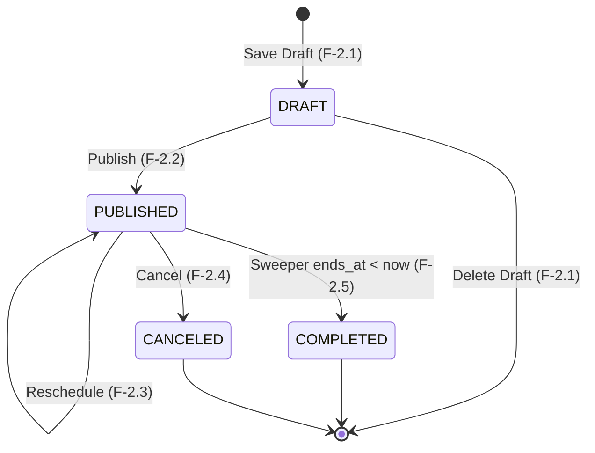

# Spec: Workshop Cancellation

> **Status:** APPROVED  
> **Domain:** 2 — Workshop Lifecycle Management  
> **Owner/area:** `workshops` module — Core Backend (`apps/backend/`)  
> **Last revised:** 2026-10-02 — first version

## 1. Overview

This feature allows an authenticated `ORGANIZER` to cancel an already `PUBLISHED` workshop before it concludes — transitioning its status to `CANCELED` and permanently closing it to further registration. Because cancellation of a live workshop directly affects registered students (refunds, notification emails, search de-indexing, capacity counter invalidation), the operation carries a strict validation burden: it must enforce temporal eligibility (cancellation is prohibited once the workshop has already ended), apply optimistic locking to prevent concurrent-write races, reject any attempt to mutate fields other than the control fields `version` and `reason`, and emit a `WorkshopCanceledEvent` to the Transactional Outbox so that downstream workers can asynchronously cancel registrations, initiate refunds, send notification emails, and purge the Elasticsearch search cache. The feature belongs exclusively to the `workshops` module in the Core Backend (`apps/backend/`) and is exposed as a dedicated `PATCH /api/v1/admin/workshops/{id}/cancel` endpoint.

## 2. Actors & Preconditions

| Actor           | Preconditions                                                                                                                                                 |
| :-------------- | :------------------------------------------------------------------------------------------------------------------------------------------------------------ |
| **ORGANIZER**   | Authenticated via a valid, non-expired RS256 JWT whose `role` claim equals `ORGANIZER` and whose `org` claim matches the target workshop's `organization_id`. |
| _(Other roles)_ | `STUDENT`, `STAFF`, and unauthenticated callers receive `401 Unauthorized` or `403 Forbidden`.                                                                |

## 3. Functional Requirements

### 3.1 Authentication & Multi-Tenant Authorization

- **FR-01:** The system SHALL reject any cancellation request that lacks a valid JWT bearer token with `401 Unauthorized`.
- **FR-02:** The system SHALL reject any cancellation request from an authenticated user whose JWT `role` claim is not `ORGANIZER` with `403 Forbidden`.
- **FR-03:** The system SHALL reject any cancellation request targeting a workshop whose `organization_id` does not match the caller's JWT `org` claim with `403 Forbidden`.
- **FR-04:** The system SHALL reject any cancellation request targeting a workshop identifier that does not exist in PostgreSQL with `404 Not Found`.

### 3.2 Request Validation

- **FR-05:** The system SHALL require a JSON request body containing a mandatory integer `version` field for optimistic locking. If `version` is absent or null, the system SHALL reject the request with `422 Unprocessable Entity`.
- **FR-06:** The system SHALL accept an optional string `reason` field in the request body. When present, `reason` MUST NOT exceed 1000 characters after trimming; if it does, the system SHALL reject the request with `422 Unprocessable Entity`. Blank or whitespace-only values SHALL be treated as absent (null).
- **FR-07:** The system SHALL reject the cancellation request with `422 Unprocessable Entity` if the request body contains any field other than `version` and `reason`. Prohibited fields are: `title`, `description`, `coverImageUrl`, `location`, `timezone`, `startsAt`, `endsAt`, `capacity`, `price`, `currency`, `speakers`, `status`, `organizationId`.

### 3.3 Workshop State Validation

- **FR-08:** The system SHALL reject the cancellation request with `422 Unprocessable Entity` if the workshop is in `DRAFT` status, with a message directing the caller to use the draft deletion endpoint (`DELETE /api/v1/admin/workshops/{id}`).
- **FR-09:** The system SHALL reject the cancellation request with `422 Unprocessable Entity` if the workshop is in `COMPLETED` or `CANCELED` status, with a message indicating the workshop is in a terminal state.

### 3.4 Temporal Eligibility

- **FR-10:** The system SHALL reject the cancellation request with `422 Unprocessable Entity` if the workshop's `ends_at` is in the past or present (`ends_at <= now()`), i.e., the workshop has already concluded. A `PUBLISHED` workshop may be canceled even if it has already started, as long as it has not yet concluded (`ends_at > now()`).

### 3.5 Optimistic Locking

- **FR-11:** The system SHALL reject the cancellation request with `409 Conflict` if the supplied `version` does not match the workshop's stored version.

### 3.6 Atomic Cancellation Execution

- **FR-12:** Upon successful validation, the system SHALL atomically in a single database transaction:
  1. Update `status` to `CANCELED`.
  2. Set `canceled_at = now()`.
  3. Set `updated_at = now()`.
  4. Set `updated_by = callerId`.
  5. Increment `version = version + 1`.
  6. Insert a `WorkshopCanceledEvent` into the `event_publication` table (Transactional Outbox).
- **FR-13:** The `WorkshopCanceledEvent` SHALL carry the following fields: `workshopId`, `organizationId`, `title`, `slug`, `startsAt`, `endsAt`, `canceledAt`, `reason` (nullable, sourced from request — NOT persisted to DB), `occurredAt`.
- **FR-14:** The `WorkshopCanceledEvent` SHALL be configured with Spring Modulith `@Externalized("unihub.events::workshop.canceled")` so that upon transaction commit it is delivered to RabbitMQ exchange `unihub.events` with routing key `workshop.canceled`.
- **FR-15:** The system SHALL return `200 OK` with the full updated workshop representation wrapped in the standard `ApiResponse<WorkshopResponse>` envelope upon successful cancellation. The response SHALL include a `canceledAt` field reflecting the cancellation timestamp.

## 4. Business Rules

- **BR-01 (Cancellation Restricted to PUBLISHED Only):** Only a `PUBLISHED` workshop may be canceled via this endpoint. `DRAFT` workshops must be deleted via the draft deletion endpoint (Feature 2.1). `COMPLETED` and `CANCELED` workshops are in terminal states and cannot transition further.
- **BR-02 (Temporal Eligibility — Already-Concluded Workshops):** A workshop may be canceled if and only if its `ends_at` is strictly in the future at the time the request is processed (`ends_at > now()`). A workshop that has already ended (`ends_at <= now()`) may not be canceled regardless of its status. A workshop that has started but not yet ended (i.e., currently in progress) MAY be canceled.
- **BR-03 (reason is Transient — Not Persisted to DB):** The optional `reason` field supplied in the request body is included exclusively in the `WorkshopCanceledEvent` payload so downstream notification workers can include it in cancellation emails. It is NOT stored in any database column.
- **BR-04 (Strictly Prohibited Fields):** The cancellation operation is exclusively a status mutation. The following fields are strictly immutable via this endpoint and must not appear in the request body: `title`, `description`, `coverImageUrl`, `location`, `timezone`, `startsAt`, `endsAt`, `capacity`, `price`, `currency`, `speakers`, `status`, `organizationId`. Their presence triggers an explicit `422 Unprocessable Entity` with field-level error messages.
- **BR-05 (Optimistic Locking & Lost Update Prevention):** Every cancellation request requires the caller to supply the current `version`, returning `409 Conflict` on mismatch. This prevents concurrent cancellation or modification races from silently overwriting each other.
- **BR-06 (Transactional Outbox for Eventual Consistency):** The `WorkshopCanceledEvent` must be committed to the `event_publication` table within the same ACID transaction as the status update. Downstream effects — registration cancellations, refund initiation, notification email delivery, Elasticsearch cache purge, Redis capacity counter invalidation — are handled asynchronously by RabbitMQ consumers. The backend never synchronously calls registration, payment, notification, or search services.
- **BR-07 (No Direct Redis / Search Side-Effect):** This use case MUST NOT directly interact with Redis or Elasticsearch. Cache purge of `capacity:{workshopId}` and search index removal are handled by downstream event consumers (`q.search`, `q.notifications`, `q.registrations`).
- **BR-08 (Primary Database Routing):** The cancellation operation MUST route to the PostgreSQL Primary to guarantee immediate read-after-write consistency per ADR-015.

## 5. State Transitions



| From State  | Event / Trigger                                               | To State   | Valid? | Rejection Behavior (if invalid)                                                                                       |
| :---------- | :------------------------------------------------------------ | :--------- | :----: | :-------------------------------------------------------------------------------------------------------------------- |
| `PUBLISHED` | `PATCH .../cancel` (ends_at > now)                            | `CANCELED` | ✅ Yes | —                                                                                                                     |
| `PUBLISHED` | `PATCH .../cancel` (ends_at <= now — already concluded)       | —          | ❌ No  | `422 Unprocessable Entity` — Workshop has already concluded and cannot be canceled.                                   |
| `DRAFT`     | `PATCH .../cancel`                                            | —          | ❌ No  | `422 Unprocessable Entity` — Workshop is in DRAFT status; use `DELETE /api/v1/admin/workshops/{id}` to delete drafts. |
| `COMPLETED` | `PATCH .../cancel`                                            | —          | ❌ No  | `422 Unprocessable Entity` — Workshop is in a terminal state (COMPLETED) and cannot be canceled.                      |
| `CANCELED`  | `PATCH .../cancel`                                            | —          | ❌ No  | `422 Unprocessable Entity` — Workshop is in a terminal state (CANCELED) and cannot be canceled.                       |
| `PUBLISHED` | `PATCH .../cancel` (prohibited field in body)                 | —          | ❌ No  | `422 Unprocessable Entity` — prohibited field(s) supplied.                                                            |
| `PUBLISHED` | `PATCH .../cancel` (version mismatch)                         | —          | ❌ No  | `409 Conflict` — optimistic locking failure.                                                                          |
| `PUBLISHED` | `PATCH .../cancel` (version null)                             | —          | ❌ No  | `422 Unprocessable Entity` — `version` is required.                                                                   |
| `PUBLISHED` | `PATCH .../cancel` (reason exceeds 1000 chars after trimming) | —          | ❌ No  | `422 Unprocessable Entity` — `reason` exceeds maximum length of 1000 characters.                                      |

## 6. Non-Functional Requirements

- **NFR-01 (ACID & Outbox Atomicity):** The `status`, `canceled_at`, `updated_at`, `updated_by`, `version` update and the `WorkshopCanceledEvent` insertion into `event_publication` MUST execute within a single `@Transactional` database boundary. A partial commit is never acceptable.
- **NFR-02 (Latency):** Cancellation operations MUST complete with a p95 latency under 150 ms on the Neon PostgreSQL Primary.
- **NFR-03 (Primary Routing):** The cancellation operation MUST route strictly to the Primary database replica per ADR-015 to guarantee immediate read-after-write consistency.
- **NFR-04 (Decoupled Externalization):** Delivery of `WorkshopCanceledEvent` to RabbitMQ MUST be managed exclusively by the Spring Modulith Event Registry (Transactional Outbox pattern), never blocking the HTTP request thread with message broker I/O.
- **NFR-05 (Idempotency Under Concurrent Retries):** Concurrent cancellation requests with the identical version MUST succeed exactly once; the competing request MUST fail with `409 Conflict` via JPA optimistic locking (`@Version`). Because `CANCELED` is a terminal state, a replay with the incremented version will be rejected with `422 Unprocessable Entity` (terminal state), guaranteeing exactly-once semantics.
- **NFR-06 (Modular Purity):** The `workshops` module MUST NOT depend on internal packages or tables of any other module. The cancellation operation is entirely self-contained within the `workshops` module via event emission; no new synchronous cross-module SPI or Facade dependency is required.
- **NFR-07 (Rate Limiting):** The cancel endpoint falls under the Default Tier of the Bucket4j + Redis Token Bucket (100 tokens, 100 per 60 s, keyed by `jwt.sub`). This tier is consistent with the other organizer-facing admin operations on this module.

## 7. Acceptance Criteria

### Scenario 1: Successfully cancel a published workshop that has not yet concluded

```gherkin
Given an authenticated ORGANIZER with organization "org-1"
And a workshop exists with ID "ws-100", organization "org-1", status "PUBLISHED", version 2
And the workshop's ends_at is 2 hours in the future
When the ORGANIZER sends "PATCH /api/v1/admin/workshops/ws-100/cancel" with body:
  """
  {
    "version": 2,
    "reason": "Venue is unavailable due to unforeseen circumstances."
  }
  """
Then the response status is 200 OK
And the response body contains "data.status" equal to "CANCELED"
And the response body contains "data.version" equal to 3
And the response body contains "data.canceledAt" as a non-null ISO 8601 timestamp
And a "WorkshopCanceledEvent" row exists in the "event_publication" table for workshop "ws-100"
And the event payload contains "reason" equal to "Venue is unavailable due to unforeseen circumstances."
And the event payload contains "canceledAt" matching the response's "data.canceledAt"
And the workshop's "canceled_at" column in the database is non-null
And the workshop's "status" column in the database is "CANCELED"
```

### Scenario 2: Successfully cancel a published workshop that has already started but not yet concluded

```gherkin
Given an authenticated ORGANIZER with organization "org-1"
And a workshop exists with ID "ws-101", organization "org-1", status "PUBLISHED", version 1
And the workshop's starts_at is 30 minutes in the past
And the workshop's ends_at is 90 minutes in the future
When the ORGANIZER sends "PATCH /api/v1/admin/workshops/ws-101/cancel" with body:
  """
  {
    "version": 1
  }
  """
Then the response status is 200 OK
And the response body contains "data.status" equal to "CANCELED"
And the event payload contains "reason" as null
```

### Scenario 3: Successfully cancel with no reason supplied

```gherkin
Given an authenticated ORGANIZER with organization "org-1"
And a workshop exists with ID "ws-102", organization "org-1", status "PUBLISHED", version 4
And the workshop's ends_at is 1 day in the future
When the ORGANIZER sends "PATCH /api/v1/admin/workshops/ws-102/cancel" with body:
  """
  {
    "version": 4
  }
  """
Then the response status is 200 OK
And the response body contains "data.status" equal to "CANCELED"
And the event payload contains "reason" as null
```

### Scenario 4: Fail cancellation when workshop has already concluded (ends_at <= now)

```gherkin
Given an authenticated ORGANIZER with organization "org-1"
And a workshop exists with ID "ws-200", organization "org-1", status "PUBLISHED", version 2
And the workshop's ends_at is 1 hour in the past
When the ORGANIZER sends "PATCH /api/v1/admin/workshops/ws-200/cancel" with body:
  """
  {
    "version": 2
  }
  """
Then the response status is 422 Unprocessable Entity
And the error response detail indicates the workshop has already concluded and cannot be canceled
And the workshop's status in the database remains "PUBLISHED"
```

### Scenario 5: Fail cancellation when workshop is in DRAFT status

```gherkin
Given an authenticated ORGANIZER with organization "org-1"
And a workshop exists with ID "ws-201", organization "org-1", status "DRAFT", version 0
When the ORGANIZER sends "PATCH /api/v1/admin/workshops/ws-201/cancel" with body:
  """
  {
    "version": 0
  }
  """
Then the response status is 422 Unprocessable Entity
And the error response detail indicates the workshop is in DRAFT status and directs the caller to use the draft deletion endpoint
```

### Scenario 6: Fail cancellation when workshop is COMPLETED

```gherkin
Given an authenticated ORGANIZER with organization "org-1"
And a workshop exists with ID "ws-202", organization "org-1", status "COMPLETED", version 3
When the ORGANIZER sends "PATCH /api/v1/admin/workshops/ws-202/cancel" with body:
  """
  {
    "version": 3
  }
  """
Then the response status is 422 Unprocessable Entity
And the error response detail indicates the workshop is in a terminal state (COMPLETED)
```

### Scenario 7: Fail cancellation when workshop is already CANCELED

```gherkin
Given an authenticated ORGANIZER with organization "org-1"
And a workshop exists with ID "ws-203", organization "org-1", status "CANCELED", version 5
When the ORGANIZER sends "PATCH /api/v1/admin/workshops/ws-203/cancel" with body:
  """
  {
    "version": 5
  }
  """
Then the response status is 422 Unprocessable Entity
And the error response detail indicates the workshop is in a terminal state (CANCELED)
```

### Scenario 8: Fail cancellation with version mismatch (optimistic locking)

```gherkin
Given an authenticated ORGANIZER with organization "org-1"
And a workshop exists with ID "ws-100", organization "org-1", status "PUBLISHED", version 5
And the workshop's ends_at is 3 days in the future
When the ORGANIZER sends "PATCH /api/v1/admin/workshops/ws-100/cancel" with body:
  """
  {
    "version": 4
  }
  """
Then the response status is 409 Conflict
And the error response contains title "Conflict" and detail referencing a version conflict
And the workshop's status in the database remains "PUBLISHED"
```

### Scenario 9: Fail cancellation when version is null

```gherkin
Given an authenticated ORGANIZER with organization "org-1"
And a workshop exists with ID "ws-100", organization "org-1", status "PUBLISHED", version 2
When the ORGANIZER sends "PATCH /api/v1/admin/workshops/ws-100/cancel" with body:
  """
  {
    "reason": "Canceled for testing."
  }
  """
Then the response status is 422 Unprocessable Entity
And the error response identifies "version" as a required field
```

### Scenario 10: Fail cancellation when request body contains a prohibited field

```gherkin
Given an authenticated ORGANIZER with organization "org-1"
And a workshop exists with ID "ws-100", organization "org-1", status "PUBLISHED", version 2
And the workshop's ends_at is 3 days in the future
When the ORGANIZER sends "PATCH /api/v1/admin/workshops/ws-100/cancel" with body:
  """
  {
    "version": 2,
    "title": "New Title Attempt"
  }
  """
Then the response status is 422 Unprocessable Entity
And the error response identifies "title" as a prohibited field for this endpoint
```

### Scenario 11: Fail cancellation when reason exceeds 1000 characters

```gherkin
Given an authenticated ORGANIZER with organization "org-1"
And a workshop exists with ID "ws-100", organization "org-1", status "PUBLISHED", version 2
And the workshop's ends_at is 3 days in the future
When the ORGANIZER sends "PATCH /api/v1/admin/workshops/ws-100/cancel" with body containing "reason" of 1001 characters
Then the response status is 422 Unprocessable Entity
And the error response identifies "reason" as exceeding the maximum length of 1000 characters
```

### Scenario 12: Fail cancellation when caller belongs to a different organization

```gherkin
Given an authenticated ORGANIZER with organization "org-2"
And a workshop exists with ID "ws-100", organization "org-1", status "PUBLISHED", version 2
When the ORGANIZER sends "PATCH /api/v1/admin/workshops/ws-100/cancel" with body:
  """
  {
    "version": 2
  }
  """
Then the response status is 403 Forbidden
```

### Scenario 13: Fail cancellation when workshop does not exist

```gherkin
Given an authenticated ORGANIZER with organization "org-1"
When the ORGANIZER sends "PATCH /api/v1/admin/workshops/non-existent-id/cancel" with body:
  """
  {
    "version": 1
  }
  """
Then the response status is 404 Not Found
```

### Scenario 14: reason field trimmed — blank value treated as null

```gherkin
Given an authenticated ORGANIZER with organization "org-1"
And a workshop exists with ID "ws-100", organization "org-1", status "PUBLISHED", version 2
And the workshop's ends_at is 1 day in the future
When the ORGANIZER sends "PATCH /api/v1/admin/workshops/ws-100/cancel" with body:
  """
  {
    "version": 2,
    "reason": "   "
  }
  """
Then the response status is 200 OK
And the event payload contains "reason" as null
```

### Scenario 15: WorkshopCanceledEvent is committed atomically — no DB write without event

```gherkin
Given an authenticated ORGANIZER with organization "org-1"
And a workshop exists with ID "ws-100", organization "org-1", status "PUBLISHED", version 2
And the workshop's ends_at is 1 day in the future
When the ORGANIZER sends "PATCH /api/v1/admin/workshops/ws-100/cancel" and the event_publication insert fails
Then the workshop's status in the database remains "PUBLISHED"
And no "WorkshopCanceledEvent" row exists in the "event_publication" table
```

## 8. Out of Scope

- **Registration cancellation:** Canceling individual student registrations for the affected workshop is NOT performed by this feature. It is handled asynchronously by the downstream registration worker upon receiving the `WorkshopCanceledEvent`.
- **Refund processing:** Initiating refunds for paid registrations is NOT performed by this feature. The payment worker independently processes refunds after consuming the event.
- **Notification email delivery:** Sending cancellation notification emails to registered students is NOT performed by this feature. The notifications worker consumes the `WorkshopCanceledEvent` and sends emails; the `reason` field in the event payload is provided for this purpose.
- **Elasticsearch cache purge:** Removing the canceled workshop from the Elasticsearch search index is NOT performed by this feature. The `search_sync` worker handles de-indexing upon consuming the event.
- **Redis capacity counter invalidation:** Zeroing out the `capacity:{workshopId}` key in Redis is NOT performed by this feature. The downstream event consumer of the registrations domain handles this.
- **Draft deletion:** Removing a workshop that is still in `DRAFT` status is performed by the draft management endpoint (`DELETE /api/v1/admin/workshops/{id}`), not this feature.
- **Bulk cancellation:** Canceling multiple workshops in a single request is not supported.
- **Cancellation of COMPLETED workshops:** Once a workshop reaches the `COMPLETED` terminal state (set by the sweeper, Feature 2.5), it cannot be canceled. This is enforced by BR-01.
- **Undoing or reversing a cancellation:** There is no transition from `CANCELED` back to any other status. Cancellation is irreversible.

## 9. Linked References

| Document                                                                                                                        | Relevant Section                                                                                           |
| :------------------------------------------------------------------------------------------------------------------------------ | :--------------------------------------------------------------------------------------------------------- |
| [`docs/feature-catalog.md`](file:///mnt/c/Users/Admin/UniHub/docs/feature-catalog.md)                                           | Feature 2.4 (`workshop-cancellation`) catalog entry                                                        |
| [`docs/system-design.md`](file:///mnt/c/Users/Admin/UniHub/docs/system-design.md)                                               | §4 Workshop Lifecycle Flow — CANCEL OPERATION sequence; Field Mutability/Prohibition Matrix                |
| [`docs/database-schema.md`](file:///mnt/c/Users/Admin/UniHub/docs/database-schema.md)                                           | Table `workshops` (`status`, `canceled_at`, `updated_at`, `updated_by`, `version`); `event_publication`    |
| [`docs/api-standards.md`](file:///mnt/c/Users/Admin/UniHub/docs/api-standards.md)                                               | Response envelope, HTTP status codes, RFC 7807 problem details                                             |
| [`docs/adrs.md`](file:///mnt/c/Users/Admin/UniHub/docs/adrs.md)                                                                 | ADR-006 (RBAC & multi-tenancy), ADR-013 (optimistic locking), ADR-017 (RabbitMQ), ADR-018 (outbox pattern) |
| [`docs/project-structure.md`](file:///mnt/c/Users/Admin/UniHub/docs/project-structure.md)                                       | Modular boundaries and Clean Architecture layering rules; Inter-Module Communication patterns              |
| [`specs/workshop-rescheduling/SPEC.md`](file:///mnt/c/Users/Admin/UniHub/specs/workshop-rescheduling/SPEC.md)                   | FR-10–FR-17, BR-06–BR-08 — patterns this feature mirrors                                                   |
| [`specs/workshop-publishing-and-update/SPEC.md`](file:///mnt/c/Users/Admin/UniHub/specs/workshop-publishing-and-update/SPEC.md) | BR-04 (prohibited fields) — patterns this feature extends                                                  |
