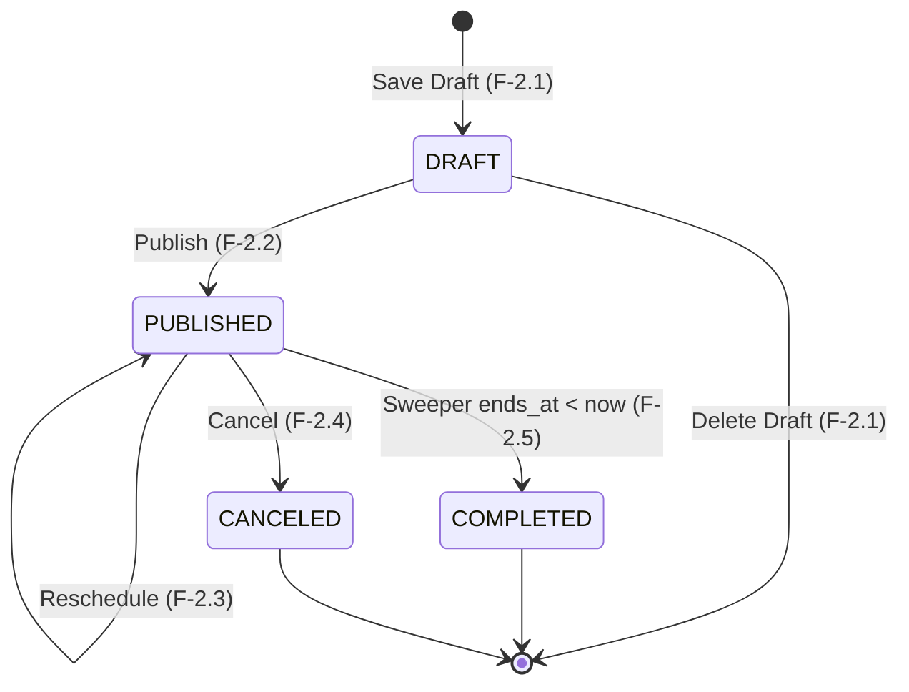

# Spec: Workshop Publishing and Update

> **Status:** APPROVED  
> **Domain:** 2 — Workshop Lifecycle Management  
> **Owner/area:** `workshops` module — Core Backend (`apps/backend/`)  
> **Last revised:** 2026-10-01 — first version

## 1. Overview

This feature governs the lifecycle transition of a workshop from a private draft into a publicly discoverable state (`DRAFT` → `PUBLISHED`), as well as the rules and constraints governing updates to an already `PUBLISHED` workshop:

1. **Publishing a Workshop (`PATCH /api/v1/admin/workshops/{id}/publish`):** Transitions a draft into `PUBLISHED` status. In `DRAFT` status (Feature 2.1), fields such as schedule, location, and capacity are optional to facilitate progressive authoring. Publishing enforces strict completeness validation (all mandatory fields present and valid, start time strictly in the future, and zero speaker schedule collisions). Publishing atomically commits the state change and writes a `WorkshopPublishedEvent` to the PostgreSQL Transactional Outbox (`event_publication` with routing key `search`). The Spring Modulith Event Registry externalizes this event to RabbitMQ queue `q.search`, where the `search_sync` background worker consumes it to index the workshop into Elasticsearch.
2. **Updating a Published Workshop (`PUT /api/v1/admin/workshops/{id}`):** Allows an Organizer to modify presentation and capacity expansion attributes (`title`, `description`, `cover_image_url`, and `capacity`). Updating `title` automatically re-synchronizes the URL `slug`. Updating `cover_image_url` purges any replaced asset from MinIO. Crucially, `capacity` cannot be reduced below the active registration count (`CONFIRMED` + `PENDING`). All core scheduling fields (`starts_at`, `ends_at`), commercial pricing fields (`price`, `currency`), lifecycle states (`status`), ownership (`organization_id`), and `speakers` are strictly immutable via `PUT` (`422 Unprocessable Entity`). Timeline modifications must be performed exclusively via `workshop-rescheduling` (`PATCH .../reschedule`, Feature 2.3). Updates emit a `WorkshopUpdatedEvent` to the outbox for Elasticsearch re-indexing and Redis search cache invalidation, but never dispatch notifications to students.

Both operations are strictly protected by optimistic concurrency control (`version` in request body) to prevent lost updates or inconsistent state transitions from concurrent organizer edits.

## 2. Actors & Preconditions

| Actor           | Preconditions                                                                                                                                          |
| :-------------- | :----------------------------------------------------------------------------------------------------------------------------------------------------- |
| **ORGANIZER**   | Authenticated via a valid, non-expired RS256 JWT whose `role` claim equals `ORGANIZER` and whose `org` claim matches the workshop's `organization_id`. |
| _(Other roles)_ | `STUDENT`, `STAFF`, and unauthenticated callers receive `401 Unauthorized` or `403 Forbidden`.                                                         |

## 3. Functional Requirements

### 3.1 Authentication & Multi-Tenant Authorization

- **FR-01:** The system SHALL reject any request to publish or update a workshop that lacks a valid JWT bearer token with `401 Unauthorized`.
- **FR-02:** The system SHALL reject any request from an authenticated user whose JWT `role` claim is not `ORGANIZER` with `403 Forbidden`.
- **FR-03:** The system SHALL reject any request targeting a workshop whose `organization_id` does not match the caller's JWT `org` claim with `403 Forbidden`.
- **FR-04:** The system SHALL reject any request targeting a workshop identifier that does not exist in PostgreSQL with `404 Not Found`.

### 3.2 Workshop Publishing (`PATCH /api/v1/admin/workshops/{id}/publish`)

- **FR-05:** The system SHALL require a JSON request body containing a mandatory integer `version` field for optimistic locking. If `version` is absent or null, the system SHALL reject the request with `422 Unprocessable Entity`.
- **FR-06:** The system SHALL reject the publish request with `409 Conflict` if the supplied `version` does not match the workshop's stored version.
- **FR-07:** The system SHALL reject the publish request with `422 Unprocessable Entity` if the current status of the workshop is not `DRAFT` (e.g., if already `PUBLISHED`, `COMPLETED`, or `CANCELED`).
- **FR-08:** The system SHALL enforce mandatory field completeness prior to transition, rejecting with `422 Unprocessable Entity` if any of the following conditions are met:
  - `title` is null, blank, or exceeds 255 characters.
  - `starts_at` is null.
  - `ends_at` is null.
  - `ends_at` is not strictly after `starts_at`.
  - `location` is null, blank, or exceeds 255 characters.
  - `capacity` is null, less than 1, or greater than 1,000,000.
- **FR-09:** The system SHALL reject the publish request with `422 Unprocessable Entity` if `starts_at` is in the past or present (`starts_at <= now()`).
- **FR-10:** If the workshop has attached speakers, the system SHALL re-verify that none of the speaker emails conflict with any other active (`PUBLISHED` or `COMPLETED`) workshop in the overlapping `starts_at`–`ends_at` time window (excluding the current workshop). If an overlap is detected, the system SHALL reject the request with `422 Unprocessable Entity` and identify the conflicting speaker email(s).
- **FR-11:** Upon successful validation, the system SHALL atomically in a single database transaction:
  1. Update `status = PUBLISHED`.
  2. Set `published_at = now()`.
  3. Set `updated_at = now()`.
  4. Set `updated_by = callerId`.
  5. Increment `version = version + 1`.
  6. Insert a `WorkshopPublishedEvent` into the `event_publication` table (Transactional Outbox).
- **FR-12:** The `WorkshopPublishedEvent` SHALL be configured with Spring Modulith `@Externalized("unihub.events::search")` so that upon transaction commit, it is delivered to RabbitMQ exchange `unihub.events` with routing key `search`.
- **FR-13:** The system SHALL return HTTP `200 OK` with the full published workshop representation wrapped in `ApiResponse<WorkshopResponse>`.

### 3.3 Updating a Published Workshop (`PUT /api/v1/admin/workshops/{id}`)

- **FR-14:** The system SHALL require a JSON request body containing a mandatory integer `version` field for optimistic locking. If `version` is absent or null, the system SHALL reject the request with `422 Unprocessable Entity`.
- **FR-15:** The system SHALL reject the update request with `409 Conflict` if the supplied `version` does not match the workshop's stored version.
- **FR-16:** The system SHALL reject the update request with `422 Unprocessable Entity` if the targeted workshop is in `DRAFT` status (with detail directing the caller to `POST /api/v1/admin/workshops/drafts`), or if the workshop is in a terminal state (`COMPLETED` or `CANCELED`).
- **FR-17:** The system SHALL accept and update any combination of the following presentation and capacity expansion fields (all presentation/capacity fields are optional; omitted or null fields retain their current stored database values):
  - `title`: Optional string; if provided, must not be blank and length between 1 and 255 characters.
  - `description`: Optional string, up to 5000 characters (blank string normalized to null).
  - `cover_image_url`: Optional valid HTTP/HTTPS URL, up to 2048 characters (blank string normalized to null).
  - `capacity`: Optional integer; if provided, must be between 1 and 1,000,000.
- **FR-18:** If `title` is provided and different from the current title, the system SHALL re-generate and update the URL `slug` using the transliteration slug generator, appending a unique suffix if a slug collision occurs. If `title` is omitted or null, the current `title` and `slug` remain unchanged.
- **FR-19:** If `cover_image_url` is modified or removed, the system SHALL delete the previous cover image asset from MinIO bucket `unihub-media` if it was hosted in the system's MinIO storage.
- **FR-20:** If `capacity` is provided, prior to updating `capacity`, the system SHALL query the current active registration count (`COUNT(*) FROM registrations WHERE workshop_id = :id AND status IN ('CONFIRMED', 'PENDING')`) from the primary database. The system SHALL reject the request with `422 Unprocessable Entity` if the proposed `capacity` is less than the current active registration count. If `capacity` is omitted or null, the current `capacity` remains unchanged.
- **FR-21:** The system SHALL reject the update request with `422 Unprocessable Entity` if the client attempts to modify any strictly prohibited field:
  - `starts_at` or `ends_at` (must use `PATCH /api/v1/admin/workshops/{id}/reschedule`).
  - `price` or `currency` (strictly immutable once published).
  - `status` (must use dedicated state transitions).
  - `organization_id` (immutable tenant boundary).
  - `speakers` (immutable via PUT).
- **FR-22:** Upon successful validation, the system SHALL atomically in a single database transaction:
  1. Apply updates for provided fields (`title`, `slug`, `description`, `cover_image_url`, `capacity`) while retaining unprovided fields.
  2. Set `updated_at = now()`.
  3. Set `updated_by = callerId`.
  4. Increment `version = version + 1`.
  5. Insert a `WorkshopUpdatedEvent` into the `event_publication` table (Transactional Outbox).
- **FR-23:** The `WorkshopUpdatedEvent` SHALL be configured with Spring Modulith `@Externalized("unihub.events::search")` so that upon transaction commit, it is delivered to RabbitMQ exchange `unihub.events` with routing key `search`.
- **FR-24:** The system SHALL NOT emit notification events to students on published workshop update (presentation and capacity updates do not disrupt attendee schedules).
- **FR-25:** The system SHALL return HTTP `200 OK` with the full updated workshop representation wrapped in `ApiResponse<WorkshopResponse>`.

## 4. Business Rules

- **BR-01 (Single Valid Publish Origin):** A workshop can only enter `PUBLISHED` status from `DRAFT`. Re-publishing an already `PUBLISHED` workshop or attempting to publish a `COMPLETED` or `CANCELED` workshop is strictly invalid (`422 Unprocessable Entity`).
- **BR-02 (Zero Past Publishing):** A workshop cannot be published if its scheduled start time has already passed (`starts_at <= now()`). Organizers must reschedule the draft before publishing.
- **BR-03 (Speaker Double-Booking Prevention):** Publishing verifies that no assigned speaker is double-booked in any other active (`PUBLISHED` or `COMPLETED`) workshop in the overlapping time window.
- **BR-04 (Published Field Mutability Boundary):** Once published, commercial pricing (`price`, `currency`) and schedule timing (`starts_at`, `ends_at`) cannot be altered via generic update. Pricing is locked to protect students who have already registered, and schedule changes require dedicated rescheduling to trigger conflict checks and mass student alerts.
- **BR-05 (Attendee Capacity Floor):** Sizing down `capacity` is strictly bounded by active attendees: `capacity >= count(CONFIRMED + PENDING registrations)`. Capacity may be expanded to accommodate more attendees or maintained at current levels.
- **BR-06 (Optimistic Locking & Lost Update Prevention):** Every state mutation (publish and update) requires caller `version` matching the stored entity version, returning `409 Conflict` on mismatch.
- **BR-07 (Slug Integrity):** The `slug` must remain synchronized with `title` across both draft and published updates, ensuring human-readable, SEO-friendly URLs.
- **BR-08 (Orphaned Media Cleanup):** When `cover_image_url` is replaced during an update, the old asset in MinIO bucket `unihub-media` must be purged to avoid storage leaks.
- **BR-09 (Eventual Consistency for Search):** Core backend mutations never synchronously call Elasticsearch or RabbitMQ directly. Changes are committed to `workshops` and `event_publication` within the same ACID transaction. Asynchronous worker consumption handles Elasticsearch synchronization.
- **BR-10 (No Student Spam):** Non-disruptive updates (title corrections, description polishing, capacity expansion) must never trigger notifications to students.

## 5. State Transitions



| Source State | Target State          | Trigger Endpoint    | Validations & Conditions                                                               | Result                                                                             |
| :----------- | :-------------------- | :------------------ | :------------------------------------------------------------------------------------- | :--------------------------------------------------------------------------------- |
| `DRAFT`      | `PUBLISHED`           | `PATCH .../publish` | `version` match, mandatory fields present, `starts_at > now()`, zero speaker conflicts | Status becomes `PUBLISHED`, `published_at = now()`, emits `WorkshopPublishedEvent` |
| `PUBLISHED`  | `PUBLISHED`           | `PUT .../{id}`      | `version` match, `capacity >= active registrations`, no prohibited fields altered      | Details updated, `version` incremented, emits `WorkshopUpdatedEvent`               |
| `PUBLISHED`  | `PUBLISHED`           | `PATCH .../publish` | Status is already `PUBLISHED`                                                          | **Rejected (`422 Unprocessable Entity`)**                                          |
| `COMPLETED`  | `PUBLISHED`           | `PATCH .../publish` | Workshop already finished                                                              | **Rejected (`422 Unprocessable Entity`)**                                          |
| `CANCELED`   | `PUBLISHED`           | `PATCH .../publish` | Workshop canceled                                                                      | **Rejected (`422 Unprocessable Entity`)**                                          |
| `DRAFT`      | `PUBLISHED` (via PUT) | `PUT .../{id}`      | Drafts must be updated via draft endpoint                                              | **Rejected (`422 Unprocessable Entity`)**                                          |
| `COMPLETED`  | Any                   | `PUT .../{id}`      | Terminal state is immutable                                                            | **Rejected (`422 Unprocessable Entity`)**                                          |
| `CANCELED`   | Any                   | `PUT .../{id}`      | Terminal state is immutable                                                            | **Rejected (`422 Unprocessable Entity`)**                                          |

## 6. Non-Functional Requirements

- **NFR-01 (ACID & Outbox Atomicity):** Workshop state update and event insertion into `event_publication` MUST execute within a single `@Transactional` database boundary.
- **NFR-02 (Latency):** Publish and update operations MUST complete with a p95 latency under 150ms on Neon PostgreSQL Primary.
- **NFR-03 (Primary Routing):** Both publish and update operations MUST route strictly to the Primary database replica per ADR-015 to guarantee immediate read-after-write consistency.
- **NFR-04 (Decoupled Externalization):** Delivery of domain events to RabbitMQ MUST be managed exclusively by the Spring Modulith Event Registry, never blocking the HTTP request thread with message broker I/O.
- **NFR-05 (Idempotency Under Concurrent Retries):** Concurrent publish requests with identical version MUST succeed exactly once; the competing concurrent request MUST fail with `409 Conflict` via JPA optimistic locking (`@Version`).
- **NFR-06 (Modular Purity):** Module `workshops` MUST NOT depend on internal packages of any other module. Active registration count checks MUST be mediated through an internal outbound port and persistence adapter.

## 7. Acceptance Criteria (Gherkin)

### Scenario 1: Successfully publish a complete workshop draft

```gherkin
Given an authenticated ORGANIZER with organization "org-1"
And a workshop exists with ID "ws-100", organization "org-1", status "DRAFT", version 0
And the workshop has valid title, location, capacity 100, starts_at 2 days in the future, ends_at 2 days + 2 hours in the future
And assigned speakers have no overlapping schedules with active workshops
When the ORGANIZER sends "PATCH /api/v1/admin/workshops/ws-100/publish" with body:
  """
  {
    "version": 0
  }
  """
Then the response status is 200 OK
And the response body contains "data.status" equal to "PUBLISHED"
And the response body contains "data.publishedAt" as a non-null ISO-8601 UTC timestamp
And the response body contains "data.version" equal to 1
And a "WorkshopPublishedEvent" row exists in the "event_publication" table for workshop "ws-100"
```

### Scenario 2: Fail to publish draft with optimistic locking version mismatch

```gherkin
Given an authenticated ORGANIZER with organization "org-1"
And a workshop exists with ID "ws-100", organization "org-1", status "DRAFT", version 2
When the ORGANIZER sends "PATCH /api/v1/admin/workshops/ws-100/publish" with body:
  """
  {
    "version": 1
  }
  """
Then the response status is 409 Conflict
And the error response contains title "Conflict" and detail referencing version conflict
And the workshop status in the database remains "DRAFT"
```

### Scenario 3: Fail to publish an incomplete draft (missing location and ends_at)

```gherkin
Given an authenticated ORGANIZER with organization "org-1"
And a workshop exists with ID "ws-101", organization "org-1", status "DRAFT", version 0
And the workshop has title "Draft Workshop", starts_at 3 days in the future, but location is null and ends_at is null
When the ORGANIZER sends "PATCH /api/v1/admin/workshops/ws-101/publish" with body:
  """
  {
    "version": 0
  }
  """
Then the response status is 422 Unprocessable Entity
And the error response identifies "location" and "endsAt" as missing mandatory fields
And the workshop status in the database remains "DRAFT"
```

### Scenario 4: Fail to publish a workshop whose scheduled start time has passed

```gherkin
Given an authenticated ORGANIZER with organization "org-1"
And a workshop exists with ID "ws-102", organization "org-1", status "DRAFT", version 0
And the workshop starts_at was 1 hour ago and ends_at is 1 hour in the future
When the ORGANIZER sends "PATCH /api/v1/admin/workshops/ws-102/publish" with body:
  """
  {
    "version": 0
  }
  """
Then the response status is 422 Unprocessable Entity
And the error response detail indicates that the workshop start time must be in the future
```

### Scenario 5: Fail to publish a draft with speaker schedule collision

```gherkin
Given an authenticated ORGANIZER with organization "org-1"
And a workshop exists with ID "ws-103", organization "org-1", status "DRAFT", version 0, scheduled tomorrow 09:00 to 11:00 UTC
And workshop "ws-103" has speaker with email "john@speaker.com"
And another workshop "ws-999" has status "PUBLISHED", scheduled tomorrow 10:00 to 12:00 UTC, with speaker "john@speaker.com"
When the ORGANIZER sends "PATCH /api/v1/admin/workshops/ws-103/publish" with body:
  """
  {
    "version": 0
  }
  """
Then the response status is 422 Unprocessable Entity
And the error response indicates a speaker schedule collision for email "john@speaker.com"
```

### Scenario 6: Fail to publish a workshop that is already PUBLISHED

```gherkin
Given an authenticated ORGANIZER with organization "org-1"
And a workshop exists with ID "ws-104", organization "org-1", status "PUBLISHED", version 1
When the ORGANIZER sends "PATCH /api/v1/admin/workshops/ws-104/publish" with body:
  """
  {
    "version": 1
  }
  """
Then the response status is 422 Unprocessable Entity
And the error response detail indicates an invalid state transition (only DRAFT can be published)
```

### Scenario 7: Successfully update presentation and capacity of a PUBLISHED workshop

```gherkin
Given an authenticated ORGANIZER with organization "org-1"
And a workshop exists with ID "ws-200", organization "org-1", status "PUBLISHED", version 1, title "Old Title", capacity 100
And the current active registration count for "ws-200" is 45
When the ORGANIZER sends "PUT /api/v1/admin/workshops/ws-200" with body:
  """
  {
    "version": 1,
    "title": "New Updated Title",
    "description": "Updated comprehensive description",
    "coverImageUrl": "https://media.unihub.com/workshops/covers/new.webp",
    "capacity": 150
  }
  """
Then the response status is 200 OK
And the response body contains "data.title" equal to "New Updated Title"
And the response body contains "data.slug" synchronized to "new-updated-title"
And the response body contains "data.capacity" equal to 150
And the response body contains "data.version" equal to 2
And a "WorkshopUpdatedEvent" row exists in the "event_publication" table for workshop "ws-200"
```

### Scenario 8: Fail to reduce capacity below active registration count

```gherkin
Given an authenticated ORGANIZER with organization "org-1"
And a workshop exists with ID "ws-201", organization "org-1", status "PUBLISHED", version 2, capacity 100
And the workshop has 60 CONFIRMED registrations and 10 PENDING registrations (active total: 70)
When the ORGANIZER sends "PUT /api/v1/admin/workshops/ws-201" with body:
  """
  {
    "version": 2,
    "title": "Workshop Title",
    "capacity": 50
  }
  """
Then the response status is 422 Unprocessable Entity
And the error response detail indicates that capacity cannot be reduced below the active registration count of 70
And the workshop capacity in the database remains 100
```

### Scenario 9: Fail to update a published workshop with prohibited fields

```gherkin
Given an authenticated ORGANIZER with organization "org-1"
And a workshop exists with ID "ws-202", organization "org-1", status "PUBLISHED", version 1
When the ORGANIZER sends "PUT /api/v1/admin/workshops/ws-202" with body:
  """
  {
    "version": 1,
    "title": "Valid Title",
    "capacity": 100,
    "price": 25.00
  }
  """
Then the response status is 422 Unprocessable Entity
And the error response detail indicates that field "price" is immutable once published
```

### Scenario 10: Fail to update a DRAFT workshop via PUT endpoint

```gherkin
Given an authenticated ORGANIZER with organization "org-1"
And a workshop exists with ID "ws-203", organization "org-1", status "DRAFT", version 0
When the ORGANIZER sends "PUT /api/v1/admin/workshops/ws-203" with body:
  """
  {
    "version": 0,
    "title": "Updated Title",
    "capacity": 100
  }
  """
Then the response status is 422 Unprocessable Entity
And the error response detail directs caller to use "POST /api/v1/admin/workshops/drafts"
```

### Scenario 11: Fail to update or publish when caller belongs to different organization

```gherkin
Given an authenticated ORGANIZER with organization "org-2"
And a workshop exists with ID "ws-300", organization "org-1", status "PUBLISHED", version 1
When the ORGANIZER sends "PUT /api/v1/admin/workshops/ws-300" with body:
  """
  {
    "version": 1,
    "title": "Attempted Hijack",
    "capacity": 100
  }
  """
Then the response status is 403 Forbidden
```

### Scenario 12: Cover image cleanup on published workshop update

```gherkin
Given an authenticated ORGANIZER with organization "org-1"
And a workshop exists with ID "ws-400", organization "org-1", status "PUBLISHED", version 1
And the workshop has existing coverImageUrl "http://localhost:9000/unihub-media/workshops/covers/old-asset.webp"
When the ORGANIZER sends "PUT /api/v1/admin/workshops/ws-400" with body:
  """
  {
    "version": 1,
    "title": "Same Title",
    "capacity": 100,
    "coverImageUrl": "http://localhost:9000/unihub-media/workshops/covers/new-asset.webp"
  }
  """
Then the response status is 200 OK
And the previous object "workshops/covers/old-asset.webp" is deleted from MinIO storage
```

### Scenario 13: Successfully perform partial update on a PUBLISHED workshop (only capacity)

```gherkin
Given an authenticated ORGANIZER with organization "org-1"
And a workshop exists with ID "ws-200b", organization "org-1", status "PUBLISHED", version 1, title "Original Title", slug "original-title", capacity 100
And the current active registration count for "ws-200b" is 45
When the ORGANIZER sends "PUT /api/v1/admin/workshops/ws-200b" with body:
  """
  {
    "version": 1,
    "capacity": 200
  }
  """
Then the response status is 200 OK
And the response body contains "data.title" equal to "Original Title"
And the response body contains "data.slug" equal to "original-title"
And the response body contains "data.capacity" equal to 200
And the response body contains "data.version" equal to 2
And a "WorkshopUpdatedEvent" row exists in the "event_publication" table for workshop "ws-200b"
```

## 8. Out of Scope

- **Workshop Rescheduling (Feature 2.3):** Modifying `starts_at` or `ends_at` of a published workshop requires complex collision checks across rooms and speakers and mass student notifications. It is strictly handled by `PATCH .../reschedule`.
- **Workshop Cancellation (Feature 2.4):** Transitioning `PUBLISHED` → `CANCELED` and triggering student refund/notification flows is handled by `PATCH .../cancel`.
- **Worker Search Synchronization (Domain 3 / `search_sync`):** Consuming `WorkshopPublishedEvent` and `WorkshopUpdatedEvent` from RabbitMQ and maintaining the Elasticsearch document index belongs to the background worker implementation. This feature's responsibility ends with committing events to the transactional outbox (`event_publication`).
- **Student Discovery & Catalog Browsing (Domain 3):** Exposing public read endpoints (`GET /api/v1/workshops`) with Elasticsearch CQRS and Redis SWR cache-aside belongs to Domain 3.
- **Draft Authoring (Feature 2.1):** First-time draft creation and modification of workshops in `DRAFT` status remain exclusively within `POST /api/v1/admin/workshops/drafts`.

## 9. Linked References

| Document                                                                                  | Relevant Section                                                                |
| :---------------------------------------------------------------------------------------- | :------------------------------------------------------------------------------ |
| [`docs/feature-catalog.md`](file:///mnt/c/Users/Admin/UniHub/docs/feature-catalog.md)     | Feature 2.2 (`workshop-publishing-and-update`) catalog entry                    |
| [`docs/system-design.md`](file:///mnt/c/Users/Admin/UniHub/docs/system-design.md)         | §4 Workshop Lifecycle Flow, Field Mutability Matrix, Asynchronous Event Fan-out |
| [`docs/database-schema.md`](file:///mnt/c/Users/Admin/UniHub/docs/database-schema.md)     | Table `workshops`, table `registrations`, table `event_publication`             |
| [`docs/api-standards.md`](file:///mnt/c/Users/Admin/UniHub/docs/api-standards.md)         | Response envelope, HTTP status codes, RFC 7807 problem details                  |
| [`docs/adrs.md`](file:///mnt/c/Users/Admin/UniHub/docs/adrs.md)                           | ADR-006 (RBAC & multi-tenancy), ADR-013 (optimistic locking), ADR-018 (outbox)  |
| [`docs/project-structure.md`](file:///mnt/c/Users/Admin/UniHub/docs/project-structure.md) | Modular boundaries and Clean Architecture layering rules                        |
