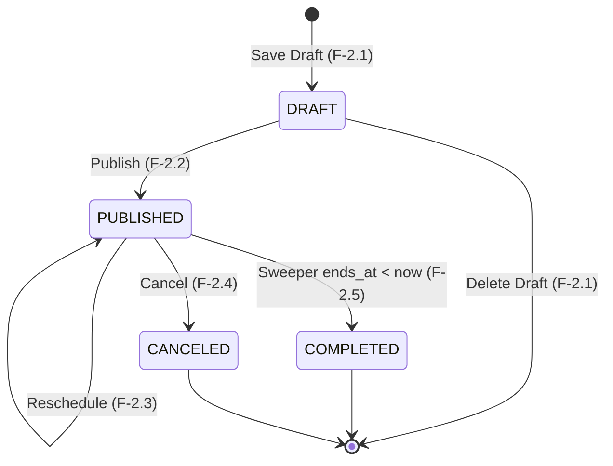

# Spec: Workshop Rescheduling

> **Status:** APPROVED  
> **Domain:** 2 — Workshop Lifecycle Management  
> **Owner/area:** `workshops` module — Core Backend (`apps/backend/`)  
> **Last revised:** 2026-10-01 — first version

## 1. Overview

This feature allows an authenticated `ORGANIZER` to modify the scheduled start and end times of an already `PUBLISHED` workshop — an operation explicitly disallowed by the generic update endpoint (Feature 2.2). Because rescheduling a live workshop directly affects registered students, the operation carries a much higher validation and notification burden than a simple field update: it must re-verify speaker schedule conflicts against the new time window, perform a campus-wide location collision check for the new time window, emit a `WorkshopRescheduledEvent` to the Transactional Outbox (so downstream workers can notify registered students and re-index the Elasticsearch document), and reject any attempt to modify any field other than the new schedule. The feature belongs exclusively to the `workshops` module in the Core Backend (`apps/backend/`) and is exposed as a dedicated `PATCH /api/v1/admin/workshops/{id}/reschedule` endpoint.

## 2. Actors & Preconditions

| Actor           | Preconditions                                                                                                                                                 |
| :-------------- | :------------------------------------------------------------------------------------------------------------------------------------------------------------ |
| **ORGANIZER**   | Authenticated via a valid, non-expired RS256 JWT whose `role` claim equals `ORGANIZER` and whose `org` claim matches the target workshop's `organization_id`. |
| _(Other roles)_ | `STUDENT`, `STAFF`, and unauthenticated callers receive `401 Unauthorized` or `403 Forbidden`.                                                                |

## 3. Functional Requirements

### 3.1 Authentication & Multi-Tenant Authorization

- **FR-01:** The system SHALL reject any reschedule request that lacks a valid JWT bearer token with `401 Unauthorized`.
- **FR-02:** The system SHALL reject any reschedule request from an authenticated user whose JWT `role` claim is not `ORGANIZER` with `403 Forbidden`.
- **FR-03:** The system SHALL reject any reschedule request targeting a workshop whose `organization_id` does not match the caller's JWT `org` claim with `403 Forbidden`.
- **FR-04:** The system SHALL reject any reschedule request targeting a workshop identifier that does not exist in PostgreSQL with `404 Not Found`.

### 3.2 Request Validation

- **FR-05:** The system SHALL require a JSON request body containing a mandatory integer `version` field for optimistic locking. If `version` is absent or null, the system SHALL reject the request with `422 Unprocessable Entity`.
- **FR-06:** The system SHALL reject the reschedule request with `409 Conflict` if the supplied `version` does not match the workshop's stored version.
- **FR-07:** The system SHALL require both `startsAt` and `endsAt` fields in the request body. If either is absent or null, the system SHALL reject the request with `422 Unprocessable Entity`.
- **FR-08:** The system SHALL reject the reschedule request with `422 Unprocessable Entity` if the new `endsAt` is not strictly after the new `startsAt`.
- **FR-09:** The system SHALL reject the reschedule request with `422 Unprocessable Entity` if the new `startsAt` is in the past or present (`startsAt <= now()`).
- **FR-10:** The system SHALL reject the reschedule request with `422 Unprocessable Entity` if the request body contains any field other than `startsAt`, `endsAt`, and `version`. Prohibited fields are: `title`, `description`, `coverImageUrl`, `location`, `capacity`, `price`, `currency`, `speakers`, `status`, `organizationId`.

### 3.3 Workshop State Validation

- **FR-11:** The system SHALL reject the reschedule request with `422 Unprocessable Entity` if the workshop is not in `PUBLISHED` status. Specifically:
  - If the workshop is in `DRAFT` status: reject with a message directing the caller to use the draft management endpoint.
  - If the workshop is in `COMPLETED` or `CANCELED` status: reject with a message indicating the workshop is in a terminal state.

### 3.4 Conflict Checks Against New Time Window

- **FR-12:** The system SHALL re-verify speaker schedule conflicts against the new `[startsAt, endsAt]` window. If the workshop has attached speakers, no speaker's email may overlap with any other active (`PUBLISHED` or `COMPLETED`) workshop in the new overlapping time window (excluding the current workshop itself). If an overlap is detected, the system SHALL reject the request with `422 Unprocessable Entity` and identify the conflicting speaker email(s).
- **FR-13:** The system SHALL perform a campus-wide location collision check against the new `[startsAt, endsAt]` window. If another active (`PUBLISHED` or `COMPLETED`) workshop has the same location (compared using a case-insensitive, trimmed match) in the overlapping new time window (excluding the current workshop), the system SHALL reject the request with `422 Unprocessable Entity` and identify the conflicting workshop.

### 3.5 Atomic Reschedule Execution

- **FR-14:** Upon successful validation, the system SHALL atomically in a single database transaction:
  1. Update `starts_at` and `ends_at` to the new values.
  2. Set `updated_at = now()`.
  3. Set `updated_by = callerId`.
  4. Increment `version = version + 1`.
  5. Insert a `WorkshopRescheduledEvent` into the `event_publication` table (Transactional Outbox).
- **FR-15:** The `WorkshopRescheduledEvent` SHALL carry the following fields: `workshopId`, `organizationId`, `title`, `slug`, `location`, `timezone`, `previousStartsAt`, `previousEndsAt`, `newStartsAt`, `newEndsAt`, `updatedAt`, `occurredAt`.
- **FR-16:** The `WorkshopRescheduledEvent` SHALL be configured with Spring Modulith `@Externalized("unihub.events::workshop.rescheduled")` so that upon transaction commit, it is delivered to RabbitMQ exchange `unihub.events` with routing key `workshop.rescheduled`.
- **FR-17:** The system SHALL return `200 OK` with the full updated workshop representation wrapped in the standard `ApiResponse<WorkshopResponse>` envelope upon successful reschedule.

## 4. Business Rules

- **BR-01 (Reschedule Restricted to PUBLISHED Only):** Only a `PUBLISHED` workshop may be rescheduled. `DRAFT`, `COMPLETED`, and `CANCELED` workshops are not eligible. Draft schedule modifications are performed via the draft management endpoint (Feature 2.1). Terminal-state workshops cannot be modified.
- **BR-02 (Future Schedule Enforcement):** The new `startsAt` must always be strictly in the future at the time the request is processed. A past reschedule target is never valid.
- **BR-03 (Chronological Integrity):** The new `endsAt` must be strictly after the new `startsAt`. A zero-duration or negative-duration window is invalid.
- **BR-04 (Speaker Double-Booking Prevention for New Window):** The speaker conflict check must be re-run against the new time window, not the old one. Existing conflict-free speakers may become conflicted if the new window overlaps another active workshop where they are also scheduled.
- **BR-05 (Campus-Wide Location Collision Prevention):** All workshops in the system are strictly offline. A location collision check is therefore universal: if another active (`PUBLISHED` or `COMPLETED`) workshop occupies the same physical location in the new time window, the reschedule is blocked. Location matching is campus-wide, trimmed, and case-insensitive: `LOWER(TRIM(w.location)) = LOWER(TRIM(:location))`.
- **BR-06 (Strictly Prohibited Fields):** The reschedule operation is exclusively a schedule mutation. The following fields are strictly immutable via this endpoint and must not appear in the request body: `title`, `description`, `coverImageUrl`, `location`, `capacity`, `price`, `currency`, `speakers`, `status`, `organizationId`. Their presence triggers an explicit `422 Unprocessable Entity` with field-level error messages.
- **BR-07 (Optimistic Locking & Lost Update Prevention):** Every reschedule request requires the caller to supply the current `version`, returning `409 Conflict` on mismatch. This prevents concurrent reschedule races from silently overwriting each other.
- **BR-08 (Transactional Outbox for Eventual Consistency):** The `WorkshopRescheduledEvent` must be committed to the `event_publication` table within the same ACID transaction as the schedule update. Downstream notification and search re-indexing are handled asynchronously by RabbitMQ consumers; the backend never synchronously calls notification or search services.
- **BR-09 (Previous Schedule in Event Payload):** The `WorkshopRescheduledEvent` must carry both the old (`previousStartsAt`, `previousEndsAt`) and new (`newStartsAt`, `newEndsAt`) schedule timestamps so downstream consumers can display change summaries and identify affected students accurately.

## 5. State Transitions



| From State  | Event / Trigger                                           | To State    | Valid? | Rejection Behavior (if invalid)                                                                      |
| :---------- | :-------------------------------------------------------- | :---------- | :----: | :--------------------------------------------------------------------------------------------------- |
| `PUBLISHED` | `PATCH .../reschedule`                                    | `PUBLISHED` | ✅ Yes | —                                                                                                    |
| `DRAFT`     | `PATCH .../reschedule`                                    | —           | ❌ No  | `422 Unprocessable Entity` — Workshop is in DRAFT status; use draft endpoint to modify schedule.     |
| `COMPLETED` | `PATCH .../reschedule`                                    | —           | ❌ No  | `422 Unprocessable Entity` — Workshop is in a terminal state (COMPLETED) and cannot be rescheduled.  |
| `CANCELED`  | `PATCH .../reschedule`                                    | —           | ❌ No  | `422 Unprocessable Entity` — Workshop is in a terminal state (CANCELED) and cannot be rescheduled.   |
| `PUBLISHED` | `PATCH .../reschedule` (speaker conflict in new window)   | —           | ❌ No  | `422 Unprocessable Entity` — speaker schedule collision for the new time window.                     |
| `PUBLISHED` | `PATCH .../reschedule` (location collision in new window) | —           | ❌ No  | `422 Unprocessable Entity` — location collision with another active workshop in the new time window. |
| `PUBLISHED` | `PATCH .../reschedule` (prohibited field in body)         | —           | ❌ No  | `422 Unprocessable Entity` — prohibited field(s) supplied.                                           |
| `PUBLISHED` | `PATCH .../reschedule` (version mismatch)                 | —           | ❌ No  | `409 Conflict` — optimistic locking failure.                                                         |
| `PUBLISHED` | `PATCH .../reschedule` (startsAt in past)                 | —           | ❌ No  | `422 Unprocessable Entity` — new startsAt must be strictly in the future.                            |
| `PUBLISHED` | `PATCH .../reschedule` (endsAt ≤ startsAt)                | —           | ❌ No  | `422 Unprocessable Entity` — new endsAt must be strictly after new startsAt.                         |

## 6. Non-Functional Requirements

- **NFR-01 (ACID & Outbox Atomicity):** The `starts_at`, `ends_at`, `updated_at`, `updated_by`, `version` update and the `WorkshopRescheduledEvent` insertion into `event_publication` MUST execute within a single `@Transactional` database boundary. A partial commit is never acceptable.
- **NFR-02 (Latency):** Reschedule operations MUST complete with a p95 latency under 150ms on the Neon PostgreSQL Primary.
- **NFR-03 (Primary Routing):** The reschedule operation MUST route strictly to the Primary database replica per ADR-015 to guarantee immediate read-after-write consistency.
- **NFR-04 (Decoupled Externalization):** Delivery of `WorkshopRescheduledEvent` to RabbitMQ MUST be managed exclusively by the Spring Modulith Event Registry, never blocking the HTTP request thread with message broker I/O.
- **NFR-05 (Idempotency Under Concurrent Retries):** Concurrent reschedule requests with the identical version MUST succeed exactly once; the competing request MUST fail with `409 Conflict` via JPA optimistic locking (`@Version`). After a successful reschedule, a replay with the incremented version will succeed if a new valid new schedule is supplied — this is intentional (repeated reschedules are allowed).
- **NFR-06 (Modular Purity):** The `workshops` module MUST NOT depend on internal packages or tables of any other module. The reschedule operation is entirely self-contained within the `workshops` module; no new cross-module SPI or Facade dependency is required.
- **NFR-07 (Rate Limiting):** The reschedule endpoint falls under the Default Tier of the Bucket4j + Redis Token Bucket (100 tokens, 100 per 60 s, keyed by `jwt.sub`). This tier is consistent with the other organizer-facing admin operations on this module.

## 7. Acceptance Criteria

### Scenario 1: Successfully reschedule a published workshop

```gherkin
Given an authenticated ORGANIZER with organization "org-1"
And a workshop exists with ID "ws-100", organization "org-1", status "PUBLISHED", version 2
And the workshop has location "Room A", starts_at 3 days in the future, ends_at 3 days + 2 hours in the future
And no other active workshop occupies "Room A" in the new time window
And no speaker email overlaps with another active workshop in the new time window
When the ORGANIZER sends "PATCH /api/v1/admin/workshops/ws-100/reschedule" with body:
  """
  {
    "version": 2,
    "startsAt": "2026-12-01T10:00:00Z",
    "endsAt": "2026-12-01T12:00:00Z"
  }
  """
Then the response status is 200 OK
And the response body contains "data.startsAt" equal to "2026-12-01T10:00:00Z"
And the response body contains "data.endsAt" equal to "2026-12-01T12:00:00Z"
And the response body contains "data.version" equal to 3
And a "WorkshopRescheduledEvent" row exists in the "event_publication" table for workshop "ws-100"
And the event payload contains "previousStartsAt" and "previousEndsAt" matching the original values
And the event payload contains "newStartsAt" equal to "2026-12-01T10:00:00Z"
```

### Scenario 2: Fail reschedule with version mismatch (optimistic locking)

```gherkin
Given an authenticated ORGANIZER with organization "org-1"
And a workshop exists with ID "ws-100", organization "org-1", status "PUBLISHED", version 5
When the ORGANIZER sends "PATCH /api/v1/admin/workshops/ws-100/reschedule" with body:
  """
  {
    "version": 4,
    "startsAt": "2026-12-01T10:00:00Z",
    "endsAt": "2026-12-01T12:00:00Z"
  }
  """
Then the response status is 409 Conflict
And the error response contains title "Conflict" and detail referencing version conflict
And the workshop's starts_at and ends_at in the database remain unchanged
```

### Scenario 3: Fail reschedule when workshop is not PUBLISHED (DRAFT)

```gherkin
Given an authenticated ORGANIZER with organization "org-1"
And a workshop exists with ID "ws-200", organization "org-1", status "DRAFT", version 0
When the ORGANIZER sends "PATCH /api/v1/admin/workshops/ws-200/reschedule" with body:
  """
  {
    "version": 0,
    "startsAt": "2026-12-01T10:00:00Z",
    "endsAt": "2026-12-01T12:00:00Z"
  }
  """
Then the response status is 422 Unprocessable Entity
And the error response detail indicates the workshop is in DRAFT status
```

### Scenario 4: Fail reschedule when workshop is COMPLETED

```gherkin
Given an authenticated ORGANIZER with organization "org-1"
And a workshop exists with ID "ws-201", organization "org-1", status "COMPLETED", version 3
When the ORGANIZER sends "PATCH /api/v1/admin/workshops/ws-201/reschedule" with body:
  """
  {
    "version": 3,
    "startsAt": "2026-12-01T10:00:00Z",
    "endsAt": "2026-12-01T12:00:00Z"
  }
  """
Then the response status is 422 Unprocessable Entity
And the error response detail indicates the workshop is in a terminal state
```

### Scenario 5: Fail reschedule when new startsAt is in the past

```gherkin
Given an authenticated ORGANIZER with organization "org-1"
And a workshop exists with ID "ws-100", organization "org-1", status "PUBLISHED", version 2
When the ORGANIZER sends "PATCH /api/v1/admin/workshops/ws-100/reschedule" with body:
  """
  {
    "version": 2,
    "startsAt": "2020-01-01T10:00:00Z",
    "endsAt": "2020-01-01T12:00:00Z"
  }
  """
Then the response status is 422 Unprocessable Entity
And the error response detail indicates that the new start time must be in the future
```

### Scenario 6: Fail reschedule when endsAt is not after startsAt

```gherkin
Given an authenticated ORGANIZER with organization "org-1"
And a workshop exists with ID "ws-100", organization "org-1", status "PUBLISHED", version 2
When the ORGANIZER sends "PATCH /api/v1/admin/workshops/ws-100/reschedule" with body:
  """
  {
    "version": 2,
    "startsAt": "2026-12-01T12:00:00Z",
    "endsAt": "2026-12-01T10:00:00Z"
  }
  """
Then the response status is 422 Unprocessable Entity
And the error response detail indicates that endsAt must be strictly after startsAt
```

### Scenario 7: Fail reschedule due to speaker schedule collision in new time window

```gherkin
Given an authenticated ORGANIZER with organization "org-1"
And a workshop exists with ID "ws-100", organization "org-1", status "PUBLISHED", version 2
And workshop "ws-100" has speaker with email "jane@speaker.com"
And another workshop "ws-999" has status "PUBLISHED", scheduled "2026-12-01T09:00:00Z" to "2026-12-01T11:00:00Z", with speaker "jane@speaker.com"
When the ORGANIZER sends "PATCH /api/v1/admin/workshops/ws-100/reschedule" with body:
  """
  {
    "version": 2,
    "startsAt": "2026-12-01T10:00:00Z",
    "endsAt": "2026-12-01T12:00:00Z"
  }
  """
Then the response status is 422 Unprocessable Entity
And the error response identifies a speaker schedule collision for email "jane@speaker.com"
```

### Scenario 8: Fail reschedule due to location collision in new time window

```gherkin
Given an authenticated ORGANIZER with organization "org-1"
And a workshop exists with ID "ws-100", organization "org-1", status "PUBLISHED", version 2, location "Room A"
And another active workshop "ws-888" has status "PUBLISHED", location "room a" (case-insensitive match), scheduled "2026-12-01T09:00:00Z" to "2026-12-01T11:30:00Z"
When the ORGANIZER sends "PATCH /api/v1/admin/workshops/ws-100/reschedule" with body:
  """
  {
    "version": 2,
    "startsAt": "2026-12-01T10:00:00Z",
    "endsAt": "2026-12-01T12:00:00Z"
  }
  """
Then the response status is 422 Unprocessable Entity
And the error response detail indicates a location collision with another active workshop during the new time window
```

### Scenario 9: Fail reschedule when request body contains a prohibited field

```gherkin
Given an authenticated ORGANIZER with organization "org-1"
And a workshop exists with ID "ws-100", organization "org-1", status "PUBLISHED", version 2
When the ORGANIZER sends "PATCH /api/v1/admin/workshops/ws-100/reschedule" with body:
  """
  {
    "version": 2,
    "startsAt": "2026-12-01T10:00:00Z",
    "endsAt": "2026-12-01T12:00:00Z",
    "location": "New Room B"
  }
  """
Then the response status is 422 Unprocessable Entity
And the error response identifies "location" as a prohibited field for this endpoint
```

### Scenario 10: Fail reschedule when caller belongs to a different organization

```gherkin
Given an authenticated ORGANIZER with organization "org-2"
And a workshop exists with ID "ws-100", organization "org-1", status "PUBLISHED", version 2
When the ORGANIZER sends "PATCH /api/v1/admin/workshops/ws-100/reschedule" with body:
  """
  {
    "version": 2,
    "startsAt": "2026-12-01T10:00:00Z",
    "endsAt": "2026-12-01T12:00:00Z"
  }
  """
Then the response status is 403 Forbidden
```

### Scenario 11: Fail reschedule with missing startsAt field

```gherkin
Given an authenticated ORGANIZER with organization "org-1"
And a workshop exists with ID "ws-100", organization "org-1", status "PUBLISHED", version 2
When the ORGANIZER sends "PATCH /api/v1/admin/workshops/ws-100/reschedule" with body:
  """
  {
    "version": 2,
    "endsAt": "2026-12-01T12:00:00Z"
  }
  """
Then the response status is 422 Unprocessable Entity
And the error response identifies "startsAt" as a required field
```

### Scenario 12: Successfully reschedule — both speaker and location checks pass for new window

```gherkin
Given an authenticated ORGANIZER with organization "org-1"
And a workshop exists with ID "ws-100", organization "org-1", status "PUBLISHED", version 2, location "Auditorium A"
And workshop "ws-100" has speaker with email "john@speaker.com"
And no other active workshop uses "Auditorium A" in the new time window
And speaker "john@speaker.com" has no other active workshop in the new time window
When the ORGANIZER sends "PATCH /api/v1/admin/workshops/ws-100/reschedule" with body:
  """
  {
    "version": 2,
    "startsAt": "2026-12-15T14:00:00Z",
    "endsAt": "2026-12-15T16:00:00Z"
  }
  """
Then the response status is 200 OK
And the response body contains "data.startsAt" equal to "2026-12-15T14:00:00Z"
And the response body contains "data.endsAt" equal to "2026-12-15T16:00:00Z"
And a "WorkshopRescheduledEvent" row exists in the "event_publication" table for workshop "ws-100"
```

## 8. Out of Scope

- **Location or capacity update:** Changing the physical location, venue name, or capacity of a workshop is not part of this operation. Location can only be set during draft authoring (Feature 2.1). Capacity expansion is handled by `PUT /api/v1/admin/workshops/{id}` (Feature 2.2).
- **Speaker management:** Adding, removing, or reordering speakers on a published workshop is not addressed by this feature. Speaker assignment remains locked at publish time per Feature 2.2 constraints.
- **Student notification delivery:** Emitting a `WorkshopRescheduledEvent` to the outbox is the full extent of this feature's responsibility. Consuming that event to send email/push notifications to registered students is handled by a downstream worker (Feature 5.x — Notification System), not here.
- **Elasticsearch re-indexing:** The search re-indexing of the rescheduled workshop document is consumed from RabbitMQ by the `search_sync` worker (Domain 3). This feature commits only to the outbox.
- **Rescheduling DRAFT workshops:** Draft schedule modification is performed via the draft management endpoint (Feature 2.1), not this endpoint.
- **Workshop cancellation:** Transitioning `PUBLISHED` → `CANCELED` is handled exclusively by Feature 2.4.
- **Pricing or commercial field changes:** `price` and `currency` are strictly immutable once published (Feature 2.2, BR-04) and cannot be modified here.
- **Bulk reschedule:** Rescheduling multiple workshops in a single request is not supported.

## 9. Linked References

| Document                                                                                                                        | Relevant Section                                                                       |
| :------------------------------------------------------------------------------------------------------------------------------ | :------------------------------------------------------------------------------------- |
| [`docs/feature-catalog.md`](file:///mnt/c/Users/Admin/UniHub/docs/feature-catalog.md)                                           | Feature 2.3 (`workshop-rescheduling`) catalog entry                                    |
| [`docs/system-design.md`](file:///mnt/c/Users/Admin/UniHub/docs/system-design.md)                                               | §4 Workshop Lifecycle Flow — RESCHEDULE OPERATION sequence; Field Mutability Matrix    |
| [`docs/database-schema.md`](file:///mnt/c/Users/Admin/UniHub/docs/database-schema.md)                                           | Table `workshops`, table `workshop_speakers`, table `event_publication`                |
| [`docs/api-standards.md`](file:///mnt/c/Users/Admin/UniHub/docs/api-standards.md)                                               | Response envelope, HTTP status codes, RFC 7807 problem details                         |
| [`docs/adrs.md`](file:///mnt/c/Users/Admin/UniHub/docs/adrs.md)                                                                 | ADR-006 (RBAC & multi-tenancy), ADR-013 (optimistic locking), ADR-018 (outbox pattern) |
| [`docs/project-structure.md`](file:///mnt/c/Users/Admin/UniHub/docs/project-structure.md)                                       | Modular boundaries and Clean Architecture layering rules                               |
| [`specs/workshop-publishing-and-update/SPEC.md`](file:///mnt/c/Users/Admin/UniHub/specs/workshop-publishing-and-update/SPEC.md) | FR-21 (prohibited fields via PUT), BR-04, BR-06 — patterns this feature extends        |
